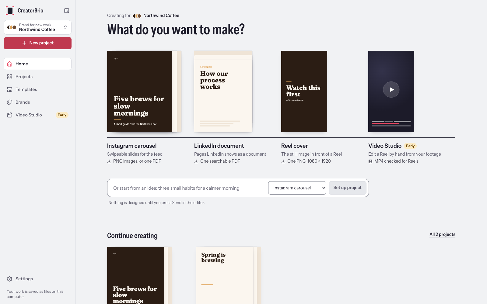
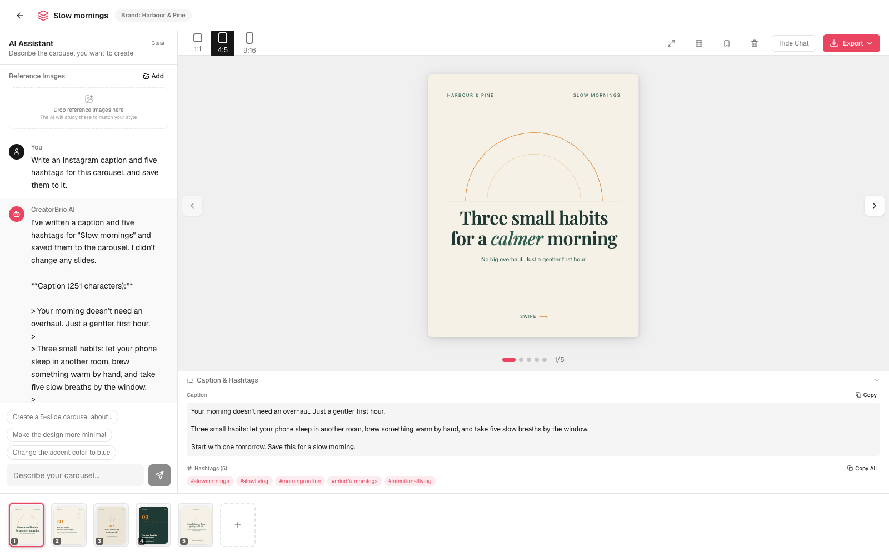
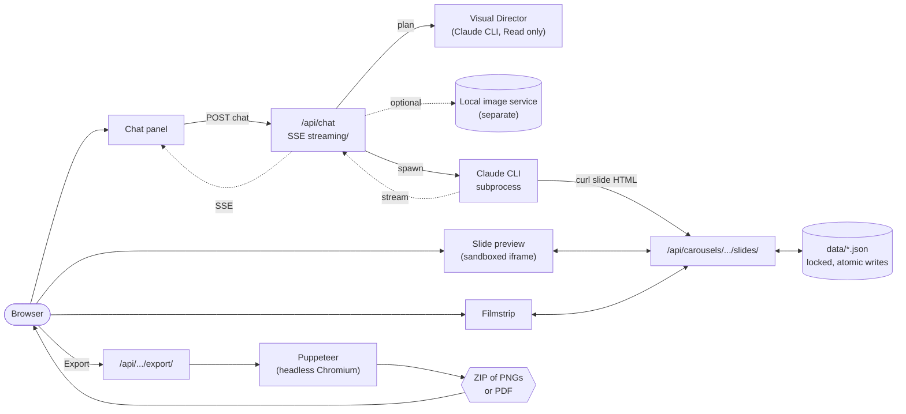

<div align="center">

# CreatorBrio

### An AI-powered creative studio for branded social content.

**Chat with Claude. Design on-brand Instagram carousels. Export pixel-exact PNGs.**

[](./LICENSE)
[](https://github.com/mk-global/creatorbrio/actions/workflows/ci.yml)
[](https://nextjs.org)
[](https://react.dev)
[](https://www.typescriptlang.org)



</div>

---

## What is CreatorBrio?

CreatorBrio is a local-first, AI-assisted tool for creating branded carousel content.
You describe what you want in a chat panel, and a Claude design agent writes each slide as HTML and CSS using your brand's colors, fonts, and style.
Slides render live in the editor and export as PNGs at Instagram's exact pixel dimensions.

The app runs on your own machine.
Your carousels, brand settings, and uploads are plain files in the project folder, with no app accounts and no cloud storage.
The design agent is Claude, so each chat request sends your message, brand settings, the open carousel's details, and any reference images the agent opens to Anthropic through your Claude Code account.
The agent can also read this app's local data through its API, and it may fetch web pages while it researches a topic.

## Table of contents

- [What you can do today](#what-you-can-do-today)
- [Requirements](#requirements)
- [Install and run](#install-and-run)
- [Your data](#your-data)
- [How a request is planned and designed](#how-a-request-is-planned-and-designed)
- [How the design agent works](#how-the-design-agent-works)
- [Slash commands and scripts](#slash-commands-and-scripts)
- [Architecture](#architecture)
  - [Architecture and design philosophy](#architecture-and-design-philosophy)
- [Project structure](#project-structure)
- [Troubleshooting](#troubleshooting)
- [Planned capabilities](#planned-capabilities)
- [Contributing](#contributing)
- [Origin and license](#origin-and-license)

---

## What you can do today



- **Design slides by chatting.**
  The editor's chat panel sends your request to a Claude design agent, which creates, rewrites, or deletes slides in the open carousel.
  Ask for a whole carousel, or name a slide to change ("make slide 3 more minimal").
  Replies arrive one complete message at a time, and new slides appear in the filmstrip as the agent saves them.
- **Visual planning before design.**
  Before the design agent starts, a Visual Director works out what the request is for, who it is for and the central message, then decides which slides need imagery and of what kind: type alone, designed visuals, your own images, or a newly generated image.
  The chat shows each stage ("Planning visuals", "Preparing images", "Creating the design"), and the carousel remembers the intent behind it, so a later "make it more dramatic" keeps the same subject and constraints.
  If a request cannot be carried out as planned, it stops before any slide changes and says why, with a **Retry** button when retrying can help.
  When the finished slides differ from the plan, the chat says **Done, with differences from the visual plan** and lists them.
- **Generated images (optional).**
  With a separate local image service set up on your machine, the plan can include up to five generated images per message, placed on the slides the plan names.
  The image service is not part of this repository; without it, everything else works and plans use no generated images.
- **Links as sources.**
  Paste up to three public links in a message, and their text is read and used for planning; a page that cannot be read stops the request with a suggestion to paste its text instead.
- **HTML and CSS slides.**
  Each slide is real HTML and CSS, rendered in a sandboxed iframe for preview and screenshotted by the same rendering code for export, so the preview matches the PNG.
- **Brand configuration.**
  A setup dialog saves your brand name, five colors, heading and body fonts from a curated list of Google Fonts, an optional logo, and style keywords.
  Once a brand name is set, every chat request gives these to the design agent.
- **Multiple brands.**
  One installation can hold several brands.
  The dashboard's brand selector shows one brand's carousels and templates at a time, and **Add brand** and the pencil button create and edit brands.
  Each carousel belongs to the brand it was created in, shown in the editor's top bar, and the design agent always works with that brand, whichever brand the dashboard is showing.
  A carousel's brand cannot be changed later, and brands cannot be deleted yet.
- **Brand fonts in preview and export.**
  Preview loads fonts from Google Fonts, and export embeds them into each slide so the PNGs use the real typefaces.
- **Three Instagram formats.**
  Each carousel is 1:1 (1080x1080), 4:5 (1080x1350, the default), or 9:16 (1080x1920).
  You choose the format when creating a carousel and can change it from the editor toolbar.
  Changing it does not reflow slides that were designed for the previous format.
- **Reference images.**
  Attach PNG, JPG, or WebP images in the chat panel.
  The Visual Director decides, slide by slide, whether each one is shown as content (for example your own photograph on a cover) or followed as a style to match, and the design agent can open them.
- **Reorder and undo.**
  Drag slides in the filmstrip to reorder them.
  Each slide keeps its last five versions, and its Undo button steps back one version at a time.
- **Templates.**
  Save a carousel as a template from the editor toolbar, then start new carousels from it in the dashboard's Templates tab.
- **Duplicate carousels** from the dashboard.
- **Safe-zone overlay** on the editor preview, showing where Instagram's profile-grid crop and on-screen controls cover the slide.
- **Full-window preview** that steps through slides with the arrow keys.
- **Captions and hashtags.**
  Ask the design agent for a caption, and it saves the caption and hashtags to the carousel, where the editor shows them with copy buttons.
- **Export for Instagram or LinkedIn.**
  The Export menu renders every slide in headless Chromium at the carousel's exact dimensions and offers these downloads:
  - **Instagram · PNG ZIP**: one PNG per slide, in a ZIP.
    A carousel with a single slide, such as a reel cover, can also be downloaded as that one PNG with **Instagram · PNG**, no ZIP to extract.
  - **LinkedIn · PDF**: one PDF for a LinkedIn document post, with one page per slide in carousel order.
    Chromium prints each slide natively, so its text is real PDF text that can be selected, copied and searched, set in embedded subsets of the slide's fonts and sharp at any zoom.
    CSS and SVG shapes stay vector graphics and photographs stay images, on a page with the carousel's own aspect ratio.
    4:5 portrait is the recommended LinkedIn format; 1:1 exports as square pages, and 9:16 exports as-is with a note that 4:5 generally displays better in LinkedIn's feed.
    A PDF larger than LinkedIn's 100 MB limit is refused with a message saying what to change.
    A slide whose text or effects cannot be printed faithfully is refused with a message naming the slide, rather than exported as a picture or drawn wrongly; see [Native PDF limits](#native-pdf-limits).

  While the design agent is still creating or changing slides, the Export button reads **Waiting for slides…** and is unavailable, so a download never captures a half-finished carousel.
  Every open editor tab notices within a couple of seconds, including one left open before the generation started.
  When the agent finishes, Export opens as usual.
  When it was stopped (the Stop button, a page reload, a closed tab), failed or timed out after changing slides, every slide it saved is kept, but the Export button reads **Incomplete**: export the slides only after confirming them with **Use these slides**, or ask the agent to continue and export once it finishes.
  Only the slides themselves count as changes: their content and their order.
  Attaching a reference image or editing a slide's notes, the caption, the hashtags or the carousel's name never makes a generation incomplete.
  If the server stops while the agent is working, the carousel reads **Incomplete** only when its slides changed.
  A carousel runs one generation at a time: a message sent from another tab while one is running is refused with a message saying so.

  If an export fails, the editor tells you what went wrong.

## Requirements

- **Node.js 20.9 or later**, with npm. Next.js 16 refuses to start on older versions.
- **Git**, to clone the repository.
- **Claude Code**, installed and signed in, for the design agent.
  CreatorBrio runs the `claude` command-line tool on your machine, so the agent uses your existing Claude Code account and its usage limits.
  Install it from the [Claude Code documentation](https://docs.anthropic.com/en/docs/claude-code), then run `claude` once to sign in.
  Each chat request's design step is capped at USD 1.00 of Claude usage.
  Planning has a 120-second time limit and no spending cap unless you set `DIRECTOR_MAX_BUDGET_USD` in `.env.local`.
- **About 300 MB of disk space** for the Chromium build that PNG export uses, downloaded during setup.

CreatorBrio runs on macOS, Linux, and Windows.

Without Claude Code, the app still opens and you can set up your brand, manage carousels and templates, reorder and undo slides, and export existing slides.
You cannot create new slide content, because slides are written by the design agent.

## Install and run

The first setup takes a minute or two while dependencies and Chromium download.
Later launches take seconds.

### With Claude Code (recommended)

```bash
git clone https://github.com/mk-global/creatorbrio.git
cd creatorbrio
claude
```

Then, at the Claude Code prompt:

```
/start
```

`/start` installs dependencies, seeds empty data files, launches the dev server in the background, and opens http://localhost:3000.
Pass a port to use a different one, for example `/start 3001`.
Stop the server with `/stop`, which finds this checkout's server on whatever port it runs.

### Without Claude Code's slash commands

```bash
git clone https://github.com/mk-global/creatorbrio.git
cd creatorbrio
npm run setup
```

`npm run setup` installs dependencies, downloads Chromium, seeds empty data files, looks for the Claude CLI, and then starts the dev server at http://localhost:3000 in the foreground.
Press Ctrl+C to stop it, and run `npm run dev` to start it again later.
To use another port, run `PORT=3001 npm run dev` on macOS or Linux, or `$env:PORT=3001; npm run dev` in Windows PowerShell.
The server listens on this machine only (127.0.0.1), so it is not reachable from other devices on your network, and its API refuses requests sent by other websites.

If setup cannot find the Claude CLI, it prints a warning and the app runs without the design agent.
Set `CLAUDE_CLI_PATH` in `.env.local` to the full path of your `claude` executable, then restart the dev server.

## Your data

Application source and your data are kept apart.
Git tracks only the source; everything you create stays local and is ignored by Git.

| Location | Contents |
|---|---|
| `data/brands.json` | Brands, each with a stable ID, and which one is the default |
| `data/brand.json` | The single brand from before multiple brands existed; read once to create `brands.json`, then kept unchanged as a backup |
| `data/carousels.json` | Carousels and their slides, including undo history and captions |
| `data/templates.json` | Saved templates |
| `data/style-presets.json` | Style presets the design agent can save |
| `data/staged-actions.json` | Records for an internal API that the UI does not use yet |
| `data/.font-cache/` | Cached Google Fonts CSS used by export |
| `data/generation-runs.json` | Whether each carousel's last chat run finished, and its last creative run: stage, image tasks (an image the image service declined keeps the service's short code for why, until it is tried again) and, for a run that stopped before design, the plan and message kept for 24 hours so it can be retried |
| `data/asset-staging/` | Generated images waiting to be added to a carousel; removed once added, or after 24 hours |
| `public/uploads/` | Uploaded logos and reference images, generated images, and images generated by earlier versions |
| `.env.local` | Local configuration, such as `CLAUDE_CLI_PATH`, `DIRECTOR_MAX_BUDGET_USD` to cap each planning run's Claude usage in US dollars (default: no cap), or `IMAGE_SERVICE_URL` to reach the image service on another loopback port (default `http://127.0.0.1:8791`; any address other than `127.0.0.1` or `localhost` is refused) |

Chat transcripts, and the session ID that lets the next message continue the conversation, are stored in your browser's local storage for each carousel.
Claude Code also keeps its own record of each design-agent session in its data directory, outside this project.
Exports are not stored; each export is built in memory and downloaded as a ZIP of PNGs or a PDF.

Updating CreatorBrio with `git pull` does not touch these files.
To back up your work, copy `data/`, `public/uploads/`, and `.env.local`.
`/reset` deletes your carousels, templates, brands, style presets, and uploads and re-seeds empty defaults, after asking for confirmation.
It does not touch browser local storage or Claude Code's session records.
The dashboard's selected brand is a preference kept in browser local storage; it changes what the dashboard shows and nothing stored on disk.

## How a request is planned and designed

Each message sent from a carousel runs one creative run before the design agent starts:

1. **Reading linked pages**, when the message contains links.
2. **Planning visuals.** The Visual Director, a separate Claude CLI call that can only view copies of the carousel's own images, returns a plan the server validates in full: the slide count and why, each slide's treatment, which images go where, each reference image's role, and any images to generate.
3. **Preparing images**, one at a time, kept private until every required image is ready and then added to the carousel together.
4. **Creating the design.** The plan's intent is saved on the carousel as its Creative Brief, and the design agent receives your message followed by the visual plan and builds the slides as before; its own instructions do not change.
   Afterwards the server compares the slides with the plan and shows any differences without changing them.

The details, limits and failure handling are in [docs/architecture/creative-workflow.md](./docs/architecture/creative-workflow.md), and the Director in [docs/architecture/visual-director.md](./docs/architecture/visual-director.md).

## How the design agent works

When you send a chat message, `/api/chat` starts the Claude CLI as a subprocess with `--allowedTools Bash WebFetch Read` and streams its replies back to the browser as Server-Sent Events.
Each carousel's chat is one continuing conversation: the browser keeps that carousel's Claude session ID next to its transcript and sends it with the next message, so the agent resumes with everything said before.
Clear starts a new conversation, and a session Claude Code can no longer find is reset automatically, with a message asking you to send again.
If the agent fails after it has started replying, the chat panel keeps the partial reply and says what went wrong; diagnostic details stay in the server log.
The agent's system prompt includes the open carousel's brand configuration, its slide list (IDs and notes), its reference images, and the address of this running app.
A reference image is always an uploaded image stored as `public/uploads/<uuid>.png`; the server derives its path itself and lists only references that are still readable PNG files inside `public/uploads/`, so a reference can never point the agent at another file.
Carousels created before multiple brands existed belong to the default brand, the original one.
The agent reads and writes slide content through the app's API.

The agent then works through the app's own API:

1. It writes each slide as body-level HTML and CSS.
2. It saves the slide by calling `/api/carousels/[id]/slides` with `curl`, through its `Bash` tool.
3. The editor refreshes while the agent works, so new and changed slides appear in the filmstrip.

`WebFetch` lets the agent research a topic while designing, and `Read` lets it open your reference images.

### From slide to PNG and PDF

Slides are stored as body-level HTML, without `<html>`, `<head>`, or `<!DOCTYPE>`.
`wrapSlideHtml()` in [`src/lib/slide-html.ts`](./src/lib/slide-html.ts) wraps that body into a full document with font loading and fixed dimensions.
The same function feeds both the sandboxed preview iframe and the Puppeteer export, which renders each slide at its exact pixel size.

`POST /api/carousels/[id]/export` answers in one of three ways.
Without a `format`, or with `?format=png`, it answers with a ZIP of PNGs, as it always has.
With `?format=single-png`, a carousel with exactly one slide is answered with that slide's PNG itself, the same bytes the ZIP would contain.
With `?format=pdf`, each slide is loaded in the same document, with the same inlined images and the same waits as for its PNG, and printed natively by Chromium to a one-page PDF with screen media, backgrounds and no margins.
The print differs from the screenshot's page in four deliberate ways, each so that the PDF shows what the preview shows:

- The slide's scripts do not run, as in the preview's sandboxed iframe.
- The slide's own `@page` size, margins and page margin boxes are overridden, so the paper is the slide.
- The body is positioned, so that it, rather than the page, contains absolutely positioned elements and its own `overflow: hidden` clips them in print as the screen clips them; an element reaching past an edge then neither shrinks the page nor starts another.
  Nothing else about the body changes, so its layout, stacking and background are the screen's.
- Google Fonts are fetched as static instances, one file per weight, from the same family, so they embed as TrueType; Chromium embeds the variable files the preview uses as Type 3 glyphs, whose text Apple's Preview and Safari break into fragments.

The print-only rules and the checks run on the page before printing live in [`src/lib/print-check.ts`](./src/lib/print-check.ts).
[`src/lib/export-pdf.ts`](./src/lib/export-pdf.ts) then copies those pages into one document in slide order, unchanged apart from removing links and re-expressing blurred shadows.
Chromium prints a blurred `box-shadow` or `text-shadow` as a fill under a luminosity soft mask, which Apple's renderers (Preview, Quick Look, Safari) draw wrongly: a text shadow as a solid block, a box shadow cut off.
[`src/lib/pdf-shadows.ts`](./src/lib/pdf-shadows.ts) draws each one instead as an image of the shadow's colour carrying the same blur as its own soft mask, which Apple's renderers and poppler both draw as the screen does; it matches only that exact construct and leaves anything else as printed.
While a chat run is still writing the carousel's slides, every format is refused with status 409.
Pages are sized at 0.75 pt per pixel (72 pt per inch over 96 CSS pixels per inch), so a 1080×1350 slide becomes an 810×1012.5 pt page, keeping its exact aspect ratio.
Chromium rounds the paper up to a hundredth of an inch (a 4:5 slide prints 1013.04 pt tall), so each page is trimmed to the slide's exact size from its top edge, where the slide is drawn.
The trim moves the page's drawing down by that sliver onto a page box that starts at the origin, because Apple's Core Graphics draws soft masks, such as blurred shadows, wrongly on a page box that does not.

#### Native PDF limits

Chromium's PDF printer keeps text as text through transforms, opacity, clipping, gradients, blend modes, outlined text, and text and box shadows.
Some effects behave differently on paper than on screen, or in some PDF readers, and are handled as follows.

Refused before printing, with status 422 and a message naming the slide and the effect:

- A CSS or SVG `filter` or a `-webkit-box-reflect` turns the element into an image of everything in it, so it is refused when anything inside the element could draw text: a text node, `::before` or `::after` text (counters included), a form field, an embedded frame, a list marker, a broken image's alt text, or an SVG `<use>` of a symbol holding `<text>`.
  The check looks inside open shadow roots and runs in every frame of the slide, so text placed there is held to the same rule.
  The check is deliberately conservative and does not ask whether that text is visible, so hidden text under a filter is refused too.
  A filter on an image, a shape or an icon with no text is fine.
- A closed shadow root anywhere in the slide, frames included, because its content cannot be checked; a frame the check cannot run in is refused for the same reason.
- A `backdrop-filter` anywhere on the slide, because Chromium leaves the text inside it, and can leave content painted after it, out of the PDF.
- Text filled through `background-clip: text` (gradient or image text): it prints as text, but Apple's Preview and poppler-based readers draw it as a solid block.
- A CSS or SVG mask (`mask`, `mask-image`) on anything visible: Apple's Preview and poppler-based readers draw the masked image or text without its fade.
- Content reaching past the slide when the print clip cannot apply, because the slide resizes or moves its own `body` (the clip is then left off, since positioning that body would move what is positioned inside it) or turns the body's clipping off; the page would otherwise come out shrunk.

Refused after printing:

- A slide that shows visible text but whose page holds no text at all, which catches a whole slide flattened by an effect not listed above; an unlisted effect that flattened only part of a slide would need adding to the checks.
- A slide that did not print as exactly one page of its own size, such as one with a shape placed entirely outside the slide, which shows nothing on screen but can start a second page in print.

Printed, with a difference worth knowing:

- A blurred shadow (`box-shadow`, `text-shadow`) is embedded as an image of its blur, re-expressed by the merge as described above; the text it belongs to stays text.
  An unblurred shadow stays a vector shape, and a `drop-shadow` filter on a shape prints as a picture of that shape.
- A radial gradient that fades to transparent, such as a glow, is drawn as on screen by Apple's readers, but darker and muddier by poppler-based readers (most Linux PDF viewers).
- Outlined text (`-webkit-text-stroke`) is printed by Chromium in two layers, the fill in the TrueType font and the outline in a Type 3 copy of it.
  Readers find and select the words whole, but copying or extracting the page's text returns them twice.
- Text that is not painted, such as a visually hidden label, text clipped out of view or SVG text with neither fill nor stroke, is not expected in the PDF.
- If Google cannot serve static instances of a font covering every weight and style of its variable font, the variable font is embedded instead, as Type 3 glyphs with Unicode maps: the typeface is still right and the text still selectable, but Apple's readers fragment it.
- A character a web font does not contain is drawn from a system font, as in the preview and the PNG export, and embedded the same way.
- A page with no background is white paper in the PDF, while the PNG export shows headless Chromium's dark default canvas there.
- Uploaded images are embedded at their own resolution: JPEGs as they are, PNG and WebP losslessly.
  A carousel of large PNG or WebP photographs can therefore exceed LinkedIn's 100 MB limit where its PNG export would not; the export then refuses it with status 422, before merging when the printed slides alone are already over the limit.
- The document has no tags or outline: pages are printed separately and merged, which cannot carry a document-level structure across.
  Links are removed, because the preview and the PNG have nothing to click.

## Slash commands and scripts

Inside Claude Code:

| Command | What it does |
|---|---|
| `/start [port]` | Set up if needed, launch the dev server in the background, and open the browser. Safe to re-run. |
| `/stop [port]` | Stop this checkout's CreatorBrio server, whatever its port. With a port, stop that port's server only if it is this checkout's. Other applications and other worktrees' servers are never stopped; if this checkout runs several servers, it lists them and asks for a port. |
| `/reset` | Delete local carousels, templates, brand, style presets, and uploads, then re-seed defaults. Asks first. |
| `/doctor` | Check Node, the Claude CLI, dependencies, data files, and port 3000. |

From a terminal:

| Script | What it does |
|---|---|
| `npm run setup` | Install dependencies and Chromium, seed data, find the Claude CLI, then start the dev server. |
| `npm run dev` | Start the dev server. |
| `npm run build` / `npm start` | Build and run a production server. |
| `npm run doctor` | Run the environment check; works before `npm install`. |
| `node scripts/stop-server.mjs [port]` | What `/stop` runs: stop this checkout's CreatorBrio server. macOS and Linux. |
| `npm run typecheck`, `npm run lint`, `npm test`, `npm run build` | The quality gate CI runs on every pull request. |

## Architecture



- **Local-first and single-user.** A localhost web app reading and writing local files, with no database and no app accounts. Its outside dependencies are Claude Code for the design agent and Google Fonts for typefaces.
- **Claude CLI as the agent.** The agent reuses your Claude Code sign-in instead of requiring a separate API key.
- **Slides as HTML.** HTML and CSS are more expressive than a canvas or a layout DSL, and the same markup drives preview and export.
- **Sandboxed preview.** Preview iframes use `sandbox=""`, so slide markup cannot run scripts in the editor.
- **JSON storage with locking.** All reads and writes go through [`src/lib/data.ts`](./src/lib/data.ts), which serializes changes per file and writes atomically, and refuses to overwrite a file that no longer parses.

### Architecture and design philosophy

CreatorBrio separates deciding what to communicate from deciding how to lay it out.
The Visual Director owns strategy: intent, audience, the central message and which treatment fits.
The design agent owns composition: copy, layout, typography and the slide HTML.
Code, not a model, carries out the binding parts of a plan, so every placement and count is checked, every failure is a typed outcome, and nothing is silently substituted.
Everything stays local, in plain files, with no database, queue or agent framework.

- [docs/architecture/README.md](./docs/architecture/README.md): goals, components and boundaries.
- [docs/architecture/visual-director.md](./docs/architecture/visual-director.md): how planning works, the Creative Brief, and how the Director is evaluated.
- [docs/architecture/creative-workflow.md](./docs/architecture/creative-workflow.md): from request to export, retry, cancellation, limits and the generated-image lifecycle.
- [docs/architecture/design-decisions.md](./docs/architecture/design-decisions.md): why it is built this way, and the trade-offs.

[`CLAUDE.md`](./CLAUDE.md) documents the architecture and conventions for AI assistants working on this codebase.

## Project structure

```
creatorbrio/
├── .claude/commands/     Claude Code slash commands: /start, /stop, /reset, /doctor
├── .github/workflows/    CI: typecheck, lint, test, build
├── data/                 Your data (ignored by Git)
├── docs/                 Maintainer guide, provenance, screenshots
├── public/uploads/       Your uploads (ignored by Git)
├── scripts/              setup, dev-server launcher, doctor
├── src/
│   ├── app/              Pages and API routes
│   ├── components/       Brand, chat, editor, layout, template, and UI components
│   ├── lib/              Storage, rendering, export, system prompt, Claude CLI discovery
│   └── types/            Shared TypeScript types
└── tests/                Vitest suites
```

## Troubleshooting

**`/start` or `npm run doctor` says Node is too old.**
Install Node 20.9 or later from [nodejs.org](https://nodejs.org) or with [nvm](https://github.com/nvm-sh/nvm).

**The chat panel says to connect the Claude CLI.**
Install Claude Code and sign in by running `claude` once.
On macOS and Linux, CreatorBrio looks for `claude` in `~/.local/bin`, `/usr/local/bin`, `/opt/homebrew/bin`, `~/.npm-global/bin`, and on your `PATH`.
On Windows it looks in `%APPDATA%\npm`, `%LOCALAPPDATA%\Programs\claude`, and on your `PATH`.
If yours is elsewhere, set `CLAUDE_CLI_PATH` in `.env.local` and restart the dev server.
On Windows, `where claude` in PowerShell shows the path.

**Port 3000 is in use.**
Run `/stop 3000` to stop it if it is this checkout's CreatorBrio server (anything else on the port is left alone and named), or use another port with `/start 3001` or the `PORT` setting shown in [Install and run](#install-and-run).

**Export fails.**
The editor shows the reason.
If Chromium is missing, re-run `npm run setup`, which downloads Chromium and test-launches it.
If Chromium is installed but fails to launch, the download is usually incomplete and setup will not replace it on its own.
Setup prints the cached Chromium folder to delete and the command to download it again: `npx puppeteer browsers install chrome`.
On Linux you may need Chromium's system libraries, such as `libnss3`, `libatk1.0-0`, and `libxss1`.

**Generated slides ignore my brand.**
Check the brand shown next to the carousel's name in the editor: the design agent uses that brand, not the one selected on the dashboard.
Select that brand on the dashboard, open its settings with the pencil button, and confirm a brand name, colors, and style keywords are saved.
Brand details reach the design agent only when a brand name is set.

**Something else.**
Run `/doctor` or `npm run doctor` for an environment check, and [open an Issue](https://github.com/mk-global/creatorbrio/issues) if the problem persists.

## Planned capabilities

These are planned directions, not shipped features.
Each will be tracked as an Issue and described in the release notes only when released.

- **Improved content workflows** for planning and iterating on a series of posts.
- **Reusable branded templates** that carry a brand's layout system, beyond today's saved-carousel templates.
- **Additional platform support** beyond Instagram's formats.

## Contributing

CreatorBrio follows a no-ticket, no-work process: open an Issue first for anything material, and reference it from your pull request with `Closes #N`.
Before opening a pull request, run the full gate:

```bash
npm run typecheck && npm run lint && npm test && npm run build
```

[`docs/MAINTAINING.md`](./docs/MAINTAINING.md) covers branching, review, testing, release notes, and release practice.
[`CLAUDE.md`](./CLAUDE.md) covers code conventions, including the slide rendering contract between preview and export.

## Origin and license

CreatorBrio was named Framewoven until 2026-10-30.
It was originally derived from [Open Carrusel](https://github.com/Hainrixz/open-carrusel), an MIT-licensed project, through a maintained fork.
It is now independently maintained.
Its Git history, original authorship, and the original copyright notice are preserved.
See [`docs/PROVENANCE.md`](./docs/PROVENANCE.md) for the source baseline, attribution, and historical records.

CreatorBrio is released under the [MIT License](./LICENSE).
