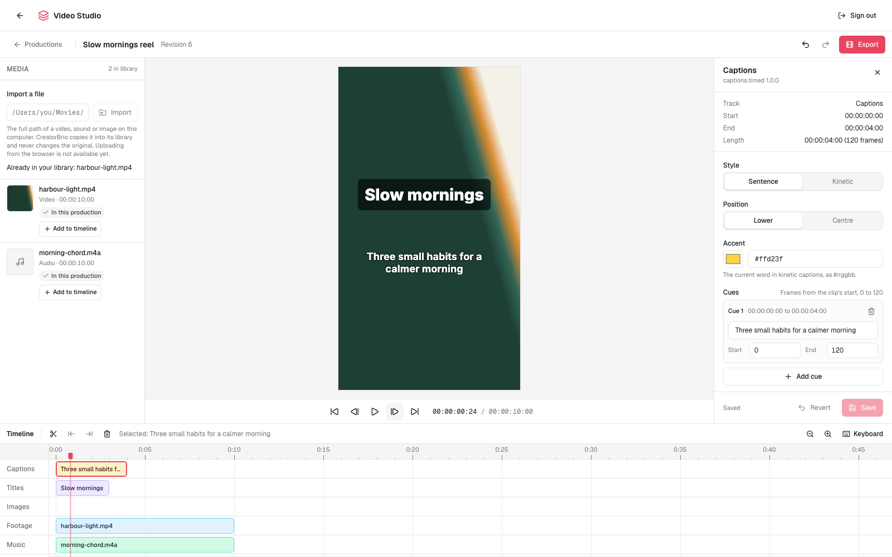
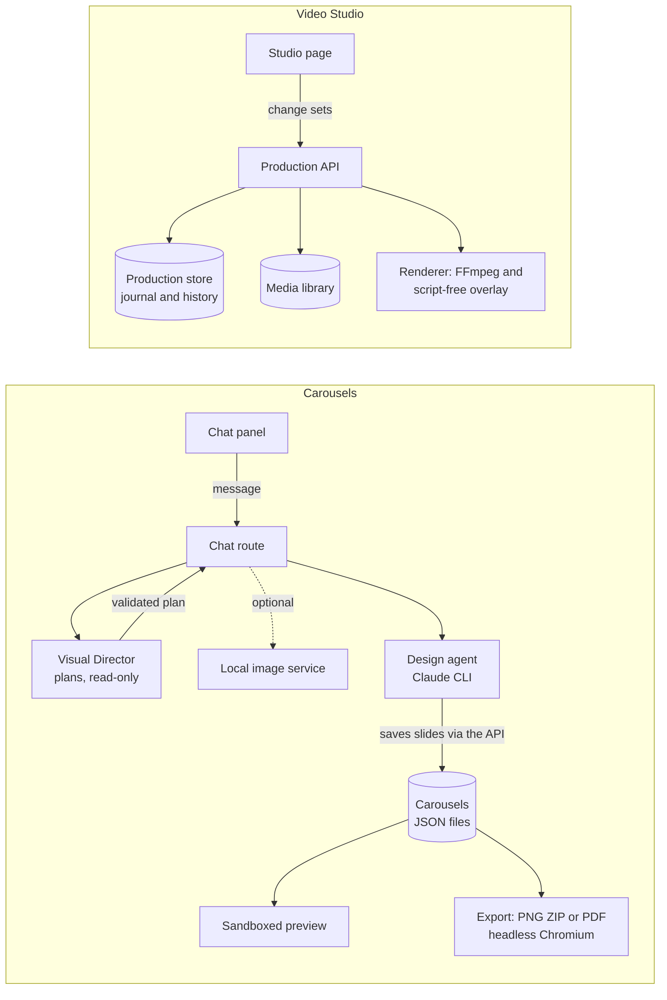

<div align="center">

# CreatorBrio

### A local-first creative studio for branded social content.

**Describe a post. Get on-brand slides. Export for Instagram or LinkedIn.**

[](https://github.com/mk-global/creatorbrio/actions/workflows/ci.yml)
[](./LICENSE)


</div>

CreatorBrio designs carousels for Instagram and LinkedIn from a conversation.
You describe a post in the chat panel; a planning step decides what the post should say and which slides need imagery, and a Claude design agent writes each slide as HTML and CSS in your brand's colours and fonts.
The slides render live in the editor, and you export them as Instagram PNGs or as a LinkedIn PDF whose text stays real, selectable text.

An early **Video Studio** edits short Instagram Reels by hand: import footage and music, trim and arrange clips, add titles and captions, and export a verified MP4.
It is the foundation for AI-assisted video editing, which is the main work in progress and is not built yet.

CreatorBrio runs on your computer and keeps your work in plain files, with no accounts and no cloud storage.
It is not offline: designing slides sends your request and brand details to Anthropic through your own Claude Code account (see [What leaves your machine](#what-leaves-your-machine)).

## Contents

- [Why CreatorBrio exists](#why-creatorbrio-exists)
- [What you can do today](#what-you-can-do-today)
- [Quick start](#quick-start)
- [What leaves your machine](#what-leaves-your-machine)
- [How it works](#how-it-works)
- [What we're building now](#what-were-building-now)
- [Roadmap](#roadmap)
- [How it is built](#how-it-is-built)
- [Known limitations](#known-limitations)
- [Your data](#your-data)
- [Commands and scripts](#commands-and-scripts)
- [Troubleshooting](#troubleshooting)
- [Project structure](#project-structure)
- [Contributing](#contributing)
- [Origin and license](#origin-and-license)

## Why CreatorBrio exists

Making a branded post usually takes several tools: a design app, an AI chat in another tab, a folder of brand assets, and an exporter, with the brand explained again each time.
CreatorBrio keeps the brand, the conversation, the slides and the exports together, so a request like "make slide 3 more minimal" changes that slide, in your fonts and colours, and the result is ready to post.

The same idea is being extended to video: one production that you can edit by hand today and, later, with AI help, without moving between apps.

## What you can do today

| What you can do | Status and notes |
|---|---|
| Design a carousel by chatting | **Works.** Needs Claude Code. A Visual Director plans the message, the slide count and the imagery; the design agent then writes the slides. A request that cannot be done as planned stops before any slide changes and says why. |
| Keep the intent across requests | **Works.** The plan's intent is saved as the carousel's Creative Brief, so "make it more dramatic" keeps the same subject and constraints. |
| Brands | **Works.** Several brands, each with five colours, heading and body fonts from a curated Google Fonts list, a logo and style keywords. A carousel keeps the brand it was created in. Brands cannot be deleted yet. |
| Formats | **Works.** 1:1 (1080×1080), 4:5 (1080×1350, the default) and 9:16 (1080×1920). Changing the format does not reflow existing slides. |
| Reference images and links | **Works.** Attach PNG, JPG or WebP images to show on a slide or to follow as a style; paste up to three public links to use as sources. |
| Generated and edited images | **Optional.** With a separate local image service, which is not part of this repository, a plan can generate images or replace the background of your photo, up to five per message. Without it, everything else works. |
| Review and arrange | **Works.** Live preview in a sandboxed frame, an Instagram safe-zone overlay, full-window preview, drag to reorder, five undo steps per slide, delete, rename and duplicate. |
| Recover an unfinished design | **Works.** If a design stops, the slides it saved are kept, Export waits for you to accept them, and **Continue** makes only the missing ones. |
| Templates | **Works.** Save a carousel as a template and start new carousels from it. |
| Captions and hashtags | **Works.** The agent writes them on request; the editor shows them with copy buttons but does not edit them. |
| Export | **Works.** **Instagram · PNG ZIP** at exact pixel sizes (or one PNG for a one-slide carousel) and **LinkedIn · PDF**, printed natively so its text can be selected and searched. A slide the PDF cannot print faithfully is refused with the reason, not flattened into a picture. |
| Edit a Reel by hand (Video Studio) | **Early.** Import by file path, preview with sound, move, trim, split and delete clips, add titles, lower thirds and typed captions, undo and redo, and export an MP4 checked against Instagram's Reel requirements. Verified with synthetic media only. |
| AI-assisted video editing | **Not built.** The video API already gives agents a separate, scoped authority, but nothing uses it yet. See [What we're building now](#what-were-building-now). |

<table>
<tr>
<td width="50%"></td>
<td width="50%"></td>
</tr>
<tr>
<td>The dashboard: carousels and templates, one brand at a time.</td>
<td>The Video Studio with synthetic footage and music, a title card and a caption.</td>
</tr>
</table>

## Quick start

### Requirements

- **Node.js 20.9 or later, with npm.** Next.js 16 refuses to start on older versions.
- **Git**, to get the code.
- **[Claude Code](https://docs.anthropic.com/en/docs/claude-code), installed and signed in**, to design slides.
  CreatorBrio runs the `claude` command on your machine, so it uses your Claude Code account and its usage limits.
  Without it the app opens, but it cannot create slide content.
- **About 300 MB of disk** for the Chromium build that PNG and PDF export use, downloaded during setup.
- **FFmpeg 6.0 or later, with ffprobe**, for the Video Studio only (for example `brew install ffmpeg` on macOS).
- **A local image service**, optional, for generated images only.
  It is separate from this repository and is reached at `http://127.0.0.1:8791` unless `IMAGE_SERVICE_URL` says otherwise.

CreatorBrio is developed on macOS, and CI runs on Linux.
Windows has code paths for starting the app but is not tested, and `/stop` does not work there.

### Install and start

With Claude Code:

```bash
git clone https://github.com/mk-global/creatorbrio.git
cd creatorbrio
claude
```

Then type `/start` at the Claude Code prompt.
It installs dependencies, downloads Chromium, seeds empty data files, starts the server in the background and opens http://localhost:3000.
`/start 3001` uses another port, and `/stop` stops this checkout's server.

Without Claude Code's slash commands:

```bash
git clone https://github.com/mk-global/creatorbrio.git
cd creatorbrio
npm run setup
```

Setup does the same and then runs the server in the foreground; press Ctrl+C to stop it and `npm run dev` to start it again.
To use another port, run `PORT=3001 npm run setup` or `PORT=3001 npm run dev` (in Windows PowerShell, `$env:PORT=3001; npm run dev`).
Setup always prints port 3000 in its last message ([#160](https://github.com/mk-global/creatorbrio/issues/160)); the server uses the port you set.
If setup cannot find the Claude CLI, set `CLAUDE_CLI_PATH` in `.env.local` to the full path of `claude` and restart.

### Make your first carousel

1. On first launch the dashboard asks for your brand: a name, colours, fonts and a few style keywords.
2. Click **New Carousel**, give it a name and pick a format.
3. In the chat panel, describe the post, for example: *"Create a 5-slide carousel about three small habits for a calmer morning. End with a gentle invitation to save the post."*
4. The chat shows each stage (planning, preparing images, creating the design), and slides appear in the filmstrip as they are saved. A five-slide request takes a few minutes.
5. Ask for changes in the same chat, such as *"make slide 3 more minimal"* or *"write the caption and hashtags"*.
6. Open **Export** and choose **Instagram · PNG ZIP** or **LinkedIn · PDF**.

The design step has a 15-minute time limit (`DESIGN_AGENT_TIMEOUT_SECONDS`, 60 to 3600) and no spending cap unless you set `DESIGN_AGENT_MAX_BUDGET_USD` in `.env.local`.
Planning has a 120-second time limit and no spending cap unless you set `DIRECTOR_MAX_BUDGET_USD`.
Your Claude account's own usage limits always apply; the costs CreatorBrio logs are the CLI's list-price estimates, not invoiced charges.

### Try the Video Studio

1. Install FFmpeg 6.0 or later.
2. Open http://localhost:3000/studio and, when it asks for a pairing code, run `npm run studio:pair` in the CreatorBrio folder and type the code it prints. A pairing lasts 12 hours, also across restarts.
3. Create a production, import a video and a sound file by their full paths, and add them to the timeline.
4. Add a title card or captions from the Inspector, then **Export** an Instagram Reel and download the MP4 once it passes the checks.

How the page works is described in [docs/architecture/video-studio-page.md](docs/architecture/video-studio-page.md).

## What leaves your machine

- **Designing slides.** Each chat request sends your message, the brand's settings, the open carousel's details and any reference images the agent opens to Anthropic, through Claude Code.
  The design agent runs under your Claude Code configuration, so your own Claude Code settings and instructions, and this repository's `CLAUDE.md`, also apply to it ([#156](https://github.com/mk-global/creatorbrio/issues/156)).
  The planning step is isolated from them.
- **Research.** Links you paste are fetched to read their text, and the design agent may fetch web pages while it researches a topic.
- **Fonts.** The preview and the export load typefaces from Google Fonts.
- **Generated images** go only to the image service on this machine; any other address is refused.
- **The Video Studio** sends nothing out: it uses FFmpeg and Chromium locally, with bundled fonts.

The server listens on this machine only (127.0.0.1), and its API refuses requests from other websites.

## How it works



**Carousels.**
The **Visual Director** is a separate Claude CLI call that can only read copies of the carousel's own images; it returns a plan the server validates in full (slide count, each slide's treatment, which images go where, and any to generate).
The plan's intent is stored on the carousel as its **Creative Brief**.
The **design agent** then receives your message and the plan; the chat route runs it with `--allowedTools Bash WebFetch Read`, and it saves each slide by calling the app's own API.
After it finishes, the server compares the slides with the plan and reports any differences without changing them.
Slides are body-level HTML; one function, `wrapSlideHtml()`, turns them into full documents for both the preview and the export, so what you see is what you download.

**Video Studio.**
A production is a typed document saved through an append-only journal, so every edit is one change set that can be undone, and nothing is lost on restart.
The Studio page owns no state: it sends each edit to the Production API and redraws from what the store holds.
The preview and the export are compiled from the same timeline by the same compiler, and the export is checked against the Instagram Reel profile before it can be downloaded.

More detail:

- [docs/architecture/README.md](docs/architecture/README.md): goals, components and boundaries.
- [docs/architecture/creative-workflow.md](docs/architecture/creative-workflow.md) and [visual-director.md](docs/architecture/visual-director.md): planning, the Creative Brief, retries, limits and the image lifecycle.
- [docs/architecture/design-agent.md](docs/architecture/design-agent.md): how the design agent runs and reaches the app.
- [docs/architecture/carousel-export.md](docs/architecture/carousel-export.md): export formats, how slides are printed, and the effects the native PDF refuses.
- [docs/architecture/design-decisions.md](docs/architecture/design-decisions.md): why it is built this way.
- The Video Studio: [architecture decision](docs/architecture/adr-creatorbrio-video-studio.md), [production store](docs/architecture/video-production-store.md), [Production API](docs/architecture/video-production-api.md), [media library](docs/architecture/video-media-registry.md), [rendering](docs/architecture/video-rendering.md) and [the Studio page](docs/architecture/video-studio-page.md).

## What we're building now

The current work is the **Edit Studio**: taking a creator's raw footage to a finished, editable short video, with AI doing the tedious parts and every AI change reversible.
It is tracked by [Campaign A, #135](https://github.com/mk-global/creatorbrio/issues/135), within the [Video Studio roadmap](docs/roadmap/video-studio/README.md).

Merged so far:

- The production model, with typed change sets, undo and redo, and agent runs that can be kept or discarded as a whole.
- A durable production store that survives crashes and restarts.
- The Production API, with separate authority for a person and for agent runs, and browser pairing for the Studio.
- A media library that copies imports, never modifies originals, and prepares preview copies.
- A renderer that compiles the timeline into an MP4 with captions and graphics and checks it against Instagram's Reel requirements.
- The Studio page described above.

Still to come before a creator can go from raw footage to a finished video:

- Transcripts and editing by words, a storyboard, and AI-assisted rough cuts and B-roll.
- Sound: music, effects and cleanup; more graphics; reframing.
- Rights and quality checks, more export profiles, and browser upload ([#141](https://github.com/mk-global/creatorbrio/issues/141)).
- Creative acceptance on real footage. So far the Studio has been verified only with synthetic media, and two qualification gates remain conditional (HDR iPhone footage, G2) or partly complete (licence review, G9).

The current status of every workstream and gate is in the [roadmap's status section](docs/roadmap/video-studio/README.md#current-status).

## Roadmap

Acceptance is based on evidence, not dates, so the roadmap has no release dates.

- **Next: complete the Edit Studio.** The remaining Edit Studio work above, released only when it meets its acceptance tests and produces publishable results.
- **Then: the Create Studio.** Topic or script to a voiced, illustrated, animated video, with local text-to-speech, consistent characters and scene-by-scene regeneration. It shares the same production model and renderer.
- **Carousels.** Current carousel work is fixes and hardening (open issues such as [#145](https://github.com/mk-global/creatorbrio/issues/145), [#130](https://github.com/mk-global/creatorbrio/issues/130) and [#155](https://github.com/mk-global/creatorbrio/issues/155)). New carousel capabilities are not yet planned in issues.
- **Out of scope for now.** A hosted or paid version is a possible later direction that the roadmap deliberately does not plan.

The full plan, with its workstreams, qualification gates and the 113 product requirements behind it, is in [docs/roadmap/video-studio/](docs/roadmap/video-studio/README.md).

## How it is built

- **Local-first, in plain files.** No database and no accounts. Carousel data is JSON written through one module with per-file locks and atomic writes; video productions use an append-only journal with content-addressed documents, committed with a compare-and-swap that holds across processes.
- **Planning separate from execution.** The Director decides what to communicate and the design agent decides how to lay it out, but code carries out the binding parts of a plan, so every count and placement is checked and every failure is a typed outcome rather than a silent substitution.
- **Bounded agent authority.** The Director can only read copies of the carousel's images. The design agent has three tools. In the video API, an agent run gets its own token and scope, its edits are grouped so the whole run can be kept or discarded, and destructive commands must name the version they expect.
- **People stay in control.** A slide's last five versions can be restored and every video edit can be undone and redone; an interrupted design is not exported until you accept it or continue it; the Studio page never applies an edit the server has not stored.
- **Tests.** Vitest suites exercise API routes against the real stores, preview-to-export parity, the PDF's extracted text, crash recovery of the job runners, and a browser run of the whole Studio flow against a production build. Media-backed tests need FFmpeg, which CI does not have yet ([#142](https://github.com/mk-global/creatorbrio/issues/142)), so they run locally.
- **Change process.** Every material change starts from an issue that passes a ticket validator. A pull request merges, by squash, only after CI (typecheck, lint, tests and build) and an independent automated AI reviewer pass on its exact final commit. Product direction and creative acceptance are the maintainer's decisions.

## Known limitations

- **Slides are edited through the agent.** There is no manual text or layout editor; you can reorder, undo, delete and ask for changes.
- **Claude Code is required** to create slide content, and the design agent picks up your Claude Code configuration ([#156](https://github.com/mk-global/creatorbrio/issues/156)).
- **Export needs the network** to fetch Google Fonts, and the native PDF refuses some CSS effects (filters over text, masks, backdrop filters and others) rather than print them wrongly; see [Native PDF limits](docs/architecture/carousel-export.md#native-pdf-limits).
- **Custom font uploads and style presets** exist in the API but cannot be used yet ([#159](https://github.com/mk-global/creatorbrio/issues/159)).
- **The Video Studio is early.** It imports by file path only, makes Instagram Reels only (1080×1920, 30 fps, up to 90 seconds), has no transitions, speed changes or effects, and has been verified with synthetic media only. Preview sync is within a frame while playing but can lag briefly at the start of playback and when a clip begins ([#151](https://github.com/mk-global/creatorbrio/issues/151)).
- **Platforms.** Developed on macOS and tested in CI on Linux; Windows is untested.
- **Open security issues.** Carousel export can read files outside `public/uploads` ([#145](https://github.com/mk-global/creatorbrio/issues/145)) and runs slide scripts in its headless browser ([#130](https://github.com/mk-global/creatorbrio/issues/130)), and several dependencies have known advisories ([#155](https://github.com/mk-global/creatorbrio/issues/155)). CreatorBrio is a single-user app meant to run on your own machine; do not expose it to a network.

## Your data

Application source and your data are kept apart: Git tracks only the source, and everything you create stays local and is ignored by Git.

| Location | Contents |
|---|---|
| `data/brands.json` | Brands, each with a stable ID, and which one is the default |
| `data/brand.json` | The single brand from before multiple brands existed; read once to create `brands.json`, then kept unchanged as a backup |
| `data/carousels.json` | Carousels and their slides, including undo history and captions |
| `data/templates.json` | Saved templates |
| `data/style-presets.json` | Style presets the design agent can save |
| `data/staged-actions.json` | Records for an internal API that the UI does not use |
| `data/.font-cache/` | Cached Google Fonts used by export |
| `data/generation-runs.json` | Whether each carousel's last chat run finished, and its last creative run, including a plan kept for 24 hours so a run stopped before design can be retried |
| `data/asset-staging/` | Generated images waiting to be added to a carousel; removed once added, or after 24 hours |
| `data/video/` | Video Studio productions, each with its full edit history |
| `data/video-media/` | The Video Studio media library: a read-only copy of every imported file and its preview copies |
| `data/video-renders/` | Exported videos, their captions and manifests |
| `data/video-auth/`, `data/video-studio.key` | Paired browser sessions and the local key the Video Studio API uses; keep them private |
| `public/uploads/` | Uploaded logos and reference images, and generated images |
| `.env.local` | Local settings such as `CLAUDE_CLI_PATH`, the time and spending limits above, and `IMAGE_SERVICE_URL` (loopback addresses only) |

Chat transcripts, and the session ID that lets the next message continue the conversation, are kept in your browser's local storage for each carousel; Claude Code also keeps its own record of each session.
Carousel exports are built in memory and downloaded, not stored; Video Studio exports are kept in `data/video-renders/` so they can be downloaded again.

`git pull` does not touch these files.
To back up your work, copy `data/`, `public/uploads/` and `.env.local`.
`/reset` deletes carousels, templates, brands, style presets and uploads and re-seeds empty defaults, after asking; it leaves Video Studio data, browser local storage and Claude Code's session records in place.

## Commands and scripts

Inside Claude Code:

| Command | What it does |
|---|---|
| `/start [port]` | Set up if needed, start the server in the background and open the browser. Safe to re-run. |
| `/stop [port]` | Stop this checkout's CreatorBrio server, whatever its port. Other applications and other checkouts' servers are never stopped. macOS and Linux. |
| `/reset` | Delete local carousels, templates, brands, style presets and uploads, then re-seed defaults. Asks first. |
| `/doctor` | Check Node, the Claude CLI, dependencies, data files and port 3000. |

From a terminal:

| Script | What it does |
|---|---|
| `npm run setup` | Install dependencies and Chromium, seed data, find the Claude CLI, then start the dev server. |
| `npm run dev` | Start the dev server. |
| `npm run build` / `npm start` | Build and run a production server. |
| `npm run doctor` | Run the environment check; works before `npm install`. |
| `npm run studio:pair` | Print a one-time code that pairs a browser with the Video Studio. |
| `node scripts/stop-server.mjs [port]` | What `/stop` runs. macOS and Linux. |
| `npm run typecheck`, `npm run lint`, `npm test`, `npm run build` | The quality gate CI runs on every pull request. |

## Troubleshooting

**Node is too old.**
Install Node 20.9 or later from [nodejs.org](https://nodejs.org) or with [nvm](https://github.com/nvm-sh/nvm).
`npm run doctor` currently accepts any Node 20 ([#6](https://github.com/mk-global/creatorbrio/issues/6)), but Next.js needs 20.9.

**The chat panel says to connect the Claude CLI.**
Install Claude Code and sign in by running `claude` once.
On macOS and Linux, CreatorBrio looks for `claude` in `~/.local/bin`, `/usr/local/bin`, `/opt/homebrew/bin`, `~/.npm-global/bin` and on your `PATH`; on Windows, in `%APPDATA%\npm`, `%LOCALAPPDATA%\Programs\claude` and on your `PATH`.
If yours is elsewhere, set `CLAUDE_CLI_PATH` in `.env.local` and restart the server.

**Port 3000 is in use.**
Run `/stop 3000` to stop it if it is this checkout's CreatorBrio server (anything else on the port is left alone and named), or use another port as shown in [Install and start](#install-and-start).

**Export fails.**
The editor shows the reason.
If Chromium is missing, re-run `npm run setup`, which downloads Chromium and test-launches it.
If Chromium is installed but fails to launch, setup prints the cached Chromium folder to delete and the command to download it again: `npx puppeteer browsers install chrome`.
On Linux you may need Chromium's system libraries, such as `libnss3`, `libatk1.0-0` and `libxss1`.

**Generated slides ignore my brand.**
The design agent uses the brand shown next to the carousel's name in the editor, not the one selected on the dashboard.
Select that brand on the dashboard, open its settings with the pencil button, and check that a brand name, colours and style keywords are saved; brand details reach the agent only when a brand name is set.

**Something else.**
Run `/doctor` or `npm run doctor`, and [open an issue](https://github.com/mk-global/creatorbrio/issues) if the problem persists.

## Project structure

```
creatorbrio/
├── .claude/commands/   Slash commands: /start, /stop, /reset, /doctor
├── .github/            CI workflow, issue and pull request templates
├── data/               Your data (ignored by Git)
├── docs/
│   ├── architecture/   How the carousel and video systems work
│   ├── roadmap/        The Video Studio roadmap and gate records
│   ├── research/       The research and specification behind the Video Studio
│   └── screenshots/
├── eval/               Opt-in evaluations of the Visual Director and acceptance runs
├── public/uploads/     Your uploads (ignored by Git)
├── scripts/            Setup, doctor, server control, Studio pairing, gate experiments
├── src/
│   ├── app/            Pages (dashboard, editor, /studio) and API routes
│   ├── components/     Brand, chat, dashboard, editor, Studio, template and UI components
│   ├── lib/            Storage, planning, the design agent, rendering, export, and lib/video for the Studio
│   └── types/          Shared TypeScript types
└── tests/              Vitest suites
```

## Contributing

Issues and pull requests are welcome on [GitHub](https://github.com/mk-global/creatorbrio/issues).
CreatorBrio follows a no-ticket, no-work process: open an issue first for anything material, and reference it from your pull request with `Closes #N`.
Before opening a pull request, run the full gate:

```bash
npm run typecheck && npm run lint && npm test && npm run build
```

[`docs/MAINTAINING.md`](./docs/MAINTAINING.md) covers branching, review, testing and releases, and [`CLAUDE.md`](./CLAUDE.md) covers code conventions, including the slide rendering contract between preview and export.

## Origin and license

CreatorBrio was named Framewoven until 2026-10-30 ([#29](https://github.com/mk-global/creatorbrio/issues/29)).
It was originally derived from [Open Carrusel](https://github.com/Hainrixz/open-carrusel), an MIT-licensed project, through a maintained fork, and is now independently maintained.
Its Git history, original authorship and the original copyright notice are preserved; see [`docs/PROVENANCE.md`](./docs/PROVENANCE.md).

CreatorBrio is maintained by [Manish Kumar](https://www.manishkumarglobal.com).

CreatorBrio is released under the [MIT License](./LICENSE).
