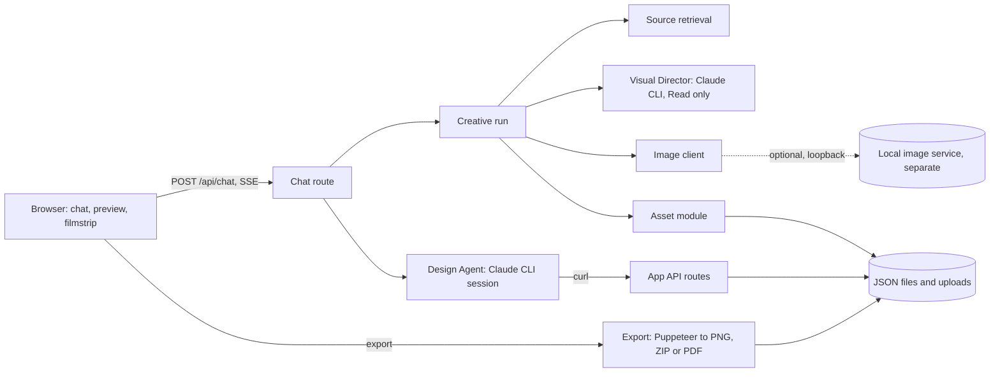

# CreatorBrio architecture

CreatorBrio is a local, single-user studio for branded social content: you describe a carousel or a reel cover in a chat, and AI agents plan and design it as HTML slides you can preview and export.
Its early Video Studio edits Instagram Reels by hand through a typed production model and API, which the components table below covers alongside the carousel system.
This page is the entry point for contributors who want to understand or extend how it works.
It describes only what is merged; anything not shipped is labelled.

## Goals

- **Effective content, not decoration.** Every request starts by deciding what the content is for and who it is for, and only then how it should look.
- **The user stays in charge.** Explicit instructions win over inferences, nothing is silently substituted, and every difference between the plan and the result is shown.
- **Local first.** Everything runs on the user's machine, stores data in plain files, and needs no account; its outside services are the Claude CLI for the agents and Google Fonts for typefaces.
- **Recoverable.** A crash, restart or cancellation never leaves half-attached images or claims unfinished slides are finished.

## Components

| Component | Responsibility | Where |
|---|---|---|
| Chat route | Owns each carousel's single active run and the event stream; runs the creative run, then the Design Agent; ends the run exactly once | `src/app/api/chat/route.ts` |
| Creative run | Sequences linked pages, planning, images and the handoff; decides when a run is blocked | `src/lib/creative-run.ts` |
| Source retrieval | Reads up to three public pages linked in a message, behind a network boundary | `src/lib/source-retrieval.ts` |
| Visual Director | Decides the visual strategy and returns a validated plan; never designs slides | `src/lib/visual-director.ts`, `src/lib/director-plan.ts` |
| Creative Brief | What a carousel is for, kept across revisions | `src/lib/creative-brief.ts` |
| Image client | Requests and validates one image from the optional local image service | `src/lib/image-service.ts` |
| Asset module | Stages, attaches, recovers and expires generated images | `src/lib/assets.ts` |
| Handoff and conformance | The Design Agent's visual plan section, and the check after design | `src/lib/creative-handoff.ts` |
| Design Agent | Writes the copy and builds every slide in HTML and CSS through the app's API | `src/lib/chat-system-prompt.ts` |
| Storage | JSON files with a per-file lock and atomic writes, plus uploaded files | `src/lib/data.ts`, `data/`, `public/uploads/` |
| Rendering and export | One shared slide document for preview and export, rendered in one headless browser per server process: screenshots for PNG, native Chromium printing for the LinkedIn PDF, merged page by page without re-rendering | `src/lib/slide-html.ts`, `src/lib/export-slides.ts`, `src/lib/print-check.ts`, `src/lib/export-pdf.ts`, `src/lib/pdf-shadows.ts`, `src/lib/pdf-content.ts`, `src/lib/fonts.ts` |
| Production store | Durable Video Studio productions: an append-only journal with content-addressed documents, committed by a compare-and-swap that holds across processes, with recovery | `src/lib/video/production/store/` |
| Production API | The Video Studio's only write path: credential-based authority for a person and for agent runs, strict request parsing, typed errors | `src/lib/video/production/api/`, `src/app/api/video/` |
| Media library | Imports media by path into read-only content-addressed copies and prepares preview files as durable jobs | `src/lib/video/media/` |
| App shell and screens | The persistent sidebar and the Home, Projects, Templates, Brands, Settings and New project screens; project formats over one carousel engine; brands loaded once for every screen | `src/app/(app)/`, `src/components/app/`, `src/lib/formats.ts` |
| Video Studio page | The `/studio` editor: pairs a browser, imports media by path, previews a production against one clock, edits it one change set at a time with undo and redo, and exports a verified Reel; it owns no state and calls only the Production API | `src/app/(app)/studio/`, `src/components/studio/`, `src/lib/video/studio/` |
| Video rendering | Compiles an admitted production revision into a render plan, captures its script-free caption and graphics overlay in hardened Chromium, cuts and mixes the originals in FFmpeg, and verifies the Instagram MP4 before publishing it, as durable render jobs | `src/lib/video/render/`, `src/lib/video/capabilities/` |

## How a request flows

1. The chat route begins the carousel's run; a second message for the same carousel is refused while it is active.
2. The creative run reads any linked pages, asks the Visual Director for a plan, generates and attaches the plan's images, and then saves the plan's Creative Brief update.
3. The Design Agent receives the user's message followed by the visual plan, resumes the carousel's conversation, and builds the slides.
4. The server checks the slides against the plan and shows any differences.
5. The user previews and exports; export waits until the run has finished.

Any stage before design can stop the run as blocked, with a reason and, when it makes sense, a Retry button.
The details are in [creative-workflow.md](creative-workflow.md).

## Local-first principles

- The app listens on `127.0.0.1` only, and its API refuses requests from other hosts and cross-site origins.
- Data is plain JSON in `data/` and files in `public/uploads/`; backing up means copying those folders.
- There is no database, external queue, vector store or agent framework. Carousel work runs inside the request that asked for it, within fixed limits; Video Studio media preparation and rendering run as durable jobs in the app's own process, recorded as files under `data/` ([video-media-registry.md](video-media-registry.md), [video-rendering.md](video-rendering.md#render-jobs)).
- Both agents are Claude CLI processes on the user's own Claude account.
- Image generation is optional and separate: a local service with a small public contract (a loopback `POST /generate` with a prompt and aspect ratio, returning a PNG, and `POST /edit` for background replacement from service version 1.1.0). It is not part of this repository, and without it every other feature works.

## Boundaries

- The Design Agent's system prompt is frozen and pinned by a test; plans reach it only in the task message.
- The Visual Director can read only copies of the carousel's own images in a temporary folder, has no shell or network tools, and returns data the server validates before acting on it.
- No model-provided path, URL, command or ID is acted on without being checked against what the server knows.
- Both agents run as the same operating-system account as the app; their tool restrictions are policy enforced by the Claude CLI, not operating-system isolation.

## Further reading

- [visual-director.md](visual-director.md): how the Director reasons, the Creative Brief, capabilities, the plan and its evaluation.
- [creative-workflow.md](creative-workflow.md): stages, outcomes, retry, cancellation, limits and the generated-image lifecycle.
- [design-decisions.md](design-decisions.md): why the system is shaped this way, and the trade-offs.
- [design-agent.md](design-agent.md): how the chat route runs the Design Agent, how it reaches the app, and the configuration it inherits.
- [carousel-export.md](carousel-export.md): carousel export formats and availability, how slides become PNGs and a native PDF, and the native PDF's limits.
- [app-shell.md](app-shell.md): the app shell and its screens, project formats, the path from an idea to the editor, and their browser test; the visual language is [../design/design-c.md](../design/design-c.md).
- [video-production-store.md](video-production-store.md): the Video Studio production store: layout, commit protocol, concurrency and crash guarantees, recovery.
- [video-media-registry.md](video-media-registry.md): the Video Studio media registry and asset ledger: import by path, derived preview files and their jobs, HDR proxies.
- [video-rendering.md](video-rendering.md): Video Studio rendering and export: the render plan, caption and graphics capabilities, the overlay document and its security boundary, the executor, verification, the manifest and render jobs.
- [video-production-api.md](video-production-api.md): the Video Studio Production API: endpoints, human and agent authority, confirmation, error codes.
- [video-studio-page.md](video-studio-page.md): the Video Studio page: pairing, the production session, the preview clock and its sync, the timeline, Inspector and export, and what was measured.
- [../PROVENANCE.md](../PROVENANCE.md) and [../MAINTAINING.md](../MAINTAINING.md): origin, licence and maintenance.
