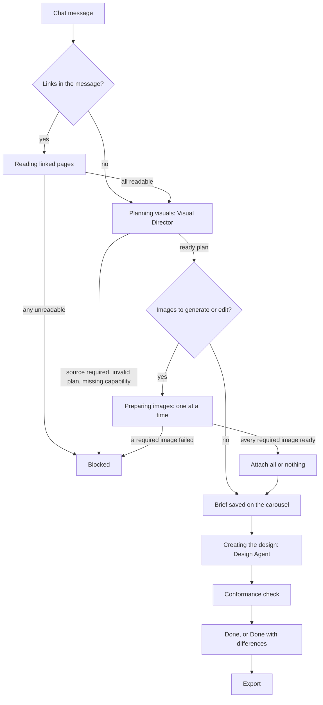
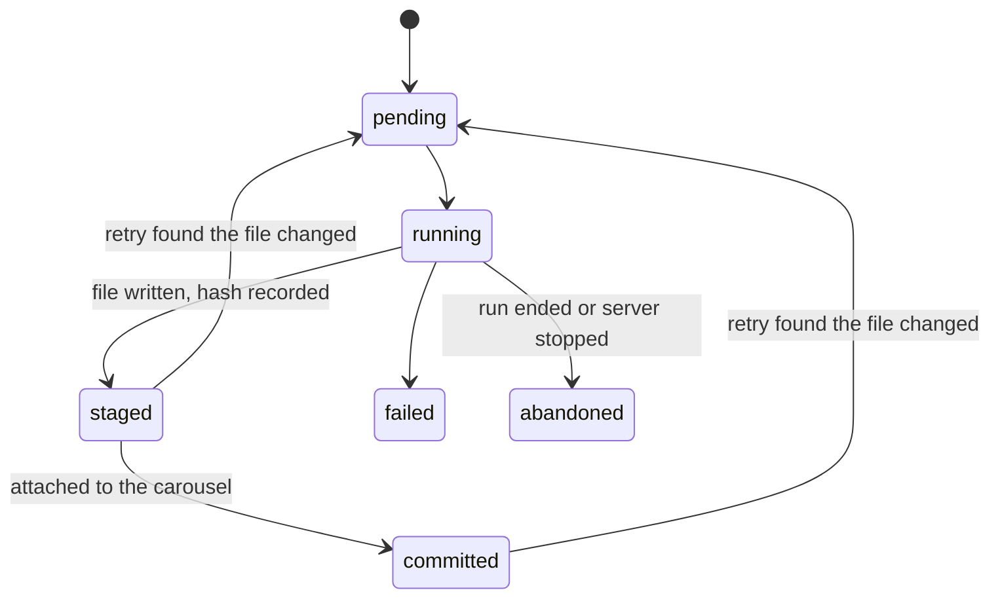
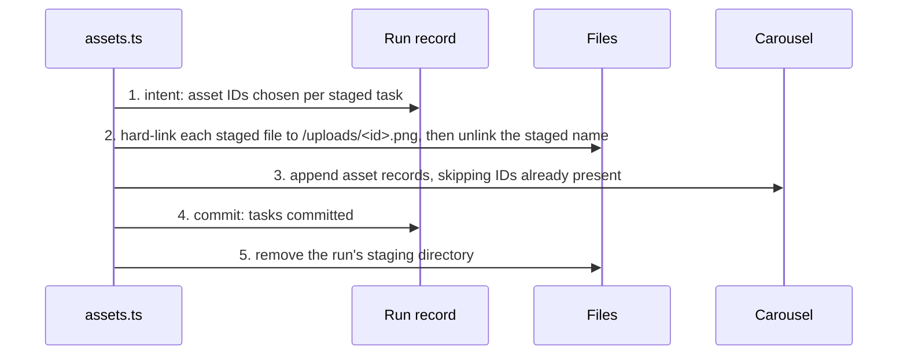

# Creative workflow

This document describes how a CreatorBrio request becomes finished slides.
It is written for contributors and describes only what is merged.

## Status

| Part | Status |
|---|---|
| Design Agent chat runs, run lifecycle and export gating | Implemented |
| Creative run: linked pages, Visual Director, image stage, handoff and conformance check | Implemented; runs for every chat message sent from a carousel |
| Typed assets (generated and edited): staging, attach, recovery, retry integrity and expiry | Implemented and used by the image stage |
| Image generation | Implemented as a client of an optional local image service that is not part of this repository; without it, plans use no generated images |
| Editing the user's photo | Background replacement only, through the same image service; the person is kept exactly as photographed. Object removal, relighting and combining images are not offered, and a request that needs one stops with a clear message |

## From request to export

Every chat message sent from a carousel runs one creative run inside the existing chat request.
The chat route still owns the carousel's single active run and the event stream; `src/lib/creative-run.ts` sequences the stages before design, and the route ends the run exactly once however it finishes.

### Stages

The chat panel shows each stage as it starts: "Reading linked pages", "Planning visuals", "Preparing images" with a count such as "2 of 5", and "Creating the design".
They reach the browser as `stage` events in the typed stream contract (`src/lib/chat-stream.ts`), which older clients ignore.

1. **Reading linked pages** runs only when the message contains links, at most three.
   Each page is fetched through the source-retrieval boundary (`src/lib/source-retrieval.ts`).
   Any page that cannot be read stops the run before planning, naming the host and the kind of failure and suggesting the user paste the text.
   Page text goes to the Director as untrusted content; the legacy handoff lists the pages by URL and stores no page text.
   Under the contained profile the handoff also carries each page's text, so the run's continuation record keeps it for as long as the run can be continued.
   With the contained Design Agent profile, which has no web fetch, the handoff also carries each page's text in its own untrusted-page block ([design-agent.md](design-agent.md#contained)).
   `untrustedPageContent()` in `src/lib/source-text.ts` builds that block for both readers, and makes any spelling of its delimiters inside page text inert, so a page cannot close its block.
2. **Planning visuals** runs the Visual Director (see [visual-director.md](visual-director.md)).
   A ready plan's brief update is not saved at this stage: it is merged into the carousel's Creative Brief only when the run goes on to design, after its images are attached.
   A run that stops before design leaves the brief unchanged.
   A design that then fails, is stopped or fails to start keeps the updated brief, even if it wrote no slide.
3. **Preparing images** runs the plan's image tasks one at a time and stages each validated image privately.
   When every required image is ready, all staged images are attached to the carousel in one all-or-nothing step.
4. **Creating the design** runs the Design Agent exactly as before, resuming the carousel's session, with the user's message followed by a delimited "Visual plan for this request".
   That section states the plan's facts only: who decides what, the slide count and why, each slide's treatment and the images to place with where to view them, each reference image's role, the linked pages, and the Director's advisory notes.
   The Design Agent's system prompt does not change; a test pins it to its recorded baseline.

### After design: the conformance check

When the Design Agent finishes, the server compares the slides with the plan's binding parts (`checkConformance` in `src/lib/creative-handoff.ts`):

- the slide count equals the plan's, unless the user asked to change it, when the new count is only reported;
- every image that was made, required or optional, and every placed reference appears in its slide's HTML;
- no reference meant only as a style source appears in any slide;
- optional images that could not be made are listed.

Differences are shown as "Done, with differences from the visual plan", recorded on the run and logged as `plan_deviation`.
They never trigger a correction, a re-prompt or a retry, and they do not block export: the slides are finished, and the user decides whether to ask for a revision.

### Run outcomes

| Outcome | When | Slides | Export |
|---|---|---|---|
| Completed | The Design Agent finished | Changed by the design | Allowed |
| Blocked | A stage before design stopped the run | Unchanged | Unchanged |
| Stopped, failed or timed out before design | Cancelled, or an unexpected error before design | Unchanged | Unchanged |
| Stopped, failed or timed out during design | As before this workflow | Possibly partly changed | Held until the user accepts the slides |

A blocked run says why, in words the user can act on, and offers Retry when its stored plan can be retried.
Blocking reasons: too many slides requested, too many links, an unreadable link, a request that needs a page the user did not give, a plan that could not be made or used, a capability this machine lacks or that is not offered (an edit other than background replacement, or generation and editing where they are not set up), a required image that could not be made (including a photo without one clearly visible person), the image stage time limit, and storage problems.

### Edited images

An edit replaces the background behind the one person in a photograph and keeps every opaque pixel of that person exactly as photographed; only a narrow band at their outline is blended.
It runs in the same image stage as generated images, one image at a time under the same time limit, with the same staging, all-or-nothing attach, retry and cancellation.

- The source is one uploaded reference image of the carousel or one of its intact assets, named by ID in the plan; the server resolves the file itself and, for an asset, refuses bytes that no longer match the recorded hash.
- The server prepares the source: upright from its EXIF orientation, sRGB, opaque, and cropped to the exact size of the requested aspect ratio around its most salient region, never stretched.
- The instruction describes only the new background; the image service wraps it in its own instructions and decides everything about the person.
- An edit is always required, so a failed edit stops the run with its reason and is never replaced by a generated image or by the plan's alternative.
- The result is attached as an asset with origin `edited` and the ID of its source; the original upload is never changed.
- A photo with no clear person, or with several people of similar size, stops the run with a request for another photo and no Retry, because the same photo would be refused again.

The person keeps the light they were photographed in: the image service asks for a background lit to match, but a strong mismatch can still look composited.
Editing needs image service 1.1.0 or later; an older service, or one with editing turned off, stops an edit with "editing photos is not set up on the image service".

### Image failures

Failures that every later image would meet too (the service not running, not set up, busy, declining for lack of machine resources, or without editing) stop the image stage at once.
A failure that belongs to one image (an unusable result, or one image taking too long) does not: the remaining images are still made, so a retry only remakes what failed.
A required image that could not be made blocks the run once the stage ends.
An optional image that could not be made is skipped; the handoff tells the Design Agent the alternative the Director planned, and the conformance check lists it.
When the image service declines an image, it gives a short code for why, such as low free memory, a review running on the machine or other AI work.
That code is kept for diagnosis only: in the "image failed" log entry and on the failed task in the run record, never in what the user reads.
It is removed when the task runs again.

### Retry

Retry is a button on a blocked run, never automatic.
It sends a normal chat request with the run's ID; there is no separate endpoint.
The server accepts it only for the carousel's most recent run, only when that run ended blocked, and only within 24 hours.
A retry does not plan again, and reads linked pages again only for the contained Design Agent, which needs their text: it re-validates the stored plan against the carousel as it is now, uses the stored message rather than anything the client sends, runs only the images that are not already valid, and applies the stored plan's Creative Brief update when it reaches design.
The plan and message are stored as soon as a plan with images is accepted, so a run cut off by a server restart before design can be retried too.

### Cancellation

Stopping a run, closing the tab or reloading cancels the request.
Before design, the run stops waiting for linked pages, stops the Director's process, aborts the image request in progress and attaches nothing; the slides are unchanged and staged images are removed.
During design, the Design Agent is stopped as before: the CLI is asked to exit and killed if it has not within five seconds, and the slides it saved are kept.
The image service may keep generating an image it already started until it finishes or times out, so an immediate retry can find it busy.

### Limits

| Limit | Value |
|---|---|
| Linked pages per message | 3, read within 30 seconds in total |
| Director | 120 seconds per message; no spending cap unless `DIRECTOR_MAX_BUDGET_USD` sets one |
| Generated images per message | 5, and never more than the slide count |
| One image | 150 seconds, or less when the stage has less time left |
| Image stage | 12 minutes |
| Design Agent | 30 minutes by default (`DESIGN_AGENT_TIMEOUT_SECONDS`, 60 to 3600 seconds), and 5 minutes without output (`DESIGN_AGENT_INACTIVITY_SECONDS`, 60 to 900 seconds, shorter than the deadline); no spending cap unless `DESIGN_AGENT_MAX_BUDGET_USD` sets one |

A run can therefore hold the chat request open for about 45 minutes in the worst case with the default settings.
The route declares a matching `maxDuration`, which a self-hosted Next.js server does not enforce; these limits are the real bound.
The Director runs on every message, including small edits, which adds its planning time and cost to each message.

### Design limits and an unfinished design (#127)

The Design Agent had a fixed USD 1.00 cap and a fixed 8-minute limit.
The CLI's cost estimate grows with every slide's tool call, so the cap stopped legitimate 8-to-10-slide carousels part-way.
Now the Design Agent has no cap of its own unless the operator sets `DESIGN_AGENT_MAX_BUDGET_USD` (an invalid value is refused before anything runs).
Its execution limits are described under [Execution limits (#187)](#execution-limits-187).
Both are separate from the Director's settings. The account's own provider limits are unchanged.

How a design ends is reported distinctly: the operator's cap (`budget_exceeded`), a usage, rate or spending limit outside CreatorBrio as the CLI reports it (`usage_limited`, never blamed on CreatorBrio), the deadline (`timed_out`), the inactivity limit (`stalled`), Stop (no error), a lost session (`session_not_found`), a setting that is not valid, or any other failure (`agent_failed`).
The `[chat] run finished` log line carries the run ID, the stage, the failure category, the configured cap, deadline and inactivity limit, which limit stopped the run (`limit`), when design started, when the CLI last wrote output, how long it had been quiet and its longest quiet period (`longestQuietMs`, measured until a limit fires), when the carousel was last written, the duration, the CLI's token usage and estimated cost, the slides saved and planned, and whether Continue is available; never the message, the plan or slide copy.
The Director logs `[director] plan finished` and the exporter `[export]`, so a failure's origin is always visible.

From the moment design starts, the run record keeps the validated plan, the exact task the Design Agent was given and each plan image's asset ID.
A design that ends without completing (Stop, failure, timeout, a cap or limit, or a server restart) keeps them, and every saved slide; the carousel stays interrupted for export as before.
`GET /api/carousels/[id]/generation` then reports `continuation: { runId, saved, expected }`, and the chat shows "N of M planned slides saved" with **Continue**.
Continue sends `continueRunId`: no linked pages, no planning and no images run again.
The task message lists the saved slides by ID in order, tells the agent to keep them unchanged and to make only the plan's missing slides one at a time, checking the count before each, and stops at the planned count.
When the Design Agent resumes the run's own conversation the original task is already there; when it cannot (no session, or `session_not_found`, after which Continue is still offered), the stored task is appended for reference.
A completed continuation clears the offer and the interruption, and runs the usual conformance check against the stored plan.
The offer is withdrawn when the user accepts the slides as they are, when a new request replaces the run, or 24 hours after the run ended; a stale or foreign `continueRunId` is refused and changes nothing.
Nothing continues on its own.

### Execution limits (#187)

A design run has two execution limits, and the first to fire stops it.

- The deadline, `DESIGN_AGENT_TIMEOUT_SECONDS`, 30 minutes by default, is absolute: no amount of output extends it.
- The inactivity limit, `DESIGN_AGENT_INACTIVITY_SECONDS`, 5 minutes by default, stops a run whose CLI has written nothing to its standard output for that long. Any output resets it.
- A set inactivity limit must be a whole number from 60 to 900 seconds and shorter than the deadline; anything else is refused before the run starts. The default applies only when the deadline is longer than 5 minutes.

Either limit sends the CLI a stop and kills it five seconds later if it is still running, then reports `timed_out` or `stalled`.
Both are recorded as a `timed-out` run, so the saved slides, the interrupted state, the export gate and Continue behave the same for both.
The message states how many of the planned slides exist: when all of them do, it says so and offers Continue to let the agent finish or the slides as they are, and it never calls a slide missing that exists.
A `[chat] design agent stopped by an execution limit` warning records which limit fired, the run's elapsed time and how long it had been quiet.

The 15-minute deadline stopped a real 10-page run after all pages were saved, while the agent was still refining them (#185).
Real runs took 437 to 1,062 seconds, so the deadline is now 30 minutes.
The 5-minute limit was checked against a proxy: the gaps between recorded events in 71 design sessions (5,309 intervals), the longest 159 seconds during one long model turn, with calls to an advisor model taking up to 116 seconds.
Standard output itself was not recorded; the CLI streams partial messages while a turn is in progress, so its silences are expected to be shorter.
5 minutes leaves almost twice the longest gap while ending a stuck run 25 minutes sooner, and the run log's `longestQuietMs` measures the real silences from now on.
A legitimately silent step longer than the limit is stopped as `stalled`; Continue resumes it, and the operator can raise the limit to 15 minutes.

### Verifying the workflow end to end

`eval/acceptance/` is an opt-in harness that runs real requests through real CreatorBrio servers it starts on its own ports, using the public API and the real Claude CLI.
Its scenarios cover a typography-only carousel, a generated cover, five generated images, an uploaded photo, two revisions (one of the generated cover and one of the typography-only carousel, which needs no generated images), a linked page, the image service being unavailable, cancellation during the image stage, and a server restart followed by Retry.
Every carousel it makes belongs to a synthetic brand (name, palette, fonts and voice as style keywords) that it creates through the public brands API, so the judge scores brand fidelity against a stated brand.
For each it records the stream's stages with timings, the Director's and Design Agent's cost, the Design Agent's model token usage (input, output, cache read and cache write, from the server's run log), the run's outcome, the conformance result and the export.
The Director's token counts and model are not in the server's records, so only its cost, time and turns are reported.
Recording them needs a product logging change, which is out of scope for the harness and for the work that records the baseline with it.
For a run with generated images it also checks that every image task was committed with its hash, that each attached file matches that hash, that each image appears on every slide the plan assigned it to, that the running server serves each image with the same bytes, and that every exported file is a PNG at the carousel's size.
A run that stops because one image could not be made after others were ready is retried, and the retry must reuse each ready image, with the same hash and the same file, rather than make it again.
The cancellation and restart scenarios also record the run's state right after the stop, and both watch whether the image service goes on with an image it had already started.
For every completed run it keeps the Director's plan summary and the carousel's Creative Brief for review.
A bounded, read-only model judge then scores the exported slides on whether the central message, constraints, imagery, priorities, brand and text come through, and a blind pairwise judge compares selected scenarios with the Design Agent working alone.
A revision is also judged against the set it revised, on whether it kept the brief and made the change asked for.
It never changes a design, and a test fails only when the harness itself fails.

It costs real model usage and is not part of `npm test`.
A paid run refuses to start in the repository's primary worktree: the servers it starts read and write that checkout's `data/` folder, which in the primary worktree holds real carousels, brands and uploads.
Run it from a dedicated linked worktree (`git worktree add <folder> -b <branch>`), which has its own `data/`.
The check compares `git rev-parse --git-dir` with `--git-common-dir`.
A dry run (`EVAL_DRY=1`) is not refused by it, and says that a paid run would be.
A linked worktree whose `data/` or `public/uploads` is a link that resolves outside the checkout is refused too, since the servers would reach the same live data through it.
Build first, then run it with `npx vitest run --config vitest.eval.config.ts eval/acceptance/acceptance.eval.ts`, selecting scenarios with `EVAL_ONLY`.
`EVAL_MODE=dev` is for dry runs only: a paid run under `next dev` is refused, as described below.
Scenarios that generate images need the local image service, which may decline work while the machine is low on free memory, a review is running or other AI work is running.
Before each of them the harness asks the service's read-only health check whether it would take work, and waits for up to 10 minutes (`EVAL_ADMISSION_WAIT_MS`); a scenario the service does not admit in time is recorded as not run, before any planning cost.
`EVAL_IMAGE_SERVICE_URL` (a loopback address, `http://127.0.0.1:8791` by default) is the service the harness asks, and the harness gives the same address to every server it starts except the one for the unavailable-service scenario, so an `IMAGE_SERVICE_URL` in `.env.local` does not apply to these runs.
`EVAL_RESTART_SIGNAL` (`SIGKILL` by default, `SIGINT` or `SIGTERM`) sets how the restart scenario stops the server.
`SIGKILL` is a crash, which tests restart recovery.
A paid run always uses a production build, because a paid run under `next dev` is refused, so a graceful signal keeps the request open until the harness kills the process 5 seconds later.
The unavailable-service scenario has two branches.
When the run stops, it passes "stopped with a reason" only when two things hold.
The code is `capability_unavailable` (the Director found the service unreachable while planning) or `image_failed` (the image stage could not reach it).
The reason names image generation or editing, in the stop message or in the Director's list of what is unavailable, so a stop for another reason fails it.
It passes "nothing changed" only when no slide or asset changed.
When the run does not stop, it passes "no silent fallback" only if it completed and its plan had no required image, and fails otherwise.
Raw results go to `eval/results/`, which is not committed; the service's reason codes appear only there, never in the summary.
Every stored path has the home folder that `HOME` names, and the account's own home folder when it is another, replaced by `~`.
results.json records only whether `HOME` differs from the account's home folder, never either path.

Each server the harness starts gets an explicit `NODE_ENV` for its mode, `production` for `next start` and `development` for `next dev`, so it loads the checkout's `.env` files, `.env.local` among them, as the app does in normal use.
The test runner's own `NODE_ENV=test` made Next.js skip `.env.local`, so before #232 the servers never saw its settings.
The harness starts each server with the Node.js that runs it and Next.js's own script from the checkout's `node_modules` (`serverLaunch` in `eval/acceptance/server.ts`), never through `npx` or `npm`.
Those read the user's and the project's npm configuration, such as an `.npmrc` `node-options` or `npm_config_*`, and put what they find in the server's environment, which neither the settings loader nor the Design-Agent-only arm would see.
Npm therefore adds nothing to a server's environment at its start.
What npm put in the harness's own environment, when the harness was itself started through `npx` or `npm`, passes on like any other variable of it and is recorded by name.
A server is therefore spawned with the harness's own environment minus what `cleanEnv` strips, plus `NODE_ENV` for its mode, `CLAUDE_CLI_PATH`, its image service address and the per-call caps.
The loader's child process is given that environment, and the arm gets what the loader leaves.
The arm's environment differs from a running server's by what Next.js itself adds to the server and, for the one server given the unused image service address (the unavailable-service scenario's), by that address.
Seven of the names Next.js adds were measured in a started `next start` server of the installed Next.js (16.4.5), by listing its process environment against the one it was spawned with: `NEXT_DEPLOYMENT_ID`, `NEXT_PRIVATE_START_TIME`, `NEXT_RUNTIME`, `PORT`, `RUST_MIN_STACK`, `TURBOPACK` and `__NEXT_PRIVATE_ORIGIN`.
`__NEXT_PROCESSED_ENV` is one more, which `@next/env` sets once it has loaded the files; it was read in that code and not seen in the measurement, and the loader's result leaves it out with every other `__NEXT_` name.
The list is what was found, not a promise that nothing else is added: `next dev` adds more, which is one more reason a paid dev run is refused.
Because the servers now load those files, the harness takes what they add from Next.js's own loader.
`loadEnvConfig` from `@next/env` runs in a child process that is given the environment a server is spawned with.
The names and values it leaves are the ones the servers and the Design-Agent-only arm see, for `next start` and `next dev` alike, with `$VAR` expansion as Next.js applies it.
No parser of the harness's own decides what a file means.
results.json records under `serverEnvFiles` the names, never the values, of every variable the files add beyond the harness's environment (results.json is never committed), and a paid run is refused before the ledger reservation when one is not on the allowlist (`SERVER_ENV_ALLOWLIST` in `eval/acceptance/server-env.ts`).
The allowlist is a list of exact names, each with the reason it is there, and not a pattern.
It holds `CLAUDE_CLI_PATH` and `DISABLE_AUTOUPDATER`.
It holds the four names `src/` reads (`DESIGN_AGENT_MAX_BUDGET_USD`, `DESIGN_AGENT_TIMEOUT_SECONDS`, `DESIGN_AGENT_INACTIVITY_SECONDS` and `DIRECTOR_MAX_BUDGET_USD`) and `IMAGE_SERVICE_URL`, which the harness overrides.
It holds the model names `ANTHROPIC_MODEL`, `ANTHROPIC_SMALL_FAST_MODEL`, `ANTHROPIC_DEFAULT_OPUS_MODEL`, `ANTHROPIC_DEFAULT_SONNET_MODEL`, `ANTHROPIC_DEFAULT_HAIKU_MODEL` and `CLAUDE_CODE_SUBAGENT_MODEL`, which the record fingerprints by name and value hash.
A file's `CLAUDE_CLI_PATH` is resolved to a real path and pinned by the harness, which gives that path to the servers explicitly, so they never read the file's value directly.
Every other name is refused, including URL, socket, gateway, model-catalogue and delegated-session variables, the provider switches `CLAUDE_CODE_USE_*`, the effort level `CLAUDE_CODE_EFFORT_LEVEL`, and the token limits `CLAUDE_CODE_MAX_OUTPUT_TOKENS`, `CLAUDE_CODE_MAX_CONTEXT_TOKENS` and `MAX_THINKING_TOKENS`.
A URL, socket, gateway, catalogue or session variable could send a call to an endpoint the record does not show.
The token limits and the effort level are refused in a `.env` file because each could let one call run past the allowance the run reserved.
`src/` never reads the effort level, and it can raise one turn's thinking.
A name that merely starts like an allowed one (`DESIGN_AGENT_ANYTHING`) is refused too.
The harness also fails closed on what it cannot account for.
It refuses a paid run when any non-blank, non-comment line of a loaded file is not accounted for by the loader's result: a `NAME:value` line the loader does not read, a line a quoted value swallowed (a value that ends in a backslash can swallow a following `NODE_OPTIONS` line, which then sets nothing) and a file the loader could not read.
A byte-order mark, a name and its `=` on separate lines, the `NAME: value` form and an expansion are read as the loader reads them, so each is loaded and checked by name.
Only the line numbers of unaccounted lines are recorded, never their content.
As in Next.js, a variable the harness's own environment defines is not added by a file, even when its value is empty.
A dry run prints the result instead of refusing.
It names the allowlist's own names that the files add, with their file, and only counts any other name, as summary.md does, so a name from the operator's machine is not printed.
A paid run's refusal, in the operator's own terminal, names the variables to remove.
The refusal says only what is true: an unknown name is refused rather than allowed, and it can be allowed by adding it to `SERVER_ENV_ALLOWLIST` after review.
The harness's own environment is recorded separately, and as exactly as it is reviewed.
It reaches every server, judge and arm unchanged apart from what `cleanEnv` strips (`CLAUDECODE`, `CLAUDE_CODE_*`, `CLAUDE_PID`, `CLAUDE_EFFORT`, `CLAUDE_CLI_PATH` and `IMAGE_SERVICE_URL`), so what it holds could change where a model call goes.
`HARMLESS_HARNESS_NAMES` in `eval/acceptance/harness-env.ts` is a list of exact names, each group with its reason: the user, location, locale and terminal variables, the harness's own `EVAL_*` settings, the caps and limits it sets, and the variables a GitHub Actions runner sets, but not the tokens a workflow adds.
The CLI reads `GITHUB_ACTIONS` and some of the other runner variables for its subprocess environment scrubbing and its telemetry, but none of them carries an endpoint, credential, proxy, configuration folder, preload or token limit.
results.json records under `harnessEnvironment.unreviewedNames` every other variable the harness passes on, by name only and never by value.
A name can carry an organization, project or machine detail, so the full list stays in results.json, which is never committed.
summary.md and a dry run name none of them.
They show the count of those names, and how many of them have a name that looks like an endpoint, socket, token or proxy variable (or is `NODE_OPTIONS`) and how many have a name that contains `MODEL`, in either case.
When either count is not zero, summary.md puts the counts in a banner line under its commit line.
That includes proxy, endpoint, socket, header, credential and configuration-folder variables of any name (`ANTHROPIC_UNIX_SOCKET`, `ANTHROPIC_CUSTOM_HEADERS`, `OTEL_EXPORTER_OTLP_ENDPOINT`, `GH_TOKEN` and the like), `NODE_OPTIONS`, and the `npm_*` and `INIT_CWD` variables that npm sets when the harness is started through `npx` or `npm`.
The model, effort and thinking variables are not in that list, because they are recorded with more than a name: `inheritedConfiguration.environment.received` holds the name and the value's hash of each one the servers receive, `strippedByHarness` those the harness removed from the invoking shell, and `envFiles` those the `.env` files add.
No value of any other variable is recorded, so a change in the value of a recorded variable is not seen, only its presence.
A paid run is refused when the harness's own environment sets any of four names: `MAX_THINKING_TOKENS`, `CLAUDE_CODE_MAX_OUTPUT_TOKENS`, `CLAUDE_CODE_MAX_CONTEXT_TOKENS` or `CLAUDE_CODE_EFFORT_LEVEL`, as it is for a `.env` file.
Each could let one call think, write or read past the allowance the run reserved.
The refusal holds whether the harness would pass the name on (`MAX_THINKING_TOKENS`) or strip it (the `CLAUDE_CODE_*` ones).
Those four names and the `.env` allowlist are all that is refused.
The CLI's other variables, for example `ANTHROPIC_BETAS`, `MAX_MCP_OUTPUT_TOKENS` and `BASH_MAX_OUTPUT_LENGTH`, are recorded by name only, in `harnessEnvironment.unreviewedNames`, and not refused.
The Design Agent and the Design-Agent-only arm run without `--setting-sources`, so they load the CLI's settings files, which can set the model, the effort, the thinking, an `env` block and an `apiKeyHelper`.
Managed settings apply to every role, the Director and the judge included, because the CLI adds them whatever `--setting-sources` says.
The harness neither refuses nor overrides any of these, so a run is not shown to be free of a setting that could raise a call's thinking, output or reads past the reserved allowance.
It records the settings files' key names instead, as described below.
Because `CLAUDE_CONFIG_DIR` cannot come from a `.env` file, the servers' configuration folder is the harness's own, and the session transcripts are read from it.
The pinned CLI costs a model its price table lacks at the rate of its main model, notes that only in an analytics event and a flag of its cost state, and reports the cost like any other, so a call on such a model can be recorded at a cost that is not its own, and the per-call caps follow the cost the CLI reports.
That was read in the code of the CLI the baseline pins, 2.1.328, and the flag is not in the result event the harness reads.
The CLI's table cannot be read from outside, so the harness cannot see a model the table lacks, and flags what it can see.
A run is marked `modelPricing.unverified` in results.json when any variable whose name contains `MODEL`, in either case, reaches the servers, the Design-Agent-only arm or the judges, from the harness's environment or the `.env` files, with the variables' names and never their values.
The test is applied to every name those processes receive, not to a list of names chosen in advance.
summary.md then carries a banner line and a line giving how many such variables there are, and a dry run prints the same count.
The names are in results.json under `modelPricing.selectionVariables`, which is never committed, and are not printed anywhere else.
A run with no such variable leaves the choice to the CLI's own defaults and settings files.
A model chosen in a settings file is not seen as a model: the files are fingerprinted by hash and their key names are recorded, so a `model` key is shown but not its value.
Managed settings can also set `modelPricing`, which replaces the price the CLI uses for a model and scales the cost it reports, for every role.
The record names a `modelPricing` key in a managed settings file and never its value, so the settings banner flags it, and the per-call caps follow the cost the CLI then reports.
When Next.js's loader cannot be run, the run is refused and the record gives only the class of the failure (a timeout, the exit code, a module that was not found, output that was not valid, or that it did not run), never the failure's text, which can hold a path or an account name.
The refusal then says to reinstall the dependencies (`npm ci`), and for a file the loader could not read it says to correct or remove that file, and not to remove a variable.
The loaded files are hashed (SHA-256 of each file's bytes, or absent) when they are checked, before the ledger reservation, and checked again at each server start and at the end of the run, each result recorded under `serverEnvFiles.rechecks`.
A server does not start on files that changed, appeared or were removed.
Any difference sets `serverEnvFiles.changed`, which summary.md reports as "Not comparable", and a later clean check does not clear it.
A paid run with `EVAL_MODE=dev` is refused before the ledger reservation: `next dev` reloads the `.env` files into a server that is already running, so an edit made during the run would reach later model calls before the next check, while `next start` reads them once, when it starts.
A dry run in dev mode still prints the plan, and says that a paid run would be refused.

The CLI's settings files are recorded by key name before the ledger reservation, and are neither refused nor overridden.
The Design Agent and the Design-Agent-only arm load the user, project and project-local files, and managed settings apply to every role.
`eval/acceptance/settings-keys.ts` lists the files from the code of the pinned CLI (2.1.328), found in the text of the installed binary.
They are the user folder's `settings.json` (the user folder is `CLAUDE_CONFIG_DIR`, else `~/.claude`), the checkout's `.claude/settings.json` and `.claude/settings.local.json`, and the managed settings file.
The managed file is `managed-settings.json` in `/Library/Application Support/ClaudeCode` on macOS, `/etc/claude-code` on Linux and `C:\Program Files\ClaudeCode` on Windows, together with the `.json` files of its `managed-settings.d` folder.
On macOS the managed preferences property lists (`/Library/Managed Preferences/<user>/com.anthropic.claudecode.plist` and `/Library/Managed Preferences/com.anthropic.claudecode.plist`) are recorded by existence and hash only, because they are not JSON.
When the checkout is a linked worktree, the CLI may also take local settings from the repository's main worktree (its canonical Git root, subject to an ownership check of its own that the harness does not repeat), so that worktree's `.claude/settings.local.json` is recorded as `project-local-main`.
That version reads no `settings.local.json` in the user folder, so none is recorded for it.
Server-managed settings and the Windows registry are not files and are not read, so a key set there is not seen.
A different pinned CLI may read other files, so the record says which version the list was read from, and the banner says so when the pinned CLI is another one.
For each file, results.json records under `settingsKeys` its label (`user`, `project`, `project-local`, `project-local-main`, `managed`, `managed-drop-in/<name>`, `managed-mdm-user` or `managed-mdm-device`, never a path), whether it exists, its state, the SHA-256 of its bytes, its top-level key names and the key names under `env`.
results.json is never committed, so it holds every recorded name, a drop-in file's name included.
A file that is not a JSON object is recorded as unparseable with its hash, a file that cannot be read as unreadable, and the keys of neither are shown.
No value is kept: a file is parsed in memory to take its key names, and a name that is not a plain name is only counted.
summary.md and a dry run name no settings file, key or variable that came from the operator's machine.
They name only strings defined in the harness's own source: the fixed file labels (`user`, `project`, `project-local`, `project-local-main`, `managed`, `managed-mdm-user` and `managed-mdm-device`) and the CLI's own top-level key names `model`, `effortLevel`, `alwaysThinkingEnabled`, `env`, `apiKeyHelper` and `modelPricing`.
Every other name is counted: a key whose name contains `model`, `effort`, `think` or `token` in either case but is not one of those six, any other key, every name under `env`, and each file in the managed `managed-settings.d` folder, which is reported as a number of managed drop-in files and never by its file name.
A banner line gives, for each label, the CLI's own key names present in it and the number of other keys whose name contains one of those words; a second line gives the sources whose keys are not shown.
A dry run prints one line per label with the same names and counts, and the number of names under `env`.

The harness resolves one CLI once: its own `CLAUDE_CLI_PATH`, else the one the `.env` files set (as the loader leaves it), else what the app's own discovery finds, and takes its real path (links resolved, a relative path taken from the checkout).
That real path is given to every server as `CLAUDE_CLI_PATH`, which takes precedence over every `.env` file, and the harness sets its own `CLAUDE_CLI_PATH` to it before it spawns anything, so the judge and the Design-Agent-only arm spawn exactly that file and never look for another.
Every role shares that one pinned path by design, and `eval/acceptance/cli.ts` owns its resolution, its checks and the proofs of its version.
The cross-check below compares the roles' uses all the same, so a future change that gives one role another CLI or version is refused before any spend instead of accepted because it used to be impossible.
A CLI that only the app's discovery found is never called pinned: a paid run is refused before the ledger reservation, and so before any spend, unless `CLAUDE_CLI_PATH` names the CLI in the harness's environment or a `.env` file.
Before anything starts, the harness reads the file's size and SHA-256 and runs `--version` (no model is involved) on the CLI the servers get, the one the Design-Agent-only arm spawns and the one the judge spawns, and refuses a paid run when their real paths or versions differ, when any is missing, or when the file cannot be read.
The refusal says to run the harness with `CLAUDE_CLI_PATH=<one installed CLI>` in its environment.
A dry run prints the same check and where the path came from, matched or not, instead of refusing.
The file's existence, size, SHA-256 and `--version` are checked again at each server start and at the end of the run, and each result is recorded in results.json under `environment.cli.pin.rechecks`.
A server does not start on a file that has changed.
Any difference sets `environment.cli.pin.changed`, which summary.md reports as "Not comparable", and a later clean check does not clear it, so a changed CLI is never silently accepted.
After the first refused server start the harness starts no more: each later item is recorded as not run when its test begins, before any stage, so settlement charges it nothing.
An item whose server start was refused before it made any model call is recorded the same way, as not run and charged nothing, while a refusal after its own chats is a harness error and is charged in full, so the ledger never under-counts what started.
The test still fails, and summary.md says why.

The Design-Agent-only arm runs under the same effective settings as the Design Agent a server spawns.
Its CLI gets the environment the loader leaves a server, value for value, so the model, effort and thinking settings of a server's Design Agent reach it too.
It gets the same cap, absolute deadline and inactivity limit, read with the product's own parser.
Its process is stopped as the chat route stops the Design Agent: output resets the inactivity limit and never moves the deadline, the first limit to fire is the only one, and a CLI that ignores the stop is killed after a short grace.
The arm's session id is taken from the `system` init event as well as the result event, so an arm run that was stopped before its result is still checked for its CLI version.
An arm run that did not complete (it timed out, stalled or failed) leaves an unfinished set, so its set is exported but neither scored nor compared: summary.md marks its pairwise row "NOT JUDGED" with the stop, and the arm is still charged.
results.json records both arms' effective limits under `environment.limits`, with the chat stream's idle limit and each plan item's test timeout.
These limits, the environment and the pinned CLI are a break in comparability with any batch recorded before #232: until then the arm ran under its own limits and the harness's environment, and the servers ran the auto-updated CLI without the checkout's `.env.local`, so results from the two periods are not compared.

The chat request uses `node:http` rather than `fetch`, whose default body timeout of 300 seconds between chunks cut off designs whose stream was quiet for longer.
It waits for the response headers, and then between chunks, for the largest stage limit plus five minutes.
The stage limits are the Director's 120 seconds with the 30 seconds for reading linked pages, the image stage's 12 minutes and the Design Agent's absolute deadline, so a short deadline cannot leave a quiet image stage cut off.
The deadline is `DESIGN_AGENT_TIMEOUT_SECONDS` as the servers see it (the harness's environment, then the `.env` files; a defined but empty value is the product's default, as in Next.js), or the product's default of 1800 seconds.
A paid run is refused before the reservation when the product would refuse the Design Agent's cap, deadline or inactivity limit, and a dry run prints the limits it will use.
Each plan item's Vitest timeout is not a fixed hour: it is the sum of the item's stage limits plus a ten-minute margin for what has no limit of its own.
The parts are:
- the server starts (each waits up to its ready limit and two stop graces);
- the waits for the image service (`EVAL_ADMISSION_WAIT_MS` each);
- the observations of the image service after a stop (60 seconds each);
- the Director (its 120 seconds, the 30 seconds for reading linked pages and the 10-second stop allowance);
- the image stage (12 minutes for each run and each retry);
- the Design Agent's deadline with its own 10-second stop allowance;
- the judges (6 minutes each);
- when compared, the Design-Agent-only arm with its stop allowance, and its judges.
The 10-second stop allowance per call covers the product's 5-second grace before it force-kills a call that ignores a stop, and the margin covers the PNG export, copying the slides for the judges, waiting for a run to go idle and the checks.
A plan with an item that no Node timer can wait for is refused, and the dry run prints each item's timeout.
Only the product's own limits therefore stop a design: the harness's limits, the chat stream's idle limit and the item's timeout sit above them.

`EVAL_REPEAT=n` (1 by default) runs every selected scenario n times, repetition by repetition in the same order, and each run carries a pairing key (`S1#2` is the second repetition of S1), so two runs of the same plan can be compared run for run.
The summary reports, per scenario, how many runs completed out of those made and how many checks passed out of those run, and then the sample size, median, minimum and maximum of the judge's scores, latency, token usage and cost; results.json keeps every run's raw record.
Each statistic says which runs it uses: scores and latencies come from completed runs only, and tokens and costs from every run that has them, since a failed run still spends.
Latency is reported as request latency, the sum of the chat requests' own durations, with the planning, image and design stages and the server's Director and design timings beside it.
The harness wall time, which also includes judging, export, waits for the image service and the checks, is labelled as such and is not a latency.
A judge verdict whose turn count is below 3, or missing, did not verifiably read the slides; it is left out of every median and tally, and the summary says how many were.

A paid run needs explicit per-call caps, `DIRECTOR_MAX_BUDGET_USD` and `DESIGN_AGENT_MAX_BUDGET_USD`, which the harness gives to every server it starts and to the Design-Agent-only arm.
The CLI checks a cap between turns, so one call can end above its cap by the turn that crossed it.
Every call is therefore limited to its cap plus an explicit overshoot allowance, `EVAL_OVERSHOOT_FRACTION` of the cap (0.25 by default, above 0 and at most 1; zero is refused).
The allowance is an assumption about how far one turn can carry a call past its cap, not a guarantee, so the worst case is an upper bound only while no call exceeds its limit.
A call measured above its limit is charged as measured, counted in the settlement and named in the ledger note, so the assumption is checked against every run.
Before anything starts, a preflight (`eval/acceptance/budget.ts`) computes the plan's worst case: for each scenario and repetition, its Director calls, its Design Agent calls and its judge calls (the judge's own cap is USD 0.60) each at its limit, plus one Design Agent call and two judge calls for each comparison.
It refuses the run when that exceeds what remains of `EVAL_M1_CAP_USD` (USD 50 by default) after everything in the spending ledger, less `EVAL_HOLD_BACK_USD` (0 by default).
The hold-back keeps part of the allowance out of the run's reach: the post-containment rerun that #221 compares against the baseline must fit in the same USD 50, so a baseline plan should be sized with that rerun held back.
The ledger is `EVAL_LEDGER` (`~/.local/share/creatorbrio-m1-eval/ledger.jsonl` by default, mode 600).
Neither the ledger nor the archive may be inside the repository checkout, links resolved, and a folder the harness creates for them is made mode 700.
A folder that already exists is never changed: it is used only when it is owned by the user and owner-only, and refused otherwise.
The ledger is changed only under an exclusive lock file next to it (`<ledger>.lock`, created with O_EXCL), so the preflight's read, check and append are one step across processes.
A lock older than two minutes is taken to be left by a dead process and is removed; a younger one is waited for up to ten seconds and then refused with an error that names the lock.
The run reserves its worst case in the ledger before it spends anything and settles it when it ends; a reservation no spend entry settles counts in full.
Settlement never under-counts.
Each paid call that started is charged at the cost it measured when it reported one, and otherwise at its per-call limit: a judge that timed out or was killed, a Design Agent run whose log line carries no cost, a Design-Agent-only arm that timed out, a comparison that threw after its paid arm ran (its record is kept, not replaced), a restart scenario that returned early.
A call counts as started when the chat stream shows its stage (planning for the Director, designing for the Design Agent) or the server log has its line, because a server killed mid-call writes no line.
An item whose test timed out or never finished, or whose driver failed with a harness error, is charged every call it planned, each at the larger of what it measured and its limit, since what had started cannot be known; an item that never began is charged nothing.
The total is rounded up.
A spend entry says "incomplete measurement" with the number of calls charged at their limit whenever any were, and results.json keeps the settlement per plan item with the reason.
A graceful restart signal (`EVAL_RESTART_SIGNAL` of `SIGINT` or `SIGTERM`) under a production build keeps the request open until the harness kills the process 5 seconds later, so the run can begin designing before the kill and the retry after the restart can design a second time.
That second Design Agent run is charged, at its limit when the log has no line for it, and the settlement and the ledger note flag it as a call beyond the plan.
SIGKILL, the default, does not do this.
If settlement itself fails, nothing smaller is recorded: the reservation stands and counts in full.
The cumulative cap is enforced by configuration, not by the harness alone: pointing `EVAL_LEDGER` at a fresh file or raising `EVAL_M1_CAP_USD` bypasses it, because the preflight only reads the ledger it is given.
Each run records the redacted ledger label and the cap it was checked against in results.json (`spend.ledger` and `spend.preflight.capUsd`), so a reviewer can see which ledger and cap a run used.
Keep one ledger for the whole M1 effort, outside every checkout and worktree, so every run counts against the same total.
`node eval/acceptance/ledger.ts show` prints the ledger and the remaining allowance, and `node eval/acceptance/ledger.ts add --usd <amount> --note <text> [--run <run id>]` records earlier spend or settles a killed run (Node 22.18 or later; older versions need `--experimental-strip-types`).
`EVAL_DRY=1` prints the plan, the per-call limits, the worst case, the remaining allowance and the hold-back, starting no server and no model.

Each run records the CLI version the servers and the harness use, with the servers' path and where it came from, the result of the CLI pin check and of its re-checks, the models seen (the Design Agent's from the CLI's session transcripts, since the server log does not name it; the judge's and the Design-Agent-only arm's from their result events; the Director's are not recorded), the SHA-256 of every harness file, the commit, and a fingerprint of the configuration the Design Agent's CLI inherits.
The fingerprint holds names, sizes and hashes only, never contents:

- the user settings, instructions and rules, managed settings, and the project's instructions, settings, rules and MCP file, by redacted label, size and SHA-256;
- the `skills`, `agents`, `commands`, `plugins`, `hooks` and `output-styles` trees of `~/.claude` (or `$CLAUDE_CONFIG_DIR`) and the `skills`, `agents` and `commands` trees of the project's `.claude/`, by relative file name, size and SHA-256 per file, and one combined hash per tree;
- the project's auto-memory folder, `<config dir>/projects/<project folder>/memory`, by file name, size and SHA-256 only, for the working directory and for the repository's main worktree (which linked worktrees may share), located by the CLI's project-folder naming convention; the session transcripts beside it are not part of this fingerprint (this run's own sessions' transcripts are opened separately, below, for their model names and `version` fields only);
- the MCP server names in the user scope and the project's entry of `~/.claude.json`, and never a command, argument, environment value or URL;
- the names and the SHA-256 of the values of the model, effort and thinking variables (`ANTHROPIC_MODEL`, `ANTHROPIC_SMALL_FAST_MODEL`, `CLAUDE_CODE_MAX_OUTPUT_TOKENS`, `MAX_THINKING_TOKENS`, `CLAUDE_EFFORT` and the other Claude Code variables for models, effort, thinking and output tokens) in the environment the servers receive, and among what the checkout's `.env` files add, as Next.js's loader leaves it.

After the run, results.json records under `environment.cli.sessions` the CLI version each Design Agent session actually ran: the Director arm's chats and, with their own role (`design-agent-only`), the Design-Agent-only arm's runs, whose `session_id` comes from the CLI's result event or, for a run stopped before one, from its `system` init event.
Each version is read from the `version` field of the session's transcript (`<config dir>/projects/<project folder>/<session id>.jsonl`, the transcripts the models are read from); the readers take only the model names and the `version` field from those files, and keep nothing else.
Each session is marked `matches`, `differs` (any recorded version is not the configured CLI's) or `unknown`.
`unknown` means no transcript, no version in it, or a transcript that could not be read, which is recorded as the fixed string "transcript unreadable" for that file alone.
A Design Agent run that reached the design stage without a session id, and an arm run without one, are counted.
`mismatch` flags the run when any session differs.
A run without a mismatch is still not verified when any session is `unknown` or any run has no session id: `unverified` flags that, and summary.md marks both flags.
The Director's version cannot be read from a transcript: it runs with `--no-session-persistence`, so its CLI writes none.
It is shown instead by the resolved pin and the end-of-run file check: its server is given the one real CLI file as `CLAUDE_CLI_PATH`, and that file's size, SHA-256 and `--version` are unchanged at every server start and at the end of the run.
results.json records this under `environment.cli.sessions.director`, where `proven` is true only when the pin held and the end-of-run check was made.
That is how the baseline shows the Director's CLI version: by the pin and the file check, not by a transcript.
The judge keeps no transcript either, since it runs with `--no-session-persistence` as well, so only the pin shows its version: the harness spawns the one real CLI file for it.
results.json records this under `environment.cli.sessions.judge`, with its own `proven` on the same condition and a `method` that says so.
summary.md carries one banner line under its commit line when the pinned CLI or the `.env` files changed during the run, when a variable chose a model whose price the CLI's table may lack, when a session ran another CLI version or one cannot be shown, or when the Director's or the judge's version is not shown by the pin.

Recorded limitations: the harness's `cleanEnv` strips `CLAUDE_CODE_*` and `CLAUDE_EFFORT`, which `/start` passes through, so the environment of a baseline launched by the harness can differ from the app's normal launch.
The record therefore also lists, by name and value hash, the model-related variables it removed from the invoking shell.
The Design Agent does not disable auto-memory, unlike the Director (`autoMemoryEnabled: false`), so it can read the project's auto-memory and write to it: a run can change what a later run reads, and the memory tree is fingerprinted once, before the run.
The memory folder is found by naming convention, so a CLI version or a setting that places it elsewhere is not seen.
Trees leave out `.git` and `node_modules` folders and `.DS_Store` files, follow symbolic links, leave a file over 16 MB unhashed and stop at 20,000 files, and a tree that hit the limit is marked truncated.
results.json keeps the per-file table; summary.md shows only the number of items fingerprinted and one combined hash, which two runs must share to be comparable.
Error messages stored in results.json and summary.md have the home folder and the checkout replaced by `~` and `<checkout>`.
After the run, results.json, summary.md, the server logs and the exported PNGs are copied to `<EVAL_ARCHIVE_DIR>/<run id>` (`~/.local/share/creatorbrio-m1-eval/acceptance` by default), owner-only, so the evidence outlives the worktree.

## Typed asset lifecycle

### Why generated images are not reference images

A carousel already has `referenceImages`: files the user uploads so the Design Agent can follow their style.
The Design Agent's instructions tell it to replicate the visual style of every reference image.
A generated image is different: it is content placed on a specific slide.
Recording it as a reference would turn it into a style source.

Generated images therefore have their own typed list, `Carousel.assets` (`src/types/carousel.ts`).
Each record is server-generated: an ID, a URL of the form `/uploads/<id>.png`, its origin (`generated` or `edited`), the ID it was edited from (empty for a generated image), its size, the SHA-256 of its bytes, the run that produced it and when.
A run's tasks carry the same origin and source from the moment its plan is accepted, so an attach finished by recovery after a crash records them exactly as one finished in-process.
Carousels created before assets existed have no list and read as having none; no existing data is rewritten.
Duplicating a carousel copies its assets, as it copies reference images.
Update routes never accept `assets` from a request body.

### Where the pieces live

| Concern | Owner |
|---|---|
| Asset records on the carousel | `src/lib/carousels.ts` |
| A creative run's task states, attach intent and retry data | `src/lib/generation-status.ts`, in `data/generation-runs.json` |
| Staging, attach, recovery, sweep and retry checks | `src/lib/assets.ts` |
| Validating an image from the image service | `src/lib/image-service.ts`, which returns validated bytes and writes nothing |
| Serving uploads and attached images written after the app was built | `src/lib/upload-files.ts` and the `/uploads/[...path]` route |

Everything uses the existing local storage: JSON files written through `src/lib/data.ts` (one lock per file, a temporary file, then a rename) and plain files.
The carousel workflow has no database, queue or scheduler; the Video Studio's durable jobs are described in [video-rendering.md](video-rendering.md#render-jobs).

A production server (`npm start`) serves only the files that were in `public/` when the app was built.
Uploaded and generated images are written while the app runs, so a route serves them, and only in the shapes the app writes: `<uuid>.png` in `public/uploads/` and `<uuid>.woff2` or `<uuid>.ttf` in `public/uploads/fonts/`, as regular files that are not links.
Files present at build time are still served by Next.js directly.

### Staging

A validated image is first written to `data/asset-staging/<runId>/<taskKey>.png`.
The web server serves only `public/`, so a staged image is never visible as finished content.

The file is written under a temporary name, flushed and renamed before the run record marks its task `staged` with the file's SHA-256.
A record therefore never claims a file that was not fully written.

Task states:

### Attaching

Staged images reach the carousel only when every required task has succeeded; otherwise nothing moves and no record is added.

The protocol spans the staged files, `public/uploads/`, the run record and the carousel, which cannot be written atomically together.
Each step is ordered so that a crash at any point leaves a state recovery can finish or undo:

A hard link never overwrites an existing file and leaves the complete file under at least one name, so no partial file ever appears under a final name.
Linking is atomic only within one filesystem, so the image stage is refused as a configuration error when `data/` and `public/uploads/` are on different filesystems.

If a move or the carousel write fails, the request rolls back: each moved file returns to staging, and any appended record is removed.
An uploads file is removed only when its name is one of this attach's asset IDs and its content matches the recorded hash.
If the roll-back fails too, the recorded intent is left for recovery.

### Recovery

Recovery runs lazily, once per server process, before the first creative run or retry, and again for a carousel before its next run.
It is idempotent, so a crash during recovery is repaired by the next one.

- An attach intent whose files are all intact, under either name, is completed.
- An attach intent with any file missing or replaced is rolled back: its records are removed from every carousel, valid staged files are kept, and the lost tasks are marked failed.
- A run that stopped before attaching ends `blocked` with the reason `restart-before-design`; its staged images stay valid for an explicit retry.
- A run that stopped while designing is settled by the existing slide fingerprint, as any interrupted chat run is.

### Cleanup and expiry

A sweep runs with recovery and before each new run or retry, skipping runs that are live in this process.
It removes temporary files, staging directories that no record claims or whose run did not end `blocked`, and staged files whose task no longer claims them with a matching hash.
It never removes anything under `public/uploads/`; uploads no carousel references are left in place, as they are when a carousel is deleted.

A blocked run can be retried for 24 hours.
Expiry is enforced when a retry is attempted, before any sweep has run, with "This attempt has expired; send the request again".
The next sweep then deletes the run's staged files and purges its stored plan and message, keeping only the run ID, outcome and timestamps.

### Retry integrity

A retry reuses a task's result only when its stored plan still validates against the carousel and its file is intact:
a staged file must match its hash and decode as a PNG of the planned aspect ratio, and a committed asset's file must match the hash on its record.
Every other task runs again, and a mismatched staged file is deleted first.

### Guarantees and limits

After any process crash, kill or restart followed by recovery:

- every asset record points to an existing file whose content matches its hash;
- no file is partially written under a final name;
- no asset record is duplicated;
- an attach is fully committed or fully absent;
- no reference image, existing upload or other run's asset is deleted;
- a blocked run's retryable tasks have valid staged or committed files.

An operating-system crash or power loss can lose the most recent JSON writes, because the shared storage renames without flushing.
Files are always written before the records that name them, and hashes are checked before reuse, which contains that loss.
The Design Agent's shell can still overwrite files in `public/uploads/`; the recorded hashes make that detectable, not preventable.

The tests for every statement above are in `tests/assets.test.ts`, including fault injection after each protocol step and during recovery.
