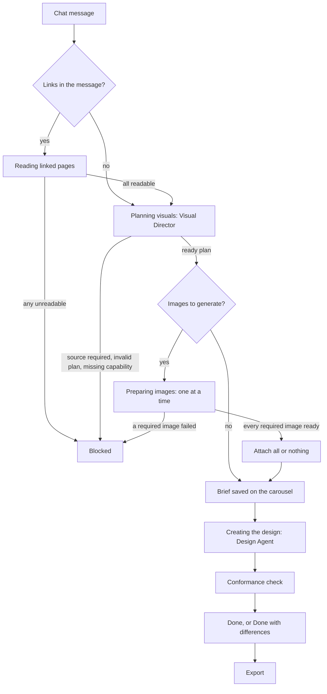
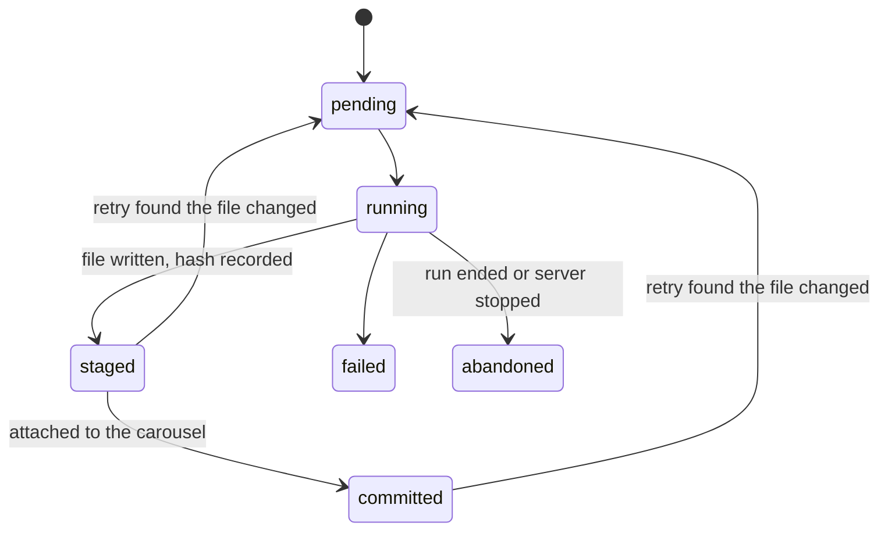
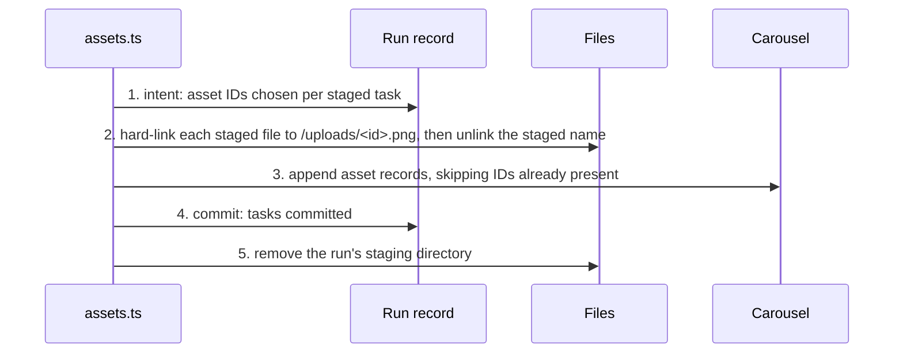

# Creative workflow

This document describes how a CreatorBrio request becomes finished slides.
It is written for contributors and describes only what is merged.

## Status

| Part | Status |
|---|---|
| Design Agent chat runs, run lifecycle and export gating | Implemented |
| Creative run: linked pages, Visual Director, image stage, handoff and conformance check | Implemented; runs for every chat message sent from a carousel |
| Typed generated assets: staging, attach, recovery, retry integrity and expiry | Implemented and used by the image stage |
| Image generation | Implemented as a client of an optional local image service that is not part of this repository; without it, plans use no generated images |
| Editing uploaded images | Not available; a request that needs it stops with a clear message |

## From request to export

Every chat message sent from a carousel runs one creative run inside the existing chat request.
The chat route still owns the carousel's single active run and the event stream; `src/lib/creative-run.ts` sequences the stages before design, and the route ends the run exactly once however it finishes.

### Stages

The chat panel shows each stage as it starts: "Reading linked pages", "Planning visuals", "Preparing images" with a count such as "2 of 5", and "Creating the design".
They reach the browser as `stage` events in the typed stream contract (`src/lib/chat-stream.ts`), which older clients ignore.

1. **Reading linked pages** runs only when the message contains links, at most three.
   Each page is fetched through the source-retrieval boundary (`src/lib/source-retrieval.ts`).
   Any page that cannot be read stops the run before planning, naming the host and the kind of failure and suggesting the user paste the text.
   Page text goes to the Director as untrusted content and is never stored; the handoff lists the pages by URL.
2. **Planning visuals** runs the Visual Director (see [visual-director.md](visual-director.md)).
   A ready plan's brief update is merged into the carousel's Creative Brief immediately, so a revision inherits it even if a later stage stops.
3. **Preparing images** runs the plan's image tasks one at a time and stages each validated image privately.
   When every required image is ready, all staged images are attached to the carousel in one all-or-nothing step.
4. **Creating the design** runs the Design Agent exactly as before, resuming the carousel's session, with the user's message followed by a delimited "Visual plan for this request".
   That section states the plan's facts only: who decides what, the slide count and why, each slide's treatment and the images to place with where to view them, each reference image's role, the linked pages, and the Director's advisory notes.
   The Design Agent's system prompt does not change; a test pins it to its recorded baseline.

### After design: the conformance check

When the Design Agent finishes, the server compares the slides with the plan's binding parts (`checkConformance` in `src/lib/creative-handoff.ts`):

- the slide count equals the plan's, unless the user asked to change it, when the new count is only reported;
- every image that was made, required or optional, and every placed reference appears in its slide's HTML;
- no reference meant only as a style source appears in any slide;
- optional images that could not be made are listed.

Differences are shown as "Done, with differences from the visual plan", recorded on the run and logged as `plan_deviation`.
They never trigger a correction, a re-prompt or a retry, and they do not block export: the slides are finished, and the user decides whether to ask for a revision.

### Run outcomes

| Outcome | When | Slides | Export |
|---|---|---|---|
| Completed | The Design Agent finished | Changed by the design | Allowed |
| Blocked | A stage before design stopped the run | Unchanged | Unchanged |
| Stopped, failed or timed out before design | Cancelled, or an unexpected error before design | Unchanged | Unchanged |
| Stopped, failed or timed out during design | As before this workflow | Possibly partly changed | Held until the user accepts the slides |

A blocked run says why, in words the user can act on, and offers Retry when its stored plan can be retried.
Blocking reasons: too many slides requested, too many links, an unreadable link, a request that needs a page the user did not give, a plan that could not be made or used, a capability this machine lacks (editing, or generation where it is not set up), a required image that could not be made, the image stage time limit, and storage problems.

### Image failures

Failures that every later image would meet too (the service not running, not set up, busy, or declining for lack of machine resources) stop the image stage at once.
A failure that belongs to one image (an unusable result, or one image taking too long) does not: the remaining images are still made, so a retry only remakes what failed.
A required image that could not be made blocks the run once the stage ends.
An optional image that could not be made is skipped; the handoff tells the Design Agent the alternative the Director planned, and the conformance check lists it.

### Retry

Retry is a button on a blocked run, never automatic.
It sends a normal chat request with the run's ID; there is no separate endpoint.
The server accepts it only for the carousel's most recent run, only when that run ended blocked, and only within 24 hours.
A retry neither reads linked pages nor plans again: it re-validates the stored plan against the carousel as it is now, uses the stored message rather than anything the client sends, runs only the images that are not already valid, and applies the stored plan's Creative Brief update when it reaches design.
The plan and message are stored as soon as a plan with images is accepted, so a run cut off by a server restart before design can be retried too.

### Cancellation

Stopping a run, closing the tab or reloading cancels the request.
Before design, the run stops waiting for linked pages, stops the Director's process, aborts the image request in progress and attaches nothing; the slides are unchanged and staged images are removed.
During design, the Design Agent is stopped as before.
The image service may keep generating an image it already started until it finishes or times out, so an immediate retry can find it busy.

### Limits

| Limit | Value |
|---|---|
| Linked pages per message | 3, read within 30 seconds in total |
| Director | $0.25 and 120 seconds per message |
| Generated images per message | 5, and never more than the slide count |
| One image | 150 seconds, or less when the stage has less time left |
| Image stage | 12 minutes |
| Design Agent | $1.00 and 8 minutes, unchanged |

A run can therefore hold the chat request open for about 23 minutes in the worst case.
The route declares a matching `maxDuration`, which a self-hosted Next.js server does not enforce; these limits are the real bound.
The Director runs on every message, including small edits, which adds its planning time and cost to each message.

### Verifying the workflow end to end

`eval/acceptance/` is an opt-in harness that runs real requests through real CreatorBrio servers it starts on its own ports, using the public API and the real Claude CLI.
Its scenarios cover a typography-only carousel, a generated cover, five generated images, an uploaded photo, a revision, a linked page, the image service being unavailable, cancellation during the image stage, and a server restart followed by Retry.
For each it records the stream's stages with timings, the Director's and Design Agent's cost, the run's outcome, the conformance result and the export.
A bounded, read-only model judge then scores the exported slides on whether the central message, constraints, imagery, priorities, brand and text come through, and a blind pairwise judge compares selected scenarios with the Design Agent working alone.
It never changes a design, and a test fails only when the harness itself fails.

It costs real model usage and is not part of `npm test`.
Build first, then run it with `npx vitest run --config vitest.eval.config.ts eval/acceptance/acceptance.eval.ts`, selecting scenarios with `EVAL_ONLY`.
Scenarios that generate images need the local image service, and are declined, correctly, while the machine is busy with other AI work.
Raw results go to `eval/results/`, which is not committed.

## Typed asset lifecycle

### Why generated images are not reference images

A carousel already has `referenceImages`: files the user uploads so the Design Agent can follow their style.
The Design Agent's instructions tell it to replicate the visual style of every reference image.
A generated image is different: it is content placed on a specific slide.
Recording it as a reference would turn it into a style source.

Generated images therefore have their own typed list, `Carousel.assets` (`src/types/carousel.ts`).
Each record is server-generated: an ID, a URL of the form `/uploads/<id>.png`, its origin (`generated`, or `edited` once editing exists), the IDs it was made from, its size, the SHA-256 of its bytes, the run that produced it and when.
Carousels created before assets existed have no list and read as having none; no existing data is rewritten.
Duplicating a carousel copies its assets, as it copies reference images.
Update routes never accept `assets` from a request body.

### Where the pieces live

| Concern | Owner |
|---|---|
| Asset records on the carousel | `src/lib/carousels.ts` |
| A creative run's task states, attach intent and retry data | `src/lib/generation-status.ts`, in `data/generation-runs.json` |
| Staging, attach, recovery, sweep and retry checks | `src/lib/assets.ts` |
| Validating an image from the image service | `src/lib/image-service.ts`, which returns validated bytes and writes nothing |
| Serving uploads and attached images written after the app was built | `src/lib/upload-files.ts` and the `/uploads/[...path]` route |

Everything uses the existing local storage: JSON files written through `src/lib/data.ts` (one lock per file, a temporary file, then a rename) and plain files.
There is no database, queue or scheduler.

A production server (`npm start`) serves only the files that were in `public/` when the app was built.
Uploaded and generated images are written while the app runs, so a route serves them, and only in the shapes the app writes: `<uuid>.png` in `public/uploads/` and `<uuid>.woff2` or `<uuid>.ttf` in `public/uploads/fonts/`, as regular files that are not links.
Files present at build time are still served by Next.js directly.

### Staging

A validated image is first written to `data/asset-staging/<runId>/<taskKey>.png`.
The web server serves only `public/`, so a staged image is never visible as finished content.

The file is written under a temporary name, flushed and renamed before the run record marks its task `staged` with the file's SHA-256.
A record therefore never claims a file that was not fully written.

Task states:

### Attaching

Staged images reach the carousel only when every required task has succeeded; otherwise nothing moves and no record is added.

The protocol spans the staged files, `public/uploads/`, the run record and the carousel, which cannot be written atomically together.
Each step is ordered so that a crash at any point leaves a state recovery can finish or undo:

A hard link never overwrites an existing file and leaves the complete file under at least one name, so no partial file ever appears under a final name.
Linking is atomic only within one filesystem, so the image stage is refused as a configuration error when `data/` and `public/uploads/` are on different filesystems.

If a move or the carousel write fails, the request rolls back: each moved file returns to staging, and any appended record is removed.
An uploads file is removed only when its name is one of this attach's asset IDs and its content matches the recorded hash.
If the roll-back fails too, the recorded intent is left for recovery.

### Recovery

Recovery runs lazily, once per server process, before the first creative run or retry, and again for a carousel before its next run.
It is idempotent, so a crash during recovery is repaired by the next one.

- An attach intent whose files are all intact, under either name, is completed.
- An attach intent with any file missing or replaced is rolled back: its records are removed from every carousel, valid staged files are kept, and the lost tasks are marked failed.
- A run that stopped before attaching ends `blocked` with the reason `restart-before-design`; its staged images stay valid for an explicit retry.
- A run that stopped while designing is settled by the existing slide fingerprint, as any interrupted chat run is.

### Cleanup and expiry

A sweep runs with recovery and before each new run or retry, skipping runs that are live in this process.
It removes temporary files, staging directories that no record claims or whose run did not end `blocked`, and staged files whose task no longer claims them with a matching hash.
It never removes anything under `public/uploads/`; uploads no carousel references are left in place, as they are when a carousel is deleted.

A blocked run can be retried for 24 hours.
Expiry is enforced when a retry is attempted, before any sweep has run, with "This attempt has expired; send the request again".
The next sweep then deletes the run's staged files and purges its stored plan and message, keeping only the run ID, outcome and timestamps.

### Retry integrity

A retry reuses a task's result only when its stored plan still validates against the carousel and its file is intact:
a staged file must match its hash and decode as a PNG of the planned aspect ratio, and a committed asset's file must match the hash on its record.
Every other task runs again, and a mismatched staged file is deleted first.

### Guarantees and limits

After any process crash, kill or restart followed by recovery:

- every asset record points to an existing file whose content matches its hash;
- no file is partially written under a final name;
- no asset record is duplicated;
- an attach is fully committed or fully absent;
- no reference image, existing upload or other run's asset is deleted;
- a blocked run's retryable tasks have valid staged or committed files.

An operating-system crash or power loss can lose the most recent JSON writes, because the shared storage renames without flushing.
Files are always written before the records that name them, and hashes are checked before reuse, which contains that loss.
The Design Agent's shell can still overwrite files in `public/uploads/`; the recorded hashes make that detectable, not preventable.

The tests for every statement above are in `tests/assets.test.ts`, including fault injection after each protocol step and during recovery.
