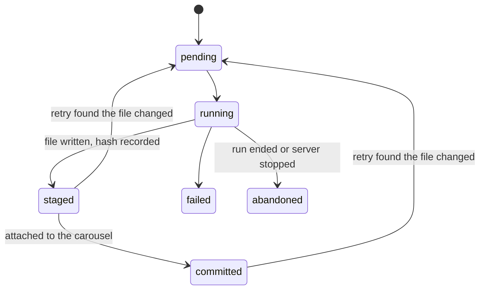
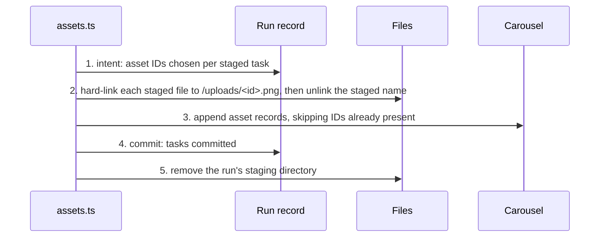

# Creative workflow

This document describes how a CreatorBrio request becomes finished slides.
It is written for contributors and describes only what is merged.

## Status

| Part | Status |
|---|---|
| Design Agent chat runs, run lifecycle and export gating | Implemented and used by every chat request |
| Typed generated assets: staging, attach, recovery, retry integrity and expiry | Implemented as a library; no request uses it yet |
| Visual Director planning, plan validation and the Creative Brief | Implemented as a library; no request uses it yet (see [visual-director.md](visual-director.md)) |
| Running the Director in a chat request and the image stage | Planned; tracked in issue #40 |

## Typed asset lifecycle

### Why generated images are not reference images

A carousel already has `referenceImages`: files the user uploads so the Design Agent can follow their style.
The Design Agent's instructions tell it to replicate the visual style of every reference image.
A generated image is different: it is content placed on a specific slide.
Recording it as a reference would turn it into a style source.

Generated images therefore have their own typed list, `Carousel.assets` (`src/types/carousel.ts`).
Each record is server-generated: an ID, a URL of the form `/uploads/<id>.png`, its origin (`generated`, or `edited` once editing exists), the IDs it was made from, its size, the SHA-256 of its bytes, the run that produced it and when.
Carousels created before assets existed have no list and read as having none; no existing data is rewritten.
Duplicating a carousel copies its assets, as it copies reference images.
Update routes never accept `assets` from a request body.

### Where the pieces live

| Concern | Owner |
|---|---|
| Asset records on the carousel | `src/lib/carousels.ts` |
| A creative run's task states, attach intent and retry data | `src/lib/generation-status.ts`, in `data/generation-runs.json` |
| Staging, attach, recovery, sweep and retry checks | `src/lib/assets.ts` |
| Validating an image from the image service | `src/lib/image-service.ts`, which returns validated bytes and writes nothing |

Everything uses the existing local storage: JSON files written through `src/lib/data.ts` (one lock per file, a temporary file, then a rename) and plain files.
There is no database, queue or scheduler.

### Staging

A validated image is first written to `data/asset-staging/<runId>/<taskKey>.png`.
The web server serves only `public/`, so a staged image is never visible as finished content.

The file is written under a temporary name, flushed and renamed before the run record marks its task `staged` with the file's SHA-256.
A record therefore never claims a file that was not fully written.

Task states:

### Attaching

Staged images reach the carousel only when every required task has succeeded; otherwise nothing moves and no record is added.

The protocol spans the staged files, `public/uploads/`, the run record and the carousel, which cannot be written atomically together.
Each step is ordered so that a crash at any point leaves a state recovery can finish or undo:

A hard link never overwrites an existing file and leaves the complete file under at least one name, so no partial file ever appears under a final name.
Linking is atomic only within one filesystem, so the image stage is refused as a configuration error when `data/` and `public/uploads/` are on different filesystems.

If a move or the carousel write fails, the request rolls back: each moved file returns to staging, and any appended record is removed.
An uploads file is removed only when its name is one of this attach's asset IDs and its content matches the recorded hash.
If the roll-back fails too, the recorded intent is left for recovery.

### Recovery

Recovery runs lazily, once per server process, before the first creative run or retry, and again for a carousel before its next run.
It is idempotent, so a crash during recovery is repaired by the next one.

- An attach intent whose files are all intact, under either name, is completed.
- An attach intent with any file missing or replaced is rolled back: its records are removed from every carousel, valid staged files are kept, and the lost tasks are marked failed.
- A run that stopped before attaching ends `blocked` with the reason `restart-before-design`; its staged images stay valid for an explicit retry.
- A run that stopped while designing is settled by the existing slide fingerprint, as any interrupted chat run is.

### Cleanup and expiry

A sweep runs with recovery and before each new run or retry, skipping runs that are live in this process.
It removes temporary files, staging directories that no record claims or whose run did not end `blocked`, and staged files whose task no longer claims them with a matching hash.
It never removes anything under `public/uploads/`; uploads no carousel references are left in place, as they are when a carousel is deleted.

A blocked run can be retried for 24 hours.
Expiry is enforced when a retry is attempted, before any sweep has run, with "This attempt has expired; send the request again".
The next sweep then deletes the run's staged files and purges its stored plan and message, keeping only the run ID, outcome and timestamps.

### Retry integrity

A retry reuses a task's result only when its stored plan still validates against the carousel and its file is intact:
a staged file must match its hash and decode as a PNG of the planned aspect ratio, and a committed asset's file must match the hash on its record.
Every other task runs again, and a mismatched staged file is deleted first.

### Guarantees and limits

After any process crash, kill or restart followed by recovery:

- every asset record points to an existing file whose content matches its hash;
- no file is partially written under a final name;
- no asset record is duplicated;
- an attach is fully committed or fully absent;
- no reference image, existing upload or other run's asset is deleted;
- a blocked run's retryable tasks have valid staged or committed files.

An operating-system crash or power loss can lose the most recent JSON writes, because the shared storage renames without flushing.
Files are always written before the records that name them, and hashes are checked before reuse, which contains that loss.
The Design Agent's shell can still overwrite files in `public/uploads/`; the recorded hashes make that detectable, not preventable.

The tests for every statement above are in `tests/assets.test.ts`, including fault injection after each protocol step and during recovery.
