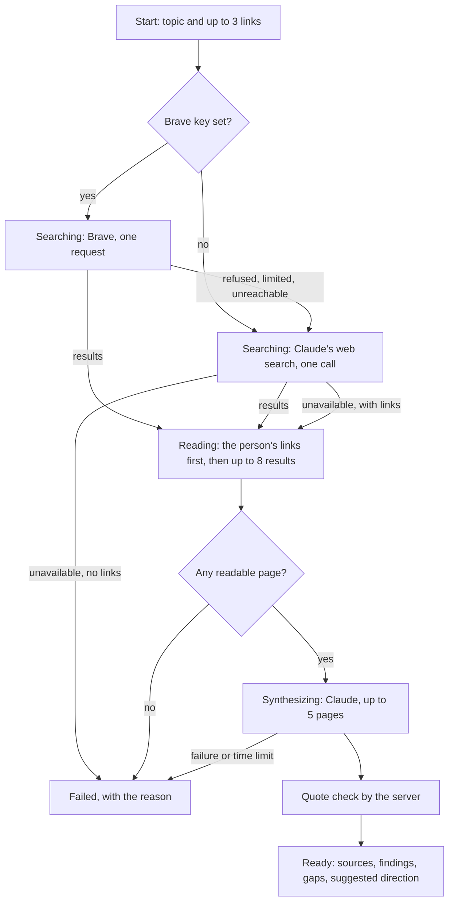

# Topic research

This page describes how CreatorBrio researches a topic for a carousel, the screen the person uses for it, and how the direction the person confirms reaches the design (#252, #253, #256).
It describes only what is merged.

## Status

| Part | Status |
|---|---|
| Research run on the server: search, page reading, synthesis and the quote check | Implemented |
| Confirmed research in the Visual Director's input and the Design Agent's task | Implemented |
| Research screen and the New project entry point | Implemented |
| Claude's web search by default, Brave Search optional | Implemented |

## Decisions it follows

- Research runs on the server through a provider, never through the Design Agent, and the person's confirmation of a direction is a workflow step, not a binding approval (FQ-11, founder decision of 2026-11-23).
- Research searches the web with the AI connection the person already has: Claude's own web search through their Claude Code sign-in, with no other account or key (founder decision of 2026-11-24, #256).
- Brave Search, with the person's own key, is an optional enhancement: when a key is set it searches first, and Claude's web search stands in when Brave fails (#256).
  FD-M supersedes the requirement of a Brave key for automatic research in FD-L and TD-07, so without a key research no longer reads only the person's links.
- Either search only finds page addresses; CreatorBrio reads every page itself, so sources and the quote check never rest on a search provider's or the model's account of a page.
- Synthesis uses the person's own Claude Code sign-in; the API-key provider path of the architecture is unchanged, and the Claude CLI is not a requirement for a future hosted edition.
- Nothing about publishing changes (FQ-10 is deferred).

## The run

`POST /api/carousels/[id]/research` with `{ topic, links? }` starts a run and answers 202 at once with the running record; the run goes on in the server's process.
A carousel has one run at a time, and a second start answers 409.
A start the server refuses answers 400 with `{ error }`, or 404 with "Project not found." for an unknown project, before anything is searched or read.
When Settings fixes the problem, Claude Code being unavailable or an invalid `RESEARCH_MAX_BUDGET_USD`, the body also carries `code` (`claude_unavailable` or `budget_setting_invalid`) so the screen can link to that Settings row; every other refusal carries no `code`.
Starting new research replaces the previous result with the next revision's running record; the snapshot the person confirmed stays.
The record moves through the stages `searching`, `reading` and `synthesizing`, and ends `ready` or `failed` with a code and a message the person can act on.
`POST /api/carousels/[id]/research/cancel` stops it; the run records itself as stopped, and nothing else on the carousel changes.
A stop answered 202 always ends the run as `cancelled`, even when the model had already answered; a stop that arrives once the result is being stored is answered 409.
`GET /api/carousels/[id]/research` returns `{ research }`, and reports a record that a stopped server left running as interrupted, so a run is never shown as running when nothing is running it.
Every write names the run's revision, so a stale run never overwrites a newer one.

### Search

Research tries the web searches it has, in order, and moves to the next only when a search fails, never when it finds nothing (`src/lib/research/providers.ts`).
There is no setting to choose one: the configuration decides.

1. Brave Search, when `BRAVE_SEARCH_API_KEY` is set.
2. Claude's own web search, whenever Claude Code is available, which a run already requires for synthesis.

Both are adapters of one provider interface (`src/lib/research/search.ts`), and both return only page addresses, filtered the same way: `http` and `https` only, at most 2,048 characters, no duplicates, at most 10.
`result.searchMethod` records which search found the pages (`brave` or `claude`), only when at least one page it found was read and used, and `result.searchFailure` the first failure the run went on past, so the screen always says how the pages were found.
The record's `searchProvider` is the search the run tried first.
`GET /api/status` reports whether a Brave key is set and which search research tries first, which is none when Claude Code is not found, key or no key, because a run cannot start without it; whether Claude's web search works on the person's connection is only known when research tries it.

A start needs only a topic, because research always tries Claude's web search when Claude Code is available, and a run already requires Claude Code.
When no search fails, the run never asks a second one.
When every search fails and the person gave links, the run goes on with them alone and records why (`result.searchFailure`), so the screen never implies the web was searched.
The one exception is a spending cap with a failed search whose cost could not be read: the run then ends at once with the first search failure it went past, which is Brave's code when Brave failed first, exactly as a run without links does, because nothing can safely be spent on synthesis (see Synthesis).
Without links, the run fails with the first failure's code and a message that says what to do: try again, add links, or set up Brave Search, or check Brave's key.
A search that works but finds nothing ends a run without links as `no_results`.

#### Brave Search

The key is read from `BRAVE_SEARCH_API_KEY` in the server's environment (`.env.local`), sent only in Brave's `X-Subscription-Token` header, and never returned, logged or stored.
One run makes at most one Brave request for up to 10 results.
Brave's terms forbid keeping search results, so a result is used only for its address, transiently: no result title, description or ranking is stored or shown.
HTTP 401 and 403 end a search as a refused key.
So does HTTP 422, which Brave's API answers to an invalid subscription token with the code `SUBSCRIPTION_TOKEN_INVALID`, because the query and the result count this adapter sends are always valid.
HTTP 429 is a rate limit, and any other failure, a malformed reply or an unreachable service, is `search_unavailable`.
Each of the three falls back to Claude's web search.
The legacy Design Agent runs with the server's environment under local trust (FD-K), so it can read the key, while the contained profile receives only an explicit allowlist and never the key.

#### Claude's web search

`src/lib/research/web-search.ts` makes one stateless Claude call through the person's own Claude Code sign-in, with the shared structured launch of `src/lib/structured-claude.ts`.
Its only tool is Claude Code's built-in web search: it has no Read, no page fetching, no setting sources, a strict empty MCP configuration, automatic memory off and no session persistence, and it runs in an empty folder outside the repository.
The topic goes on standard input as untrusted text, and the call returns, through a JSON schema, whether it searched and up to 10 addresses from its search results.
It has a 120-second time limit and the run's remaining spending cap.
The server never trusts those addresses beyond finding pages: it reads each one itself, so an address the model made up yields no source and no quote.
The same rule as for Brave keeps search results out of storage, so nothing of a search result is kept beyond the pages the server read.

Claude Code's web search is not offered on every connection, for example through Amazon Bedrock, and it is found out by trying.
Whether it works on a given Claude Code connection or sign-in is found out the same way, and the real path through Claude Code is verified only by a real run, because the automated tests stand in for the CLI.
A failed or timed-out call, a denied web search tool, a reply that does not match the schema, or the model saying it could not search all end the search as `web_search_unavailable`.
The model's word that it searched is not independently verified.
The CLI's own count of web search requests for the call (the sum of each model's `webSearchRequests`) is logged for diagnosis only, because not every search path of the CLI records it, and a count of zero rejects nothing.
What keeps the research honest is that the server reads every page itself and checks every quote against what it read.
A stop at the spending cap ends the whole run as `budget_exceeded`, without another search or synthesis.

### Reading pages

Every page, the person's links and search results alike, is read through the source-retrieval boundary (`retrieveLinks` in `src/lib/source-retrieval.ts`) with its existing validation and limits: public addresses only, every redirect checked, 10 seconds per page and 30 seconds for all of them.
Unlike a chat message, where any unreadable link blocks the run, research goes on without a page it cannot read and lists it with its reason.
The list names the host of one of the person's own links, and gives an empty host for a page a search found, because search results are not kept.
At most five readable pages are used, the person's links first, with at most two search pages from one site.
The model reads at most 12,000 characters of each page.

### Synthesis

`src/lib/research/synthesis.ts` makes one Claude call through the person's own Claude Code sign-in, with the Visual Director's launch, shared in `src/lib/structured-claude.ts`: Read confined to an empty folder outside the repository, no setting sources, a strict empty MCP configuration, automatic memory off, no session persistence, input on standard input and structured output.
It has a 180-second time limit and no spending cap unless `RESEARCH_MAX_BUDGET_USD` sets one.
That setting caps the whole run: Claude's web search may spend up to the cap, and synthesis only what the search left, so a run that reaches the cap before synthesis ends as `budget_exceeded` without calling it.
A web search that was launched but whose cost could not be read, such as one that timed out, counts as having spent the whole cap, because it may have, so nothing can safely be spent on synthesis.
When that search failed, the run ends at once, before any page is read, with the first search failure it went past, which is Brave's code when Brave failed first, exactly as a run without links does, and not as `budget_exceeded`, because no limit the person could raise would help.
In the rare case that such a search worked but the CLI still did not report a cost, synthesis is not started and the run ends as `budget_exceeded`.
A search that could not be started spent nothing, and a run without a cap is not affected.
The `budget_exceeded` message says that the limit covers the web search and the reading together, because the cap can be reached in either.
The run's recorded cost is the sum of both Claude calls' estimated costs.
An invalid value is refused when a run is started, with a 400 and its own message, before anything is searched or read, and it is checked again when the run begins and when synthesis starts, so a setting changed in between ends the run as `budget_setting_invalid` and is never read as no cap.
Page text reaches the model only inside untrusted-content blocks, with their delimiters neutralized.
It returns at most 12 findings, at most 6 gaps and one suggested direction: angle, audience, central message, one to eight key points and an optional call to action.

### The quote check

The model is never trusted with facts about its sources.

- Source IDs (`S1` to `S5`) exist only for pages the server read; the model cannot add a source.
- Each finding gives one to three quotes, each naming a source.
- A finding is `quoted` only when every one of its quotes, at least 20 characters long, is found in the exact text the model was given for the source it names, after folding Unicode forms, case, quote and dash styles and spacing.
- Any other finding is `unchecked` and keeps no quote.

A quote found on a page shows that the words are there, not that the finding follows from them, so CreatorBrio says "quoted in source" and never "verified".
Each source stores a SHA-256 of the page text as the server read it, cut to the characters the model is given and before any page delimiter in it is made inert, and `reliability: "unverified"`: CreatorBrio does not rate a source.
The quote check reads the text after that neutralization, which is the text the model saw.

## What is stored

The research lives on the carousel as `research` in `carousels.json`, owned by the server; no update route accepts it.
It holds the topic, the links, the state, the stage, the search tried first, the times, the result (sources, findings, gaps, the suggested direction and the unreadable pages) or the failure, and the run's cost, duration, search requests and pages read.
Page text is never stored, and neither is the host of a search page that could not be read.
A duplicated carousel keeps its research, but never a run in progress, and never `lastDesign`, because the copy has had no design run of its own.
A copy made while a run was in progress and nothing was confirmed gets no research at all.

The source type is the Production v2 research dossier's `ResearchSource`, shared through `src/types/research.ts`.
Findings use their own type rather than the dossier's `Claim`, whose `supported` status claims more than the quote check shows.

## Confirming a direction

`POST /api/carousels/[id]/research/confirm` with `{ revision, direction }` confirms the direction the person reviewed, as suggested or as they edited it, for the latest ready revision; anything else answers 409.
The confirmed research is kept as its own snapshot (`research.confirmed`): the direction, whether the person edited it, and the revision's sources and findings.
Researching again starts a new revision and keeps that snapshot until the person confirms another, so it never changes what existing slides were built from.

Confirming is a workflow step, not a binding approval.
Under the default Design Agent profile's local trust (FD-K), the agent reaches the app's API with the person's permissions, so a confirmation is not proof that a person made it; a binding, agent-proof approval arrives with the publishing gates.

## The research screen

`/carousel/[id]/research` is an ordinary page of the app shell (#253).
A person reaches it from **Research a topic** in New project's "Start from" choice, from **Research it** beside Home's idea field, or from **Research** in the editor's toolbar.
New project hands the topic and links to the screen through this tab's `sessionStorage`, as it hands a first message to the editor, and the screen starts research once on arrival.
The start forms never require links, because research searches the web itself and a topic is enough.
When Claude Code is not found, the forms say that research needs it and link to the Claude Code row of Settings, and still let a start through, so the server's refusal, which links there too, is the answer the person gets.

The screen polls the research record while a run is in progress, so a reload or a second tab shows the same run, and **Stop** cancels it.
A failure shows the server's message, and the form keeps the topic and links so they can be changed.
Failures the same request may get past, such as a busy search service, Claude's web search being unavailable, pages that could not be read or an interrupted run, also offer **Try again**.
A refused search key, Claude's web search being unavailable, an invalid spending setting and a missing Claude Code link to the Settings row that fixes them, in the notice of a run that failed and, for the last two, in the message of a start that was refused.
If the research cannot be read at all, the notice offers **Try again** to read it again.
A ready run says which search found its pages, and names the person's links only when one of them was read; when the first search failed, it says which one stood in or that only the person's links were read.
It shows the findings quoted in a source with their quotes and source links, the findings that were not checked (marked as left out of the design), what the pages do not establish, every page read and every page that could not be read.
The screen says that a quote found in a page shows the words are there, not that the finding is true.

The suggested direction is a form the person can change, and each field grows to show everything it holds.
**Confirm and create design** is the only thing that confirms: Enter in a field never does, and the button waits until the project's format has loaded, so the format's words are never left out.
It confirms exactly what is in the form and opens the editor, which sends one message: the format's own words, if it has any, then "Design it from the confirmed research.".
That is the one handoff that sends: the person's confirmation is their request to design.
The handoff names the revision and confirmation time the server answered with, and is kept in this tab's `sessionStorage` per project.
The editor reads and clears it once, whether or not it uses it, so a reload never sends it again.
It sends the message only when the carousel still holds that exact confirmed direction and the editor's check of Claude Code has finished without finding it missing.
A key left behind for the confirmation the carousel still holds, because the editor was not opened after the confirmation, is sent on the next visit to that editor in the same tab, since it is still the person's own confirmed request.
A key for a confirmation the carousel no longer holds sends nothing.
A person who leaves the screen before the answer arrives hands nothing over and sends nothing, although the server has confirmed the direction.
**Research again** starts a new revision with the same or different words and links.

## From confirmed research to the design

Every creative run on a carousel with confirmed research gives the Visual Director a "Confirmed research" section and the Design Agent's task a "Confirmed research" part of its visual plan, built by `src/lib/research/handoff.ts`.
Both carry the confirmed direction as the person's own request and only the `quoted` findings, with the sources they cite, inside an untrusted-content block; an `unchecked` finding never reaches a design.
The Director's instructions tell it to treat the direction as the person's own explicit request, so the direction is recorded in the Creative Brief as `explicit` (`src/lib/director-instructions.ts`).
The Design Agent is told to state as fact only those findings and to add no statistics, quotes or claims of its own.
Under the legacy profile that is guidance rather than enforcement, because the agent keeps its own web access under local trust.
The creative run record stores the research revision its design used (`researchRevision`), and the research record keeps the latest one (`lastDesign`).
A carousel without confirmed research gets the same Director input document and the same design message as before.
Its Director launch is not byte-identical to the earlier one, because the Director's instructions now carry a "Confirmed research" section for every carousel.

The Design Agent receives its task as one command-line argument, so the research in it is budgeted (`fitResearch` in `src/lib/research/handoff.ts`, applied by `buildDesignMessage`).
The research is fitted first, to what is left once the person's request, the plan and the reserve for a Continue in a new conversation are in, and linked pages share what it leaves.
Research that fits is unchanged.
Otherwise the cut is always the same: for each count of findings kept, starting with all of them, the sources' titles stay long when that fits and are shortened when it does not.
The findings drop from the end, one at a time, with any source that only they cite.
Only when no finding is left are the direction's texts shortened, each ending in an ellipsis where it was cut.
An `unchecked` finding and an uncited source never reach the design message, although the stored snapshot may still hold them.

A Retry of a run that stopped before design reuses its stored plan, so it is refused with the usual "can no longer be retried" answer when the carousel's confirmed research is not the one the plan was made from.
The stored plan keeps that research's revision and confirmation time, or none when the carousel had none.
Another revision, research confirmed after a plan made without any, and the same revision confirmed again all refuse the Retry.

## Limits

| Limit | Value |
|---|---|
| Topic | 3 to 500 characters |
| The person's links | 3 |
| Search | Brave: one request, up to 10 results, 10 seconds; Claude's web search: one call, up to 10 addresses, 120 seconds |
| Pages read | up to 8 search results plus the links, 10 seconds each and 30 seconds in total |
| Pages used | 5, at most 2 search pages per site, 12,000 characters each |
| Synthesis | 180 seconds |
| Spending | no cap unless `RESEARCH_MAX_BUDGET_USD` sets one, for web search and synthesis together |
| Findings, gaps, key points | 12, 6, 8 |

## Logs

The lines are structured, and an expected outcome is never an error.
`[research] started` carries the carousel, the revision, the searches it will try in order and the number of links.
`[research] search` carries the provider, the outcome code, the result count and the duration, with Brave's HTTP status or Claude's estimated cost, number of turns and reported web search requests; it has no carousel.
Claude's web search also carries a `reason` from a closed set, so the causes behind one `web_search_unavailable` can be told apart: `results`, `start_failed`, `cancelled`, `timed_out`, `agent_failed`, `denied`, `invalid_output`, `not_searched`, `budget_exceeded` and `unexpected` (`WEB_SEARCH_REASONS` in `src/lib/research/web-search.ts`).
What the person is told does not depend on it.
Claude's web search logs a search that worked or was stopped as information, a failed one as a warning, and only an exception of the server's own as an error.
`[sources] source` is one line per page read, with its host, outcome code, redirect count, size and duration; it has no carousel.
`[research] synthesis finished` carries the carousel, the outcome code, the cost, the number of turns, the duration, the cap it ran under (what was left of the run's cap once web search had spent) and the number of pages.
A synthesis that worked or was stopped is information, an expected failure (Claude exiting with an error or giving an unreadable reply, a reply that fails validation, the time limit, the spending cap or an invalid cap setting, a Claude launch that failed) is a warning, and only an unexpected exception is an error, with the error's name and system code and never its message.
A failure of the server's own, such as no temporary folder, ends the run as `research_failed`; only a failed launch of Claude ends it as `claude_unavailable`.
`[research] finished` carries the carousel, the revision, the outcome code, the cost, the duration, the number of search requests, the number of pages read and the codes of every search failure the run went past, in order, so a run that ended on the first failure still shows the others.
For a finished run it also carries the number of unreadable pages, the search that found the pages (or null), and the number of findings and of quoted findings.
The stored `result.searchFailure` is the first of those codes.
It is information for every coded outcome, including a `research_failed` that came from a synthesis result, because synthesis already logged that cause as an error.
An unexpected exception thrown inside the run itself makes it an error that also carries `err`, the exception's name and never its message, unless the person had already stopped the run, in which case the exception counts as stopped and is information with no `err`.
`[research] confirmed` and `[research] interrupted` carry the carousel and the revision, and the first also whether the person edited the direction.
`[research] could not record the outcome` is an error that carries the carousel, the revision, the outcome code and the error's name.
None of them carries the topic, a link's path, a query, the key, page text, findings or the direction.
An expected failure is logged as information or a warning; only an unexpected one is an error.
