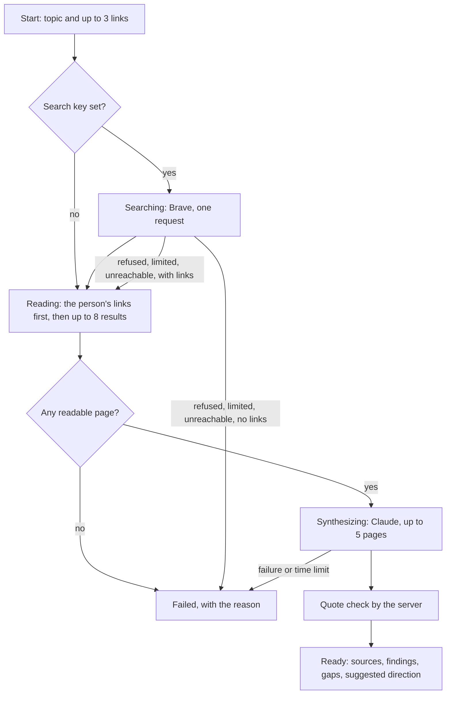

# Topic research

This page describes how CreatorBrio researches a topic for a carousel and how the direction the person confirms reaches the design (#252).
It describes only what is merged.

## Status

| Part | Status |
|---|---|
| Research run on the server: search, page reading, synthesis and the quote check | Implemented |
| Confirmed research in the Visual Director's input and the Design Agent's task | Implemented |
| Research screen and the New project entry point | Planned under #253 |

## Decisions it follows

- Research runs on the server through a provider, never through the Design Agent, and the person's confirmation of a direction is a workflow step, not a binding approval (FQ-11, founder decision of 2026-11-23).
- Brave Search is the first search provider, with the person's own key; without a key, research reads only the person's own links (TD-07).
- Synthesis uses the person's own Claude Code sign-in; the API-key provider path of the architecture is unchanged, and the Claude CLI is not a requirement for a future hosted edition.
- Nothing about publishing changes (FQ-10 is deferred).

## The run

`POST /api/carousels/[id]/research` with `{ topic, links? }` starts a run and answers 202 at once with the running record; the run goes on in the server's process.
A carousel has one run at a time, and a second start answers 409.
The record moves through the stages `searching`, `reading` and `synthesizing`, and ends `ready` or `failed` with a code and a message the person can act on.
`POST /api/carousels/[id]/research/cancel` stops it; the run records itself as stopped, and nothing else on the carousel changes.
`GET /api/carousels/[id]/research` returns `{ research }`, and reports a record that a stopped server left running as interrupted, so a run is never shown as running when nothing is running it.
Every write names the run's revision, so a stale run never overwrites a newer one.

### Search

`src/lib/research/search.ts` has one provider interface and one adapter.
The key is read from `BRAVE_SEARCH_API_KEY` in the server's environment (`.env.local`), sent only in Brave's `X-Subscription-Token` header, and never returned, logged or stored.
`GET /api/status` reports only whether a key is set.
One run makes one search request for up to 10 results.
Brave's terms forbid keeping search results, so a result is used only for its address, transiently: no result title, description or ranking is stored or shown.
A refused key, a rate limit or an unreachable service ends a run that has no links of the person's own with its own message, each suggesting research from the person's own links instead.
When the person gave links, the run goes on with them alone and the result records why search failed (`result.searchFailure`), so the screen never implies the web was searched.
Without a key, research needs at least one link, and a start with neither is refused before anything runs.

### Reading pages

Every page, the person's links and search results alike, is read through the source-retrieval boundary (`retrieveLinks` in `src/lib/source-retrieval.ts`) with its existing validation and limits: public addresses only, every redirect checked, 10 seconds per page and 30 seconds for all of them.
Unlike a chat message, where any unreadable link blocks the run, research goes on without a page it cannot read and lists it with its host and reason.
At most five readable pages are used, the person's links first, with at most two search pages from one site.
The model reads at most 12,000 characters of each page.

### Synthesis

`src/lib/research/synthesis.ts` makes one Claude call through the person's own Claude Code sign-in, with the Visual Director's launch, shared in `src/lib/structured-claude.ts`: Read confined to an empty folder outside the repository, no setting sources, a strict empty MCP configuration, automatic memory off, no session persistence, input on standard input and structured output.
It has a 180-second time limit and no spending cap unless `RESEARCH_MAX_BUDGET_USD` sets one; an invalid value is refused before anything runs.
Page text reaches the model only inside untrusted-content blocks, with their delimiters neutralized.
It returns at most 12 findings, at most 6 gaps and one suggested direction: angle, audience, central message, one to eight key points and an optional call to action.

### The quote check

The model is never trusted with facts about its sources.

- Source IDs (`S1` to `S5`) exist only for pages the server read; the model cannot add a source.
- Each finding gives one to three quotes, each naming a source.
- A finding is `quoted` only when every one of its quotes, at least 20 characters long, is found in the exact text the model was given for the source it names, after folding Unicode forms, case, quote and dash styles and spacing.
- Any other finding is `unchecked` and keeps no quote.

A quote found on a page shows that the words are there, not that the finding follows from them, so CreatorBrio says "quoted in source" and never "verified".
Each source stores a SHA-256 of the exact text the model read, and `reliability: "unverified"`: CreatorBrio does not rate a source.

## What is stored

The research lives on the carousel as `research` in `carousels.json`, owned by the server; no update route accepts it.
It holds the topic, the links, the state, the stage, the provider, the times, the result (sources, findings, gaps, the suggested direction and the unreadable pages) or the failure, and the run's cost, duration, search requests and pages read.
Page text is never stored.
A duplicated carousel keeps its research, but never a run in progress.

The source type is the Production v2 research dossier's `ResearchSource`, shared through `src/types/research.ts`.
Findings use their own type rather than the dossier's `Claim`, whose `supported` status claims more than the quote check shows.

## Confirming a direction

`POST /api/carousels/[id]/research/confirm` with `{ revision, direction }` confirms the direction the person reviewed, as suggested or as they edited it, for the latest ready revision; anything else answers 409.
The confirmed research is kept as its own snapshot (`research.confirmed`): the direction, whether the person edited it, and the revision's sources and findings.
Researching again starts a new revision and keeps that snapshot until the person confirms another, so it never changes what existing slides were built from.

Confirming is a workflow step, not a binding approval.
Under the default Design Agent profile's local trust (FD-K), the agent reaches the app's API with the person's permissions, so a confirmation is not proof that a person made it; a binding, agent-proof approval arrives with the publishing gates.

## From confirmed research to the design

Every creative run on a carousel with confirmed research gives the Visual Director a "Confirmed research" section and the Design Agent's task a "Confirmed research" part of its visual plan, built by `src/lib/research/handoff.ts`.
Both carry the confirmed direction as the person's own request and only the `quoted` findings, with the sources they cite, inside an untrusted-content block; an `unchecked` finding never reaches a design.
The Design Agent is told to state as fact only those findings and to add no statistics, quotes or claims of its own.
Under the legacy profile that is guidance rather than enforcement, because the agent keeps its own web access under local trust.
The creative run record stores the research revision its design used (`researchRevision`), and the research record keeps the latest one (`lastDesign`).
A carousel without confirmed research produces exactly the Director input and design message it did before.

## Limits

| Limit | Value |
|---|---|
| Topic | 3 to 500 characters |
| The person's links | 3 |
| Search | one request, up to 10 results, 10 seconds |
| Pages read | up to 8 search results plus the links, 10 seconds each and 30 seconds in total |
| Pages used | 5, at most 2 search pages per site, 12,000 characters each |
| Synthesis | 180 seconds; no spending cap unless `RESEARCH_MAX_BUDGET_USD` sets one |
| Findings, gaps, key points | 12, 6, 8 |

## Logs

`[research] started`, `[research] search`, `[sources] source` and `[research] finished` carry the carousel, the revision, the outcome code, counts, the cost and durations.
They never carry the topic, a link's path, a query, the key, page text, findings or the direction.
An expected failure is logged as information; only an unexpected one is an error.
