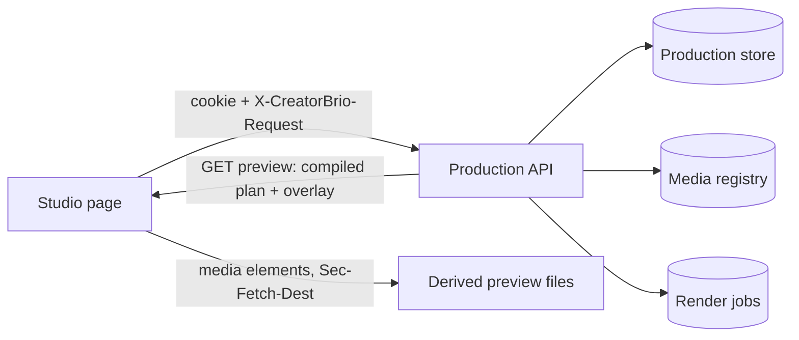

# Video Studio page

The Studio page at `/studio` is where a person edits a video production by hand ([#150](https://github.com/mk-global/creatorbrio/issues/150)).
It pairs a browser, lists and creates productions, imports media by path, previews the production with its sound, captions and graphics, edits the timeline and the graphics, undoes and redoes, and exports a verified Instagram Reel.
It is a client of the [Production API](video-production-api.md) and nothing else: it owns no production state, writes nothing itself, and holds no key.

## What a person does

1. **Pair the browser.**
   The page asks for a code from `npm run studio:pair`, run in the CreatorBrio folder.
   A code works once, for five minutes; the pairing lasts 12 hours, across server restarts, until **Sign out**.
2. **Open or create a production.**
   A new production is an empty Instagram Reel, 1080 × 1920 at 30 frames per second, with footage, image, music, title and caption tracks.
   The open production is in the address (`/studio?production=<id>`), so a reload or a restart reopens it.
3. **Import media by path** in the media bin.
   CreatorBrio copies the file into its library and prepares a preview copy; the original is never changed.
   **Add to timeline** places a library item on the track for its kind, after what is already there.
4. **Edit.**
   On the timeline, drag to move or trim, or use the keyboard (the **Keyboard** button lists the keys); split at the playhead, swap neighbours and delete from the toolbar.
   In the Inspector, add a title card, a lower third or captions at the playhead, and edit their text, position, colour and caption cues.
   Every edit is one step in the history: **Undo** and **Redo** in the header, or Cmd/Ctrl+Z and Shift+Cmd/Ctrl+Z.
5. **Preview** with Space or the transport: the picture, its sound and the music play together, with the captions and graphics the export draws.
6. **Export** from the header: the render is verified against the Instagram Reel checks before the MP4, the SRT and WebVTT captions and the manifest can be downloaded.

## How it is built

| Part | Responsibility | Where |
|---|---|---|
| API client | Every request same-origin with the session cookie and the Studio header; refusals become a typed error with the server's stable code and details | `src/lib/video/studio/api.ts` |
| Production session | The page's only view of a production and its only way to change it | `src/lib/video/studio/production-session.ts` |
| Playhead | The preview's one clock | `src/lib/video/studio/playhead.ts` |
| Preview | Media elements and the overlay, slaved to the playhead | `src/components/studio/Preview*.tsx`, `src/lib/video/studio/preview-*.ts` |
| Timeline | Lanes, gestures and keyboard edits, each one change set | `src/components/studio/Timeline*.tsx`, `src/lib/video/studio/edits.ts`, `timeline-keys.ts`, `timeline-view.ts` |
| Inspector | Graphic and caption forms, built from the capability modules' limits | `src/components/studio/Inspector*.tsx`, `src/lib/video/studio/capability-forms.ts`, `caption-cues.ts`, `clip-placement.ts` |
| Export panel | Render requests, progress, verification result and downloads | `src/components/studio/Export*.tsx`, `src/lib/video/studio/render-status.ts` |
| Workspace | Wires the above for one open production | `src/components/studio/workspace.tsx`, `StudioWorkspace.tsx` |

### The page never owns timeline state

Every edit, whether a drag, a key, a toolbar button or an Inspector save, is one change set against the revision the page last read.
After every outcome the session reads the stored production and its preview again, so the page always shows what the store holds.
A refused edit leaves the store unchanged; the banner says why, by the server's stable error code, and the timeline returns to the stored state.
A conflict (another window, an agent run, contention) is explained in plain words; the engine's own refusals list their issues.
One command runs at a time: a second one while the first is in flight is declined rather than queued, because it would be computed on a state about to change.
Undo and redo send `expectedGeneration`, so they never undo something the person has not seen.
Reordering is one change set of several `moveClip` operations, because overlap is checked on the final state.

The session is framework-free and read through `useSyncExternalStore`.
It is never disposed: React's development mode mounts, unmounts and mounts again with the same instance.

### Preview

The server compiles the stored revision with the same compiler the export uses (`GET /api/video/productions/:id/preview`): the render plan, and the overlay document of captions and graphics with the frame ranges where it draws anything.
The page draws that plan, not its own interpretation of the timeline.

- **One clock.** The playhead computes its frame from elapsed time, never by counting animation frames, so slow frames do not accumulate drift.
- **Media follow it.** Each video, image and sound is a media element showing its preview copy, placed with the export's `layerBox()` geometry.
  While playing, an element further than three quarters of a frame from where the playhead says it should be is nudged by 5% of speed until it is within a quarter frame; more than 0.25 s away, it is seeked.
  The dead band is wide on purpose: every change of an element's playback rate briefly stalls its clock while the browser restarts time-stretching, by about a frame, so correcting a small offset costs more than the offset.
  A clip that starts soon is already in the page, waiting at its first frame, and starts a learned "start lead" early, because a media element's clock stands still for a moment after `play()`.
- **The overlay** is the export's own document, re-seeked to the playhead (`previewOverlayAt()`) in two `sandbox=""` iframes that swap when the next frame has loaded, about 12 times a second while playing and exactly on pause or seek.
  It runs no script, as in the export.
- **Fonts.** The overlay document embeds its fonts as `data:` URLs.
  The app's Content-Security-Policy allows `data:` fonts on `/studio` only; every other page keeps the stricter rule (`next.config.ts`, tested in `tests/app-csp.test.ts`).
- **Gain above 1** cannot be played by a media element and is played at 1; no Studio edit produces one today.

### Timeline

`@xzdarcy/react-timeline-editor` draws the lanes and handles pointer gestures only; positions are rounded to whole frames before anything is sent.
A gesture commits once, when it ends.
A drag stops flush against a neighbour, trims stop at one frame and at the ends of the source, and snapping is to the same lane's clip edges and the playhead.
Every clip is focusable and can be selected, moved and trimmed by one frame or one second, split, swapped and deleted from the keyboard; Space and anything with Cmd or Ctrl are left to the workspace.
Trimming or splitting a caption clip moves its cues in the same change set, because cues are relative to their clip.

### Inspector

Forms take their limits and defaults from the capability modules, so the Studio never keeps a second copy of a rule.
The server judges every value: a refused save keeps the draft and shows each issue at its field.
A draft is kept per clip until it is saved or reverted; the preview shows only what is saved.

### Export and downloads

**Export Instagram Reel** queues a render job for the current revision ([video-rendering.md](video-rendering.md)); the header shows its progress while it runs.
A link cannot send the Studio header, so downloads read the file through the API client and save it from memory, which a reel of at most 90 seconds allows.
The cookie rules are unchanged: a download navigation without the header is refused like any other.

## Measured

On the development Mac (Apple Silicon, 18 cores, with other workloads running), in the production build, with a 60-second production on six tracks (ten footage clips cut out of order, three stills, music, a second sound track, two title cards and 19 kinetic caption cues):

- **Per-edit cost**: the change set and the reload of production and preview take 22 ms at the median (25 ms at the 95th percentile); a key press to the redrawn clip on the timeline takes 40 ms (46 ms).
  Each edit reloads a preview of about 290 KB, almost all of it the overlay document.
- **Preview clock**: over a full 60-second play, every element stays well within one frame once it has started.
  The exceptions are brief: the first few frames after pressing Play (the start lead), and an occasional stall of about one and a half frames when a clip enters, closed within about a second.
  The one-frame acceptance check on the founder's Mac, and whether sound stays in sync to the ear, are still to be done by a person.
- **Preview against export**: a paused preview frame and the same frame of the exported MP4 differ by 1.7 of 255 on average after downscaling, against 100 for a different frame (`tests/studio-e2e.test.ts`).

## Dependencies

| Package | Version | Licence | Why |
|---|---|---|---|
| `@xzdarcy/react-timeline-editor` | 1.0.0, pinned exactly | MIT | Timeline lanes and pointer gestures |
| `@xzdarcy/timeline-engine` | 1.0.0 | ISC | Its timing engine |
| `interactjs`, `react-virtualized` | 1.10.28, 9.22.6 | MIT | Its drag and virtualised lanes |

## Tests

- `tests/studio-production-session.test.ts`: the session against the real routes, including refusals, conflicts, undo and redo, and React's development remount.
- `tests/studio-playhead.test.ts`, `tests/studio-preview-plan.test.ts`, `tests/studio-preview-layout.test.ts`, `tests/studio-preview-route.test.ts`: the clock, the sync decisions and the preview endpoint.
- `tests/studio-edits*.test.ts`, `tests/studio-timeline-*.test.ts`: every edit builder accepted by the real store, undo restoring the timeline, and the key map.
- `tests/studio-inspector-routes.test.ts`, `tests/studio-capability-forms.test.ts`, `tests/studio-render-*.test.ts`: forms, issue mapping, render status and downloads, including that a download without the Studio header is still refused.
- `tests/studio-e2e.test.ts`: the whole flow in a browser against the production build, with no Claude CLI on the server's PATH; skipped without FFmpeg, Chromium or an up-to-date build.

## Not built yet

- Browser upload of media ([#141](https://github.com/mk-global/creatorbrio/issues/141)); import is by path.
- Muting a clip's own sound ([#146](https://github.com/mk-global/creatorbrio/issues/146)) and deleting renders ([#147](https://github.com/mk-global/creatorbrio/issues/147)).
- Transcript editing, the storyboard, a canvas inspector for transforms, ripple editing and keyframes.
- Running the Studio's browser test in CI, which has no FFmpeg yet ([#142](https://github.com/mk-global/creatorbrio/issues/142)).
