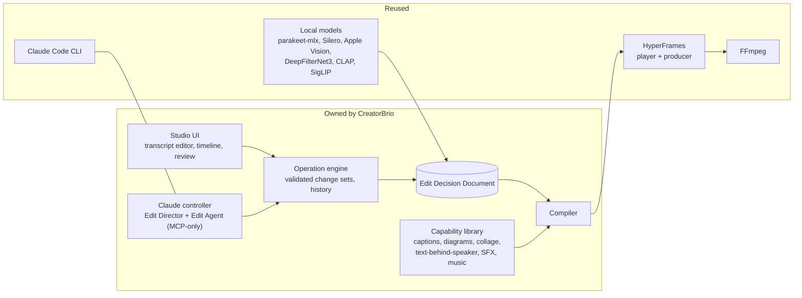

# 00 · Executive decision: CreatorBrio Video Studio

> **Historical record, 2026-11-08.** This document is kept as written.
> Since then the renderer decision changed: HyperFrames failed gate G1, and CreatorBrio uses its own script-free overlay renderer with FFmpeg (see the [amended ADR](../../architecture/adr-creatorbrio-video-studio.md)).
> A first Studio slice has also merged.
> For current status, see the [roadmap](../../roadmap/video-studio/README.md#current-status).

[← Research index](README.md)

> **Superseded in part.** The product specification in [`spec/`](spec/README.md) extends this document for both production workflows. See [spec/09](spec/09-differences-from-pr64.md) for exactly what changed.

**Status:** recommendation for founder review. Nothing here is implemented.
**Research date:** 2026-11-03. **Ticket:** [#63](https://github.com/mk-global/creatorbrio/issues/63).

## The decision

**Build Video Studio as Architecture C.**
CreatorBrio owns the edit document, the editing operations, the Claude controller, the creative-capability library and the Studio UI.
It reuses existing technology for the rest:

- **HyperFrames** (Apache-2.0) as its single rendering engine, for both preview and export;
- **FFmpeg** for all media processing;
- local **Apple Silicon models** for analysis: parakeet-mlx for transcription, Silero for speech activity, Apple Vision for mattes and faces, DeepFilterNet3 for voice cleanup, CLAP and SigLIP for search.

Everything runs locally on the user's Claude Code subscription, with no other API key required.

## Why this wins

1. **It reuses the hard, generic part and owns the product part.** Frame-accurate rendering of HTML and CSS motion graphics over footage is expensive to build and has no product-specific behaviour. HyperFrames already provides it: a seek protocol, animation-library adapters, frame-exact video, an audio mixer, alpha output, a preview player and a Node API ([03 §2](03-source-analysis.md#2-hyperframes-the-chosen-render-engine)). What makes a talking-head editor good is product-specific, and no candidate offers it under acceptable terms: word- and take-level editing, judgment, brand styles and safe agent edits. So CreatorBrio builds those.
2. **It extends what CreatorBrio already is.** Slides are HTML rendered by headless Chromium today. HyperFrames renders HTML compositions the same way, and our experiment showed the principle is deterministic ([E0](evidence/e0-experiments.md)). Brand fonts, colours and the Design Agent's HTML skill carry over unchanged.
3. **Practitioners converged on it independently.** Ghost Editor (a `reel.json` compiled to HyperFrames) and Yap Studio (its own EDL rendered through HyperFrames) are both talking-head reel tools built for Claude Code users on Macs. Both own their edit model and use HyperFrames to render **[source]**.
4. **Claude cannot corrupt the timeline.** The agent's only write path is a typed change set that deterministic code validates and applies atomically. One agent turn is one undo step, which the user keeps or discards. The pattern is verified in Nuzky, OpenChatCut, vedit and WeftCut, and is CreatorBrio's own Visual Director rule ([05 §5](05-proposed-architecture.md#5-how-claude-edits-safely)).
5. **The renderer stays replaceable.** Because the edit document is ours, a different renderer means a new compiler backend, not a rewrite. OpenFilm's renderer (MIT) is the pre-agreed fallback.

## What it sacrifices

- **A ready-made editor UI.** We build the Studio UI on a small MIT timeline widget. Forking OpenFilm's young Studio or embedding HyperFrames Studio would have meant giving up the data model and UX ([04](04-architecture-alternatives.md)).
- **Some render speed.** Chromium per-frame capture is slower than the native compositors in BaoCut, Nuzky or Concat. It should be acceptable for reels under 90 seconds; checkpoint V1 measures it.
- **Independence from a pre-1.0, vendor-led upstream**, mitigated by exact pins, a single adapter module and the fallback above.

## Answers to the brief's key questions (short form)

| Question | Answer |
|---|---|
| Fork OpenFilm or use a modular SDK? | Neither as the foundation. OpenFilm is well designed but 3.5 weeks old, uses an HTML project format and has no talking-head intelligence; it is the fallback renderer. Use a modular approach with an owned model on HyperFrames |
| Better foundation than OpenFilm or Twick? | Yes: HyperFrames for rendering. Twick is insufficient: custom changeable licence, dormant since May 2026, preset animations only |
| Who owns the project format? | CreatorBrio: the Edit Decision Document ([05 §3](05-proposed-architecture.md#3-the-edit-decision-document)). OTIO and FCPXML are export formats |
| Canonical timeline and operation model? | Integer-frame timeline; microsecond source ranges; words stored once in source time; one mutation funnel with typed ops and revisioned change sets ([05 §4](05-proposed-architecture.md#4-editing-operations)) |
| How does Claude edit safely? | MCP-only tools; `propose_changes` validated against invariants; optimistic concurrency; run = one undo step with Keep/Discard |
| Non-destructive media? | Content-addressed immutable originals; all derived media regenerable and cached by input hash |
| Small revisions without full regeneration? | Change sets touch specific clips; recompile only changed sub-compositions; content-hash caches for mattes and graphics; range re-render and splice |
| Preview = export? | Same compiler, same HyperFrames runtime; only media resolution differs |
| External animation tools without competing timelines? | Port their visual grammar into capability templates that render inside our composition; never call their renderers |
| Claude operates tools or plans? | Both, layered: the Director plans (schema-validated); the Agent iterates through read tools and validated change sets; servers run every media tool |
| Local AI in Next.js? | Loopback Python worker (uv, MLX first) on the existing image-service pattern; Swift CLI for Apple frameworks; FFmpeg spawned from Node |
| Avoid duplicated engines? | One tool per responsibility ([05 §10](05-proposed-architecture.md#10-one-tool-per-responsibility)) |
| Assets and effect presets? | Versioned capability packages with manifests, parameter schemas, templates and licence records |
| Customisable for future ideas? | A new capability is a folder plus tests; no core change |
| Build vs reuse? | [03 §9](03-source-analysis.md#9-what-reuse-most-of-the-work-means-precisely) |
| Without extra API keys? | Everything in the core workflow ([06](06-feature-coverage.md#what-genuinely-runs-without-extra-api-keys)) |
| Biggest risks? | macOS render speed and determinism, upstream churn, HDR footage, matte quality, filler detection ([09](09-risks-and-open-questions.md)) |
| Hard to automate? | Taste, fillers without non-commercial models, hair-level mattes, B-roll relevance, meaning-preserving restructuring ([06](06-feature-coverage.md#capabilities-that-remain-hard-to-automate-well)) |

## What would change this decision

| Finding | Change |
|---|---|
| V1: HyperFrames on macOS is not deterministic, or is too slow | Compile to OpenFilm's renderer or our own Puppeteer renderer; nothing else changes |
| V2: the HyperFrames player cannot run sandboxed | Preview through server-rendered frames; keep HyperFrames for rendering |
| HyperFrames changes licence or drops its Node API | Same as the V1 fallback |
| elah gains robust multi-track playback | Consider its timeline UI in place of the xzdarcy widget |
| The founder prefers an embedded third-party editor UI | Revisit Architecture D for the UI only, keeping the edit document canonical |

## First action after approval

Raise the minimum Node.js version to 22 (its own ticket), then run checkpoint **V1**.
V1 renders a hand-built 60-second fixture reel with pinned `@hyperframes/producer` on the founder's M5 Max, twice, and records frame-hash determinism, A/V sync and render time at several worker counts.
That single measurement confirms or redirects the rendering choice before any production code depends on it.
The operation engine (W2) can start in parallel because it has no external dependencies ([08](08-implementation-plan.md#first-tickets-after-approval)).
