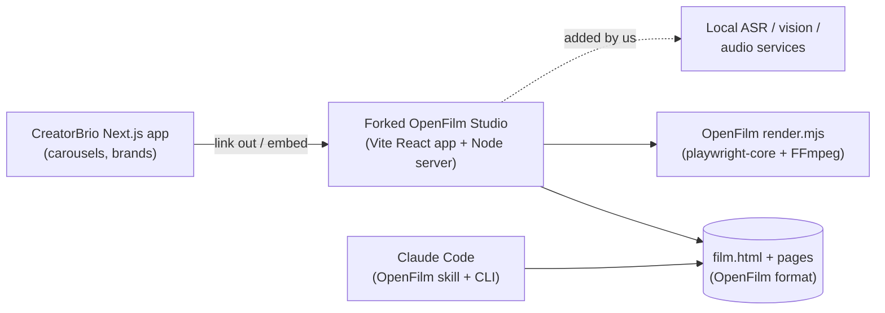
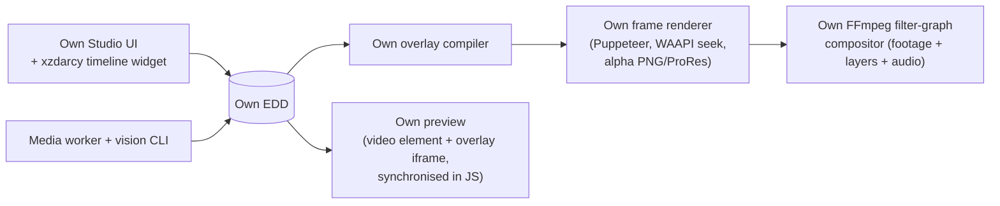
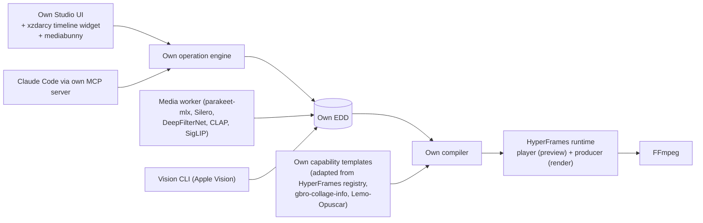
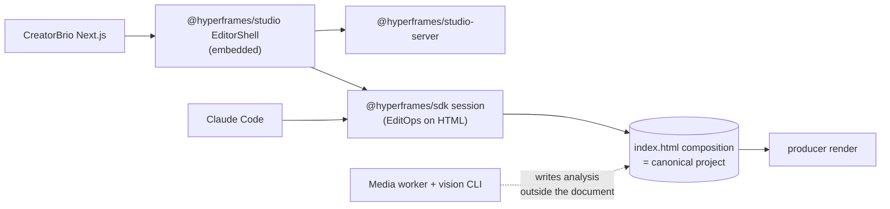

# 04 · Architecture alternatives and decision matrix

[← Research index](README.md) · Chosen design: [05 Proposed architecture](05-proposed-architecture.md)

Four credible architectures were developed from the evidence, plus a fifth that was considered and excluded.
Each one below gives its components, ownership, integration details, risks, licensing, testing and maintenance.
Effort figures are **engineering estimates** for one experienced engineer working with Claude Code, given as ranges. They are not measurements.

## Architecture A · Fork and adapt a complete open-source editor (OpenFilm)

OpenFilm is the strongest permissively licensed complete editor whose architecture resembles CreatorBrio's ([E1 §1](evidence/e1-complete-editors-a.md#1-openfilm-openfilmopenfilm)).
It is MIT, renders HTML in headless Chromium and encodes with FFmpeg, drives Claude Code without an API key, and its Studio UI is React 19 with Tailwind v4.
The other complete editors fail on licence or architecture: OpenChatCut is AGPL plus Remotion, BaoCut is source-available and forbids incorporation, Concat is AGPL with a CLA, Nuzky is GPL, and QCut has provenance problems.

| Aspect | Detail |
|---|---|
| Technologies | Fork of `openfilm/openfilm` at `4d52629`; its Studio (Vite + React 19), server (`studio/server/*.mjs`), renderer (`src/render.mjs`, `host.mjs`), `film.html` format; plus a local ASR/vision/audio sidecar we add |
| Code ownership | We own a fork of about 70k lines of UI plus the server and renderer, and must rename the product (OpenFilm's trademark policy) |
| Reused | Timeline UI, ops (`ops.mjs`), per-clip undo, renderer, QA (`look.mjs`), VTT captions, NLE export |
| Built new | Local transcription, filler and retake detection, reframing, matting, audio chain, brand integration, the agent controller, merging the Vite app into or alongside Next.js, and every talking-head feature |
| Source-level integration | Either run OpenFilm Studio as a second local server linked from CreatorBrio (two apps, two UIs), or port its UI into Next.js routes. The agent edits `film.html` as a file, so structured edits need adding. OpenFilm's Studio ops are structured, but its agent path is not ([E1](evidence/e1-complete-editors-a.md#architecture)) |
| Pros | Fastest path to a working NLE UI; MIT; preview equals export; well-tested renderer; same paradigm as slides |
| Cons | 3.5 weeks old and changing daily (216 commits in that time), so a fork diverges immediately. The project document is HTML, so word-level and take-level semantics must be bolted on. Two applications to integrate. None of the talking-head automation exists. Rendering composites raw footage in Chromium per frame |
| Major risks | Fork drift; upstream design churn; an HTML-as-project format resisting the semantics we need; trademark rename work |
| Licensing | MIT + trademark policy (rename required); `playwright-core` Apache-2.0 |
| Customisation | High in principle (we own the fork), lower in practice (to stay mergeable we must not change much) |
| Testing | Inherit OpenFilm's 272 node:test files; add our own for new features; keep two test runners |
| Effort (estimate) | Medium to start; high to complete, because all the talking-head intelligence is still to build |
| Mac / Claude Code | Good / good (skill + CLI, ACP in its desktop app) |
| Maintenance | Poor: either a frozen fork that misses upstream fixes, or continual merges against a fast-moving young project |

## Architecture B · Assemble everything from foundational libraries

Build CreatorBrio's own renderer by extending today's Puppeteer export with a time parameter, as proven in [E1](evidence/e0-experiments.md#e1--deterministic-htmlcss-overlay-frames-composited-by-ffmpeg).
FFmpeg composites footage, and a minimal timeline widget plus local models complete the stack.
No editor framework is used.

| Aspect | Detail |
|---|---|
| Technologies | Puppeteer (existing), FFmpeg filter graphs (as vedit does, [E1 §4](evidence/e1-complete-editors-a.md#4-vedit-metiutekeditorvideo-ai)), `@xzdarcy/react-timeline-editor`, mediabunny, media worker, vision CLI |
| Code ownership | Everything except libraries |
| Reused | Libraries only: FFmpeg, Puppeteer, the timeline widget, models |
| Built new | Frame renderer, animation seeking for every library we use, audio mixer, parallel chunking, alpha encoding, motion blur, a real-time preview that keeps HTML overlays in sync with `<video>`, the filter-graph compositor, transitions, and everything in Architecture C |
| Pros | Maximum control; smallest dependency surface; compositing footage in FFmpeg may be faster than per-frame Chromium capture **[untested]** |
| Cons | Rebuilds what HyperFrames already does: adapters, audio envelopes, alpha output, motion blur, parallel capture, readiness gates, HDR handling. Preview and export become **two different compositors** (browser vs FFmpeg filter graph), which is exactly the inconsistency SynthCut shows ([E2 §8](evidence/e2-complete-editors-b.md#8-synthcut--relo-videosynthcut)) |
| Major risks | Preview/export divergence; long time to quality; a renderer becomes a second product to maintain |
| Licensing | Cleanest (MIT/Apache/MPL libraries; FFmpeg as a separate GPL process) |
| Customisation | Total |
| Testing | All on us: golden-frame tests for the compositor, sync tests for preview |
| Effort (estimate) | Highest. The renderer alone is a multi-month effort to reach HyperFrames' current robustness |
| Mac / Claude Code | Good / good |
| Maintenance | Heavy: we own a rendering engine |

## Architecture C · Hybrid: CreatorBrio-owned model and controller on a reused render engine **(recommended)**

CreatorBrio owns the Edit Decision Document, the operation engine, the compiler, the agent controller, the capability registry and the Studio UI.
It reuses HyperFrames' runtime, player and producer as its single rendering engine, FFmpeg for media, and local models through a worker.
Full design: [05](05-proposed-architecture.md).

| Aspect | Detail |
|---|---|
| Technologies | Next.js 16 / React 19 (existing); `@hyperframes/{core,player,producer,engine}` pinned, behind CreatorBrio adapters; FFmpeg `ffmpeg-full`; `@xzdarcy/react-timeline-editor`; mediabunny; Python uv worker with parakeet-mlx, Silero VAD, DeepFilterNet3 (mlx-audio), CLAP, SigLIP 2, PySceneDetect; Swift vision CLI; Earshot (optional sidecar) |
| Code ownership | **Owned:** EDD schema, operation engine, history, compiler, capability manifests and templates, agent prompts, schemas and MCP server, Studio UI, ingest pipeline, worker glue and analysis algorithms (retakes, filler gaps, reframe smoothing, ducking), QA checks, style profiles. **Reused:** frame rendering, animation seeking, audio mixing, encoding, preview player, models, codecs |
| Source-level integration | The compiler emits HyperFrames' documented HTML contract (`data-start`, `data-duration`, `data-media-start`, `data-track-index`, `data-volume`, sub-compositions) **[source]**. The render worker calls `createRenderJob` / `executeRenderJob` **[source]**. Preview uses the `<hyperframes-player>` web component. Nothing in HyperFrames is forked; if a patch is needed it goes upstream (Apache-2.0) or into a small `patch-package` patch with an issue |
| Pros | One render engine for preview and export; the format we need; agent edits are validated ops; HyperFrames is already the renderer for Ghost Editor, Yap Studio and OpenVids, and BaoCut supports its contract, which is evidence of a de-facto standard ([E6](evidence/e6-recent-discovery.md)); the renderer stays swappable because the EDD is ours |
| Cons | Depends on a pre-1.0, very fast-moving library (2,989 commits in 90 days; releases daily). macOS renders use screenshot mode rather than BeginFrame **[source]**. The video preview needs scripts, so the sandbox policy must change for video. We still build the Studio UI ourselves |
| Major risks | HyperFrames API churn (mitigated by exact pins and an adapter); render speed or determinism on macOS (checkpoint V1); player sandboxing (V2) |
| Licensing | HyperFrames Apache-2.0 (root licence; per-package fields mostly absent, so confirm on npm); avoid GSAP in our output; FFmpeg GPL as a separate, user-installed process; model licences gated per model |
| Customisation | High: every product decision lives in owned code; capabilities are a documented extension point |
| Testing | Unit tests for ops and invariants (fast, CI); golden HTML snapshots for the compiler (CI); render determinism tests on fixtures (Linux CI with chrome-headless-shell, Mac opt-in); worker contract tests with a fake worker (CI); agent-plan evaluation harness (opt-in, like `eval/director`) |
| Effort (estimate) | Medium–high: less than B by the size of a renderer; more than D for the UI |
| Mac / Claude Code | Good (darwin-arm64 headless shell; MLX; Apple Vision) / good (MCP-only, keyless) |
| Maintenance | Moderate: upgrade HyperFrames deliberately behind tests; everything else is ours |

## Architecture D · HyperFrames-native: adopt HyperFrames Studio and its document as the product

Use HyperFrames' HTML composition as the canonical project and embed `@hyperframes/studio` (`EditorShell`, `NLEPreview`, timeline, property panel), edited through `@hyperframes/sdk` `EditOp`s **[source]** ([E0](evidence/e0-experiments.md#direct-verification-by-the-lead-researcher)).
CreatorBrio adds analysis, the talking-head pipeline and the agent.

| Aspect | Detail |
|---|---|
| Technologies | `@hyperframes/studio` 0.9.9 (about 166k lines including tests), `studio-server`, `sdk`, `player`, `producer` |
| Code ownership | Little: the editor UI and document model are HyperFrames' |
| Reused | Full NLE UI, edit operations, history, persist queue, preview, render |
| Built new | Talking-head analysis and its mapping into HTML; transcript editing on top of an HTML document that does not know about words; brand integration; agent controller |
| Pros | Fastest route to a polished NLE; a single vendor stack from UI to render |
| Cons | The canonical format is HTML plus animation timelines, so words, takes and source ranges must be smuggled into attributes. `@hyperframes/studio` depends on GSAP and exposes GSAP keyframe operations **[source]**, bringing GSAP's licence into the product's editing UI. Embedding a 166k-line pre-1.0 UI inside Next.js couples our UX to HeyGen's release cadence. HeyGen's skills and CLI include sign-in and credit upsell paths ([E4 §1](evidence/e4-creative-and-audio-tools.md#1-hyperframes--heygen-comhyperframes-most-important)) |
| Major risks | Vendor lock-in at the UX and data-model level; GSAP licence; churn; customisation limits |
| Licensing | Apache-2.0 + GSAP Standard licence (studio) |
| Customisation | Low–medium: we would be skinning someone else's editor |
| Testing | Mostly upstream's; ours for integration |
| Effort (estimate) | Medium to a first editor; high to make it a talking-head product, because the data model fights us |
| Mac / Claude Code | Good / good (Studio even has an agent modal and WebMCP tools) |
| Maintenance | Tied to HeyGen's roadmap |

## Considered and excluded · Drive an external editor as a tool

Run a user-installed editor (BaoCut, Concat, Nuzky or FilmCraft) and drive it over its MCP or CLI from CreatorBrio.
This is legally possible for BaoCut ("independently written … client that only uses public interfaces" ([E1 §3](evidence/e1-complete-editors-a.md#3-baocut-jimliubaocut))), Concat and Nuzky, and each is technically strong.
It fails the brief's central requirement, *own and customise the product*.
The workflow, UI, data and roadmap would belong to someone else; three of the four are copyleft or source-available; all are single-maintainer projects only weeks or months old.
It remains a valid optional integration ("open in BaoCut") later, via FCPXML or OTIO export.

## Weighted decision matrix

Weights reflect the brief's priorities: editing quality, customisation, technical completeness, time to a complete usable system, local execution and maintainability.
Scores are 1 (poor) to 5 (excellent) and are **reasoned judgments from the evidence above, not measurements**.

| Criterion | Weight | A · Fork OpenFilm | B · Assemble from primitives | **C · Hybrid (owned model, reused renderer)** | D · HyperFrames-native |
|---|---:|---:|---:|---:|---:|
| Editing quality achievable | 25% | 3 | 4 | **4** | 4 |
| Customisation and ownership | 20% | 4 | 5 | **5** | 2 |
| Technical completeness of the foundation | 15% | 3 | 2 | **4** | 5 |
| Time to a complete, usable system | 15% | 3 | 1 | **4** | 3 |
| Local execution on Apple Silicon | 10% | 4 | 5 | **5** | 4 |
| Maintainability and licence risk | 15% | 2 | 3 | **3** | 2 |
| **Weighted score** | 100% | **3.15** | **3.40** | **4.15** | **3.30** |

Why the scores differ:

- **Quality**: A starts with no talking-head intelligence. B, C and D can all reach high quality, but B spends its effort on a renderer instead of on editing.
- **Customisation**: D gives away the data model and UX; A's customisation is limited by the need to stay mergeable.
- **Completeness**: D is the most complete out of the box; C reuses the hardest-to-build part (the renderer) and builds the product-specific parts.
- **Time**: B must build a renderer first; D's data-model mismatch and A's two-app integration cost time later.
- **Maintainability**: every option has a weakness. C depends on a pre-1.0 library behind an adapter, the smallest exposure among A, C and D. B carries a self-owned renderer.

Sensitivity checks, recomputed from the scores above:

- With "time to complete" at 5% and "customisation" at 30%, the scores are C 4.25, B 3.80, A 3.25 and D 3.20.
- With maintainability at 30% (quality 20%, customisation 15%, completeness 15%, time 10%, local 10%), the scores are C 3.95 and B 3.35.
- C minus D equals 3×(customisation weight) + (time weight) + (local weight) + (maintainability weight) − (completeness weight). D wins only if completeness is weighted more heavily than those four criteria combined, which contradicts the brief.

## Final recommendation

**Architecture C.**
It is the only option that gives CreatorBrio ownership of what differentiates the product without rebuilding a video renderer.
The differentiators are the editing semantics (words, takes, styles), the agent's judgment and safety, and the brand-specific creative library.

**What it sacrifices**:

- A ready-made editor UI on day one. We build the Studio UI on a small timeline widget rather than adopting HyperFrames Studio or forking OpenFilm's.
- Some rendering speed. Per-frame Chromium capture is slower than native compositing (BaoCut, Nuzky, Concat), which is acceptable for reels under 90 seconds and is checked at V1.
- Independence from one upstream for rendering, mitigated by pinning and by the EDD keeping the compiler target replaceable.

**Evidence that would change the decision**:

| If validation shows… | Then… |
|---|---|
| HyperFrames on macOS is non-deterministic or too slow for a 60–90 s 1080×1920 reel (V1) | Switch the compiler target to OpenFilm's `frame(t)` renderer (MIT, same paradigm), or to Architecture B's own Puppeteer renderer for overlays plus FFmpeg compositing. The EDD, ops, agent and UI are unaffected |
| `<hyperframes-player>` cannot run in an opaque-origin sandbox (V2) | Preview via server-rendered frames in a script-free scrubber; keep HyperFrames for render |
| HyperFrames changes licence or abandons the Node API | Same as the first row |
| elah matures multi-video-track playback and keyframe lanes | Consider `@elah/timeline` in place of the xzdarcy widget for the timeline UI only |
| The founder decides an embedded third-party editor UI is acceptable | Reconsider D for the UI layer while keeping the EDD as canonical |
