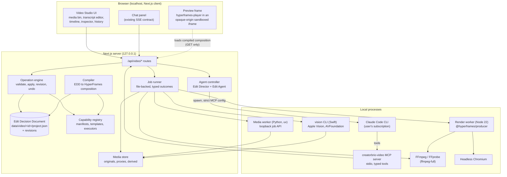
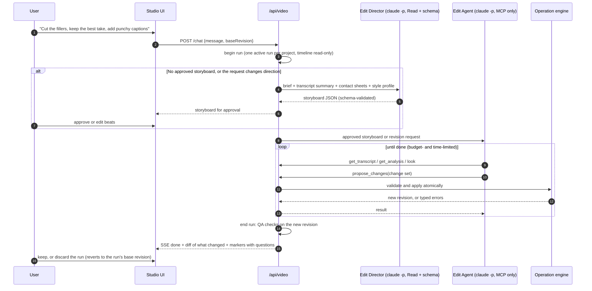
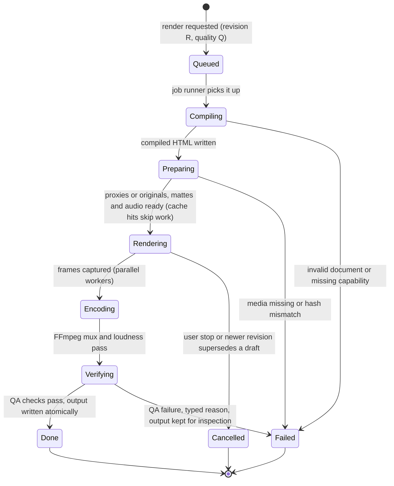
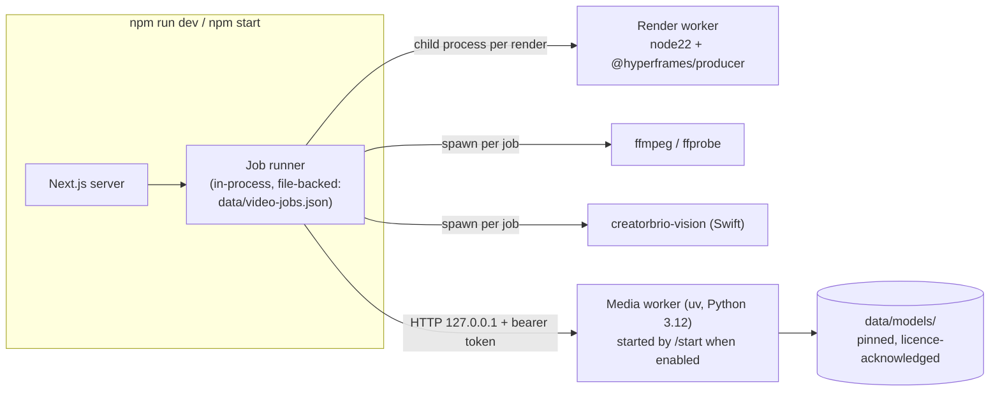

# 05 · Proposed architecture: CreatorBrio Video Studio

[← Research index](README.md) · Decision: [00 Executive decision](00-executive-decision.md) · Alternatives: [04](04-architecture-alternatives.md)

> **Superseded in part.** The product specification in [`spec/`](spec/README.md) extends this document for both production workflows. See [spec/09](spec/09-differences-from-pr64.md) for exactly what changed.

This is the recommended design: **Architecture C, the hybrid**.
CreatorBrio owns the edit document, the editing operations, the agent controller and the creative capabilities.
It reuses HyperFrames as its one rendering engine, FFmpeg for media processing, and local Apple Silicon models for analysis.

Evidence labels used on this page: **[source]** verified in source code, **[docs]** official documentation, **[exp]** our own experiment ([E0](evidence/e0-experiments.md)), **[inferred]** follows from the architecture, **[untested]** needs a validation checkpoint ([08](08-implementation-plan.md#validation-checkpoints)).

## 1. Design principles

1. **One canonical document, owned by CreatorBrio.** The *Edit Decision Document* (EDD) is the single source of truth for a video project. Everything else (HyperFrames HTML, previews, renders, OTIO exports) is compiled from it and can be thrown away and rebuilt.
2. **One rendering engine.** Every pixel in preview and export comes from the same compiled HyperFrames composition, evaluated by the same HyperFrames runtime. Creative tools never render final video themselves; they contribute clips to the EDD.
3. **Deterministic code executes; Claude decides.** Claude proposes typed operations. Server code validates them against the document and applies them atomically. This is CreatorBrio's existing Visual Director rule ([design-decisions.md](../../architecture/design-decisions.md#deterministic-code-executes-the-plan)), applied to video.
4. **Source media is immutable.** Originals are content-addressed and never modified. Proxies, transcripts, masks and renders are derived, cached by input hash, and regenerable.
5. **One tool per responsibility.** No two engines compete for the same job ([§10](#10-one-tool-per-responsibility)).
6. **Local first, plain files, no new infrastructure.** JSON documents, a file-backed job list, a loopback media worker; no database, queue service or cloud.
7. **The person stays as recorded.** No operation regenerates the speaker's face or body. Masks cut out real pixels; generative models never touch the person ([baseline](01-creatorbrio-baseline.md#existing-product-rules-video-studio-must-keep)).

## 2. System overview



| Component | Owner | Built from |
|---|---|---|
| Video Studio UI | **CreatorBrio** | React 19 / Tailwind (existing); timeline interaction from `@xzdarcy/react-timeline-editor` (MIT); thumbnails and waveforms from `mediabunny` (MPL-2.0) |
| Preview | Reused | `@hyperframes/player` web component (Apache-2.0) **[source]**, hosted by CreatorBrio |
| Operation engine, EDD, history | **CreatorBrio** | TypeScript, zod-style validation, `src/lib/data.ts` patterns |
| Compiler | **CreatorBrio** | Emits HyperFrames' HTML composition contract **[source]** |
| Capability registry and templates | **CreatorBrio** (some templates adapted) | Manifests + HTML/CSS/SVG templates; adapted from HyperFrames registry blocks (Apache-2.0), gbro-collage-info (MIT) and Lemo-Opuscar styles (MIT) |
| Agent controller and MCP server | **CreatorBrio** | Claude Code CLI patterns already used by the Visual Director; MCP-only tool surface as in Nuzky, OpenChatCut and vedit **[source]** |
| Render worker | Reused, wrapped | `@hyperframes/producer` + `engine` (Apache-2.0), pinned, behind `renderComposition()` |
| Media worker | **CreatorBrio** glue, reused models | parakeet-mlx, Silero VAD, DeepFilterNet3 (via mlx-audio), CLAP, SigLIP 2, PySceneDetect |
| Vision CLI | **CreatorBrio** (small Swift package) | Apple Vision and AVFoundation (OS frameworks) |
| FFmpeg | Reused | Homebrew `ffmpeg-full`, separate process |

## 3. The Edit Decision Document

### Why CreatorBrio owns the format

None of the candidate formats carries what a talking-head editor reasons about: words, takes, and which source range each word came from.

- HyperFrames' format is HTML with `data-start` / `data-duration` attributes and a paused animation timeline **[source]**. It describes *what to draw when*, not *why*: a cut made because a word was a filler looks the same as any other trim.
- OpenFilm's `film.html` is similar **[source]**.
- OTIO has no motion graphics, captions or effects model **[source]** ([E3 §15](evidence/e3-sdks-and-renderers.md#15-opentimelineio-academysoftwarefoundationopentimelineio)).
- Remotion compositions are code **[docs]**.

The projects closest to our workflow converged on the same answer independently.
Ghost Editor keeps a `reel.json` and compiles it to HyperFrames **[source]**, and Yap Studio keeps its own EDL model and renders through HyperFrames **[source]**.
Nuzky, BaoCut and OpenChatCut each own a typed project model **[source]**.
Owning the EDD is also what keeps the renderer replaceable: a different engine needs a new compiler backend, not a new data model.

### Time model

- **Timeline positions are integer frames** at the project frame rate (default 30 fps). elah and OpenChatCut make the same choice to avoid floating-point drift after splits **[source]**.
- **Source positions are integer microseconds** into the original media's audio-aligned timeline, as Nuzky does **[source]**. This survives variable-frame-rate camera footage, which is conformed to constant frame rate only in proxies and in render inputs ([E5 §1.3](evidence/e5-building-blocks.md#13-proxies-vfr-and-hdr-pitfalls)).
- Word timings from ASR are stored in source microseconds. A word's position on the timeline is *computed* by mapping through the clips that include it, never stored twice.

### Schema (TypeScript sketch)

This is a design sketch, not final code; field names will be settled in the first implementation ticket.

```ts
/** data/video/<projectId>/project.json */
interface VideoProject {
  schemaVersion: 1;
  id: string;
  name: string;
  brandId: string;                 // fixed at creation, like carousels
  styleProfileId: string | null;   // brand video style, see §8
  revision: number;                // increments on every applied change set
  format: { width: 1080; height: 1920 | 1350 | 1080; fps: 30 | 25 | 24 | 60 };
  brief?: CreativeBrief;           // reused unchanged from src/types/creative-brief.ts
  storyboard?: Storyboard;         // approved beats, see §7
  media: MediaRef[];               // which registered media this project uses
  tracks: Track[];                 // ordered bottom to top
  captions: CaptionLayer | null;   // derived from transcript words + style
  audio: { masterLufs: number; ducking: DuckingPolicy };
  markers: Marker[];               // agent notes and questions pinned to time ranges
  createdAt: string; updatedAt: string;
}

interface MediaRef {
  mediaId: string;                 // sha256 of the original's bytes
  role: "a-roll" | "b-roll" | "music" | "sfx" | "image" | "logo";
  label: string;
}

type Track =
  | { id: string; kind: "video"; role: "a-roll" | "b-roll" | "overlay"; clips: VideoClip[]; hidden?: boolean }
  | { id: string; kind: "graphics"; clips: GraphicsClip[]; hidden?: boolean }
  | { id: string; kind: "audio"; role: "voice" | "music" | "sfx"; clips: AudioClip[]; muted?: boolean };

interface ClipBase {
  id: string;
  start: number;                   // timeline frame
  duration: number;                // frames
  provenance: Provenance;          // who made it and why, see below
}

interface VideoClip extends ClipBase {
  source: { mediaId: string; inUs: number; outUs: number };
  speed?: number;                  // 1 = normal; ramps as keyframes
  framing?: Keyframes<Rect>;       // reframe/zoom crop in source pixels
  effects?: EffectRef[];           // e.g. grade LUT, blur, matte-based effects
  audio?: { gainDb: Keyframes<number>; fadeInFrames?: number; fadeOutFrames?: number };
  transitionIn?: TransitionRef;
}

interface GraphicsClip extends ClipBase {
  capability: { id: string; version: string; params: unknown }; // validated against the manifest's schema
  layer: "behind-subject" | "front";                             // text behind the speaker uses a matte
  renderCacheKey?: string;                                       // set when pre-rendered to an alpha layer
}

interface AudioClip extends ClipBase {
  source: { mediaId: string; inUs: number; outUs: number };
  gainDb: Keyframes<number>;       // ducking is written here as keyframes, not hidden in a filter
  processing?: { denoise?: number; eqPreset?: string; normalise?: boolean };
}

interface Provenance {
  by: "user" | "agent" | "system";
  changeSetId: string;
  reason?: string;                 // e.g. "filler: 'um'", "retake 2 of 3 kept"
}

type Keyframes<T> = Array<{ frame: number; value: T; ease?: "linear" | "ease-in-out" | "hold" | string }>;
```

Analysis results are **not** stored in the project.
They live beside the media they describe, keyed by the original's hash and the tool version, and are shared by every project that uses that footage:

```ts
/** data/media/analysis/<sha256>/<kind>@<toolVersion>.json */
interface Transcript {
  mediaId: string; engine: "parakeet-tdt-0.6b-v3" | "whisper.cpp:large-v3-turbo"; language: string;
  words: Array<{ id: string; text: string; startUs: number; endUs: number; confidence?: number; kind: "word" | "filler" | "breath" }>;
  utterances: Array<{ id: string; wordIds: string[] }>;
  takeGroups?: Array<{ id: string; utteranceIds: string[]; recommended: string; reason: string }>;
  corrections: Array<{ wordId: string; text: string }>;   // user fixes, never lost on re-transcription
}
// Also: vad.json, faces.json (tracks), shots.json, loudness.json, masks/ (alpha video), embeddings.bin
```

### Invariants the operation engine enforces

- Every clip references media that is registered and intact (hash verified, as `src/lib/assets.ts` already does for images).
- No two clips overlap on the same track.
- `inUs < outUs` lies within the source's duration, and `duration` matches `(outUs - inUs) / speed` at the project frame rate.
- Every graphics clip names an available capability, and its parameters validate against that capability's JSON Schema.
- Captions only reference words that survive the current cuts. This is the same check Ghost Editor's build makes when a beat points at cut material **[source]**.
- Total duration is within platform limits (for example 90 s for an Instagram Reel, configurable).

## 4. Editing operations

All changes, from the UI, the agent or a capability, go through **one mutation funnel**: elah's principle P3 and Nuzky's single editing authority **[source]**.

```ts
type EditOp =
  // transcript-level (the primary talking-head editing surface)
  | { op: "deleteWords"; mediaId: string; wordIds: string[]; ripple: true }
  | { op: "restoreWords"; mediaId: string; wordIds: string[] }
  | { op: "chooseTake"; takeGroupId: string; utteranceId: string }
  | { op: "tightenPauses"; maxPauseMs: number; scope?: Range }
  | { op: "reorderSegments"; segmentIds: string[] }      // story restructuring
  // timeline-level
  | { op: "insertClip"; trackId: string; clip: NewClip }
  | { op: "moveClip"; clipId: string; start: number; trackId?: string }
  | { op: "trimClip"; clipId: string; edge: "in" | "out"; toFrame: number; ripple?: boolean }
  | { op: "splitClip"; clipId: string; atFrame: number }
  | { op: "removeClip"; clipId: string; ripple?: boolean }
  | { op: "setFraming"; clipId: string; keyframes: Keyframes<Rect> }
  | { op: "setSpeed"; clipId: string; keyframes: Keyframes<number> }
  | { op: "setGain"; clipId: string; keyframes: Keyframes<number> }
  | { op: "setTransition"; clipId: string; transition: TransitionRef | null }
  | { op: "applyEffect"; clipId: string; effect: EffectRef }
  | { op: "removeEffect"; clipId: string; effectId: string }
  // capability-level
  | { op: "addGraphic"; trackId: string; start: number; duration: number; capability: CapabilityCall; layer?: "front" | "behind-subject" }
  | { op: "updateGraphicParams"; clipId: string; params: unknown }
  | { op: "setCaptionStyle"; presetId: string; overrides?: CaptionStyleOverrides }
  | { op: "editCaptionText"; wordId: string; text: string }   // writes a correction, never the media
  | { op: "addMarker"; range: Range; note: string; kind: "note" | "question" };

interface ChangeSet {
  id: string;
  baseRevision: number;            // optimistic concurrency: refused if the project moved on
  by: "user" | "agent";
  runId?: string;                  // one agent turn = one change set = one undo step
  summary: string;                 // shown in history, e.g. "Removed 14 fillers, kept take 3"
  ops: EditOp[];
}
```

**Apply semantics** (all deterministic; **[inferred]** from the patterns cited):

1. Load the project under its file lock (`mutateData` semantics, per project file).
2. Refuse with `409 stale_revision` if `baseRevision` is not the current revision. The agent re-reads and re-plans; the UI rebases simple ops.
3. Apply each op to a draft copy, then validate every invariant on the result. If anything fails, nothing is written and the response lists each failing op with a typed reason.
4. Write the new project atomically, then a snapshot to `revisions/<n>.json` plus the change set to `changes.jsonl`.
5. Emit a `project.changed` event (SSE) with the new revision and the set of affected clip IDs; the preview recompiles only those.

**Undo, redo and versions.** Undo restores the previous revision's snapshot and records that as its own change set, so history is linear and never rewritten.
OpenFilm computes per-clip inverse edits so one person's undo does not revert concurrent agent work **[source]**.
We avoid needing that by allowing only one writer at a time: while an agent run is active the timeline is read-only, as in Nuzky and WeftCut **[source]**.
Named versions ("v1 sent to client") are labels on revisions.
Snapshots are small because transcripts and media live outside the project.

## 5. How Claude edits safely

### Two agent roles, both on the user's Claude Code subscription

| Role | Purpose | Invocation (same isolation as the existing Visual Director) | Output |
|---|---|---|---|
| **Edit Director** | Reads the brief, transcript summary, style profile and reference-reel analysis; proposes the storyboard and creative direction for approval | Stateless `claude -p`, `--tools Read` scoped to a per-run folder of contact sheets, `--json-schema` for the storyboard, `--no-session-persistence`, `--strict-mcp-config`, `--setting-sources ""` (all flags already used in `src/lib/visual-director.ts` **[source]**) | A validated `Storyboard`: beats, intent per beat, chosen capabilities, pacing targets, music mood. Advisory and binding parts are kept separate, as in today's plans |
| **Edit Agent** | Carries out an approved storyboard, or a revision request ("make the intro punchier"), by inspecting the project and proposing change sets | Resumable `claude -p` session per project, `--strict-mcp-config --mcp-config <creatorbrio-video stdio server>`, built-in tools limited to `Read` scoped to the project's inspection folder; **no `Bash`, no `WebFetch`** | One or more `ChangeSet`s via MCP, each validated by the server |

Spawning the user's own `claude` with a strict MCP configuration and no shell is verified in four independent projects: Nuzky (`--strict-mcp-config --mcp-config … --allowedTools mcp__nuzky`), OpenChatCut (built-in Bash, Read and Edit denied), vedit and OpenFilm's ACP driver **[source]** ([E1](evidence/e1-complete-editors-a.md), [E2](evidence/e2-complete-editors-b.md)).
It requires no API key.

### The MCP tool surface

The `creatorbrio-video` MCP server is a small stdio program in this repository.
It forwards to the local API using server-issued IDs only, the same rule the image service follows today.

| Tool | Kind | What it returns or does |
|---|---|---|
| `get_project` | read | Compact project summary: tracks, clips, captions, revision, style profile |
| `get_transcript` | read | Words with IDs and timeline positions after current cuts; take groups; filler candidates |
| `find_words` | read | Search the transcript for phrases and return word ID ranges |
| `get_analysis` | read | Faces, shots, loudness, VAD, beat grid: summaries, not raw arrays |
| `list_capabilities` | read | Available capabilities with parameter schemas and why any are unavailable |
| `search_assets` | read | B-roll, music and SFX candidates from the local library (CLAP/SigLIP search) |
| `look` | read | Renders a contact sheet or specific frames of the **current** compiled preview into the agent's scoped inspection folder, for viewing with `Read` |
| `propose_changes` | write | Submits a `ChangeSet`; the server validates and applies it or returns typed errors |
| `ask_user` | write | Adds a question marker to a time range instead of guessing |

There is no tool that writes HTML, runs FFmpeg or touches files directly.
The agent cannot corrupt the timeline, because the only write path is the validated operation engine.

### Run lifecycle



This keeps the existing product rules: one run per document; stop and resume are typed outcomes; and the user sees a diff of everything the agent changed and can keep or discard the whole run.
WeftCut's timeline diff and Nuzky's `end_run(keep|discard)` are the precedents **[source]**.

**Answer to "should Claude operate tools directly or produce plans a controller executes?"** Both, layered.
The Director produces a plan, and the Agent iterates.
But the Agent's only effect on the world is a typed change set that a deterministic controller validates and applies.
Claude never executes media tools: transcription, matting, rendering and loudness are triggered by the server as consequences of validated operations.

## 6. Creative capabilities

A capability is a self-contained, versioned unit with a manifest.
It extends today's capability table ([`src/lib/creative-capabilities.ts`](https://github.com/mk-global/creatorbrio/blob/ecf5db7f443b2424e26ee811ba283c357161cea2/src/lib/creative-capabilities.ts)) from images to time-based media.

```ts
interface CapabilityManifest {
  id: string;                      // "captions.kinetic-pop", "graphic.architecture-diagram", "fx.text-behind-subject"
  version: string;
  kind: "graphic" | "effect" | "transition" | "audio" | "analysis";
  describe: { does: string; usefulWhen: string; notFor: string; constraints: string }; // for the Director, as today
  params: JSONSchema;              // the agent can only pass validated data
  requires: Array<"transcript" | "faces" | "personMatte" | "beats" | "shots" | "brand">;
  produces: "graphics-clip" | "effect" | "audio-clip" | "analysis";
  template?: string;               // HTML/CSS/SVG template path, rendered by the HyperFrames runtime
  executor?: string;               // server function for analysis or audio work
  license: { spdx: string; attribution?: string; source?: string };
  availability: "always" | "worker" | "worker+model:<name>" | "vision-cli";
}
```

Three forms, all rendering through the same HyperFrames composition:

1. **Template capabilities** (most of the creative library): an HTML/CSS/SVG template plus a typed parameter schema. Examples are kinetic caption styles, lower thirds, title cards, animated diagrams, data charts, collage sequences, end cards and transitions. The compiler instantiates the template inside a sub-composition at the clip's time, with brand tokens injected as CSS variables. Templates are code in this repository, reviewed like any code.
2. **Analysis-backed capabilities**: an executor that asks the media worker or vision CLI for data, then emits ordinary EDD content. Auto-reframe writes `framing` keyframes; text-behind-subject requests a person matte and places a graphic on the `behind-subject` layer; SFX placement writes audio clips at cue frames.
3. **Authored graphics**: for one-off visuals no template covers ("animate *this* architecture"). The Design Agent writes an HTML/CSS/SVG block with CSS or Web Animations only, **no script**, in the way it writes slides today. The server lints it (no `<script>`, no network, no timers) and runs a determinism check before accepting it as a graphics clip: render sampled frames twice in shuffled order and compare hashes. That check is [E1](evidence/e0-experiments.md#e1--deterministic-htmlcss-overlay-frames-composited-by-ffmpeg) automated, as OpenFilm's `look` does **[source]**. HyperFrames' CSS/WAAPI adapter seeks these animations **[source]**.

**How tools integrate without competing render timelines.**
Each capability has its own local time from 0 to its duration and knows nothing of the global timeline.
The compiler places it, as HyperFrames sub-compositions are placed with `data-start` **[source]**.
External creative projects are therefore integrated by *porting their visual grammar into templates*, not by calling their renderers:

| Request | Capability chain | Reused from |
|---|---|---|
| "Create an animated technical architecture diagram" | `graphic.architecture-diagram`: Mermaid lays out the graph as SVG (MIT); the template animates stroke-draw and node reveals with CSS. Style presets come from Lemo-Opuscar `blueprint` | Mermaid; HyperFrames registry `flowchart` block (Apache-2.0); Lemo-Opuscar style prompts (MIT, attribution) |
| "Documentary-style collage B-roll sequence" | `graphic.collage-sequence`: cut-out stills or B-roll frames, paper textures, staggered reveals, camera drift | gbro-collage-info's CSS and motion grammar (MIT; vendored GSAP and Mixkit files dropped); HyperFrames `paper-collage-reveal` |
| "Put animated text behind the speaker" | `fx.text-behind-subject`: person matte (vision CLI) → alpha matte video cached by hash → compiler stacks footage, text, then the cut-out | Apple Vision; recipe as in Ghost Editor, OpenEdit and HyperFrames' captions guide **[source]** |
| "Add appropriate sound effects to these visual events" | `audio.sfx-for-events`: cue list read from the compiled timeline (graphic entrances, cuts, zooms) → retrieval from a licence-tagged library (CLAP) or a procedural Earshot sound → audio clips at cue frames, levelled against the voice | Real SFX's idea of reading cues from the composition **[source]**, reimplemented because it has no LICENSE file; Earshot procedural bank (MIT); CC0 `uisfx` |

No capability runs unless the plan or the user asks for it.

## 7. Workflow: from raw footage to finished reel

```mermaid
flowchart LR
  I["1 Ingest<br/>register by path, hash,<br/>probe, SDR proxy, WAVs"] --> AN["2 Analyse<br/>ASR words, VAD, fillers,<br/>takes, faces, shots, loudness"]
  AN --> RC["3 Rough cut (deterministic)<br/>best takes, fillers and long<br/>pauses removed: a proposal"]
  RC --> SB["4 Storyboard<br/>Edit Director: hook, beats,<br/>capabilities, music mood"]
  SB --> AP{"5 User approves<br/>or edits beats"}
  AP --> EX["6 Execute<br/>Edit Agent change sets:<br/>captions, zooms, graphics,<br/>B-roll, SFX, music"]
  EX --> PR["7 Preview<br/>player on proxies;<br/>draft render for review"]
  PR --> RV{"8 Review<br/>manual edits or<br/>targeted revision"}
  RV -- "revise" --> EX
  RV -- "approve" --> QA["9 QA checks<br/>loudness, peaks, safe zones,<br/>caption legibility, black frames"]
  QA --> FR["10 Final render<br/>from originals"]
```



- Steps 1–3 are **deterministic** and run without Claude. The rough cut is a proposal the user can inspect in the transcript editor before any AI judgment is applied.
- Steps 4 and 6 use **AI judgment**.
- Step 8 accepts both manual edits and natural-language revisions. A revision such as "make the second graphic shorter" becomes a change set touching one clip.

## 8. Brand-specific editing styles

Each brand gains an optional **video style profile**, stored next to the brand (`data/video-styles.json`, keyed by `brandId`).
The profile is data the Director and the compiler both read:

| Field | Founder (tech, AI, leadership) — example | Wellness educator — example |
|---|---|---|
| Pacing | Tight: pauses ≤ 250 ms, frequent pattern breaks | Calm: pauses ≤ 600 ms kept, no jump-cut flurries |
| Captions | Kinetic, 1–3 words, accent-colour highlight | Sentence-case, 2 lines, soft fade, high legibility |
| Camera treatment | Punch-in zooms on key claims, occasional speed ramps | Gentle slow push-ins only |
| Graphics vocabulary | Architecture diagrams, data charts, code callouts | Clean lower thirds, key-point cards, gentle illustrations |
| B-roll policy | Screen recordings, product shots, collage | Nature or lifestyle B-roll, never clinical stock |
| Sound | Whooshes and UI ticks on graphics, driving music | Minimal SFX, soft ambient music, careful ducking |
| Trust rules | — | No exaggerated claims in on-screen text; cite sources on screen when stated |
| Grade | Neutral-cool LUT | Warm, natural skin tones LUT |

Brand colours, fonts and logos come from the existing `Brand` record, injected into every composition as CSS custom properties and embedded fonts (the existing `src/lib/fonts.ts`).
**Reference-reel analysis** produces a proposed style profile from a reel the user likes.
Deterministic metrics come from FFmpeg and the worker: cut rate, shot-length distribution, caption density, loudness, motion energy.
Claude then interprets contact sheets and the transcript into profile fields.
The profile is proposed for approval, never applied silently.

## 9. Rendering contract

### Compiler output

The compiler turns one EDD revision into a HyperFrames project folder:

```text
data/video/<projectId>/build/<revision>-<quality>/
  index.html                 root composition: data-width/height/duration, one clip element per EDD clip
  compositions/<clipId>.html sub-compositions for graphics clips (template + params)
  brand.css                  brand tokens as CSS custom properties + @font-face (embedded)
  runtime/                   pinned HyperFrames runtime + vendored anime.js / Mermaid output (no CDN)
  media -> links to proxies (preview) or originals / mattes (final)
```

- **Footage** becomes `<video data-start data-duration data-media-start data-track-index>` elements; audio becomes `<audio data-volume …>`. HyperFrames uses these attributes in its core **[source]** (counted in [E0](evidence/e0-experiments.md#direct-verification-by-the-lead-researcher)), and Ghost Editor's `build.mjs` produces the same shape **[source]**.
- **Framing keyframes** become CSS transforms on a wrapper, seeked by the WAAPI adapter.
- **Gain keyframes** become HyperFrames audio volume envelopes (`audioVolumeEnvelope.ts` **[source]**). The exact attribute contract is to be confirmed in V1.
- **No GSAP** in CreatorBrio-authored output (see [risk R4](09-risks-and-open-questions.md)). Templates use CSS animations, WAAPI or anime.js (MIT), all of which HyperFrames adapters seek **[source]**.

### Preview and final render stay consistent

| | Interactive preview | Draft render | Final render |
|---|---|---|---|
| Purpose | Scrub and play while editing | Agent self-review; sharing a draft | Delivery |
| Engine | `@hyperframes/player` running the compiled composition in the browser | `@hyperframes/producer` in the render worker | `@hyperframes/producer` in the render worker |
| Media | SDR H.264 proxies (720×1280, short GOP) | Proxies | Originals, tone-mapped and conformed by FFmpeg at render input |
| Mattes | Cached alpha WebM at preview size | Same | Full-size mattes |
| Same compiler and runtime | ✔ | ✔ | ✔ |

The only difference between the columns is media resolution, which the compiler parameterises.
Composition, timing, fonts, animation and audio logic are identical **[inferred]**.
The browser `<video>` element plays footage only in interactive preview; renders use FFmpeg-extracted frames **[source]** (HyperFrames `videoFrameExtractor.ts`), which avoids the codec gaps seen in [E2](evidence/e0-experiments.md#e2--frame-accurate-video-seeking-in-headless-chromium).

### Preview isolation

Slides use `sandbox=""`, which forbids scripts.
The video preview cannot: HyperFrames compositions need the runtime script.
The design is:

- The composition is served by CreatorBrio under `/video-preview/<projectId>/<revision>/…` and shown in an iframe with `sandbox="allow-scripts"` and **without** `allow-same-origin`, so it runs in an opaque origin.
- Its responses carry a strict CSP: `default-src 'self'; connect-src 'none'; script-src 'self'` with only the vendored runtime.
- A state-changing API request from that frame carries `Origin: null` and is refused by the existing guard **[source]** ([`request-guard.ts`](https://github.com/mk-global/creatorbrio/blob/ecf5db7f443b2424e26ee811ba283c357161cea2/src/lib/request-guard.ts)). Reads fail CORS because no `Access-Control-Allow-Origin` header is sent **[inferred]**.
- Model-authored graphics contain no scripts at all (§6, form 3); only reviewed template code runs.
- Whether `@hyperframes/player` works under this sandbox is checkpoint V2 **[untested]**. The fallback is server-rendered preview frames streamed to a script-free `` scrubber.

This changes CLAUDE.md's rule that iframe slides use `sandbox=""` *for video previews only*. That needs an explicit decision when the implementation ticket is opened.

### Avoiding full re-renders after small revisions

- **Preview** recompiles only the sub-compositions whose clips changed. The player reloads the root composition, and media and cached mattes are untouched **[inferred]**.
- **Expensive layers are cached by content hash**: mattes, denoised voice, authored graphics pre-rendered to ProRes 4444 or VP9 alpha. The key is `sha256(capability id + version + params + input hashes + brand tokens)`. A revision that does not change a layer's inputs reuses it.
- **Final renders are chunked by time range.** HyperFrames splits frame ranges across parallel workers **[source]**, and OpenEdit re-renders a `--from/--to` range and splices it with the concat demuxer **[source]**. Whether producer exposes range rendering or chunk reuse is part of V1. If it does not, the render worker renders affected ranges and splices them, which OpenEdit shows is practical.
- **Analysis is never repeated** for unchanged media: results are keyed by the original's hash and the tool version.

### Render lifecycle



## 10. One tool per responsibility

| Responsibility | The one tool | Explicitly not used for this |
|---|---|---|
| Probe, decode, conform, tone-map, transcode, proxies, loudness, final mux | **FFmpeg / FFprobe** (`ffmpeg-full`) | mediabunny (browser only), HyperFrames' own transcoding beyond what producer needs internally |
| Composition, animation timing, preview and render of frames | **HyperFrames runtime + producer + player** | Remotion, OpenFilm renderer, elah renderer, Revideo |
| Browser thumbnails, filmstrips, waveforms | **mediabunny** | FFmpeg-in-browser |
| Speech to text with word timings | **parakeet-mlx** (Parakeet TDT 0.6B v3) | whisper.cpp only for languages Parakeet lacks |
| Speech activity and pauses | **Silero VAD** | FFmpeg `silencedetect` (kept only as a quick health check) |
| Person matte, faces, saliency | **Apple Vision via the Swift CLI** | MediaPipe, BiRefNet (fallback only if V5 fails), RVM (GPL) |
| Open-vocabulary object segmentation | **SAM 3.1 via mlx-vlm** (optional, gated weights) | — |
| Voice denoise | **DeepFilterNet3** (mlx-audio port; Rust CLI fallback) | Resemble Enhance, pedalboard (GPL) |
| SFX and music retrieval | **CLAP** embeddings over a licence-tagged library | — |
| Visual search over B-roll | **SigLIP 2** embeddings | CLIP variants |
| Shot boundaries | **PySceneDetect** | TransNetV2 (stale) |
| Agent | **Claude Code CLI** (user's subscription) | Gemini, OpenAI or other paid APIs |

## 11. Local process orchestration



- **Job runner**: one in-process scheduler with two lanes. The GPU lane (ASR, matting, denoise, embeddings, renders) has concurrency 1–2; the CPU lane (probe, proxies, waveforms) has concurrency equal to half the cores. Jobs are records in a JSON file, so a server restart marks running jobs `interrupted` and offers retry. This mirrors how `generation-runs.json` records interrupted chat runs today.
- **Render worker** runs as a separate Node 22 process. This isolates Chromium crashes, avoids bundling Puppeteer into Next route handlers (Remotion documents the same problem for Next **[docs]**), and makes cancellation a process kill.
- **Media worker** follows the image-service contract. It is optional, loopback-only, holds a bearer token, exposes `GET /capabilities`, and takes paths under `data/media/` only. Without it the Studio opens and edits, and analysis features say what to install ([E5 §6](evidence/e5-building-blocks.md#6-local-ai-runtime-integration-with-nextjs)).
- **Models** are downloaded explicitly by a setup step, at pinned revisions, with a recorded licence acknowledgement. At runtime the worker is offline (`HF_HUB_OFFLINE=1`).

## 12. Error handling and recovery

- Every job ends in a typed outcome (`done`, `failed:<code>`, `cancelled`, `interrupted`) with a user-facing message, extending `src/lib/chat-stream.ts`'s codes.
- **No silent substitution.** If a required matte cannot be made, the operation that needed it is refused with the reason. It is never quietly replaced with a blur, which is today's no-fallback rule.
- Generated media is staged privately and attached all-or-nothing, as `src/lib/assets.ts` does for images, with streaming hashes for large files.
- A corrupt project file is never overwritten (`DataFileCorruptError` semantics). Revisions allow restoring the last good state.
- An agent run that fails or is stopped leaves the project at its last applied change set. The run's diff is shown with **Keep** or **Discard**, as with interrupted carousel generations today.

## 13. What is deterministic and what needs judgment

| Deterministic (code; testable with fixtures) | AI judgment (Claude; evaluated by harness) |
|---|---|
| Ingest, hashing, proxies, HDR to SDR, conforming | Choosing the hook and the story order |
| Transcription, VAD, filler *candidates*, take *grouping* | Which take is best when the last take is not best |
| Face tracking, reframe smoothing, matting | Which words are fillers when "like" is meaningful |
| Applying cuts, ripple, caption layout and line breaking | Where emphasis, zooms and graphics help, and where they distract |
| Loudness normalisation, ducking envelopes from VAD | Music mood and SFX taste |
| Compiling, rendering, QA checks | B-roll relevance; on-screen text wording |
| Cue extraction for SFX from the timeline | Style-profile interpretation of a reference reel |

The design leaves every AI decision **visible and reversible**: as a change set with a reason in its provenance, a marker, or a storyboard beat the user approved.
