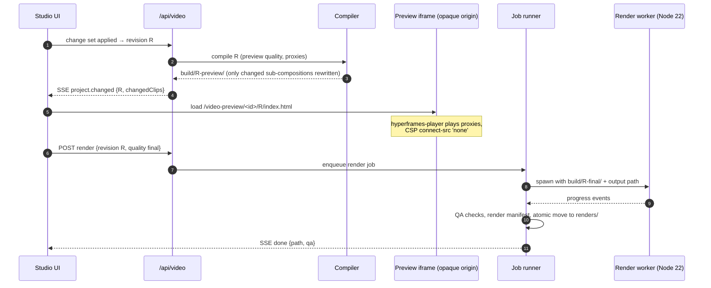

# 07 · CreatorBrio integration plan

[← Research index](README.md) · Architecture: [05](05-proposed-architecture.md) · Baseline: [01](01-creatorbrio-baseline.md)

This plan describes exactly how the recommended architecture fits into the repository as it stands at [`ecf5db7`](https://github.com/mk-global/creatorbrio/tree/ecf5db7f443b2424e26ee811ba283c357161cea2).
Carousels, image generation, brands, templates and export keep working unchanged.
Video is an additional product area that shares their foundations.

## 1. Existing modules

### Reused unchanged

| Module | Used for |
|---|---|
| `src/lib/data.ts` | All JSON reads and writes: project index, project documents, style profiles, job records |
| `src/lib/claude-path.ts` | Locating `claude` for the Edit Director and Edit Agent |
| `src/lib/brand.ts`, `src/types/brand.ts` | Brand identity for every video project (`brandId` fixed at creation) |
| `src/lib/fonts.ts` | Inlined Google Fonts CSS for compositions, so renders use the real typefaces |
| `src/lib/creative-brief.ts`, `src/types/creative-brief.ts` | A video project's brief |
| `src/proxy.ts`, `src/lib/request-guard.ts`, `src/lib/request-origin.ts` | Guarding `/api/video/*` and the preview routes |
| `src/lib/reference-images.ts` | Unchanged; video adds its own confinement for media |
| `src/lib/image-service.ts` | Optional stills for video (background-replaced photos, generated images as B-roll stills) |

### Modified, additively

| Module | Change | Why |
|---|---|---|
| `src/lib/chat-stream.ts` | New stage values (`analysing`, `storyboarding`, `editing`, `checking`) and blocked/error codes for video; older clients ignore unknown values, as the file already documents | One chat contract for carousels and video |
| `src/lib/creative-capabilities.ts` | Split into a shared capability type plus two registries: today's image table and a video registry loaded from manifests | Video capabilities are many and versioned; the carousel table stays exactly as is |
| `src/lib/export-slides.ts` | Extract the single-browser lifecycle into `src/lib/browser-pool.ts`, used by slide export and by the `look` tool's frame captures | Keep "one managed browser per server" for in-process captures; renders run in the separate worker |
| `src/components/layout/TopBar.tsx`, `src/app/page.tsx` | A Carousels / Videos switch on the dashboard, filtered by the selected brand as today | Entry point |
| `package.json` `engines` | `"node": ">=22"` | HyperFrames engine and producer require Node 22 ([E0](evidence/e0-experiments.md#direct-verification-by-the-lead-researcher)); Node 20 reached end of life in April 2026. Its own ticket, before video work |
| `scripts/setup.mjs`, `scripts/doctor.mjs`, `.claude/commands/start.md` | Detect FFmpeg (`ffmpeg-full` path, required filters), the optional media worker and the vision CLI; report what video features are available | Same "works without it, says what is missing" approach as the Claude CLI and image service |
| `CLAUDE.md`, `README.md`, `docs/architecture/*` | Document Video Studio once shipped; record the video-preview sandbox exception | Docs-consistency tests already pin these files |

## 2. New code

### Directory structure

```text
src/
  app/
    video/[id]/page.tsx                    Video Studio page
    api/video/
      projects/route.ts                    GET list (by brand) / POST create
      projects/[id]/route.ts               GET / PATCH (name only) / DELETE
      projects/[id]/changes/route.ts       POST change set → new revision or typed errors
      projects/[id]/history/route.ts       GET revisions; POST undo / redo / restore / label
      projects/[id]/chat/route.ts          POST agent run (SSE), same contract as /api/chat
      projects/[id]/runs/[runId]/route.ts  POST keep | discard
      projects/[id]/render/route.ts        POST draft | final render; GET status (SSE)
      projects/[id]/look/route.ts          POST frames/contact sheet for a revision
      media/route.ts                       POST register by local path (or streamed upload); GET list
      media/[mediaId]/route.ts             GET metadata, analysis status
      media/[mediaId]/analyse/route.ts     POST request analysis kinds
      jobs/route.ts, jobs/[id]/route.ts    GET status, DELETE cancel
      capabilities/route.ts                GET registry with availability
      styles/route.ts, styles/[brandId]/route.ts   video style profiles
    video-preview/[id]/[rev]/[...path]/route.ts    compiled composition (opaque-origin iframe; CSP)
    media-files/[...path]/route.ts                 range-capable serving of proxies, waveforms, mattes
  components/video/
    VideoStudio.tsx  MediaBin.tsx  TranscriptEditor.tsx  Timeline/*.tsx (lanes: video, b-roll,
    graphics, captions, audio, keyframes)  Inspector.tsx  PreviewFrame.tsx  HistoryPanel.tsx
    RunReview.tsx (diff, Keep/Discard)  StoryboardReview.tsx  RenderPanel.tsx  StyleProfileEditor.tsx
  lib/video/
    schema.ts            EDD types + runtime validation
    invariants.ts        document invariants (05 §3)
    ops/                 one file per op family; apply.ts (the mutation funnel)
    history.ts           revisions, change-set log, undo/redo, labels
    timeline-map.ts      word ↔ source ↔ timeline mapping
    compiler/            EDD → HyperFrames project folder; brand.css; captions layout
    capabilities/        registry.ts, availability.ts, lint-authored-graphic.ts
    render/              render-client.ts (spawns worker), cache.ts (content-hash keys), manifest.ts
    media/               store.ts (register, hash, confine), ingest.ts (probe, proxies, WAVs), ffmpeg.ts (typed wrapper)
    analysis/            client for media worker + vision CLI; takes.ts, fillers.ts, reframe.ts, ducking.ts, sfx-cues.ts
    jobs.ts              file-backed job runner (two lanes)
    agent/               director.ts (schema + args), edit-agent.ts (args, run lifecycle), prompts/
    qa/                  checks.ts (loudness, black frames, safe zones, legibility, sync)
    style-profiles.ts
  types/video.ts
capabilities/                              versioned capability packages (manifest.json, template.html, params.schema.json, README with licence/attribution)
  captions.kinetic-pop/  captions.calm-sentence/  graphic.architecture-diagram/  graphic.data-chart/
  graphic.collage-sequence/  graphic.lower-third/  graphic.key-point-card/  fx.text-behind-subject/
  fx.punch-in/  transition.whip/  transition.dissolve/  audio.sfx-for-events/  audio.music-bed/ …
workers/
  render/                                  Node 22 render worker (wraps @hyperframes/producer); its own package.json
  media/                                   Python 3.12 uv project: pyproject.toml, uv.lock, creatorbrio_media/ (server, jobs, models)
  vision/                                  Swift package: creatorbrio-vision CLI
mcp/
  creatorbrio-video/                       stdio MCP server for the Edit Agent (TypeScript, forwards to /api/video)
data/                                      (ignored by Git, as today)
  video-projects.json                      index: id, name, brandId, revision, updatedAt
  video-styles.json                        style profiles by brandId
  video-jobs.json                          job records
  video/<projectId>/project.json           EDD (current revision)
  video/<projectId>/revisions/<n>.json     snapshots
  video/<projectId>/changes.jsonl          change-set log
  video/<projectId>/build/…                compiled compositions (regenerable)
  video/<projectId>/renders/…              outputs + render manifests
  media/originals/<sha256>.<ext>           immutable originals (hard link or copy)
  media/derived/<sha256>/…                 proxies, WAVs, waveforms, thumbnails, mattes
  media/analysis/<sha256>/<kind>@<ver>.json
  media/library/                           user B-roll / music / SFX libraries + manifest with licences
  models/                                  pinned model snapshots
```

All new storage lives under `data/`, which is already ignored by Git, so footage never risks being committed.

### Schemas

The EDD, operation and change-set types are in [05 §3–§4](05-proposed-architecture.md#3-the-edit-decision-document).
The supporting records are:

```ts
interface MediaRecord {            // data/media/registry.json (via data.ts)
  mediaId: string;                 // sha256
  kind: "video" | "audio" | "image";
  originalName: string;
  bytes: number;
  probe: { durationUs: number; width?: number; height?: number; fps?: string; vfr: boolean;
           colour: { primaries?: string; transfer?: string; hdr: boolean; dolbyVision?: boolean };
           audio?: { sampleRate: number; channels: number } };
  derived: { proxy?: string; wav16k?: string; wav48k?: string; waveform?: string; sprite?: string };
  analysis: Partial<Record<AnalysisKind, { status: "missing" | "queued" | "running" | "done" | "failed"; tool: string; path?: string; error?: string }>>;
  licence?: { spdx?: string; attribution?: string; source?: string };  // for library media
  addedAt: string;
}

interface Job {
  id: string; kind: JobKind; lane: "gpu" | "cpu";
  projectId?: string; mediaId?: string; revision?: number;
  status: "queued" | "running" | "done" | "failed" | "cancelled" | "interrupted";
  progress?: number; error?: { code: string; message: string };
  createdAt: string; startedAt?: string; endedAt?: string;
}

interface RenderManifest {
  projectId: string; revision: number; quality: "draft" | "final";
  compilerVersion: string; hyperframes: string; ffmpeg: string; chromium: string;
  models: Record<string, string>; inputs: Record<string, string /* sha256 */>;
  qa: QaReport; output: { path: string; sha256: string; durationMs: number; lufs: number; truePeakDb: number };
}
```

## 3. Claude agent interfaces

| Interface | Detail |
|---|---|
| Edit Director | `src/lib/video/agent/director.ts`. Same flags as the Visual Director (`--tools Read`, path-scoped `Read`, `--json-schema`, `--no-session-persistence`, `--setting-sources ""`, `--strict-mcp-config`, input on stdin). Its own budget and time limit, recorded in docs and pinned by a docs-consistency test as today |
| Edit Agent | `src/lib/video/agent/edit-agent.ts`. `claude -p --output-format stream-json --strict-mcp-config --mcp-config <mcp/creatorbrio-video> --tools Read --allowedTools mcp__creatorbrio_video Read(/<inspection dir>/**)`, `--setting-sources ""`, resumable per project. No `Bash`, no `WebFetch` (research happens in the Director's brief, or the user pastes links, as carousels do today) |
| MCP server | `mcp/creatorbrio-video`: tools in [05 §5](05-proposed-architecture.md#the-mcp-tool-surface); each call is an HTTP request to `/api/video/*` on loopback with a per-run token the server issues and checks, so the MCP server cannot act outside its run |
| Budgets | Per message: Director and Agent caps, as the existing USD 0.25 + 1.00 caps; video runs need their own, measured in V7 |
| Evaluation | `eval/video/`: scenario footage (synthetic and consented), expected properties (fillers removed, takes chosen, captions in safe zones, no cut mid-word), model-judged storyboard quality, as `eval/director` does |

## 4. Capability and plugin boundaries

- A capability is a folder under `capabilities/` with a manifest, a parameter schema, a template and/or an executor, and a README stating licence and attribution.
- **Templates may contain script** only from the vendored, reviewed runtime libraries (CSS/WAAPI, anime.js, Lottie, Mermaid output). They never load from a CDN; Ghost Editor's CDN-loaded GSAP is the anti-pattern.
- **Authored graphics** (from Claude) may not contain script; the linter enforces it before the graphic enters the EDD.
- Executors run in Node, call the worker or vision CLI through the job runner, and write only through the operation engine.
- Adding a capability: a folder, a registry entry, a golden compiler test, and a render determinism test. No core change is needed, which meets the "customisable for future editing ideas" goal. Third-party capability packages are a later option, with the same review rule.

## 5. Preview and export workflows



- **Exports**: Instagram Reel (1080×1920, H.264 High, AAC 48 kHz, loudness target from the style profile; −14 LUFS is a common convention, not a published Instagram specification ([E5 caveats](evidence/e5-building-blocks.md#key-caveats))), LinkedIn video, story, square; SRT sidecar; optional OTIO/FCPXML hand-off.
- **Agent previews**: the `look` tool renders requested frames or a contact sheet of the current revision through `@hyperframes/engine` captures, so the agent sees what the user sees.

## 6. Brand configuration

- Every compiled composition carries `brand.css` with `--brand-primary`, `--brand-secondary`, `--brand-accent`, `--brand-background`, `--brand-surface`, `--brand-heading-font` and `--brand-body-font`, plus inlined `@font-face` from `src/lib/fonts.ts` and the brand logo path.
- Templates use only these variables for colour and type, so one template serves both creators.
- Style profiles ([05 §8](05-proposed-architecture.md#8-brand-specific-editing-styles)) are a sibling store keyed by `brandId`; brands themselves are not changed.

## 7. Local process orchestration and dependency installation

| Dependency | How it is installed | Required? | Detected by |
|---|---|---|---|
| Node 22+ | User (nvm / installer) | Yes | `doctor`, `setup` |
| FFmpeg (`brew install ffmpeg-full`) | User, once; path set in `.env.local` as `FFMPEG_PATH` / `FFPROBE_PATH` (keg-only) | Yes for video | `doctor` checks version and required filters (`zscale`, `libass` / `drawtext`, `loudnorm`, `lut3d`) |
| `@hyperframes/*` (exact pins) | `npm install` in `workers/render` (its own `package.json`, so the main app's dependency tree is untouched) | Yes for video | `setup` |
| chrome-headless-shell for HyperFrames | Downloaded by its Puppeteer at `setup`, as Chromium is today | Yes | `doctor` |
| `@xzdarcy/react-timeline-editor`, `mediabunny` | `npm install` (main app) | Yes | — |
| uv + media worker | `brew install uv`; `uv sync` in `workers/media`; started by `/start` when enabled | Optional (analysis features) | `GET /capabilities` |
| Models | `npm run video:models` (runs the worker's model manager: pinned revisions, licence acknowledgement, offline at runtime) | Optional, per feature | worker `/capabilities` |
| Swift vision CLI | `swift build -c release` in `workers/vision` (Xcode Command Line Tools) | Optional (masks, faces, HDR helper) | `doctor` |
| Earshot | `uv` tool install, invoked as a sidecar | Optional | worker `/capabilities` |

CI (Ubuntu, GitHub-hosted) keeps running `typecheck / lint / test / build`.
Video tests that need FFmpeg use the runner's FFmpeg.
Tests that need MLX, Apple Vision or the real HyperFrames render are opt-in Mac suites, like `eval/`.

## 8. Error handling and recovery

Covered in [05 §12](05-proposed-architecture.md#12-error-handling-and-recovery).
Concretely in this codebase:

- New error and blocked codes go into `chat-stream.ts` and job error codes into `types/video.ts`, each with a user-facing message that says what to do.
- `video-jobs.json` running jobs are marked `interrupted` on server start, as generation runs are today.
- Staged outputs (mattes, renders) are written to `*.partial` and renamed on success, with a hash recorded before any record references them, as `src/lib/assets.ts` orders its writes.

## 9. Test strategy

| Layer | Tests | Runs in |
|---|---|---|
| Schema and invariants | Property-style tests: random op sequences never produce an invalid document; every refused op leaves the file untouched | CI |
| Operations | Per-op unit tests including ripple and word mapping; `stale_revision` refusal | CI |
| Timeline mapping | Word ↔ source ↔ timeline round-trips across cuts and speed changes | CI |
| Compiler | Golden snapshots of compiled HTML for fixture projects; brand variables; no CDN URLs; no script in authored graphics | CI |
| Capabilities | Each manifest's schema validates; each template compiles; a lint test for licence fields | CI |
| Render determinism | Render sampled frames twice in shuffled order and compare hashes (E1 automated); A/V sync fixture with flash and beep per segment, as in Ghost Editor's sync test | CI (Linux headless shell) + Mac opt-in |
| FFmpeg wrapper | Argument builders tested without running FFmpeg (MakeMyClip's approach); a small real-FFmpeg suite on synthetic `testsrc` media | CI |
| Worker contract | Fake worker server implementing the job API; real worker suite on Mac | CI (fake) / Mac |
| Agent | MCP tool contract tests with a scripted fake agent; `eval/video` scenarios with the real CLI, opt-in | CI (fake) / opt-in |
| UI | Component tests for transcript editing and run review; Playwright smoke test of the Studio | CI |
| Docs | Docs-consistency tests extended to pin video agent tools and budgets in CLAUDE.md | CI |

## 10. Performance and resource considerations

These are design expectations and reported figures, **not measurements on the target Mac**.

- **Rendering**: per-frame Chromium capture is the bottleneck. A 60 s reel at 30 fps is 1,800 frames. In this research's Linux container one 1080×1920 PNG capture took about 142 ms ([E0](evidence/e0-experiments.md#e1--deterministic-htmlcss-overlay-frames-composited-by-ffmpeg)). HyperFrames parallelises across workers; on an M5 Max with 128 GB, several capture workers are expected to fit. V1 measures real throughput and sets the default worker count.
- **Proxies** keep the interactive preview light: 720×1280, short GOP, H.264.
- **GPU lane concurrency** of 1–2 avoids contention between MLX models and Chromium.
- **Memory**: models are cached LRU with a budget; 128 GB allows ASR, the VAD, the denoiser and an embedder to stay resident together.
- **Disk**: originals are hard-linked when on the same volume (no copy); proxies and mattes are regenerable; `npm run video:clean` removes derived media for deleted projects.
