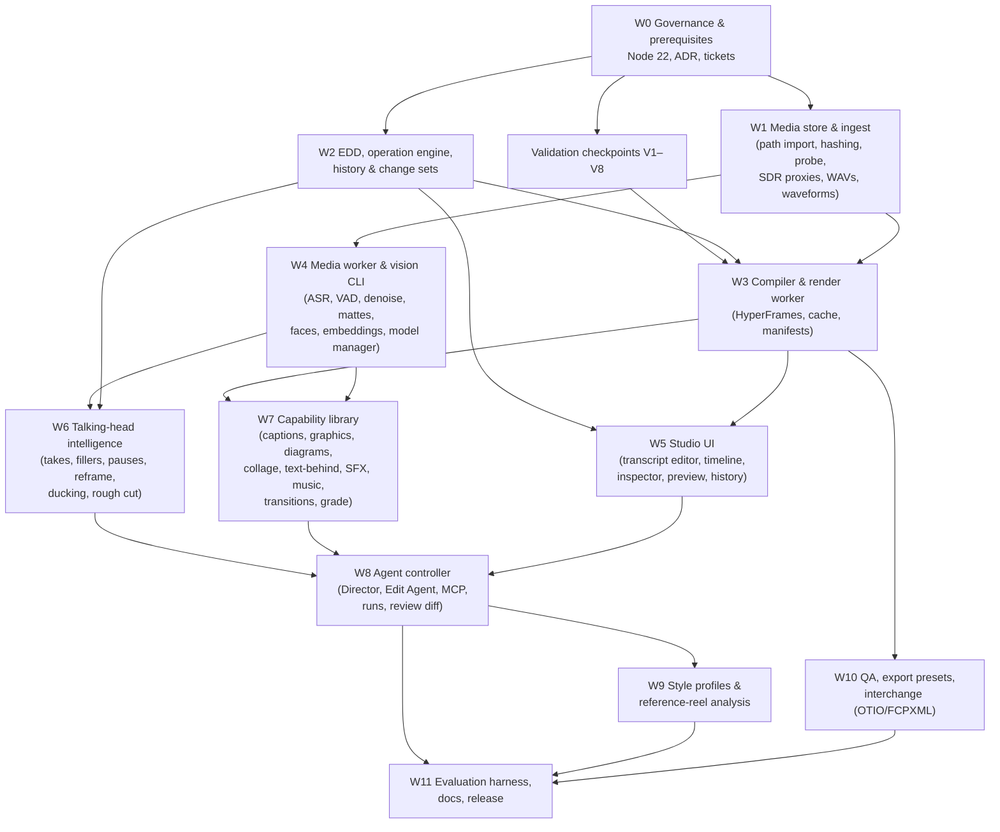

# 08 · Implementation plan

[← Research index](README.md) · Architecture: [05](05-proposed-architecture.md) · Integration: [07](07-integration-plan.md)

> **Superseded in part.** The product specification in [`spec/`](spec/README.md) extends this document for both production workflows. See [spec/09](spec/09-differences-from-pr64.md) for exactly what changed.

The plan builds the complete Video Studio in dependency order.
It does not ship an intentionally incomplete product: workstreams land behind a "Video (preview)" switch until the release in which every capability in [06](06-feature-coverage.md) is present and has passed its acceptance checks.
The validation checkpoints are architectural gates, run first, that can change *how* later work is done.

Each workstream becomes one or more GitHub issues under the repository's No Ticket, No Work rule, validated with the canonical ticket validator before work starts.
Sizes are **engineering estimates** (S ≈ under a week, M ≈ 1–3 weeks, L ≈ 3–6 weeks, for one engineer working with Claude Code), not commitments.

## Validation checkpoints

These run before or alongside the first workstreams, on the founder's Apple Silicon Mac with real footage from both creators.
Each has a pass criterion and a pre-agreed fallback, so a failure redirects work instead of stopping it.

| ID | Question | How | Pass criterion | If it fails |
|---|---|---|---|---|
| **V1** | Is HyperFrames on macOS (screenshot capture mode) deterministic and fast enough? | Compile a 60 s 1080×1920 fixture by hand: talking-head footage, kinetic captions, a diagram, a cut-out layer and music. Render with `@hyperframes/producer` (pinned), twice; compare frame hashes; measure wall time at 1, 4 and 8 workers; check A/V sync with a flash-and-beep fixture | Identical frame hashes across runs; A/V offset within one frame; final render time acceptable to the founder (target to be agreed, e.g. under 5 minutes for 60 s) | Switch the compiler target to OpenFilm's `frame(t)` renderer or Architecture B's own Puppeteer renderer ([04](04-architecture-alternatives.md#final-recommendation)); EDD, ops, agent and UI unchanged |
| **V2** | Does `<hyperframes-player>` work in an iframe with `sandbox="allow-scripts"`, no `allow-same-origin`, and CSP `connect-src 'none'`? | Spike page in CreatorBrio's dev server | Plays, seeks and scrubs the V1 fixture on proxies; API writes from the frame are refused (`Origin: null`) | Server-rendered preview frames streamed to a script-free scrubber; playback via a proxy `<video>` + overlay frames |
| **V3** | Does iPhone HLG / Dolby Vision footage tone-map to SDR acceptably? | 10 real clips from both creators; FFmpeg `zscale` + `tonemap` vs `libplacebo` vs an AVFoundation path in the vision CLI; compare side by side with Photos / QuickTime | Founder judges skin tones and highlights acceptable on at least one path | Ask creators to record in SDR (camera setting), and keep validating |
| **V4** | Can fillers be found without a non-commercial model? | 10 minutes of each creator's raw speech, hand-labelled fillers; Parakeet raw output; VAD-gap + YAMNet/CLAP classifier; Whisper filler-prompt re-decode | Recall and precision on labelled fillers that the founder accepts (target to be agreed; the user reviews candidates either way) | Ship filler candidates as review-only suggestions; consider an opt-in non-commercial model only for personal use, clearly labelled |
| **V5** | Are Apple Vision person mattes good enough for text behind the speaker and background replacement? | Matte both creators' setups (hair, hands, motion) with Vision `accurate` + temporal smoothing vs BiRefNet-portrait (MPS) | Founder accepts edges in a rendered sample at 1080×1920 | Use BiRefNet (MIT) with Ghost Editor's temporal smoothing as primary; Vision for faces only |
| **V6** | Which timeline interaction layer? | Two-day timebox: `@xzdarcy/react-timeline-editor` vs `@elah/timeline` vs HyperFrames Studio timeline components against our lanes (words, captions, keyframes, waveforms) | Handles 60 s × 6 lanes with a few hundred caption words at 60 fps scroll; React 19 / Next 16 compatible; licence MIT/Apache | Custom canvas timeline (estimated 2–4k lines) |
| **V7** | What do agent runs cost and take? | Run the Director and Edit Agent on 5 scenarios with the real CLI | Budgets set from measurements, as the existing Director's were | Narrow the MCP tool outputs; summarise analysis more aggressively |
| **V8** | Exact HyperFrames contract for audio envelopes, sub-compositions and range rendering at the pinned version | Read and test against the pinned version | Each compiler feature has a passing fixture | Patch upstream or adapt the compiler |

## Workstreams and dependency order

| WS | Scope | Depends on | Size (estimate) | Done when |
|---|---|---|---|---|
| **W0** | Raise `engines` to Node 22 (own ticket); write the Video Studio ADR from this research; open tickets for W1–W11 and V1–V8; record the sandbox exception decision for video previews | — | S | Founder approves the architecture; tickets admitted |
| **W1** | `lib/video/media/*`: register by local path (hard link or copy into `data/media/originals/`), streaming SHA-256, ffprobe JSON, HDR detection, SDR proxy and WAV derivation per V3's chosen path, waveform peaks and sprite, range-capable media route, registry | W0 | M | 4K HEVC HDR iPhone clip ingests to a seekable proxy; corrupt or unsupported input gives a typed error |
| **W2** | `lib/video/{schema,invariants,ops,history,timeline-map}.ts`: EDD, all ops in [05 §4](05-proposed-architecture.md#4-editing-operations), change sets with `baseRevision`, revisions, undo/redo, labels, project API routes | W0 | L | Property tests pass; every op covered; refusal leaves files untouched |
| **W3** | `lib/video/compiler/*`, `workers/render`, `lib/video/render/*`: compile EDD → HyperFrames project (preview and final), brand CSS, captions layout, render worker process, content-hash cache, render manifests, preview route with CSP | V1, V2, V8, W1, W2 | L | Golden compiler tests; determinism test; V1 fixture renders through the full path from an EDD |
| **W4** | `workers/media` (uv project: job API, capabilities, model manager, parakeet-mlx, Silero, DeepFilterNet3, CLAP, SigLIP 2, PySceneDetect, loudness), `workers/vision` (Swift: person and instance masks with temporal smoothing, face tracks, saliency, optional AVFoundation HDR path), Node clients | W1, V3, V5 | L | Each job kind returns schema-valid output on fixtures; Studio works with the worker absent |
| **W5** | `components/video/*`: media bin, transcript editor (delete and restore words, corrections, take groups), timeline with lanes (V6 choice), inspector (params from capability schemas), preview frame, history, keyboard shortcuts | W2, W3, V6 | L | A user can make a complete reel by hand without the agent |
| **W6** | `lib/video/analysis/*`: take grouping, filler candidates (V4 approach), pause tightening, reframe algorithm, ducking envelopes, deterministic rough cut | W2, W4 | M | Rough cut on both creators' sample footage reviewed by the founder |
| **W7** | `capabilities/*`: kinetic and calm caption presets, lower thirds, key-point cards, title and end cards, architecture diagram (Mermaid), data chart, collage sequence (adapted from gbro-collage-info), text behind subject, punch-in and speed ramp, transitions, grade LUTs, SFX-for-events (Earshot + CC0 + CLAP), music bed + ducking, background replacement; authored-graphic linter | W3, W4 | L | Each capability: manifest, schema, golden test, determinism test, licence README, rendered sample approved |
| **W8** | `lib/video/agent/*`, `mcp/creatorbrio-video`: Edit Director (storyboard schema), Edit Agent, run lifecycle (one run per project, read-only timeline during runs, Keep/Discard, diff), markers for questions, chat route and SSE stages, budgets from V7 | W5, W6, W7 | L | The four example requests in the brief work end to end; refused change sets never corrupt a project |
| **W9** | Style profiles UI and store; two starter profiles (founder, wellness educator) tuned with real footage; reference-reel analysis | W8 | M | Each creator approves their profile's output on three reels |
| **W10** | QA checks, export presets, SRT sidecar, OTIO JSON and FCPXML export, render manifests surfaced in UI | W3 | M | Every final render ships with a passing QA report or an explicit, user-accepted waiver |
| **W11** | `eval/video` scenarios and thresholds, docs (README, CLAUDE.md, architecture pages), docs-consistency tests, release notes | W8, W9, W10 | M | Release checklist; full gate green |

W1 and W2 can proceed in parallel with the checkpoints.
W3 starts once V1, V2 and V8 have answered.

## First tickets after approval

1. **Raise the Node.js requirement to 22** (W0): `engines`, `doctor`, `setup`, README requirements, CI node version.
2. **Video Studio ADR**: commit the decision in `docs/architecture/` once the founder approves this research.
3. **V1 render spike**: a throwaway branch, not merged, that renders the V1 fixture with pinned `@hyperframes/producer` on the founder's Mac and records determinism, sync and timings in the ticket.
4. **V2, V3, V5 spikes** in parallel on the same Mac.
5. **W2 EDD and operation engine**: pure TypeScript with no external dependencies, so it is safe to start immediately.

## Definition of complete

Video Studio is released when:

- every row of [06](06-feature-coverage.md) is implemented or explicitly deferred by the founder;
- both creators have produced reels they would publish;
- the QA stage passes on those reels;
- the full repository gate is green;
- the documentation describes only what shipped.
