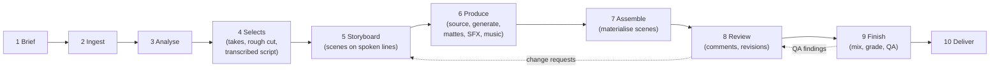

# 02 · Workflow A: raw footage to a professionally edited video

[← Specification index](README.md) · Shared stages: [04 Storyboard and review](04-storyboard-and-review.md) · State machine: [07 §8](07-data-models-and-interfaces.md#8-workflow-state-machine)

**Input:** one or more raw recordings, usually a talking head on a phone or camera, often with several takes, plus optional B-roll, photos, logos and reference reels.
**Output:** a finished, brand-styled short video and its editable production, captions, credits and render manifest.

Requirement IDs refer to [01](01-product-requirements.md#6-requirements-register).
Acceptance tests are in [10](10-acceptance-tests.md).
**Judgment** is **D** for deterministic code, **AI** for model judgment, **U** for a user decision.

## 1. Stages at a glance

## 2. Stage specifications

### Stage 1 · Brief

| | |
|---|---|
| Inputs | Chat request or form; brand; optional reference reels; optional links |
| Work | Capture the brief (PLN-01); infer missing fields as *inferred* (PLN-02); if reference reels are given, propose a style adjustment (STY-04) |
| Judgment | U (explicit fields), AI (inferred fields) |
| Output | `brief` with usage intent |
| Exit | Objective, audience, platform and usage intent present (explicit or accepted inferred) |

### Stage 2 · Ingest

| | |
|---|---|
| Inputs | Local file paths (preferred) or streamed uploads; multi-file sessions |
| Work | Hash and register originals read-only (MED-01); group files of one recording session into a source set (MED-03); probe; create SDR proxies, analysis WAVs, waveforms, thumbnails; tone-map HDR per the validated path (MED-02) |
| Judgment | D |
| Output | Assets with technical metadata; proxies |
| Failure | Unsupported codec or corrupt file: typed error naming the file; no partial asset |
| Exit | All files registered and proxied |

### Stage 3 · Analyse

| | |
|---|---|
| Work | Transcribe with word timings, choosing Parakeet or whisper.cpp by language (SPC-01). Speech activity; filler and false-start candidates (SPC-05). Take groups with a recommended take and reason (SPC-04). Delivery metrics per take (SPC-07). Faces, shots, saliency (SPC-08). Loudness. Embeddings for search (MED-05) |
| Judgment | D (models are deterministic tools here); AI only for take recommendation reasons |
| Output | Transcript, take groups, candidates, face tracks, shots — cached by source hash and tool version |
| Exit | Transcript present for every spoken source; analysis status shown per asset |

### Stage 4 · Selects

| | |
|---|---|
| Work | Build the **transcribed script** (PLN-09): one line per utterance, linked to its words and take group. Propose a deterministic rough cut: the recommended take per group, filler and long-pause candidates removed per the style's thresholds. Show it in the transcript editor, where the user can restore words, swap takes and correct text (SPC-03, SPC-06) |
| Judgment | D for the proposal; AI for take recommendations; U to accept |
| Output | `script` (origin `transcribed`), selects (which words survive), spine |
| Exit | User accepts the selects (or autopilot accepts the proposal) |

### Stage 5 · Storyboard

| | |
|---|---|
| Work | The `story-director` proposes hook options from what was actually said (PLN-07), a structure (PLN-08) and scenes anchored to spoken lines (STB-01). Each scene gets a visual plan: A-roll framing, overlay graphics, B-roll needs, diagram or animation inserts, text, captions, music and SFX intents, with asset slots. Story restructuring (reordering segments) is proposed here, never applied silently, with a meaning check comparing before and after |
| Frames | Rendered from the real composition: the A-roll frame at the scene's words plus placeholders or candidate assets (STB-02); animatic with the selected takes (STB-03) |
| Judgment | AI proposes; U approves per scene (STB-04) |
| Exit | Scenes approved, or approved scenes released to production individually |

### Stage 6 · Produce

For each approved scene, in parallel where possible:

| Need | How | Requirement |
|---|---|---|
| B-roll, photos, music, SFX | Search local libraries first, then the enabled connectors; rank and explain; the rights policy filters by usage intent | SRC-01 … SRC-06, RGT-02 |
| Diagrams, charts, titles, lower thirds, key-point cards | Native templates with brand tokens | GFX-02, GFX-03 |
| Animated insert scenes | Scene Specs (characters, diagrams, illustrations) — the Workflow B machinery reused inside a footage edit | STB-09, GFX-04, GFX-05 |
| Text behind the speaker, background replacement or blur | Person matte (vision CLI) → behind-subject layer | SPC-09, VFX-03 |
| Reframing to the output aspect | Face tracking → smoothed framing keyframes | VFX-01 |
| One-off visuals | Authored script-free graphics, or a specialist tool directly (for example Manim) | GFX-07, AIM-06 |

A slot that cannot be filled moves the scene to `blocked` with the reason; nothing is substituted silently.

### Stage 7 · Assemble

| | |
|---|---|
| Work | Materialise approved scenes in story order (STB-06). The A-roll follows the selects; overlays, B-roll and graphics are placed on their tracks; captions are laid out from the spine with the brand preset (GFX-01); punch-ins and camera moves go on emphasis words (VFX-02); SFX cues are extracted and placed (AUD-02); the music bed and ducking keyframes are added (AUD-01, AUD-03) |
| Output | Rough cut on the timeline; scene bands; draft render |
| Exit | Every approved scene realised |

### Stage 8 · Review

| | |
|---|---|
| Work | The user watches the preview or draft render, comments on times, scenes or clips (STB-07), edits by hand (EDT-02 … EDT-05) and asks for targeted revisions (REV-01). Each agent run is shown as a diff with keep or discard (STB-08) |
| Exit | Picture lock approved |

### Stage 9 · Finish

| | |
|---|---|
| Work | Voice processing (VOC-07), mix and master (AUD-04), grade preset (VFX-04). Technical QA (QAS-01), creative QA (QAS-02), claim QA for anything stated on screen (QAS-03), rights QA (QAS-04). Each finding is fixed or waived with a reason (QAS-05) |
| Exit | No unwaived blocking findings; rights cleared for the usage intent |

### Stage 10 · Deliver

| | |
|---|---|
| Work | Render finals from originals for each deliverable (EXP-01). Write captions sidecars, credits (RGT-03), cover (reusing the carousel system), render manifest (EXP-04). Optionally export the editable bundle (EXP-02) and OTIO/FCPXML (EXP-03) |
| Exit | Deliverables written atomically; version recorded |

## 3. What the two creators' Workflow A looks like

| | Founder (technology, AI, leadership) | Wellness educator |
|---|---|---|
| Footage | Phone, often several takes per point, sometimes screen recordings | Phone or camera, calm single takes, sometimes outdoors |
| Selects | Tight pauses, aggressive filler removal | Natural pauses kept; only obvious stumbles removed |
| Storyboard inserts | Architecture diagrams, data charts, code callouts, collage B-roll | Key-point cards, gentle illustrations, nature B-roll |
| Captions | Kinetic, accent highlights | Calm, two-line, high legibility |
| Effects | Punch-ins, text behind speaker on key claims | Slow push-ins, background blur at most |
| Sound | Whooshes and UI ticks on graphics, driving music | Minimal SFX, soft ambience, careful ducking |
| QA emphasis | Pacing, hook strength | Claims supported, no sensational wording, legibility |

## 4. Failure handling

| Situation | Behaviour |
|---|---|
| ASR model not installed | Analysis stage shows what to install; manual editing still works on waveforms |
| No takes detected but repeats exist | User marks a repeat in the transcript; the take group is created from that selection |
| Mattes unavailable or poor | Scenes needing them are `blocked` with a reason; the user can choose a different visual plan |
| Connector unreachable | The slot offers local library and generation routes; a connector failure never blocks other scenes |
| Agent run fails mid-way | The run's applied change sets stay; the diff is shown with keep or discard |
