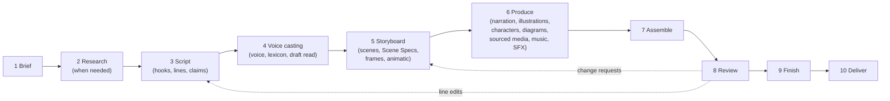

# 03 · Workflow B: script or topic to a complete animated video

[← Specification index](README.md) · Shared stages: [04 Storyboard and review](04-storyboard-and-review.md) · State machine: [07 §8](07-data-models-and-interfaces.md#8-workflow-state-machine)

**Input:** a complete script, or a topic with a brief, plus optional source links, documents, brand assets and reference videos.
**Output:** a finished animated video with locally generated narration, and the same editable production, captions, credits and manifest as Workflow A.

Requirement IDs refer to [01](01-product-requirements.md#6-requirements-register).
**Judgment** is **D** for deterministic code, **AI** for model judgment, **U** for a user decision.

## 1. Stages at a glance

Stages 7–10 are identical to Workflow A ([02 §2](02-workflow-a-footage.md#2-stage-specifications)); only the spine differs.

## 2. Stage specifications

### Stage 1 · Brief

As Workflow A, plus the audience's knowledge level and whether research is wanted (PLN-01, PLN-02).

### Stage 2 · Research (when needed)

| | |
|---|---|
| When | The user gives a topic rather than a finished script, or asks for research, or the brief includes facts to check |
| Work | The `researcher` role lists questions, retrieves sources through the existing bounded retrieval module and user-supplied documents, and records claims linked to sources with reliability (PLN-03). Sensitive claims (health, finance, legal) are flagged (PLN-04) |
| Judgment | AI gathers; U reviews the dossier |
| Output | `research` dossier |
| Exit | Dossier reviewed, or skipped by the user |

### Stage 3 · Script

| | |
|---|---|
| Work | Paste a finished script (PLN-05: accepted unchanged), or generate a draft in the brand voice within the duration estimate (PLN-06). At least three hook options (PLN-07); structure choice (PLN-08); each factual line linked to claims; character lines for multi-voice pieces |
| Judgment | AI drafts; U edits and approves |
| Output | `script` (origin `written` or `generated`) with estimated duration per line |
| Exit | Script approved |

### Stage 4 · Voice casting

| | |
|---|---|
| Work | Choose the narrator voice (brand default, STY-03) and character voices (VOC-05). Load the brand pronunciation lexicon (VOC-02). Render a quick draft read of the whole script so pacing can be judged and the storyboard timed (VOC-01, VOC-03) |
| Judgment | U (voice choice); D (synthesis) |
| Output | `voice` settings; draft narration takes with word timings |
| Exit | Voice chosen |

The draft read gives Workflow B a spine before the storyboard, exactly as the selected takes do in Workflow A.

### Stage 5 · Storyboard

| | |
|---|---|
| Work | The `story-director` splits the script into scenes (STB-01) and gives each a visual plan. Options are a character scene, a diagram, a chart, an illustrated scene, a collage, sourced footage, a title card, or a mix. The `scene-author` writes a Scene Spec for each animated scene (STB-09): which characters, which poses on which words, which diagram nodes reveal when, camera moves, and cues for sound. Slots list what must be sourced or generated |
| Frames | Rendered from compiled Scene Specs at key moments, with placeholders for illustrations not yet generated (STB-02); animatic with the draft read (STB-03) |
| Judgment | AI proposes; U approves, edits or rejects each scene (STB-04) |
| Exit | Scenes approved (or released individually) |

### Stage 6 · Produce

| Need | How | Requirement |
|---|---|---|
| Final narration | Synthesise per line with direction (rate, pauses, emphasis, energy, pronunciations); keep takes; regenerate single lines; word timings by engine or forced alignment | VOC-01 … VOC-04 |
| Stick figures and characters | Character library rigs driven by the Scene Spec's pose tracks; shape-based lip sync from narration timings | GFX-04 |
| Diagrams and charts | Layout engine + native reveal templates, synced to words | GFX-03 |
| Illustrations | Generated through the image-service contract in the brand illustration style, or sourced from Commons, Openverse or Internet Archive; animated with parallax and camera moves | GFX-05, SRC-01 … SRC-04 |
| Collage sequences | Cut-outs, textures and archival imagery with the collage grammar | GFX-06 |
| Lottie and vector assets | Imported as clips | GFX-08 |
| Specialist pieces | A specialist tool used directly, returning a baked layer, for example a Manim derivation | AIM-06 |
| Music, ambience, SFX | Library and connector search by mood; optional local generation; SFX on Scene Spec cues and graphic entrances | AUD-01, AUD-02, AUD-05 |

Each produced asset carries provenance and rights; the rights policy runs as assets are placed (RGT-02, RGT-05).

### Stages 7–10 · Assemble, Review, Finish, Deliver

Identical to Workflow A.
Captions come from the script text with narration word timings, so they are exact; no ASR is needed.
Claim QA checks narration and on-screen text against the dossier (QAS-03).
A change to one script line regenerates only that line's narration, shifts the downstream timing deterministically, and re-materialises only the affected scenes (VOC-04, STB-05).

## 3. How timing works when there is no footage

1. Each scene's duration is its narration length plus head and tail pads from the style profile (for example 150 ms in, 300 ms out).
2. Scene Spec tracks are expressed in milliseconds *or* in word references (`{ wordId }`). Word references are resolved against the narration timings at compile time, so re-recording a line moves the animation with it.
3. Silent scenes (title cards, transitions, musical beats) have explicit durations.
4. Music cues and ducking derive from the narration spine exactly as from a footage spine.

## 4. What the two creators' Workflow B looks like

| | Founder | Wellness educator |
|---|---|---|
| Typical piece | "How an AI agent actually works" in 60 seconds | "Three breathing techniques for stress" |
| Research | Technical sources, product docs | Peer-reviewed or institutional health sources only; every technique linked to a claim |
| Visuals | Stick figures at a laptop, animated architecture diagram, data chart, code callouts | Soft illustrated scenes, a calm character demonstrating breathing, key-point cards |
| Voice | Energetic narrator, fast-ish rate, technical lexicon (e.g. "LLM", "MCP") | Calm, slower rate, longer pauses, gentle emphasis |
| Sound | Clicks and whooshes on reveals, driving music | Ambient bed, soft chimes on key points |
| QA emphasis | Clarity of the diagram, pacing | Claims supported and non-sensational, no medical promises, legibility |

## 5. Failure handling

| Situation | Behaviour |
|---|---|
| TTS engine not installed | Voice casting shows what to install. The user can record narration themselves (the production becomes hybrid, with a recorded spine) or continue with silent captions |
| Illustration generation unavailable or declined | Slot routes fall back to sourcing or a vector placeholder only if the user chooses; never silently |
| Character rig lacks a requested pose | The Scene Spec is rejected at validation with the missing pose named; the agent chooses an existing pose or the user adds one |
| A claim lacks a source | Sensitive: blocks delivery until confirmed or removed. Otherwise flagged in QA |

## 6. Hybrid productions

A production can mix both workflows: a talking-head intro and outro from footage with an animated explainer in the middle, or narration over B-roll with a short on-camera segment.
The spine is then a sequence of segments, each either footage speech or narration.
Each scene anchors to its own segment, and everything downstream is unchanged.
This is why the script, storyboard and timeline types are shared rather than duplicated per workflow.
