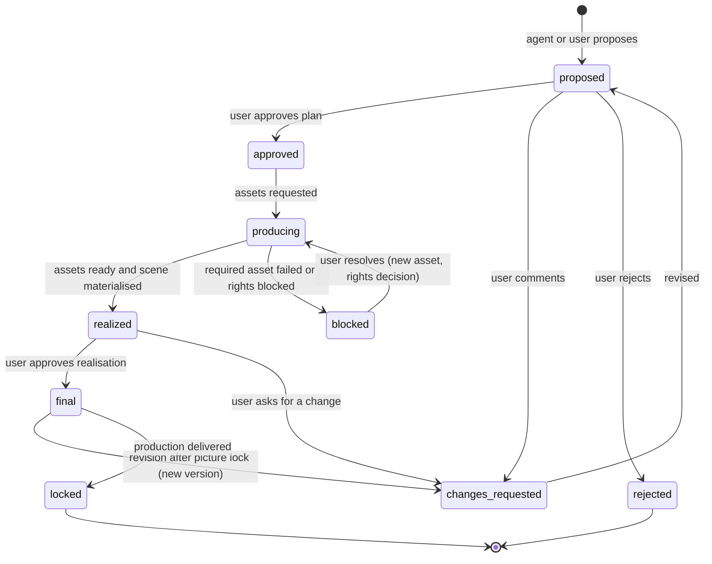

# 04 · Visual storyboard and editorial review

[← Specification index](README.md) · Data models: [07](07-data-models-and-interfaces.md) · Workflows: [02](02-workflow-a-footage.md), [03](03-workflow-b-script-animation.md)

The storyboard is the centre of both workflows.
It is where the creator sees, scene by scene, what the video will be before anything expensive is produced, approves or redirects each scene individually, and later asks for targeted changes.
The timeline is the *realisation* of the approved storyboard; the storyboard is the *editorial plan*.
Both live in the same production document and change only through typed operations.

## 1. Principles

1. **Scenes are the unit of approval and revision.** A creator approves scene 3 without approving scene 4, and "make scene 3 calmer" changes only scene 3.
2. **Every storyboard frame is real.** Frames are rendered by the same compiler and renderer as the final video, from the scene's actual layers, at chosen moments. A frame is never a separate mock-up that the final video might not match. Before assets exist, a frame shows labelled placeholders, never invented imagery.
3. **The plan stays linked to the result.** Every timeline clip that realises a scene carries that scene's id, so the storyboard can always show what the timeline did with the scene and whether someone edited it since.
4. **Both workflows produce the same storyboard type.** Workflow A scenes anchor to words already spoken on camera; Workflow B scenes anchor to script lines that will be narrated. Everything downstream is shared.

## 2. Scene schema

```ts
interface Storyboard {
  id: string;
  scenes: Scene[];                  // in story order
  structure: StoryStructure;        // arc chosen for this production
  status: "draft" | "in-review" | "approved" | "locked";
  animatic?: { renderId: string; revision: number };  // timed preview of frames + voice
}

interface StoryStructure {
  pattern: "hook-problem-solution-cta" | "list" | "story" | "explainer" | "myth-vs-fact" | "before-after" | "custom";
  hookSceneId: string;
  targetDurationMs: number;
  rationale: string;                // advisory: why this structure fits the brief
}

interface Scene {
  id: string;
  title: string;
  purpose: "hook" | "context" | "point" | "example" | "evidence" | "transition" | "summary" | "cta";
  scriptLineIds: string[];          // the words this scene carries (spine anchor)
  durationTargetMs: { min: number; max: number };
  visual: VisualPlan;
  audio: AudioPlan;
  captions: { presetId?: string; emphasisWordIds: string[]; hidden?: boolean };
  transitionIn?: TransitionRef;
  slots: AssetSlot[];               // media the scene needs, with candidates
  status: SceneStatus;
  approvals: Approval[];
  comments: string[];               // comment ids in review state
  realization?: Realization;
  frames: StoryboardFrame[];        // rendered stills, see §4
  provenance: { by: "user" | "agent"; changeSetId: string; reason?: string };
}

interface VisualPlan {
  mode: "a-roll" | "a-roll-overlay" | "b-roll" | "animated-scene" | "diagram" | "illustration"
      | "collage" | "stock" | "screen-recording" | "title-card" | "mixed";
  description: string;              // what the viewer sees, in words (advisory)
  layers: LayerPlan[];              // binding: what will be built
  camera?: { move: "static" | "push-in" | "pull-out" | "pan" | "punch-in"; onWordIds?: string[] };
  framing?: "full" | "subject-left" | "subject-right" | "subject-small";   // A-roll placement
}

type LayerPlan =
  | { kind: "a-roll"; take: "selected" }
  | { kind: "media"; slotId: string; fit: "cover" | "contain"; kenBurns?: boolean }
  | { kind: "capability"; capabilityId: string; params: unknown; layer: "front" | "behind-subject" }
  | { kind: "scene-spec"; specId: string }          // animated scene, §5
  | { kind: "text"; role: "title" | "key-point" | "lower-third" | "citation"; text: string; claimIds?: string[] };

interface AudioPlan {
  musicCue?: { mood: string; intensity: "low" | "medium" | "high"; trackSlotId?: string };
  sfx: Array<{ at: "scene-start" | { wordId: string } | { layerEvent: string }; intent: string; slotId?: string }>;
  ambience?: { intent: string; slotId?: string };
  voiceDirection?: NarrationDirection;              // B only; overrides the production default for this scene
}

interface AssetSlot {
  id: string;
  need: string;                     // "photo of a sunrise over hills, warm, no people"
  kind: "video" | "image" | "audio" | "music" | "sfx" | "illustration" | "character";
  sourcing: Array<"user-library" | "connector" | "generate" | "capture">;  // allowed routes, in preference order
  candidates: Array<{ assetId: string; score: number; reason: string; rightsStatus: RightsRecord["status"] }>;
  selectedAssetId: string | null;
}

interface Realization {
  clipIds: string[];                // timeline clips owned by this scene
  materializedAtRevision: number;
  fingerprint: string;              // hash of the owned clips at materialisation
  diverged: boolean;                // true when someone edited owned clips afterwards
}

interface Approval { by: "user"; at: string; revision: number; scope: "plan" | "realization" }
```

`proposeScenes` creates scenes with `status: "proposed"`.
Every later change to a scene goes through `editScene` and is recorded with provenance, so a creator can see who changed what and why ([07 §6](07-data-models-and-interfaces.md#6-operations-and-change-sets)).

## 3. Scene lifecycle



| State | Meaning | Who moves it on |
|---|---|---|
| `proposed` | Plan exists; frames show placeholders or candidate assets | User approves, comments or rejects |
| `approved` | The plan is accepted; nothing is produced yet | System starts production (immediately, or when all scenes are approved, per user setting) |
| `producing` | Narration, generation, sourcing or analysis jobs are running for this scene | Job runner |
| `blocked` | A required asset failed or was blocked by the rights policy; the reason is shown | User |
| `realized` | Clips exist on the timeline for this scene | User reviews in context |
| `final` | Realisation approved | Locked at delivery |
| `changes_requested` | A comment of kind `change-request` is open on the scene | Agent or user revises |

Approval granularity is configurable per production: approve every scene (default for client work), approve the storyboard as a whole, or autopilot (approval only at picture lock).
Whatever the setting, a scene that a user has explicitly commented on is never changed without its own approval.

## 4. Storyboard frames and the animatic

- **Frames** are rendered stills at the scene's key moments: its first frame, each layer entrance and its last frame. They come from the same HyperFrames composition the final render uses, at preview resolution. They render in seconds because only the requested frames are captured ([merged research 05 §5, `look`](../05-proposed-architecture.md#the-mcp-tool-surface)).
- **Placeholders** stand in for missing assets: a neutral box labelled with the slot's `need`. Placeholders are never filled with invented imagery.
- **Animatic**: a low-resolution timed render of the whole storyboard, with frames held for each scene's duration and the voice spine underneath. Workflow A uses the selected takes; Workflow B uses narration takes, or a quick draft voice if narration is not approved yet. It lets the creator judge pacing before full production.

## 5. Scene Specs: the format for animated scenes

Workflow B needs animated stick figures, cartoon characters, diagrams and illustrated scenes that a model can author and a person can then adjust.
Models therefore author **data, not code**: a Scene Spec is a declarative JSON document that a native capability compiles into an HTML/SVG composition, rendered by the single renderer.

```ts
interface SceneSpec {
  id: string;
  durationMs: number;
  canvas: { background: Fill; safeArea: "platform-default" | Rect };
  styleRef: string;                     // brand illustration style (palette, line weight, texture)
  elements: SceneElement[];
  camera?: Keyframes<{ x: number; y: number; zoom: number }>;
  cues: Array<{ id: string; atMs: number | { wordId: string }; label: string }>;  // for SFX and caption sync
}

type SceneElement =
  | { kind: "character"; id: string; characterId: string;           // from the character library
      track: Array<{ atMs: number; pose: PoseName | PoseVector; expression?: ExpressionName;
                     position?: { x: number; y: number }; facing?: "left" | "right"; ease?: Ease }>;
      lipSync?: { scriptLineIds: string[] } }                         // mouth shapes from spine word timings
  | { kind: "prop"; id: string; asset: string /* svg asset id */; track: TransformTrack }
  | { kind: "illustration"; id: string; slotId: string; track: TransformTrack; parallax?: number }
  | { kind: "diagram"; id: string; source: { lang: "mermaid" | "d2" | "graph-json"; text: string };
      reveal: Array<{ nodeOrEdge: string; atMs: number | { wordId: string } }> }
  | { kind: "chart"; id: string; data: ChartData; chartType: "bar" | "line" | "donut" | "number"; reveal: RevealSpec }
  | { kind: "text"; id: string; text: string; style: "title" | "label" | "callout" | "quote"; track: TransformTrack }
  | { kind: "path-draw"; id: string; svgPath: string; drawFromMs: number; drawToMs: number };
```

- **Characters** come from the character library ([07 §4.3](07-data-models-and-interfaces.md#43-libraries)). A character is a rig: named parts, joints and limits, plus a palette and named poses and expressions. A stick figure is the simplest rig. Poses are joint angles, which a model can choose by name ("wave", "point-right", "think", "walk-cycle") or as vectors. The compiler interpolates joint angles between keyframes and renders SVG, seeked by the renderer's CSS/WAAPI adapter.
- **Lip sync** for talking characters uses mouth shapes derived from the spine's word and phoneme timings. It is shape-based, not photorealistic, and never applies to real people.
- **Diagrams** are laid out by an existing layout engine (Mermaid, or D2 / ELK if validated) and revealed node by node in sync with words.
- **Illustrations** are image assets in a slot, generated or sourced, animated with transforms (parallax, Ken Burns) rather than generated motion.
- The compiled output of a Scene Spec is ordinary HTML/SVG/CSS, so the final video and the storyboard frames come from one renderer, and a person can edit any element's timing or text in the inspector.

The concrete rigging and pose-interpolation approach is chosen at validation gate [G6](11-implementation-program.md#validation-gates), using the evidence in [E7](../evidence/e7-openmontage-animation.md).

## 6. From storyboard to timeline: materialisation

`materializeScene` is a deterministic function that turns one approved scene into clips:

| Scene content | Clips produced |
|---|---|
| A-roll on selected take | Video and voice clips for the take's word range, on the A-roll tracks |
| Narration | Voice clip from the selected narration take |
| `media` layer | Video or image clip on the B-roll or overlay track with fit and Ken Burns keyframes |
| `capability` layer | Graphics clip with the capability call, on the front or behind-subject layer |
| `scene-spec` layer | Graphics clip referencing the compiled Scene Spec |
| `text` layer | Graphics clip using the brand's text template for that role |
| Audio plan | Music clip and ducking keyframes; SFX clips at cue frames |
| Captions | Caption emphasis on the listed words; caption style preset |

Rules:

1. Scenes are placed in story order on the spine. In Workflow A a scene's position is where its words fall after cuts. In Workflow B it is the end of the previous scene plus the scene's own narration length and pads.
2. Every produced clip records `sceneId` and `provenance.by: "system"` with the materialisation's change-set id.
3. Re-materialising a scene in `replace-owned` mode removes only clips that the scene owns *and* that nobody has edited since materialisation. Edited clips stay and the scene is flagged `diverged`; the user chooses to keep the edits or replace them.
4. Materialisation is one change set, so it can be undone in one step.
5. Manual timeline work is never blocked by the storyboard. A clip a user adds by hand belongs to no scene, or to the scene the user assigns it to.

## 7. Editorial review

### Review surfaces

| Surface | Shows | Actions |
|---|---|---|
| Storyboard board | One card per scene: frames, script lines, purpose, visual mode, audio plan, slot status, rights status, state | Approve, request changes, reject, reorder, edit fields, choose candidates, compare alternatives |
| Scene detail | All of the above plus layers, Scene Spec elements and narration takes | Edit layers and params; play the scene alone; regenerate one element |
| Animatic | Timed playback of the storyboard | Comment at a time; approve pacing |
| Timeline review | The realised video with scene bands above the timeline | Comment at a time or on a range; approve picture lock |
| Run review | A diff of everything an agent run changed, grouped by scene ([merged research 05 §5](../05-proposed-architecture.md#run-lifecycle)) | Keep or discard the whole run; keep per scene |
| QA report | Technical and creative findings with timestamps ([10](10-acceptance-tests.md), [01 QA](01-product-requirements.md#requirements-register)) | Fix, waive with a reason, or ask the agent to fix |

### Comments and targeted revisions

```ts
type ReviewTarget =
  | { kind: "production" }
  | { kind: "script-line"; lineId: string }
  | { kind: "scene"; sceneId: string }
  | { kind: "scene-element"; sceneId: string; elementId: string }
  | { kind: "time-range"; fromFrame: number; toFrame: number }
  | { kind: "clip"; clipId: string }
  | { kind: "asset"; assetId: string };

interface Comment {
  id: string; target: ReviewTarget; text: string;
  kind: "note" | "change-request" | "question";
  by: "user" | "agent"; at: string; revision: number;
  resolution?: { by: "user" | "agent"; changeSetId?: string; at: string; note?: string };
}
```

A revision request in chat ("make the hook punchier", "scene 4's diagram is too busy") is resolved to targets before anything changes.
The agent states which scenes or elements it will touch.
Its change set may only modify those targets; the operation engine rejects ops outside the declared targets in that run.
That is how "small revision, small change" is enforced rather than hoped for.

### Versions

Delivering a production records a named version (the revision, the deliverables and their manifests).
A revision after delivery starts a new version on the same production; the earlier version's deliverables stay available and reproducible from its revision.
