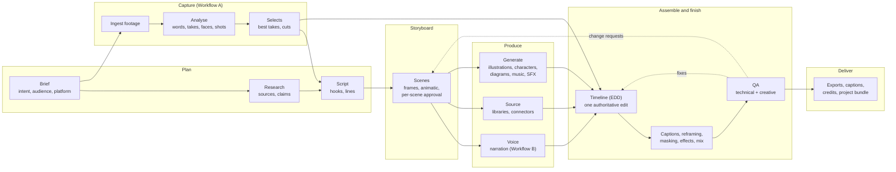
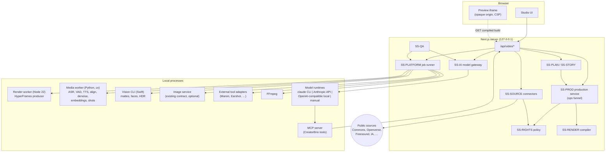
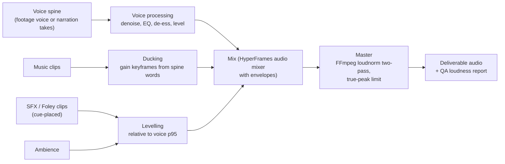

# 06 · Architecture: the complete editorial pipeline

[← Specification index](README.md) · Data models: [07](07-data-models-and-interfaces.md) · Changes from the merged research: [09](09-differences-from-pr64.md)

This is the single product architecture for both production workflows.
It keeps the merged research's core intact:

- a CreatorBrio-owned document;
- one authoritative timeline;
- immutable source media;
- typed, revisioned operations and reversible AI changes;
- HyperFrames as the one renderer, plus FFmpeg;
- local models behind a loopback worker.

It adds the editorial stages before the timeline, the subsystems that Workflow B needs, a rights ledger and a provider-agnostic model gateway.

## 1. The pipeline

Workflow A enters at **Ingest**: its script is transcribed from the footage, and selects become the spine.
Workflow B enters at **Brief/Research/Script**: its spine is synthesised narration.
From the storyboard onward the stages, data and code are the same.
A *hybrid* production, for example a talking head with animated explainer scenes, uses both entry points at once: some scenes anchor to footage and others to narration ([03 §6](03-workflow-b-script-animation.md#6-hybrid-productions)).

## 2. Subsystems and ownership

Each subsystem is an owner for requirements in [01](01-product-requirements.md#6-requirements-register) and a workstream in [11](11-implementation-program.md).

| ID | Subsystem | Responsibility | Owns (data) | Reuses |
|---|---|---|---|---|
| **SS-PROD** | Production service | Production document, typed ops, invariants, revisions, change sets, stage machine, approvals | `production.json`, revisions, change log | `src/lib/data.ts` locking; merged-research ops and history |
| **SS-PLAN** | Brief, research and script | Brief capture, research dossier with claims and citations, script and hook options | `brief`, `research`, `script` | `creative-brief.ts`, `source-retrieval.ts` |
| **SS-STORY** | Storyboard | Scenes, slots, Scene Specs, frames, animatic, materialisation | `storyboard`, scene specs | Compiler and renderer for frames |
| **SS-MEDIA** | Media and asset ledger | Ingest, hashing, probe, proxies, HDR policy, asset records, libraries | `data/media/*` | FFmpeg, mediabunny |
| **SS-RIGHTS** | Rights and provenance | Licence normalisation, rights policy, consent records, credits | `RightsRecord`, policy | — (CreatorBrio-owned) |
| **SS-SOURCE** | Sourcing | Connectors (Wikimedia Commons, Openverse, Freesound, Internet Archive, optional Pexels/Pixabay, public-domain archives), local library search, relevance ranking | Candidates, `SourceRecord` | SigLIP 2, CLAP, Claude vision |
| **SS-ANALYSIS** | Analysis | ASR, VAD, filler candidates, take grouping, faces, mattes, shots, loudness, embeddings | Analysis side files | parakeet-mlx, whisper.cpp, Silero, Apple Vision, PySceneDetect |
| **SS-VOICE** | Voice and narration | TTS engines, voice library, lexicons, narration takes, alignment | Narration takes, voices | Local TTS ([E8](../evidence/e8-tts-sourcing-providers.md)), forced aligner |
| **SS-GFX** | Graphics and animation | Templates (captions, titles, diagrams, charts, collage), Scene Spec compiler, character rigs, illustration requests | Capability packages, character library | HyperFrames adapters, Mermaid, anime.js, Lottie; existing image service |
| **SS-AUDIO** | Audio design | Music and SFX selection, procedural SFX, Foley cues, ducking, voice processing, mastering | Audio clips, gain keyframes | FFmpeg, DeepFilterNet3, Earshot, CLAP |
| **SS-RENDER** | Compiler and render | Production → HyperFrames composition; preview, frames, draft and final renders; caches; manifests | Build folders, renders | HyperFrames, FFmpeg |
| **SS-TOOLS** | External tool adapters | Direct use of specialist tools as isolated jobs that return media | Invocation manifests | Manim, Earshot CLI, `render(t)` pages, others |
| **SS-AI** | Model gateway and agents | Runtimes, role prompts and schemas, MCP server, run lifecycle, budgets | Run records | Claude Code CLI; Anthropic API; OpenAI-compatible local servers |
| **SS-QA** | Quality assurance | Technical checks, creative rubric review, fact and claim checks, rights gate | QA reports | FFmpeg filters, `visual-critic` role |
| **SS-EXPORT** | Delivery | Deliverables, sidecars, credits, bundles, OTIO/FCPXML | Deliverables | FFmpeg, OTIO JSON |
| **SS-STYLE** | Brand and style | Brand video style profiles, illustration styles, voice and lexicon defaults, reference-reel analysis | Style profiles | Existing brands |
| **SS-UI** | Studio UI | Brief and script editors, storyboard board, transcript editor, timeline, inspector, review, QA, export | — | React 19, timeline widget, `<hyperframes-player>` |
| **SS-PLATFORM** | Local platform | Job runner, worker supervision, model manager, settings, doctor and setup | Jobs, model registry | uv, Swift toolchain |

## 3. Runtime components

The merged research's process model is unchanged: the Next.js server owns state, and every heavy or risky task runs in a separate process the job runner supervises.
Four things are new: the sourcing connectors (server-side HTTP to public APIs, the only new outbound network use), TTS and alignment in the media worker, external tool adapters, and the model gateway in place of direct `claude` spawning.

## 4. One authoritative timeline, two kinds of plans

| Document | Role | Authority |
|---|---|---|
| Brief | Why and for whom | Advisory for planning |
| Research dossier | What is true, with sources | Binding for claims on screen: a sensitive claim without support is flagged by QA |
| Script | What is said | Binding for words: narration and captions come from it (B), or it is derived from what was said (A) |
| Storyboard | What each scene shows and sounds like | Binding for *what to produce*; materialisation turns it into clips |
| Timeline | What the video is | **The single authority for the output.** Renders, QA and exports read only the timeline |

The storyboard never renders on its own: its frames are rendered from compiled timeline fragments.
There is therefore exactly one place that defines the video's pixels and samples.

## 5. Capability routing

A request ("create an animated technical architecture diagram", "add sound effects to these visual events") is routed in three steps:

1. **Planning:** the `story-director` or `edit-agent` chooses a capability from the registry, which lists only available capabilities, each with `describe` text and a parameter schema, as today's Visual Director does.
2. **Validation:** the server validates parameters against the manifest, checks requirements (for example `personMatte` needs the vision CLI) and the rights implications of its outputs.
3. **Execution:** the executor runs as a job. Its result arrives as assets or as a change set ([07 §5](07-data-models-and-interfaces.md#5-capability-interface)).

Nothing runs unless a plan or a user asks for it, so a calm wellness video never pays for a collage engine.

## 6. Native capabilities and direct tool use

Both are first-class; the choice follows from what the creator needs to do after generation.

| Use native adaptation when… | Use the specialist tool directly when… |
|---|---|
| The creator will adjust the result: text, timing, colours, positions | The output is a self-contained piece the creator will accept or regenerate whole |
| The result must follow the brand style exactly | The tool's own look is the point (a Manim proof, a procedural sound) |
| It must stay in sync with words on the spine | Timing is internal to the piece |
| It should be previewable in real time | A baked layer is acceptable |

The full mapping per tool is in [05](05-capability-matrix.md).

## 7. Rendering, preview and caching

Unchanged from the merged research ([05 §9](../05-proposed-architecture.md#9-rendering-contract)):

- one compiler and one runtime for preview, frames, drafts and finals;
- proxies for interactive preview;
- originals for final renders;
- content-hash caches for mattes, generated layers and external-tool outputs;
- an opaque-origin, CSP-locked preview iframe;
- range re-rendering.

Additions:

- **Storyboard frames and animatics** use the same compiler with a frame list or a held-frame timeline.
- **Narration and generated assets are cached** by `(engine, version, voice, text, direction, seed)` or `(capability, version, params, inputs)`. Changing one line regenerates only that line's narration.
- **Scene Specs compile to sub-compositions.** Editing one element recompiles one scene.

## 8. Audio architecture

Every gain change is a keyframe on a clip in the timeline, never a hidden filter, so the user sees and edits the mix.
SFX cues come from three places:

- words on the spine;
- events in compiled compositions (graphic entrances, Scene Spec cues);
- cuts and transitions.

This generalises Real SFX's idea of reading cues from the composition ([merged research E4 §9](../evidence/e4-creative-and-audio-tools.md#9-real-sfx--clipwingskills-skillsreal-sfx)).

## 9. Security and isolation

All the merged research's boundaries stay:

- loopback-only API, with cross-site writes refused;
- MCP-only agents with no shell;
- server-issued ids only;
- path confinement for the workers;
- a no-script rule for model-authored graphics.

New boundaries:

- **Connectors** fetch only from an allow-listed set of API hosts, through the server, with size limits. Downloaded media goes through the same validation as uploads (magic bytes, probe) before entering the ledger.
- **External tool adapters** run with a per-job working folder, declared inputs only, a time limit, and no access to the production document.
- **Model runtimes** receive only per-run folders and server-assembled context; untrusted text (web pages, transcripts of sourced media) is delimited and labelled as data, as `visual-director.ts` does today.
- **Voice cloning** requires a recorded consent for the voice's owner and is limited to voices the user owns or has documented permission to use.
