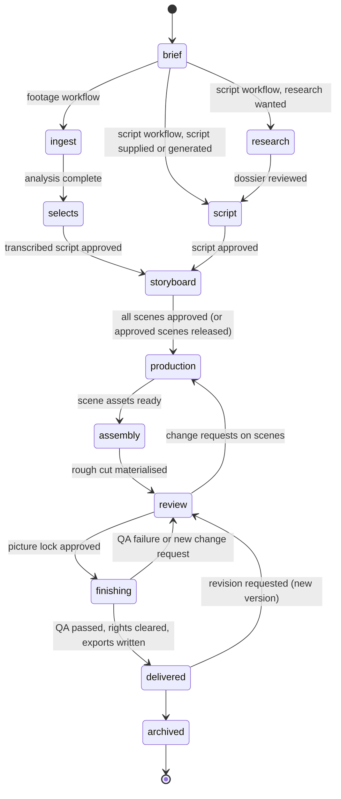

# 07 · Data models and subsystem interfaces

[← Specification index](README.md) · Architecture: [06](06-architecture.md) · Storyboard: [04](04-storyboard-and-review.md)

This page is the data contract between subsystems.
TypeScript is used as the notation; it is a design sketch, and the first implementation ticket of each subsystem fixes names and validation rules.
Every persisted shape is versioned (`schemaVersion`) and validated on read and write.

It extends the Edit Decision Document (EDD) from the merged research ([05 §3](../05-proposed-architecture.md#3-the-edit-decision-document)) rather than replacing it.
The EDD's timeline, clips, keyframes, time model and invariants are kept as they are; this page adds the documents around the timeline and generalises assets and agents.
[09](09-differences-from-pr64.md) lists every change.

## 1. The production document

One **production** is one video project.
All its editorial state lives in one document with one revision counter, changed only through typed operations ([§6](#6-operations-and-change-sets)).
This keeps the merged research's guarantees (one authoritative timeline, reversible changes, optimistic concurrency) while adding the stages before the timeline.

```ts
/** data/video/<productionId>/production.json */
interface Production {
  schemaVersion: 2;                 // 1 was the timeline-only EDD of the merged research
  id: string;
  name: string;
  brandId: string;                  // fixed at creation, as carousels
  styleProfileId: string | null;
  workflow: "footage" | "script" | "hybrid";   // A, B, or both in one production
  usageIntent: "personal" | "commercial" | "client";  // drives the rights policy (§4)
  revision: number;
  stage: ProductionStage;           // workflow state machine (§8)
  format: OutputFormat;             // primary deliverable; extra deliverables in `deliverables`
  brief: Brief;
  research: ResearchDossier | null;
  script: Script | null;
  storyboard: Storyboard | null;    // see 04
  timeline: Timeline;               // the merged research's EDD tracks, captions, audio, markers
  voice: VoiceSettings | null;      // narration voice for this production
  review: ReviewState;              // comments, approvals, QA reports, run records
  deliverables: Deliverable[];
  createdAt: string; updatedAt: string;
}

interface OutputFormat {
  width: number; height: number;    // 1080×1920, 1080×1350, 1080×1080, 1920×1080
  fps: 24 | 25 | 30 | 60;
  maxDurationMs: number;            // platform limit, e.g. 90 000 for an Instagram Reel
  platform: "instagram-reel" | "tiktok" | "youtube-short" | "linkedin" | "youtube" | "custom";
}
```

Large texts (source documents, transcripts, research excerpts) are stored as content-addressed side files under `data/video/<productionId>/blobs/<sha256>.json` and referenced by hash.
That keeps revision snapshots small, as the merged research intended.

## 2. Brief, research and script

```ts
interface Brief extends CreativeBrief {          // reuses src/types/creative-brief.ts fields and provenance
  platform: OutputFormat["platform"];
  targetDurationMs: { min: number; max: number };
  tone: string[];                                 // "calm", "authoritative", "playful"
  callToAction?: BriefValue;
  mustInclude: BriefItem[];                       // facts, phrases, products
  mustAvoid: BriefItem[];                         // claims, words, imagery
  audienceKnowledge: "novice" | "intermediate" | "expert";
  sources: SourceRef[];                           // links or documents the user supplied
}

interface ResearchDossier {
  questions: string[];                            // what the research must answer
  sources: ResearchSource[];
  claims: Claim[];                                // every factual statement the script may use
  status: "draft" | "reviewed";
}

interface ResearchSource {
  id: string;
  kind: "url" | "document" | "user-note";
  url?: string; title: string; publisher?: string; retrievedAt: string;
  blob: string;                                   // sha256 of the extracted text side file
  reliability: "primary" | "reputable-secondary" | "unverified";
  retrievedBy: "user" | "source-retrieval";       // the existing bounded retrieval module
}

interface Claim {
  id: string;
  text: string;
  sourceIds: string[];                            // at least one for "supported"
  status: "supported" | "unsupported" | "disputed" | "user-asserted";
  sensitive: boolean;                             // health, finance, legal: needs on-screen care
}

interface Script {
  origin: "written" | "generated" | "transcribed"; // B, B, A
  hookOptions: HookOption[];                       // alternatives offered before approval
  selectedHookId: string | null;
  sections: ScriptSection[];
  status: "draft" | "approved";
}

interface HookOption { id: string; text: string; technique: "question" | "bold-claim" | "story" | "contrast" | "statistic" | "demonstration"; rationale: string }

interface ScriptSection {
  id: string;
  role: "hook" | "context" | "point" | "example" | "transition" | "summary" | "cta";
  lines: ScriptLine[];
}

interface ScriptLine {
  id: string;
  speaker: "narrator" | "on-camera" | "character";
  characterId?: string;                           // for multi-voice animation
  text: string;                                   // what is said
  claimIds: string[];                             // facts this line relies on
  delivery?: NarrationDirection;                  // B: TTS direction; A: note for the creator
  estimatedMs?: number;
  // A only: where this line was actually spoken
  spoken?: { mediaId: string; fromWordId: string; toWordId: string; takeGroupId?: string };
}
```

In Workflow A the script is *transcribed*: each line points at the words in the footage where it was spoken, and take groups hold the alternatives.
In Workflow B the script is *written or generated* first; narration is synthesised from it.
Both shapes are the same type, which is what lets the storyboard and timeline treat both workflows identically.

## 3. The speech spine

Both workflows hang their timing on a **spine**: one primary speech track whose words have exact times.

| | Workflow A (footage) | Workflow B (script) |
|---|---|---|
| Spine source | The on-camera recording | Synthesised narration, one WAV per script line or scene |
| Word times from | Local ASR (parakeet-mlx; whisper.cpp for other languages) | The TTS engine's own timings where provided, otherwise forced alignment of the known text |
| Stored as | `Transcript` (merged research [05 §3](../05-proposed-architecture.md#schema-typescript-sketch)) | The same `Transcript` type, with `engine` naming the TTS model and aligner |

Captions, scene anchors, emphasis zooms, SFX cues and ducking all read word times from the spine, never from the workflow, so the same code serves both.

```ts
interface NarrationTake {                         // one synthesised rendition of a line or scene
  id: string;
  scriptLineIds: string[];
  voiceId: string;
  direction: NarrationDirection;
  assetId: string;                                // WAV 48 kHz, mono, in the asset store
  transcriptId: string;                           // word times for this take
  status: "candidate" | "selected" | "rejected";
}

interface NarrationDirection {
  rate: number;                                   // 0.8–1.25 relative
  pitchShift?: number;                            // semitones, where the engine supports it
  energy?: "calm" | "neutral" | "energetic";
  pausesMs?: Array<{ afterWordIndex: number; ms: number }>;
  emphasis?: number[];                            // word indexes
  pronunciations?: Record<string, string>;        // word → phonemes or respelling; also from the brand lexicon
}

interface VoiceSettings {
  voiceId: string;                                // from the voice library (§4.3)
  defaultDirection: NarrationDirection;
  lexiconId: string | null;                       // brand pronunciation lexicon
}
```

## 4. Assets, provenance and rights

The merged research's media store (content-addressed, immutable originals) is generalised into one **asset ledger** for everything that enters a production.
This includes footage, uploads, sourced stock, generated narration, illustrations, rendered layers and music.

### 4.1 Asset record

```ts
/** data/media/assets.json (index) + data/media/originals/<sha256>.<ext> (bytes) */
interface Asset {
  id: string;                                     // sha256 of bytes
  kind: "video" | "audio" | "image" | "vector" | "animation" | "font" | "document";
  mime: string;
  tech: TechMetadata;                             // probe: duration, size, fps, colour, channels, sample rate
  origin: "captured" | "uploaded" | "sourced" | "generated" | "rendered" | "derived";
  source?: SourceRecord;                          // when sourced or uploaded with known origin
  generation?: GenerationRecord;                  // when generated or rendered
  derivedFrom: string[];                          // asset ids (e.g. a matte from footage)
  rights: RightsRecord;
  tags: string[];                                 // search: subject, mood, style
  embeddings?: { visual?: string; audio?: string };// ids of SigLIP / CLAP vectors
  addedAt: string;
}

interface SourceRecord {
  connector: "wikimedia-commons" | "openverse" | "freesound" | "internet-archive" | "pexels" | "pixabay"
           | "nasa" | "smithsonian-open-access" | "library-of-congress" | "user-library" | "upload";
  sourceUrl: string; sourceId: string;
  title?: string; author?: string; authorUrl?: string;
  retrievedAt: string;
  rawMetadata: string;                            // blob hash of the connector's original response
}

interface GenerationRecord {
  capabilityId: string; capabilityVersion: string;
  engine: string; engineVersion: string;          // e.g. "kokoro-82m@v1.0", "hyperframes-producer@0.9.9"
  modelLicence?: string;                          // SPDX or the model's licence name
  promptOrParams: string;                         // blob hash; never contains secrets
  seed?: number;
  reproducible: "deterministic" | "seeded" | "non-reproducible";
  externalTool?: { name: string; version: string; invocation: string };  // direct use of a specialist tool
}

interface RightsRecord {
  licence: string;                                // SPDX id, "CC-BY-4.0", "CC0-1.0", "PDM", "Pexels", "Pixabay", "proprietary-own", "unknown"
  licenceUrl?: string;
  attribution?: string;                           // exact text to credit
  commercialUse: "allowed" | "forbidden" | "unknown";
  modification: "allowed" | "forbidden" | "unknown";   // ND licences forbid
  shareAlike: boolean;                            // CC BY-SA obligations on the output
  aiGenerated: boolean;
  personConsent?: "self" | "documented" | "none";  // for footage and cloned voices of real people
  status: "cleared" | "needs-review" | "restricted" | "blocked";
  reviewedBy?: { by: "user"; at: string; note?: string };
}
```

### 4.2 Rights policy

A deterministic **rights policy** evaluates every asset placed on the timeline against the production's `usageIntent`.
It runs when an asset is placed and again before export.

| Condition | personal | commercial / client |
|---|---|---|
| `commercialUse: forbidden` (e.g. CC BY-NC) | allowed, labelled | **blocked** |
| `commercialUse: unknown` (e.g. many Internet Archive items) | needs review | **blocked** until the user records a rights decision |
| `modification: forbidden` (CC BY-ND) and the asset is cropped, cut, recoloured or composited | **blocked** | **blocked** |
| `shareAlike: true` (CC BY-SA) | allowed; the export carries the share-alike notice | needs review: the whole video may have to be released under BY-SA |
| Requires attribution | credits generated automatically | credits generated automatically |
| Real person, no recorded consent | needs review | **blocked** |

Blocked assets cannot be exported; the timeline shows them with the reason.
The policy is data, not code paths scattered through capabilities, and is tested on its own.

### 4.3 Libraries

| Library | Contents | Stored |
|---|---|---|
| Media library | User B-roll, photos, logos, music, SFX folders; sourced assets | Asset ledger, tagged, embedded for search |
| Voice library | Voices with engine, language, licence of the voice model, consent record for cloned voices | `data/video-voices.json` |
| Character library | Character design sheets: rig (parts, joints, palette), expressions, poses, licence | `data/video-characters/<id>/` |
| Pronunciation lexicons | Per brand: words → phonemes or respellings | `data/video-lexicons.json` |
| Capability library | Templates and executors (§5) | `capabilities/` in the repository, plus user-installed packages |

### 4.4 Media formats

| Purpose | Format |
|---|---|
| Original footage, audio, images | Unchanged bytes, content-addressed, read-only |
| Preview proxy | H.264 High, 720×1280 (or matching aspect), short GOP, SDR BT.709, `+faststart` |
| Analysis audio | WAV 16 kHz mono (ASR, VAD); WAV 48 kHz (processing) |
| Narration takes | WAV 48 kHz 24-bit mono + word-timed `Transcript` |
| Processed voice | WAV 48 kHz (denoised, EQ'd), derived asset |
| Mattes and alpha layers | VP9 + alpha WebM (preview), ProRes 4444 (final) |
| Illustrations and generated stills | PNG (lossless), sRGB, with generation record |
| Vector art, diagrams | SVG (sanitised: no scripts, no external references) |
| Character and scene animation | Scene Spec JSON ([04 §5](04-storyboard-and-review.md#5-scene-specs-the-format-for-animated-scenes)) compiled to HTML/SVG; Lottie JSON for imported animations |
| Final deliverable | MP4 H.264 High + AAC-LC 48 kHz, BT.709 tagged; optional HEVC, ProRes |
| Sidecars | SRT and WebVTT captions; credits (Markdown and plain text); render manifest JSON |
| Editable project | Production bundle ([§9](#9-editable-project-bundle)) |

## 5. Capability interface

Every creative and analytical function is a **capability** with a manifest.
This extends the merged research's manifest ([05 §6](../05-proposed-architecture.md#6-creative-capabilities)) with the asset-producing and external-tool kinds that Workflow B needs.

```ts
interface CapabilityManifest {
  id: string;                         // "voice.narrate", "anim.stick-figure", "graphic.architecture-diagram", "tool.manim"
  version: string;
  kind: "analysis" | "generator" | "template" | "effect" | "transition" | "audio-process" | "connector" | "external-tool";
  implementation: "native" | "external";          // native code/template vs direct use of a specialist tool
  describe: { does: string; usefulWhen: string; notFor: string; constraints: string };
  params: JSONSchema;
  requires: Requirement[];            // "spine", "faces", "personMatte", "worker:tts", "tool:manim", "model:<id>"
  produces: Array<"graphics-clip" | "media-asset" | "audio-asset" | "analysis" | "effect" | "storyboard-frames">;
  determinism: "deterministic" | "seeded" | "non-reproducible";
  licence: { code: string; weights?: string; assets?: string; attribution?: string };
  commercialUse: "allowed" | "restricted" | "forbidden"; // feeds the rights policy for its outputs
  availability: AvailabilityProbe;    // computed locally; never a network call at planning time
  cost: { timeClass: "instant" | "seconds" | "minutes" | "long"; gpu: boolean };
}

interface CapabilityExecutor {
  plan(params: unknown, ctx: CapabilityContext): Promise<ExecutionPlan>;   // validates, estimates, lists inputs
  run(plan: ExecutionPlan, job: JobHandle): Promise<CapabilityResult>;     // runs as a job; writes staged outputs
}

type CapabilityResult =
  | { kind: "assets"; assetIds: string[] }                     // e.g. narration WAVs, an illustration, a baked ProRes layer
  | { kind: "ops"; changeSet: Omit<ChangeSet, "id" | "baseRevision"> }  // e.g. reframe keyframes, SFX clips
  | { kind: "analysis"; ref: string }
  | { kind: "failed"; code: string; message: string; retryable: boolean };
```

**Two ways to use a specialist tool**, both through this interface:

- **Native adaptation** (`implementation: "native"`): the technique is reimplemented as a template or executor inside CreatorBrio. The output is ordinary EDD content rendered by the single renderer. This is the default for anything a creator will want to tweak after generation: captions, diagrams, stick figures, collage, transitions.
- **Direct use** (`implementation: "external"`, `kind: "external-tool"`): the tool runs as a job in an isolated working folder with declared inputs. It must return media files plus an invocation manifest: a ProRes 4444 or VP9-alpha layer, a PNG sequence, or a WAV. The files enter the asset ledger with `generation.externalTool` recorded and are placed as ordinary media clips. Re-running the recorded invocation reproduces the asset when the tool is deterministic. Examples: Manim for mathematical animation, Earshot for procedural SFX, an OpenFilm or Lemo-Opuscar `render(t)` page for a self-contained scene.

External tools never own timing beyond their own clip, never write to the production, and are never required for the core workflow.
That is the "no competing render timelines" rule from the merged research, restated so that direct use is possible ([09](09-differences-from-pr64.md)).

## 6. Operations and change sets

The merged research's `ChangeSet` (base revision, run id, summary, ops) and its apply semantics are kept unchanged ([05 §4](../05-proposed-architecture.md#4-editing-operations)).
The operation vocabulary grows to cover the documents before the timeline:

```ts
type ProductionOp =
  | TimelineOp                                   // every EditOp of the merged research, unchanged
  // brief and research
  | { op: "updateBrief"; patch: BriefPatch }
  | { op: "addSource"; source: NewResearchSource }
  | { op: "setClaim"; claim: Claim }
  // script
  | { op: "setHookOptions"; options: HookOption[] }
  | { op: "selectHook"; hookId: string }
  | { op: "editScriptLine"; lineId: string; text?: string; delivery?: NarrationDirection; claimIds?: string[] }
  | { op: "insertScriptLine"; sectionId: string; afterLineId: string | null; line: NewScriptLine }
  | { op: "removeScriptLine"; lineId: string }
  | { op: "moveScriptSection"; sectionId: string; toIndex: number }
  // storyboard (see 04 for semantics)
  | { op: "proposeScenes"; scenes: NewScene[]; replaceSceneIds?: string[] }
  | { op: "editScene"; sceneId: string; patch: ScenePatch }
  | { op: "reorderScenes"; sceneIds: string[] }
  | { op: "setSceneStatus"; sceneId: string; status: SceneStatus; note?: string }
  | { op: "selectAsset"; sceneId: string; slotId: string; assetId: string }
  | { op: "materializeScene"; sceneId: string; mode: "replace-owned" | "append" }
  // voice
  | { op: "selectNarrationTake"; takeId: string }
  // review
  | { op: "addComment"; target: ReviewTarget; text: string; kind: "note" | "change-request" | "question" }
  | { op: "resolveComment"; commentId: string }
  | { op: "approve"; target: ReviewTarget }
  | { op: "setStage"; stage: ProductionStage }
  | { op: "recordRightsDecision"; assetId: string; status: RightsRecord["status"]; note: string };
```

All writes from the UI, the agents and the capabilities go through one funnel, as before.
Long-running work (TTS, generation, rendering) is a job whose *result* arrives as a change set or as new assets, never as a side effect.

## 7. Model gateway interface

The merged research tied every AI role to the Claude Code CLI.
The product needs a provider-agnostic interface so the open-source distribution and any future paid service can use other supported arrangements ([08](08-licensing-and-commercial.md#4-ai-providers-and-terms)).

```ts
type AgentRole =
  | "story-director"      // brief → hooks → script → storyboard proposals (structured output)
  | "researcher"          // questions → sources → claims (server-side retrieval tools only)
  | "edit-agent"          // iterative editing through MCP tools and change sets
  | "scene-author"        // storyboard scene → Scene Spec / graphic params (structured output)
  | "visual-critic";      // frames + rubric → findings (vision, structured output)

interface RoleRequirements {
  structuredOutput: boolean;    // JSON-schema-constrained final answer
  toolUse: boolean;             // MCP tools
  vision: boolean;              // reads images (frames, contact sheets, storyboards)
  minContextTokens: number;
}

interface ModelRuntime {
  id: "claude-code-cli" | "anthropic-api" | "openai-compatible" | "manual";
  describe(): RuntimeCapabilities;              // structured output, tools, vision, context, streaming
  run(task: AgentTask, events: (e: AgentEvent) => void, signal: AbortSignal): Promise<AgentOutcome>;
}

interface AgentTask {
  role: AgentRole;
  instructions: string;                          // CreatorBrio-owned prompt for the role, versioned
  input: string;                                 // context assembled by the server (never raw untrusted text unmarked)
  attachments: Array<{ path: string; mime: string }>;  // inside a per-run folder only
  tools?: { mcpServer: McpServerSpec; allow: string[] };
  outputSchema?: JSONSchema;
  budget: { maxCostUsd?: number; maxTurns?: number; timeoutMs: number };
  session?: { resumeId?: string; persist: boolean };
}

type AgentOutcome =
  | { status: "ok"; output?: unknown; sessionId?: string; usage?: Usage }
  | { status: "invalid-output"; detail: string }
  | { status: "unavailable" | "refused" | "budget-exceeded" | "timeout" | "cancelled" | "failed"; message: string };
```

| Runtime | How it runs | Intended use |
|---|---|---|
| `claude-code-cli` | Spawns the user's own installed `claude` with the existing isolation flags (`--strict-mcp-config`, `--setting-sources ""`, path-scoped `Read`, `--json-schema`, budgets) | Local, self-hosted use by the person who installed CreatorBrio, on their own account. This is today's behaviour |
| `anthropic-api` | Claude Agent SDK or the Messages API with an API key the operator supplies; the MCP tools are the same | Any deployment where CreatorBrio is offered to other people, including a future paid service |
| `openai-compatible` | Any endpoint implementing chat completions with tool calling and JSON-schema output: local Ollama, LM Studio, MLX-LM or llama.cpp servers, or other hosted providers | Fully local operation without any Anthropic account; quality depends on the model, and roles whose requirements the model lacks (for example vision) are refused with the reason |
| `manual` | No model | Every workflow remains usable by hand: the user writes the script, builds the storyboard and edits the timeline |

The gateway checks each role's requirements against the runtime's capabilities before running, and every runtime returns the same `AgentOutcome` codes.
Role prompts, schemas and MCP tools are CreatorBrio's own and identical across runtimes.
The `edit-agent` tool surface is the merged research's MCP server ([05 §5](../05-proposed-architecture.md#the-mcp-tool-surface)), extended with script, storyboard and asset tools (`get_storyboard`, `propose_scenes`, `search_sources`, `request_narration`).

## 8. Workflow state machine

```ts
type ProductionStage =
  | "brief" | "research" | "script" | "ingest" | "selects"
  | "storyboard" | "production" | "assembly" | "review" | "finishing" | "delivered" | "archived";
```



- Stages advance only by an explicit `setStage` op after their exit criteria pass ([02](02-workflow-a-footage.md), [03](03-workflow-b-script-animation.md)). A user may enable **autopilot** for a production, which lets the system request approval only at storyboard, picture lock and delivery.
- Going back a stage never deletes work: earlier documents stay versioned, and scenes that are already realised keep their clips until they are re-materialised.
- Scenes have their own states inside `storyboard`, `production` and `review` ([04 §3](04-storyboard-and-review.md#3-scene-lifecycle)).

## 9. Editable project bundle

A production can be exported as a self-contained folder or zip that another CreatorBrio installation can open and continue editing:

```text
<name>.cbvideo/
  manifest.json                 bundle schema version, CreatorBrio version, created, usageIntent
  production.json               the production document at a chosen revision
  history/changes.jsonl         optional: full change-set history
  blobs/                        side files referenced by hash
  assets/<sha256>.<ext>         every referenced asset, or none ("references only" mode)
  assets.json                   asset records including provenance and rights
  capabilities.lock.json        capability ids and versions used, with content hashes of templates
  renders/                      optional: last final render and its manifest
  CREDITS.md                    attributions required by asset licences
```

Opening a bundle verifies every asset hash, checks that the capability versions are installed (or lists what is missing), and re-runs the rights policy.
Interchange exports (OTIO, FCPXML) are separate and lossy, as in the merged research.

## 10. Interfaces between subsystems

| From → To | Interface | Contract |
|---|---|---|
| UI → Production service | `POST /api/video/productions/:id/changes` | `ChangeSet` → new revision or typed errors |
| Agents → Production service | MCP tools → same route | Only `propose_*` / change-set tools write |
| Production service → Job runner | In-process call | `JobRequest { kind, inputs (asset ids), params, lane }` |
| Job runner → Media worker | Loopback HTTP + bearer token | `POST /jobs`, `GET /jobs/:id/events` (SSE), `GET /capabilities`; inputs are paths under `data/media/` only |
| Job runner → Vision CLI | Process per job | JSON in, JSON + files out |
| Job runner → Render worker | Child process | Compiled build folder + output path → progress events, manifest |
| Job runner → External tool adapter | Process per job, isolated folder | Declared inputs → declared outputs + invocation manifest |
| Job runner → Image service | Existing loopback contract (`POST /generate`, `POST /edit`) | Unchanged; extended with style/reference parameters by a separate ticket |
| Sourcing connectors → Asset ledger | Server-side HTTP to the public APIs | Search → candidates with licence metadata; download → asset + `SourceRecord` + `RightsRecord` |
| Model gateway → Runtimes | `ModelRuntime.run` | `AgentTask` → `AgentOutcome` |
| Compiler → Renderer | HyperFrames composition folder | As in the merged research [05 §9](../05-proposed-architecture.md#9-rendering-contract) |
| Export → File system | Deliverables, sidecars, bundle | Written atomically with a render manifest |
