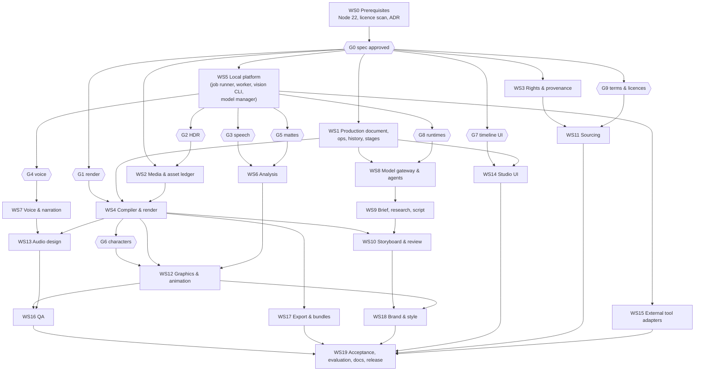

# 11 · Implementation programme

[← Specification index](README.md) · Requirements: [01](01-product-requirements.md#6-requirements-register) · Acceptance: [10](10-acceptance-tests.md)

This programme builds the complete Video Studio, both workflows on one infrastructure, in dependency order.
It does not define a reduced first product.
Work lands behind a "Video Studio (preview)" switch until every acceptance test in [10](10-acceptance-tests.md) passes.
Validation gates come first wherever a choice depends on evidence that only running the stack on the target Mac can provide.

Every workstream becomes GitHub issues under No Ticket, No Work, each validated with the canonical ticket validator before work starts.
Sizes are **engineering estimates** for one engineer working with Claude Code (S under a week, M 1–3 weeks, L 3–6 weeks), not commitments.

## 1. Validation gates

Each gate has a question, a method, a pass criterion and a pre-agreed fallback, so a failure redirects work rather than stopping it.
The merged research's checkpoints V1–V8 are absorbed here.

| Gate | Question | Method | Pass criterion | If it fails | Blocks |
|---|---|---|---|---|---|
| **G0** | Is this specification approved, and are the founder decisions made? | Review of this PR; answers to [08 §8](08-licensing-and-commercial.md#8-decisions-for-the-founder) | Approved | Revise the specification | Everything |
| **G1** | Does HyperFrames render deterministically and fast enough on macOS, run in the sandboxed preview, and support our compiler's needs (envelopes, sub-compositions, range renders)? (V1, V2, V8) | Hand-built 60 s fixture with footage, captions, a diagram, a cut-out layer, a Scene Spec character scene and music; render twice at 1/4/8 workers; play in the opaque-origin iframe | Identical frame hashes; A/V within one frame; time within the founder's target; player works sandboxed | Compile to the OpenFilm `frame(t)` renderer or CreatorBrio's own Puppeteer path (merged research [04](../04-architecture-alternatives.md#final-recommendation)); server-rendered preview frames | WS4 |
| **G2** | Does iPhone HDR footage tone-map acceptably? (V3) | 10 real clips; FFmpeg zscale/tonemap vs libplacebo vs AVFoundation | Founder accepts at least one path | Record in SDR; keep testing | WS2 proxies |
| **G3** | Are ASR accuracy, take recommendations and filler detection good enough? (V4) | 10 min of each creator, hand-labelled | Thresholds agreed by the founder | Review-only filler candidates; opt-in non-commercial model for personal use only | WS6 |
| **G4** | Which local TTS meets quality, control, timing and licence needs? | Narrate M3 and M4 with each shortlisted engine ([E8](../evidence/e8-tts-sourcing-providers.md)); blind listening by both creators; timing accuracy vs forced alignment | A commercially licensed engine passes the creators' listening test and supports rate, pauses, emphasis and lexicon | Next engine on the shortlist; user-recorded narration as a hybrid | WS7 |
| **G5** | Are Apple Vision mattes good enough? (V5) | Both creators' setups | Founder accepts edges at 1080×1920 | BiRefNet primary with temporal smoothing | WS6 mattes, WS12 masking |
| **G6** | Can a model author choreography that our rig compiler renders well and deterministically? | Prototype rig format, choreography schema and `pose(t)` sampler for a stick figure and one cartoon character; the scene-author writes choreography for three scenes of M3 | Schema-valid output in ≥ 9 of 10 attempts; deterministic frames; founder accepts the look; mocap clip licence (if used) cleared | Reduce to named poses only (no IK targets); curated hand-made clips instead of mocap | WS12 characters |
| **G7** | Which timeline interaction layer? (V6) | Two-day comparison: xzdarcy, `@elah/timeline`, HyperFrames Studio timeline components | 60 s × 8 lanes with hundreds of caption words, smooth; React 19 / Next 16; MIT/Apache | Custom canvas timeline | WS14 |
| **G8** | Which model runtimes can fill which roles, at what cost? (V7) | Each role on Claude Code CLI, Anthropic API and two local models via OpenAI-compatible servers; five scenarios | Budgets set from measurements; role × runtime support table published; visual-critic rubric useful to the founder | Restrict roles per runtime with typed refusals | WS8 |
| **G9** | Are sourcing terms and model licences confirmed from primary pages? | Read the API terms and model cards that the research session could not reach ([E8](../evidence/e8-tts-sourcing-providers.md), [E7](../evidence/e7-openmontage-animation.md)) | Every default connector and model has a verified licence entry | Disable the connector or model by default | WS11, model registry |

## 2. Workstreams

| WS | Owner subsystem | Scope | Depends on | Size (estimate) |
|---|---|---|---|---|
| WS0 | SS-PLATFORM | Node ≥ 22; dependency licence scan in CI; Video Studio ADR from this specification; tickets for all workstreams and gates | — | S |
| WS1 | SS-PROD | Production document v2, op vocabulary, invariants, revisions, change sets, stage machine, approvals | G0 | L |
| WS2 | SS-MEDIA | Ingest by path, hashing, probing, source sets, proxies, HDR policy, asset ledger, libraries and search index | G0, G2 | L |
| WS3 | SS-RIGHTS | Rights record, licence normalisation, policy engine, consent, credits | G0 | M |
| WS4 | SS-RENDER | Compiler, render worker, preview route, frames, animatic, caches, range renders, manifests | G1, WS1, WS2 | L |
| WS5 | SS-PLATFORM | Job runner, media worker (uv, MLX), vision CLI, model manager with licence registry, doctor/setup | G0 | L |
| WS6 | SS-ANALYSIS | ASR, VAD, fillers, takes, delivery metrics, faces, shots, mattes, reframing | G3, G5, WS5 | L |
| WS7 | SS-VOICE | TTS engine(s), voice library, lexicons, direction mapping, narration takes and cache, alignment, consent | G4, WS5 | M |
| WS8 | SS-AI | Model gateway, runtimes (CLI, API, OpenAI-compatible, manual), role prompts and schemas, MCP server, run lifecycle, target-scoped revisions | WS1, G8 | L |
| WS9 | SS-PLAN | Brief editor, research dossier and claims, script editor, hooks, structures, transcribed scripts | WS8 | M |
| WS10 | SS-STORY | Storyboard schema and lifecycle, Scene Specs, frames, animatic, materialiser, review model, comments, run diffs | WS4, WS9 | L |
| WS11 | SS-SOURCE | Connectors (Commons, Openverse, Freesound, Internet Archive, optional stock and archives), ranking, explanations | WS3, G9 | M |
| WS12 | SS-GFX | Captions, templates, transitions, diagrams and charts, character rigs and choreography compiler, illustration requests and style conditioning, collage, authored graphics, Lottie/SVG import, zooms, masking, grading, safe zones | WS4, WS6, G6 | L+ |
| WS13 | SS-AUDIO | Voice processing, music and SFX retrieval, cue extraction, Earshot adapter, ducking envelopes, mix and master | WS4, WS7 | M |
| WS14 | SS-UI | Studio shell, brief/script editors, storyboard board, transcript editor, timeline (G7), inspector, review, QA and export panels | WS1, G7 | L+ |
| WS15 | SS-TOOLS | External-tool adapter runtime; Manim and `render(t)`-page adapters | WS5 | S |
| WS16 | SS-QA | Technical, creative, claim and rights QA; waivers | WS12, WS13 | M |
| WS17 | SS-EXPORT | Deliverable presets, sidecars, covers, credits, bundles, OTIO/FCPXML | WS4 | M |
| WS18 | SS-STYLE | Video style profiles including illustration, voice and lexicon; two creator profiles; reference-reel analysis | WS10, WS12 | M |
| WS19 | All | Acceptance tests with real material, evaluation harness, documentation, release | All | M |

## 3. Requirements by workstream

Every requirement in [01](01-product-requirements.md#6-requirements-register) has exactly one implementing workstream:

| WS | Requirements |
|---|---|
| WS0 | [OSS-01](01-product-requirements.md#oss-01), [OSS-03](01-product-requirements.md#oss-03) |
| WS1 | [PRD-01](01-product-requirements.md#prd-01), [PRD-02](01-product-requirements.md#prd-02), [PRD-03](01-product-requirements.md#prd-03), [PRD-04](01-product-requirements.md#prd-04), [EDT-01](01-product-requirements.md#edt-01), [REV-02](01-product-requirements.md#rev-02) |
| WS2 | [PRD-05](01-product-requirements.md#prd-05), [MED-01](01-product-requirements.md#med-01), [MED-02](01-product-requirements.md#med-02), [MED-03](01-product-requirements.md#med-03), [MED-04](01-product-requirements.md#med-04), [MED-05](01-product-requirements.md#med-05) |
| WS3 | [RGT-01](01-product-requirements.md#rgt-01), [RGT-02](01-product-requirements.md#rgt-02), [RGT-03](01-product-requirements.md#rgt-03), [RGT-04](01-product-requirements.md#rgt-04), [RGT-05](01-product-requirements.md#rgt-05) |
| WS4 | [REN-01](01-product-requirements.md#ren-01), [REN-02](01-product-requirements.md#ren-02), [REN-03](01-product-requirements.md#ren-03), [REN-04](01-product-requirements.md#ren-04), [PLT-05](01-product-requirements.md#plt-05) |
| WS5 | [OSS-02](01-product-requirements.md#oss-02), [PLT-01](01-product-requirements.md#plt-01), [PLT-02](01-product-requirements.md#plt-02), [PLT-03](01-product-requirements.md#plt-03), [PLT-04](01-product-requirements.md#plt-04) |
| WS6 | [SPC-01](01-product-requirements.md#spc-01), [SPC-02](01-product-requirements.md#spc-02), [SPC-03](01-product-requirements.md#spc-03), [SPC-04](01-product-requirements.md#spc-04), [SPC-05](01-product-requirements.md#spc-05), [SPC-06](01-product-requirements.md#spc-06), [SPC-07](01-product-requirements.md#spc-07), [SPC-08](01-product-requirements.md#spc-08), [SPC-09](01-product-requirements.md#spc-09), [VFX-01](01-product-requirements.md#vfx-01) |
| WS7 | [VOC-01](01-product-requirements.md#voc-01), [VOC-02](01-product-requirements.md#voc-02), [VOC-03](01-product-requirements.md#voc-03), [VOC-04](01-product-requirements.md#voc-04), [VOC-05](01-product-requirements.md#voc-05), [VOC-06](01-product-requirements.md#voc-06) |
| WS8 | [REV-01](01-product-requirements.md#rev-01), [AIM-01](01-product-requirements.md#aim-01), [AIM-02](01-product-requirements.md#aim-02), [AIM-03](01-product-requirements.md#aim-03), [AIM-04](01-product-requirements.md#aim-04), [AIM-05](01-product-requirements.md#aim-05) |
| WS9 | [PLN-01](01-product-requirements.md#pln-01), [PLN-02](01-product-requirements.md#pln-02), [PLN-03](01-product-requirements.md#pln-03), [PLN-04](01-product-requirements.md#pln-04), [PLN-05](01-product-requirements.md#pln-05), [PLN-06](01-product-requirements.md#pln-06), [PLN-07](01-product-requirements.md#pln-07), [PLN-08](01-product-requirements.md#pln-08), [PLN-09](01-product-requirements.md#pln-09) |
| WS10 | [STB-01](01-product-requirements.md#stb-01), [STB-02](01-product-requirements.md#stb-02), [STB-03](01-product-requirements.md#stb-03), [STB-04](01-product-requirements.md#stb-04), [STB-05](01-product-requirements.md#stb-05), [STB-06](01-product-requirements.md#stb-06), [STB-07](01-product-requirements.md#stb-07), [STB-08](01-product-requirements.md#stb-08), [STB-09](01-product-requirements.md#stb-09) |
| WS11 | [SRC-01](01-product-requirements.md#src-01), [SRC-02](01-product-requirements.md#src-02), [SRC-03](01-product-requirements.md#src-03), [SRC-04](01-product-requirements.md#src-04), [SRC-05](01-product-requirements.md#src-05), [SRC-06](01-product-requirements.md#src-06), [SRC-07](01-product-requirements.md#src-07) |
| WS12 | [GFX-01](01-product-requirements.md#gfx-01), [GFX-02](01-product-requirements.md#gfx-02), [GFX-03](01-product-requirements.md#gfx-03), [GFX-04](01-product-requirements.md#gfx-04), [GFX-05](01-product-requirements.md#gfx-05), [GFX-06](01-product-requirements.md#gfx-06), [GFX-07](01-product-requirements.md#gfx-07), [GFX-08](01-product-requirements.md#gfx-08), [GFX-09](01-product-requirements.md#gfx-09), [EDT-04](01-product-requirements.md#edt-04), [VFX-02](01-product-requirements.md#vfx-02), [VFX-03](01-product-requirements.md#vfx-03), [VFX-04](01-product-requirements.md#vfx-04), [VFX-05](01-product-requirements.md#vfx-05) |
| WS13 | [VOC-07](01-product-requirements.md#voc-07), [AUD-01](01-product-requirements.md#aud-01), [AUD-02](01-product-requirements.md#aud-02), [AUD-03](01-product-requirements.md#aud-03), [AUD-04](01-product-requirements.md#aud-04), [AUD-05](01-product-requirements.md#aud-05) |
| WS14 | [EDT-02](01-product-requirements.md#edt-02), [EDT-03](01-product-requirements.md#edt-03), [EDT-05](01-product-requirements.md#edt-05) |
| WS15 | [AIM-06](01-product-requirements.md#aim-06) |
| WS16 | [QAS-01](01-product-requirements.md#qas-01), [QAS-02](01-product-requirements.md#qas-02), [QAS-03](01-product-requirements.md#qas-03), [QAS-04](01-product-requirements.md#qas-04), [QAS-05](01-product-requirements.md#qas-05) |
| WS17 | [EXP-01](01-product-requirements.md#exp-01), [EXP-02](01-product-requirements.md#exp-02), [EXP-03](01-product-requirements.md#exp-03), [EXP-04](01-product-requirements.md#exp-04) |
| WS18 | [STY-01](01-product-requirements.md#sty-01), [STY-02](01-product-requirements.md#sty-02), [STY-03](01-product-requirements.md#sty-03), [STY-04](01-product-requirements.md#sty-04) |

## 4. Order of work

1. **WS0** and **G0**.
2. In parallel: **G1** (needs the founder's Mac), **G7**, **G9**, plus **WS1**, **WS3** and **WS5**, which are pure TypeScript and platform work testable in CI.
3. **WS2** (after G2), **WS4** (after G1), then gates **G3**, **G4**, **G5**, **G8** on the running worker.
4. **WS6**, **WS7**, **WS8**, **WS11**, **WS15**.
5. **WS9**, **WS10**, **G6**, then **WS12**, **WS13**, **WS14**.
6. **WS16**, **WS17**, **WS18**.
7. **WS19**: acceptance with real material; release.

## 5. Definition of complete

Video Studio is released when:

- every requirement in [01](01-product-requirements.md#6-requirements-register) is implemented, or explicitly deferred by the founder in a recorded decision;
- every acceptance test in [10](10-acceptance-tests.md) passes, including the judged criteria by the named creators;
- the licence audit passes;
- the full repository gate is green;
- the documentation describes only what shipped.

## 6. Proposed first engineering task

**Gate G1: the render validation spike on the founder's M5 Max.**
It is the one remaining uncertainty that could change the architecture.
Every other workstream either does not depend on the renderer or depends on it heavily.

The spike:

- builds the 60 s fixture by hand, including a stick-figure Scene Spec scene compiled by a throwaway `pose(t)` prototype;
- renders it twice with pinned `@hyperframes/producer`;
- checks determinism, A/V sync and render time at 1/4/8 workers;
- checks the player in the opaque-origin sandbox.

It is a throwaway branch; its results are recorded in the gate's ticket.
WS1 (production document and operations) can start in parallel because it has no external dependencies.
