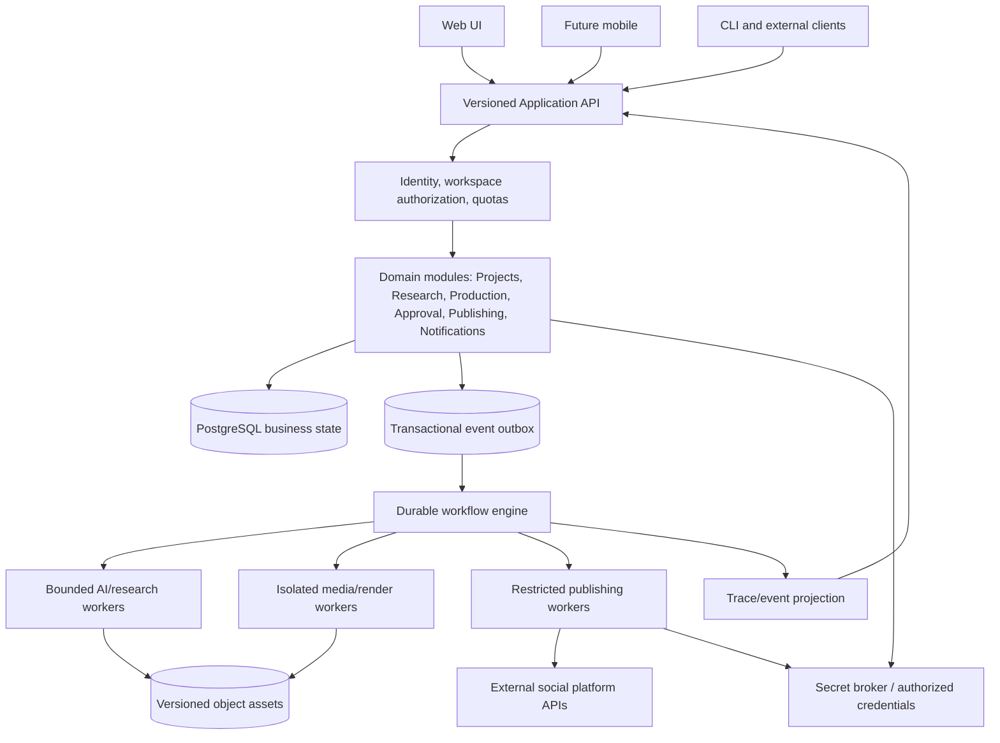

# RFC: API-first social content operations platform

**Status:** Proposed, NOT ACCEPTED. **Date:** 2026-11-17. **Ticket:** [#214](https://github.com/mk-global/creatorbrio/issues/214).  
**Scope:** target architecture for a possible future evolution of CreatorBrio. Not the shipped CreatorBrio design or an authorization to change it.

## 1. Problem, users, and architectural drivers

The end-user job is: express one social-content goal, inspect/approve evidence-backed research, inspect/approve a complete media package, and delegate authorized scheduling/publication with status and notifications. Personas: solo creator, agency operator managing brands, self-hosted developer, and later managed-SaaS customer. The platform should support repeatable customer-specific recipes without requiring new code for each brand.

Priorities, in order: (1) quality and human control; (2) safe irreversible actions and tenant isolation; (3) durability and auditability; (4) portability from local to hosted; (5) composability and reasonable cost; (6) scale when evidence requires it. Realtime animations, agent count, arbitrary workflow editing and speculative microservices are not first-order product outcomes.

Non-goals for first end-to-end slice: promises of viral reach, unrestricted web scraping/downloading, arbitrary customer-executed code, every social network, autonomous no-review publishing, an app store, full enterprise tenancy/SSO/billing, a native phone video editor, multi-region Kubernetes, and a generic n8n competitor.

## 2. Decisions proposed, not yet ratified

| Area | Proposed direction | Alternatives / proof needed |
|---|---|---|
| Product/repos | One open-source product with a modular monorepo; keep any truly independent creative/publishing products separated behind contracts | Review CreatorBrio's existing ownership before any extraction or consolidation |
| Application structure | API-first modular monolith: versioned HTTP API independent of browser, separate web + worker processes | Next.js route handlers vs distinct API process must be benchmarked/validated |
| Execution | Single durable workflow authority; isolated worker categories for inference, rendering, and credentialed publication | Spike Hatchet vs Temporal vs simpler solution; do not select on marketing alone |
| AI | Model/provider-independent agent/tool contracts, structured outputs and explicit capability grants | Local Claude CLI as opt-in, never universal hosted auth |
| Storage | PostgreSQL for multiuser domain state; S3-compatible object-store abstraction for assets; secrets via secure platform-specific mechanisms | Local file adapter and staged migration from current durable local store; no premature destructive conversion |
| Identity | Explicit workspace/organization ownership in domain objects from start; invite/team functionality later | Need local login/setup model and proven hosted auth/RLS design |
| Creative | CreatorBrio's canonical production contract and renderer stay authoritative until reviewed migration; use capability adapter rather than duplicate editor | Validate whether reuse in-process or remote contract is safer and simpler |
| Distribution | Provider-capability-specific adapters, frozen publication manifest, reconcile uncertain outcomes | Rights, OAuth permissions, API audits and scheduling behavior by provider |
| Mobile | Responsive web first; later native Expo client uses same versioned API | Mobile push/deep links/offline preview need separate proof |
| Open source | Self-hostable core, deterministic setup/upgrade/restore, documented license and provenance | MIT currently applies; commercial/third-party dependencies require license counsel/review |

A workflow engine is NOT an AI agent framework. A workflow governs durable state, retries and timers; an agent performs bounded reasoning steps; specialized tools generate media; platform SDKs publish. Avoid nested competing workflow coordinators.

## 3. Logical architecture



This is **logical**, not a requirement for ten services. In local mode, API, worker and supporting storage may be colocated. In SaaS mode, the API scales separately from specialized worker pools. Contracts and security boundaries must survive both shapes.

### Ownership boundaries

- Application API owns authentication, workspace scoping, authorization, request validation and business commands. Neither browser nor mobile client writes domain tables directly.
- Domain services own invariants, including immutable version approvals and legitimate state transitions. Do not entrust them to prompts or framework orchestration.
- Workflow engine owns delivery, durable waits, timers, retries and execution status; it must not become the sole source of truth for approved publications or authorizations.
- Production module owns versioned content packages and media job contracts; retain current Video Studio architecture until explicitly reconciled.
- Publishing module owns platform-specific capabilities, destination account validation, scheduling, manifest locking, upload reconciliation and error classifications.
- Notifications module owns durable notification records; email/push are best-effort deliveries over that durable state.
- Research module owns source provenance and confidence/claim verification metadata; never treat retrieved instructions as trusted.

## 4. Canonical lifecycle and human authority

Conceptual state flow:

```
draft → researching → research_ready → awaiting_research_approval
    → approved_research → producing → production_ready
    → awaiting_production_approval → approved_package
    → scheduled → publishing → published
```

Add explicit revision-requested, rejected, cancelled, blocked, expired, failed/retryable and `external_outcome_unknown` states. State transitions are server-enforced and idempotent. A running AI step cannot approve itself.

**Research gate:** an authorized human approves an immutable ResearchReport + CreativeBrief version and requested work scope. Any changed report/brief needs fresh approval, unless a documented bounded-change policy applies.

**Production gate:** an authorized human approves an exact manifest that includes asset content hashes/version IDs, caption(s), cover, destinations and platform options. Approval for one version is never automatically reused for a changed version, account or material description.

**Publication:** a publication intent carries a workspace-bound idempotency key, immutable manifest, approval evidence, and scheduled timezone-aware instant. The publish worker has the narrowest credential scope and must never synthesize an approval. Platform timeout after submission is `external_outcome_unknown`; reconcile via provider evidence before retry. Exactly-once external side effects cannot be assumed.

**Notifications:** durable per-user events for review required, job failed, scheduled, published, cancelled and outcome unknown, with dedupe and channel-specific delivery receipts. Push/email delivery is not proof of receipt.

**Worker restarts:** checkpoint/resume and bounded retry must be proven by killing processes during research, rendering, approval waits and publication. Protect state transitions from double-submits, concurrent approvals, duplicate jobs and out-of-order callbacks.

## 5. Proposed minimum domain model

- `Workspace`, `Member`, `Role` / permission grants, `Brand`, `ConnectedAccount`, `ProviderConnection`.
- `ContentProject` (workspace owner, goal, format, source set, audience), `WorkflowDefinitionVersion`, `WorkflowRun`, `StepExecution`.
- `SourceEvidence` (URI, retrieval time, claim mapping, license/rights status, uncertainty), `ResearchReportVersion`, `CreativeBriefVersion`.
- `Production`, `ArtifactVersion` (immutable file refs + hashes), `AssetRightsRecord`, `ReviewRequest`, `ApprovalDecision`.
- `PublicationManifest`, `PublicationAttempt`, `ExternalPublicationRecord`, `ScheduledAction`, `Notification`, `UsageLedger`, `AuditEvent`.

Identifiers must be generated by the server, not trusted from model output. Record workflow definition and integration version used in each run. Correlate with trace/run IDs but don't treat a tracing backend as the business audit log. Make user-generated metadata editable while retaining immutable historical artifacts and audit events.

## 6. API and client portability

Versioned, documented HTTPS API with OpenAPI schemas and generated clients as appropriate; no business feature exclusively reachable through Next.js Server Actions. Illustrative endpoints:

```
POST /api/v1/projects
POST /api/v1/projects/{id}/runs
GET  /api/v1/runs/{id}
GET  /api/v1/runs/{id}/events
POST /api/v1/reviews/{id}/decision
GET  /api/v1/projects/{id}/artifacts
POST /api/v1/publications
GET  /api/v1/publications/{id}
GET  /api/v1/notifications
```

Stable error codes, pagination, request idempotency, optimistic concurrency and explicit workspace authorization are required. Use SSE/polling for progress unless genuinely bidirectional capabilities require WebSockets. Web UI is responsive first; future Expo/React Native consumes the same contract, shares schemas/domain vocabulary, but uses mobile-native UI and push, not an assumed shared complex video editor.

## 7. Isolation and threat model

| Boundary | Mandatory invariants |
|---|---|
| Workspace | Every data read/write is scoped and authorized; database RLS where chosen, tested with real application/worker roles; never trust client `workspace_id` alone |
| Object media | Scoped object key namespaces, server-side access checks before short-lived signed URLs, no public-by-default media; lifecycle/cleanup and restore proofs |
| AI/research | Allowlisted tools, egress controls and SSRF protections, untrusted content stays data; model output is schema validated and lacks publishing authority |
| Media renderer | Bounded CPU/GPU, time, memory, disk, file validation; isolated process/container and reduced privileges; Chromium/FFmpeg cannot see unrelated secrets |
| Publisher | No research tools or general shell access; credentials accessible to only required destination and operation; server-derived manifest and verified approval |
| Secrets | Envelope encryption/managed key provider in hosted mode; safe local secret mechanism, redaction and rotation; no secrets inside artifacts, traces or repo |
| Control plane | Authn/authz, CSRF/CORS/session protections, rate limits, audit, quotas, anti-replay for webhooks/approval actions |
| Extensibility | Trusted provider adapters and constrained declarative recipes first; arbitrary third-party executable plugins deferred until robust sandboxing proven |

Current CreatorBrio's same-OS-user local processes are not a SaaS sandbox. Existing loopback browser pairing, local key file and in-process file backed stores must not be represented as hosted multi-tenant security controls. Build a threat model before exposing any route beyond loopback.

## 8. Data, resilience, portability and migration

- Local profile: setup that works without a cloud account; app/API + durable worker + local DB and object storage or a demonstrated compatible adapter; backup/export and restore. A sleeping machine cannot run local schedules unless the external platform schedules natively.
- Hosted profile: stateless or horizontally scalable API, managed relational datastore and object store, dedicated credentials service, durable workflow runtime, worker pools with tenant quotas, backup/restore, deployment rollbacks and security operations. Shared-tenant model with isolation, with dedicated enterprise deployment only if justified.
- Avoid hardcoded filesystem paths and local CLI authentication in portable contracts. Don't require every local user to run Kubernetes or provision cloud services.
- Existing local CreatorBrio data, Production v2 journals and content-addressed media must be preserved. Specify adapters, one-time migration, dual-read or export/import strategy, checksums, crash recovery, downgrade/rollback implications and user consent. **Do not migrate before verifying compatibility**.
- Use asset versioning and immutable hashes for approved packages. Object lifecycle cleanup must respect publication/approval retention and customer data export/delete requirements.
- Use transactional outbox or equivalent reliable mechanism for domain-record updates and workflow dispatch. Aim for at-least-once delivery with idempotency, not fictitious exactly-once external semantics.

## 9. Provider and content capabilities

Allow user selection of official model-provider APIs with workspace-scoped encrypted keys; local CLI/model option is an opt-in local adapter, not a SaaS credential strategy. Provider adapters declare supported modalities, costs, rate limits and capabilities; fail explicitly when the requested task cannot be completed.

Research: source URLs, evidence packet, original analysis, explicit uncertainty and permissions. Do not scrape copyrighted or platform-restricted media simply because it exists. Claims about reach/virality are hypotheses, never guarantees.

Creation: AI creative reasoning produces validated structured instructions; deterministic or specialized image/video/audio/media tools assemble deliverables. Do not imply current CreatorBrio AI video creation is finished. Reuse or evolve existing Production API with a separate compatibility/migration plan.

Publishing: capability matrix per platform for image/video formats, account type, OAuth, upload, schedule, moderation, thumbnails and verification. Provider-native scheduling where supported; otherwise reliable platform adapter worker. Comply with provider terms, audits and quotas.

## 10. Commercial and open-source readiness

One source product, multiple distributions: self-hosted OSS, hosted subscription, and paid implementation/recipe services. Document open-source installation, upgrades, telemetry opt-in, backup/restore, key custody, outbound network calls, accepted licenses and provenance. Existing CreatorBrio is MIT licensed with preserved third-party copyright; do not unilaterally relicense or promise all provider dependencies may be bundled. A hosted product additionally needs legal/provider review, billing, payment boundaries, operations, privacy/security policy and incident response. Avoid customer-specific forks; configure brands and workflows through versioned portable recipes.

Capture usage by tenant/project/run/step: AI input-output tokens, model charges, transcription, image/video compute, object storage, outbound data and distribution requests. Enforce budgets, max attempts, tenant concurrency, and graceful degraded operation. Do not prematurely implement full invoicing.

## 11. Candidate technology, explicitly pending proof

- Next.js/React for web; TypeScript domain/API/worker code; Expo/React Native as future mobile client.
- PostgreSQL for future multiuser canonical business state; S3-compatible storage for canonical media; platform-specific encrypted secrets.
- Hatchet is a **candidate** workflow engine, not selected or qualified. Compare against Temporal and Trigger.dev and against a simpler approach. Required proof: local packaging, waiting across restarts, deploy/version migration, cancellation, multi-tenant isolation, retries, scheduling, operational burden, deployment parity and license terms.
- FFmpeg, sandboxed Chromium and approved specialized providers for media, preserving CreatorBrio's existing rendering/production contracts.

A new dependency is justified by a measured requirement, not by novelty. Prototype with the smallest durable workflow and compare maintenance burdens before locking ADRs.

## 12. Acceptance tests for the architecture

1. Suspend after research, restart entire deployment, approve next day and resume **once**.
2. Kill media worker mid-render, replay safely without two approved artifacts or leaked temp assets.
3. Reject changed caption/media after approval and require approval again.
4. Simulate external publishing success followed by network timeout; reconcile without duplicate post.
5. Cross-tenant attempts at DB, signed URL, workflow event, worker job, webhook and secrets access fail.
6. Feed prompt injection, malicious URLs and malformed media into pipeline; no privilege escalation or internal network access.
7. Exhaust one tenant's budget/quota; other tenants remain healthy.
8. Swap model provider and media renderer behind same versioned capability contracts.
9. Export local project/media and restore in a clean deployment with matching hashes, rights and approvals.
10. Drive the same review and status operations from a generated API client, not a web-only code path.
11. Confirm capability-based refusal when a social provider cannot schedule/attach a cover or an account is ineligible.
12. Demonstrate complete source-and-cost provenance and no secret leakage in logs, trace events or artifacts.

These are **future verification requirements**. No test is claimed passed until evidence exists.

## 13. Open decision register

| ID | Open question | Required evidence before acceptance |
|---|---|---|
| D1 | Is expanding CreatorBrio itself the right product boundary, or should the workflow platform be an independent repo? | Review existing Video Studio product identity, coupling, release cadence, licensing, integration contracts and customer journey |
| D2 | Which durable workflow engine, if any? | Comparative spike with restart/approval/retry and self-hosted packaging |
| D3 | Can the existing production store remain local while an extensible domain store is introduced? | Migration/compatibility RFC and data-preservation proof |
| D4 | Separate API process or Next.js route-handler API? | Security/auth isolation, typed API and mobile/SDK proof, operational simplicity |
| D5 | Tenant isolation, authentication, secrets and RLS design? | Threat model + adversarial end-to-end tests |
| D6 | Which media execution sandbox for local vs hosted? | FFmpeg/Chromium sandbox test, resource and egress controls |
| D7 | Which first publishing provider and account tier? | OAuth/provider TOS/capability review and safe publish proof |
| D8 | Which first video workflow and what input media rights? | Real creator acceptance, cost and repeatability evaluation |
| D9 | License/commercial strategy and optional telemetry? | MIT provenance/legal obligations and dependency inventory |
| D10 | What belongs in CreatorBrio versus an external publishing package? | Verified inventory of existing publishing code, ownership and reuse terms |

## 14. Explicit decision gates

This RFC remains PROPOSED until an independent reviewer returns findings, repository maintainer resolves all P0 architectural questions, proof issues are opened and verified, and accepted decisions are captured separately in ADRs. No current roadmap or architecture document is superseded by merging this proposal. See [roadmap](ROADMAP.md) and [review brief](ARCHITECTURE-REVIEW.md).
