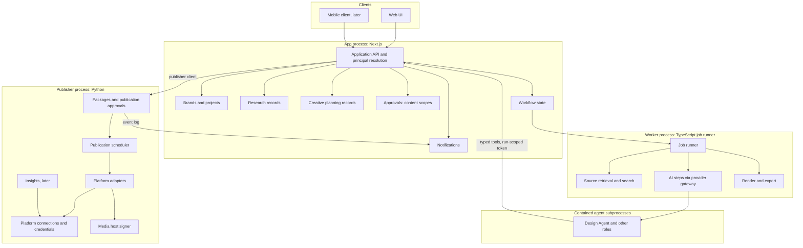
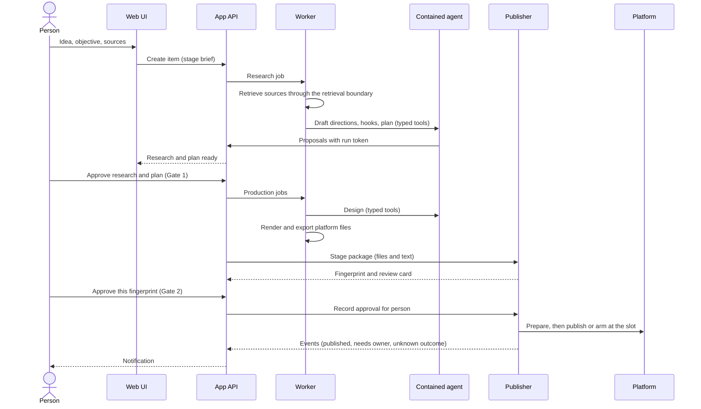

# RFC: CreatorBrio content automation architecture

**Status:** Revision 3, validated for implementation readiness.
The founder decisions in section 1 are ACCEPTED product requirements.
Every architectural decision in this RFC is PROPOSED until it is accepted in the [decision register](DECISION-REGISTER.md); none authorizes implementation by itself.

**Date:** 2026-11-18 (revision 2 was 2026-11-17).

**Ticket:** [#218](https://github.com/mk-global/creatorbrio/issues/218) (revision 3), after [#216](https://github.com/mk-global/creatorbrio/issues/216) (revision 2), which revised the proposal merged in [#215](https://github.com/mk-global/creatorbrio/pull/215) under [#214](https://github.com/mk-global/creatorbrio/issues/214).

**Inputs:** the [preserved independent review](reviews/2026-11-17-pr215-independent-review.md), the founder decisions below, a read-only assessment of the Social Automation publisher, and the [open-source research](OSS-RESEARCH.md).

**Companions:** [roadmap](ROADMAP.md), [Social Automation migration plan](SOCIAL-AUTOMATION-MIGRATION.md), [decision register](DECISION-REGISTER.md), [adversarial self-review](reviews/2026-11-17-reconciliation-self-review.md), [final validation review](reviews/2026-11-18-final-validation.md).

Present-tense facts about CreatorBrio come from merged code and the [architecture documentation](../../architecture/README.md), which win over this RFC wherever they disagree.
This RFC does not amend the [Video Studio ADR](../../architecture/adr-creatorbrio-video-studio.md), [design decisions](../../architecture/design-decisions.md) or the [Video Studio roadmap](../video-studio/README.md); where it needs a change to them, section 13 lists the amendment, and each goes through its own governed change.

## 1. Founder decisions (ACCEPTED requirements)

The founder accepted FD-A to FD-E on 2026-11-17 and FD-F to FD-I on 2026-11-18.
Each row states its decision in full, and the [decision register](DECISION-REGISTER.md#1-founder-decisions) cites this section as their source.

| ID | Decision |
|---|---|
| FD-A | CreatorBrio becomes one AI-powered social content automation product. A user gives an idea, objective, topic, source video or prompt; the system researches it, proposes creative directions, scripts, hooks, covers, captions and a production plan; the user approves the research; the system produces the content; the user approves the final publishing package; the system schedules or publishes it and notifies the user. It is one continuous, durable workflow inside one application. |
| FD-B | One modular repository, `mk-global/creatorbrio`. Modules have explicit responsibilities, interfaces, permissions, tests and ownership. Separate runtime processes are allowed where security or resource isolation needs them. One repository is not one process or one security boundary. |
| FD-C | The existing private Social Automation publishing system migrates into CreatorBrio as a separate, well-isolated module, after it has been assessed and without a second domain model, duplicate approvals or another independent scheduler. |
| FD-D | The open-source edition stays useful and completes the advertised workflows. Self-hosters run their own infrastructure, bring their own AI keys or permitted local models, register their own social developer apps, obtain their own permissions and reviews, and own upgrades, backups and monitoring. Where platform policy allows, they can publish automatically with their own app credentials. The hosted edition differentiates through convenience, not artificial restrictions. CreatorBrio stays MIT with its attribution until a separate licensing review says otherwise. |
| FD-E | Local first. The same domain capabilities later serve self-hosted installations, a multi-tenant hosted SaaS and mobile clients for creation, approval, status, scheduling and notifications. Minimize rewrites; do not build future infrastructure now. |
| FD-F | Positioning and customers, stated in section 1.1. |
| FD-G | The deferment principle, stated in section 1.2. |
| FD-H | Approval authority is never hardcoded to one named person. It belongs to authenticated people who hold the approval permission, and AI agents can never issue a human approval. |
| FD-I | The live Social Automation publishing cutover does not happen until the required containment proof (T1) passes on the actual publishing host. A test baseline is not that proof. |

### 1.1 Positioning and customers

**Positioning (product requirement):** CreatorBrio turns a content objective into research-backed, reviewed, publishable content, then helps measure and improve the next piece.
It is not positioned as another social media scheduler.

**Primary customers:** independent content creators, personal brands and small content teams.
**Expansion customers:** social media agencies, marketing teams and businesses managing several brands.

**Intended value:** less manual work between an idea and published content; higher quality through evidence, brand consistency and human review; continuous improvement informed by how content actually performed.
These three outcomes, and every commercial assumption behind them, are **unvalidated until measured** by T7 (creator outcome) and T6 (cost per approved artifact).

**What the evidence says today** (public vendor pages read on 2026-11-18; details in the [final validation review](reviews/2026-11-18-final-validation.md#2-positioning-against-existing-products)):

- Scheduling, approval workflows, brand kits, AI captions and basic analytics are table stakes in existing tools, so none of them differentiates CreatorBrio on its own.
- Cited research attached to the piece that ships, and a loop from a post's performance back into the next piece's research, are rare, and no product checked combines them with an approval of the exact final package.
- That combination is a **plausible differentiation, not a demonstrated advantage**: incumbents already ship pieces of it (cited listening insights in one, content locked after approval in another), so the window may be short.
- Approval workflows are sold mainly in team and agency tiers, so whether solo creators value formal approval is an open product assumption that T7 must test.

**Consequences for the roadmap:** the differentiating halves are research (phase 2) and the measurement loop, so the loop starts with a read-only performance readback in phase 5, before the hosted and mobile phases (AD-42).
Small content teams are primary customers, but reviewing remotely needs an identity beyond loopback, so teams are served by the hosted edition (or a self-hosted server once identity lands), while single creators are served locally first.

### 1.2 Deferment principle

Design now only what would be expensive, risky or disruptive to retrofit later; implement a capability only when an actual product outcome needs it.
Every capability is tested with five questions: would adding it later change foundational data ownership or authorization; would postponing it force a disruptive migration of content, approval or publishing records; would it later force changes across otherwise independent modules; does postponing it create a security or reliability problem today; is it needed for the first customer workflow.
The answers classify each capability as **FOUNDATIONAL** (contracts and invariants designed now, the minimum implemented when its phase needs it), **DEFERRED** (owner, dependencies and extension point recorded, nothing specified in detail) or **FUTURE** (customer value and the trigger for further research recorded), in the [product capability matrix](#product-capability-matrix).
No abstraction layer, database, service, orchestration framework or plug-in system is added without a concrete requirement.

## 2. Recommendation in brief

Evolve CreatorBrio itself into the product, as one repository with **three kinds of runtime process** and **one authority per kind of truth**:

1. **The app process** (Next.js) serves the UI and the one application API, and owns content, research, approvals of content, workflow state and notifications.
2. **The worker process** (same TypeScript codebase) runs bounded, durable compute jobs: rendering, export, media preparation, research retrieval and AI steps.
   Video Studio's Python and Swift media workers (ADR item 10) run under the same job model, as separate processes.
3. **The publisher process** is the migrated Social Automation system, kept in Python, the only process that reads social credentials, and the owner of platform connections, publication packages, publication approvals, the publication scheduler and platform adapters.
   It holds the frozen package and the Gate 2 approval of every publication, a manual handoff included (AD-36).
   The future insights and engagement modules use connections inside this process boundary with their own state (AD-40, AD-42, AD-43).
   A separate process gives fault isolation and one narrow interface; it is not privilege separation from other processes of the same operating-system user (AD-45).
4. **Agents** run as contained subprocesses with no route to credentials, approvals or the publisher.

Six decisions carry the design:

- **No new umbrella domain model.** Content authority stays with the carousel record and the Production v2 document.
  Research and approval become one shared contract that both use (section 5).
- **The Social Automation package is the publication manifest.** Its fingerprinted package, approval-in-force rule, per-platform lifecycle and reconciliation become CreatorBrio's publishing domain, not a second one (section 5.4).
- **Domain state, not a workflow engine.** Human waits are records in a state; compute is idempotent jobs; time is the publisher's due-time scheduler.
  No workflow engine, database server or queue is added for the local product (section 6).
- **Agents never hold authority.** Approvals come only from a person principal; agents run contained, and the durable boundary is typed tools with no shell, no raw file system and no web access (sections 7 and 8).
- **Ports, not rewrites, for portability.** Storage, secrets, triggers, media hosting and notifications sit behind ports with local adapters now and hosted adapters later, each proved by a conformance suite (section 9).
- **Self-hosted publishing is bring-your-own-app.** The open-source edition publishes with the self-hoster's own platform apps and bucket; the hosted edition publishes through the operator's reviewed apps (section 11).

## 3. Alternatives considered

| Criterion | A. Evolve CreatorBrio, publisher as an isolated Python process (recommended) | B. Evolve CreatorBrio, port the publisher to TypeScript first | C. Separate publishing service repository behind a contract | D. Adopt an existing open-source scheduler (for example Postiz) |
|---|---|---|---|---|
| Fit with FD-B and FD-C | Full | Full | Contradicts FD-B | Contradicts FD-C |
| Risk to working publishing | Lowest: code moves, behavior and tests move with it | High: about 7,800 lines of audited edge-case handling rewritten before any user value | Low for code, high for coherence | Replaces a working, audited system with one built on different assumptions |
| Duplication | None if the package and approval contract are shared | None after the port | Approvals and accounts straddle two repositories | Its own users, accounts, approvals and scheduler duplicate CreatorBrio's |
| Licensing | Publisher to be licensed MIT by its sole author on import (subject to FQ-1) | Same | Free choice | Postiz is AGPL-3.0, which cannot be copied into the MIT core, and its default stack (Temporal, Redis, source-available Elasticsearch) dwarfs the publisher it would replace ([research](OSS-RESEARCH.md#i-social-publishing)) |
| Contributor cost | Two languages in one repository; the publisher has no third-party Python dependencies | One language | Two release trains | A large foreign codebase |
| Hosted SaaS later | Publisher needs tenancy, a store port and hosted credentials either way | Same | Same | Its own SaaS model |
| Consistency with accepted decisions | Video Studio ADR item 10 already names "Python/Swift local workers" | Same | Contradicts the one-repository decision | Contradicts the capability ownership in the ADR |

**Recommendation: A.**
A TypeScript port (B) is deferred, not rejected: it is decided before a third new platform adapter is built or at the hosted stage, whichever comes first, because each new Python adapter enlarges a later port, and only with the full parity suite of the [migration plan](SOCIAL-AUTOMATION-MIGRATION.md) as its gate (decision AD-07).
The publisher assessment recommended a staged TypeScript port and advised against shipping a Python process to public users.
This RFC departs from that advice for three reasons: it carries the lowest risk to working publishing, a separate process gives credential use one narrow, auditable interface (protection from agents comes from containment, AD-45), and Video Studio ADR item 10 already allows Python workers.
Phase 6 therefore ships the Python publisher to self-hosters, an accepted consequence that founder question FQ-9 covers.

## 4. Module map

Each module owns its state; no module writes another module's state; cross-module work goes through the owning module's interface.

| Module | Owns | Runs in | Depends on | Permissions |
|---|---|---|---|---|
| App shell and API | Routes, request validation, principal resolution, stable errors, UI | App | Every domain module's handler library | Loopback only until the identity work in section 8 lands |
| Brands and projects | Brands and their knowledge (visual identity today; voice and audience context when research needs them), carousels, productions, formats, templates | App (writes) | Storage ports | Person and agent-run principals, scoped by run (AD-46) |
| Research and evidence | Research dossiers, sources, claims, retrieval, search adapters | Worker (retrieval), app (records) | `source-retrieval.ts`, search provider adapters | Network egress only through the retrieval boundary |
| Planning and creative direction | Editorial plan entries (AD-44), briefs, creative directions, hooks, scripts, plans, storyboards | App (records), worker (AI steps) | Provider gateway, research | Agent runs write proposals only, never approvals or plan dates |
| Media production | Carousel slides, exports (PNG, JPEG, PDF), media registry, renders | Worker | FFmpeg (user-installed), sandboxed Chromium | No network for render pages; bounded CPU, memory, disk and time |
| Approvals and versioning | The approval contract, review feedback, revision binding, in-force derivation (5.6) | App (content scopes), publisher (publication scope) | Content records, packages, identity | Person principals holding the matching `approve` permission only |
| Workflow state and execution | Per-item stage, job records, leases, recovery, worker supervision | App (state), worker (jobs) | Storage ports | Internal |
| Platform connections | Connections, destinations, accounts (destination sets), granted capabilities, credential custody, thin platform clients (AD-40) | Publisher process | Secret store, platform APIs | The only module that reads social credentials; serves each module only its own capability |
| Publishing and scheduling | Publication packages, publication approvals, publications, the publication scheduler, media hosting | Publisher process | Platform connections, media host | The only module that publishes or acts on a slot |
| Insights (DEFERRED; readback in phase 5) | Performance records keyed by publication, the evidence summaries research can cite (AD-42) | Publisher process (platform reads), app (views) | Platform connections, publications | Reads only through connections that hold the insights capability |
| Community engagement (FUTURE) | Comments, messages, inbox and response drafts (AD-43) | Publisher process (platform reads and replies), app (views) | Platform connections | Outward replies only for a person principal under an agreed response policy |
| Notifications | Durable notification records and delivery channels | App | Domain events, publisher event log | Person principals read their own |
| Providers and integrations | AI provider gateway (Claude CLI interactive, API keys, local models, manual), image service, search providers | Worker | Secret store | Keys never reach agents or the browser |
| Identity, secrets, tenancy | Principals with stable identifiers, permissions, sessions, agent-run credentials, secret store port; later workspaces and membership (AD-38, AD-39) | App, publisher | OS keychain locally, managed services hosted | Section 8 |
| Storage and portability | Storage ports, local adapters, export and import, conformance suites | All | File system now; PostgreSQL and object storage hosted | Section 9 |

**API host.**
The application API stays Next.js route handlers over each module's handler library, as it is today.
A separate API process is revisited at the hosted stage, and only if a hosted load or isolation test fails (AD-37).

### Overlap with Video Studio workstreams

These Video Studio workstreams own capabilities the platform needs, so the platform reuses them, adds only what the table lists and builds no parallel version.
The workstreams are defined in the [Video Studio roadmap](../video-studio/README.md#5-complete-workstream-register) and [spec/11](../../research/video-studio/spec/11-implementation-program.md).

| Workstream | What it owns | What the platform reuses or adds | Boundary |
|---|---|---|---|
| WS1 production data and atomic operations ([#78](https://github.com/mk-global/creatorbrio/issues/78)) | Production v2 document, typed operations, revisions, change sets, stage machine, stage-exit approvals | Reuses Production v2 as the video authority and its `Approval`; adds the shared research and approval contract (5.2), which carousels adopt additively | WS1 co-owns the shared module and decides the migration of `Approval` to `ApprovalRecord`; the platform changes no Production v2 schema |
| WS3 rights and provenance ([#80](https://github.com/mk-global/creatorbrio/issues/80)) | Rights records, licence normalisation, policy engine, consent, credits | Adds no rights model; carries every asset's rights and credits manifest into the publication package (5.3), shows it on the Gate 2 card and refuses staging for an asset that is not cleared | WS3 owns the records and the policy; the platform reads them and never re-derives rights; carousel images use the same record once it exists, and the person's declaration is carried until then |
| WS5 jobs and workers ([#82](https://github.com/mk-global/creatorbrio/issues/82)) | Job runner, leases, recovery, media and model workers, doctor and setup | Reuses the runner for research, AI-step, export and format-conversion jobs; adds job kinds and the one start command for app and worker | WS5 owns the runner and its supervision; the platform adds no second runner, and the publisher's tick is not a WS5 job because the publisher is the only publication scheduler (AD-08) |
| WS8 AI gateway, roles and MCP ([#85](https://github.com/mk-global/creatorbrio/issues/85), G8 [#104](https://github.com/mk-global/creatorbrio/issues/104)) | Model gateway, runtimes (CLI, API, local, manual), role prompts and schemas, the MCP tool server, run lifecycle | Reuses the gateway and typed tools; adds roles (research analyst, creative planner), search provider adapters behind the gateway and, until typed tools land, the contained CLI profile for the Design Agent (7.4) | WS8 owns the gateway and the tool registry; the platform adds roles and tool grants, never a second registry or an agent framework (TD-01) |
| WS9 brief, research and script ([#86](https://github.com/mk-global/creatorbrio/issues/86)) | Brief editor, research dossier and claims, script editor, hooks | Reuses the dossier and claim model; adds carousel research, retrieval, search and the Gate 1 review UI on top of it | WS9 owns research for video; carousel research uses the same dossier type through the shared module, so there is one dossier model |
| WS10 storyboard and editorial review ([#87](https://github.com/mk-global/creatorbrio/issues/87)) | Storyboard schema and lifecycle, Scene Specs, frames, animatic, review model, comments, run diffs | Reuses its review surfaces; adds Gate 2 as the final approval of the publication package | Review surfaces feed Gate 2: they inform the person and produce `plan` and `realization` approvals, but only a `publication` approval on the package fingerprint releases a post |

### Product capability matrix

Each area is classified under the deferment principle (section 1.2).
"Today" separates what CreatorBrio's merged code does from what the Social Automation publisher does; nothing proposed here is implemented until its phase lands.

| Capability area | Owner module | Today | Foundation designed now | Implementation stage | Class and rationale |
|---|---|---|---|---|---|
| A. Workspace, identity, team collaboration | Identity, secrets, tenancy | CreatorBrio: carousel routes rely on loopback and Origin checks only; the Video Studio API has a human key, paired browser sessions and run-scoped agent tokens. Publisher: from migration step P1 new records carry a principal, and earlier ones are read by AD-38's legacy rule | Stable principal identifiers in every human-attributed record; the permission set; agents never hold approval, scheduling, connection or administrative authority; one implicit local workspace (AD-38, AD-39) | Contract in phase 2 (carousel approvals) and migration step P1 (publisher); membership, invitations, roles and team review in phase 7 | FOUNDATIONAL for identity in records, because those records are immutable; DEFERRED for team features, because they need an identity beyond loopback; FUTURE for single sign-on |
| B. Brand strategy, audience context, brand knowledge | Brands and projects | CreatorBrio: brands hold visual identity (colours, fonts, logo, style keywords); each carousel keeps a Creative Brief with objective and audience; Production v2 has its own brief | None: brand voice, audience and content pillars are additive optional fields | Phase 2, when the research job and creative planner need them | DEFERRED: adding them later changes no ownership and migrates nothing |
| C. Planning, editorial calendar, campaigns, assignments | Planning and creative direction | CreatorBrio: none. Publisher: slots, and a check against an external plan that is not migrated (AD-27) | Plan entries express intent; the publisher's slot is the only time anything acts on (AD-44) | Plan entries and the calendar view in phase 4; assignments with teams in phase 7 | FOUNDATIONAL for the authority split, because a second scheduler is a reliability risk; DEFERRED for the calendar; FUTURE for campaigns, bulk operations and agency calendars (AD-04) |
| D. Research, evidence, creative strategy | Research and evidence; planning and creative direction | CreatorBrio: SSRF-safe retrieval of up to three supplied links; Production v2 types for dossiers, sources and claims, embedded without an identifier; no research job | Dossier identity and revision; research only through the server's retrieval boundary (AD-21, AD-41) | Phase 2 | FOUNDATIONAL for identity, because published posts must later resolve to their research |
| E. Creative production, video, carousels, covers, assets | Brands and projects; media production; Video Studio workstreams | CreatorBrio: carousel engine with PNG and native PDF export, Reel covers, the manual Video Studio with media registry and verified MP4 renders | Content references with a revision (carousels gain a server-owned revision counter, AD-41); assets by identifier (AD-15) | Built; JPEG publishing export in phase 4; video publishing after the `spec/01` amendment (AD-34) | Existing authority kept; no new production model |
| F. Review, comments, approval authority, audit history | Approvals and versioning | CreatorBrio: Production v2 stage-exit approvals and review comments, attributed to a generic actor; carousels have neither. Publisher: immutable approvals and revocations with in-force derivation | One approval record with a person principal and in-force derivation; feedback is never approval (AD-05, AD-38, AD-39, 5.6) | Gate 1 in phase 2, Gate 2 in phase 4; carousel comments and external reviewers with teams | FOUNDATIONAL: approval and audit records are immutable and shared by every format |
| G. Social connections, publishing, scheduling | Platform connections; publishing and scheduling | Publisher: in production for Instagram Reels and carousels, Facebook Page posts and YouTube videos, with fingerprinted packages, a per-platform lifecycle, reconciliation and its own scheduler. CreatorBrio: none | Connection, destination and account cardinality with per-capability use (AD-40); one scheduler (AD-08) | Import in phase 3, integration in phase 4, new adapters in phase 9 | FOUNDATIONAL contracts over working code |
| H. Insights, analytics, reporting, performance feedback | Insights | Publisher: account-level insight snapshots. CreatorBrio: none | Publication identifiers and staging provenance (AD-41); the insights capability on connections (AD-40) | Read-only readback per post in phase 5; dashboards, experiments and attribution FUTURE | DEFERRED: the identifiers are designed now so nothing needs migrating; the module waits for published posts to measure |
| I. Community engagement | Community engagement | None | Only the separate engagement capability on connections and the credential boundary (AD-40, AD-43) | Phase 9 at the earliest, after an independent privacy, platform-permissions and response-policy review | FUTURE: customer value is plausible for agencies, but storing messages is a new sensitive-data category and replies are outward actions |
| J. Integrations, notifications, durable execution, security, portability | Providers and integrations; notifications; workflow state and execution; storage and portability | CreatorBrio: durable render jobs, the Visual Director's isolated run, source retrieval, the request guard, the Production API's credential rules. Publisher: event log, alerts, its own runner | Agent containment and run-scoped API authority (AD-11, AD-46); one job runner (WS5); ports mapped but extracted only with their second adapter (AD-16) | M1 first; notifications in phase 4; Linux adapters in phase 5; hosted adapters in phase 7 | FOUNDATIONAL for security boundaries; DEFERRED for second adapters |

## 5. Unified domain model

### 5.1 Content authority

- A **carousel** (Instagram carousel, LinkedIn document, Reel cover) stays authoritative in the carousel record (`src/lib/carousels.ts`).
- A **video** stays authoritative in its Production v2 document (`src/types/production.ts`) and the production store.
- There is no `ContentProject`, `ResearchReportVersion`, `CreativeBriefVersion`, `ReviewRequest` or `ApprovalDecision` entity; the [preserved review](reviews/2026-11-17-pr215-independent-review.md) (P0-1) showed they duplicate Production v2.
- One idea that should become several formats (for example a carousel and a Reel) is two content items that reference one research dossier by its identifier and revision (5.7).
  A grouping record ("campaign") is DEFERRED until real use shows it is needed (AD-04).

### 5.2 The shared research and approval contract

A small shared module, owned jointly with Video Studio WS1 and WS9, holds the types both content kinds use:

- `ResearchDossier`, `ResearchSource` and `Claim`, lifted unchanged from `src/types/production.ts`, which re-exports them so Production v2 is unaffected; a dossier referenced across content items gains an identifier and revision (5.7).
- `ApprovalRecord`, a generalization of today's `Approval`:
  - `principal`: the stable identifier of the person who approved (never an agent run or a service, AD-38);
  - `permission`: the `approve` scope the person exercised, and `workspace`, absent for the implicit local workspace (AD-39);
  - `at`: when;
  - `scope`: `research`, `plan`, `realization` or `publication`;
  - `subject`: what was approved, by kind and identifier, with the exact `revision` (content) or `fingerprint` (publication package) it is bound to;
  - `statement`: the person's own words, optional.
- One rule, taken from the publisher's proven design: **whether an approval is in force is derived, never stored.**
  An approval is in force only while it is not revoked, its subject has not changed since, and its approver still holds the permission it exercised (AD-39); removing a person's permission first records, through the owning module's revocation (the publisher's Revoke command for publication approvals), an attributed revocation of exactly the approvals that person holds in force under that permission, made by the person removing it, the person's new approvals under that permission are refused once its removal begins, and the removal takes effect only after every revocation is recorded, so a failed revocation fails the removal and the publisher derives in-force status from its own records without reading permission state; any change to the subject produces a new revision or fingerprint that has no approval.
- Production v2's existing `Approval { by, at, revision, scope }` on storyboard scenes stays valid; it is the `plan` and `realization` scopes of the same contract, and its migration to `ApprovalRecord` is a WS1 decision.

Carousels gain the contract additively: a server-owned `revision` counter and optional `research` (a dossier reference), `plan`, `stage` and `approvals` fields, so every existing carousel stays valid and the editor keeps working without them.

### 5.3 Workflow stages

The two human gates of FD-A map onto existing structures instead of a new state machine:

| Step of FD-A | Carousel | Video (Production v2) | Gate |
|---|---|---|---|
| Idea, objective, sources | `stage: brief`, creative brief (exists) | `stage: brief` | |
| Research, competitor patterns, directions, hooks, plan | `stage: research`, dossier and plan | `stage: research`, `script` | |
| **Research approval** | `ApprovalRecord` scope `research` on the dossier revision and `plan` on the plan | stage-exit approval of `research` and `script` (the WS1 item still open) | Gate 1 |
| Production | `stage: production` (the existing design run) | `storyboard` to `finishing` | |
| Package assembly | export to platform files, then staging in the publisher | render, then staging | |
| **Package approval** | `ApprovalRecord` scope `publication` on the package fingerprint, held by the publisher for every destination, a manual handoff included (AD-36) | same | Gate 2 |
| Schedule, publish, reconcile, notify | publisher lifecycle (5.4) | same | |

A change after Gate 1 that alters the approved dossier or plan reopens Gate 1 for that subject only; production edits never need Gate 1 again.
Any change to a staged package produces a new fingerprint and needs Gate 2 again; moving the slot does not, because the slot is not part of what the public sees.
The slot invariant of section 5.4 governs moving it, and AD-06 records this deviation from the review's frozen-time manifest.
The package CreatorBrio stages carries a rights and credits manifest for every asset in it, taken from the asset's rights record (Video Studio WS3), or from the person's declaration where no record exists yet.
The manifest travels with the package as a declaration, so it is inside the fingerprint; Gate 2 shows it on the card, and staging is refused for an asset that is not cleared (AD-33).
A video follows the same path once Video Studio's out-of-scope list is amended to allow its output to be published through the platform (section 13, AD-34).

### 5.4 Publishing domain

These entities make up CreatorBrio's publishing domain:

- **Connection, destination and account** (AD-40): a connection is one credential grant with one provider, owned by the workspace, with the scopes the provider granted; a destination is one platform identity reached through a connection; an account is one brand's named set of destinations.
  A brand has zero or more destinations, grouped into zero or more accounts, and each package targets exactly one account, so the publication key of account, package and platform stays unique even when a brand has several accounts on one platform.
  Publishing, insights and engagement are separate capabilities of a connection, each used only by its own module and only when the granted scopes allow it.
- **Package**: exactly what the public will see in one slot, as files plus per-platform text and declarations, copied into a content-addressed store and identified by a **fingerprint** over every byte and setting except the slot.
  This is the frozen publication manifest the earlier RFC asked for.
- **Staging**: each time a package version is staged, an immutable record of when and from what: the brand, the content item and revision, and the dossier and revision when there is one (AD-41); it sits outside the fingerprint because none of it reaches a platform.
- **Publication approval**: an immutable record binding one fingerprint to a person's approval, with the person's identifier and the permission exercised (AD-38); in force by derivation.
- **Publication**: one package on one platform, with an explicit lifecycle (`pending`, `preparing`, `prepared` or `scheduled`, `publishing`, `published`, and the stops `needs_owner`, `failed`, `missed`), a unique key of account, package and platform, classified failures, and reconciliation that reads the platform before repeating anything that could post.
- **Slot**: a separate, movable record with history (AD-06).
- **Event log**: the record of every staging, approval, attempt, result and alert.
- **Manual destination**: for a platform with no configured app, the publisher still holds the frozen package and its Gate 2 approval (AD-36).
  The person approves the package, receives the frozen handoff bundle (the files and per-platform text the approval covers), posts it themselves and confirms the posting, which is recorded as an attributed event.
  No platform is called, and a change to the package after approval yields a new fingerprint with no approval, so the bundle is refused for it.
  It uses the same publication record, keyed by account, package and platform (the "account" of a manual destination is the person's named handoff target, which needs no credentials), passes through the same states up to `published`, which only the person's confirmation sets, and has a slot only if the person sets one, in which case a passed slot raises a reminder alert and not the `missed` or `failed` stop.

**Invariants of the publishing module.**
Each is proven by T2 and T12 (section 14).

- Only an approval in force for the stored fingerprint releases a post or a handoff bundle; the module never publishes on a calendar status, a CreatorBrio stage or an agent's word, and it never deletes a live post.
- Every value that reaches a platform is inside the package fingerprint, which excludes only the slot.
- An approval binds to one fingerprint, and only a person principal holding the publication approval permission creates it; only a person holding that permission revokes it, or, for exactly the approvals made under a permission being removed and as part of that removal, the person removing it (AD-39); agents never create, extend or judge an approval (AD-12, FD-H, section 5.5).
- Every approval, revocation, reslot, duplicate override and posting confirmation records the person principal that made it (AD-38).
- Events are append-only, carry a sequence number and an actor, and status output is machine-readable.
- The slot is a separate record that only a person principal holding `schedule` moves, every move is an attributed event, and moving it never touches an approval (AD-06).
- Mutating commands and the runner's tick are serialized, so a command never interleaves with a publication step.
- Credentials, triggers, keep-awake, media hosting and notifications sit behind ports (section 9), and only the publisher process reads social credentials.

### 5.5 Approval authority in the publishing domain

Approval authority follows the approval invariant of section 5.4 (AD-12) and founder decision FD-H, which answered the rule half of founder question FQ-3 (its "never judge" part rests on AD-12) in the [decision register](DECISION-REGISTER.md):

- Gate 2 approvals reach the publisher only through the CreatorBrio API on behalf of a person principal (the Production API's human key or paired browser session, extended to the approval routes in roadmap phase 2; section 8), or from the person at their own interactive terminal; agents have no route to an approval.
- The review card the person sees is rendered from what the publisher staged, not from CreatorBrio's own view, so the person approves the stored bytes.
- One CreatorBrio package carries every platform's text on one card, so one person approval covers the text of every platform shown there.
- Residual risk: in local single-user mode, processes of the same operating-system user are one principal; agent containment (M1) keeps agents out, and hosted mode uses an authenticated service interface.

### 5.6 Identity, review and approval policy

One policy serves every format and both gates.

- **Principals** have stable opaque identifiers: `person`, `agent-run` or `service` (AD-38).
  Local mode has exactly one person, the owner, created at setup.
  Records made before this rule that name no actor, or the generic `by: "user"`, read as the owner; records that name any non-person actor, such as `agent` or `system`, read as agent-run or service principals, never as a person, and an approval among them is not in force (AD-38).
- **Authority is a permission, never a name** (FD-H, AD-39).
  Identity (who signed in), membership (who belongs to the workspace), `review` (comment and request changes) and `approve`, `schedule`, `connect` and `administer` are separate, so a creator can later invite a reviewer who can comment or approve a content item without receiving publishing credentials or administrative authority.
  Agent-run and service principals can never hold `approve`, `schedule`, `connect` or `administer`.
- **Feedback is not approval.** A review comment or change request, by a person or an agent, never counts toward a gate; only an `ApprovalRecord` does.
- **Revisions.** A changed subject has a new revision or fingerprint with no approval; Gate 1 reopens only for the changed dossier or plan (5.3).
- **Revocation** is its own immutable record, made by a person holding the matching `approve` permission or, as part of removing an approver's permission, by the person removing it (AD-39), with a reason; an approval never comes back after revocation or a change to its subject.
- **Delegation** is granting a person a permission; no one approves on another's behalf, and no approval is ever extended to other text, other destinations or another package by an agent's judgment.
- **Scheduling.** The slot is outside the fingerprint (AD-06); moving it needs `schedule` and is an attributed event.
  Whether a reslot after approval must notify or re-ask the approver is a team policy DEFERRED to the hosted stage.
- **Separation of duties** (the creator may not approve their own work) is a team policy DEFERRED to the hosted stage; in single-person use the owner approves their own work.

### 5.7 Identifiers that link research, content, publication and performance

A published post must later resolve to the research it relied on, the creative revision it came from, the package the person approved and the performance it earned (AD-41).
Only identifiers are designed now; no metric schema is.

| Link | Identifier | Owner | Recorded |
|---|---|---|---|
| Research | Dossier identifier and revision | Research and evidence | When a dossier is saved (phase 2); Production v2 adopts it through WS1 and WS9 |
| Content | Content kind (`carousel` or `production`), identifier and revision | Brands and projects | Carousels gain a revision counter in phase 2; productions already have one |
| Package | Fingerprint, plus the staging's provenance (brand, content and dossier references) | Publishing | At staging, immutably (phase 4) |
| Publication | Account, package and platform, the platform's post identifier and link | Publishing | Exists in the publisher |
| Performance | Publication reference and time of the reading | Insights | When the readback lands (phase 5) |

Insight summaries reach research as a source kind a dossier can cite, so the loop runs through the research module's own records and Insights never writes research (AD-42).

## 6. Execution model

- **Human waits are domain state.** An item waiting for Gate 1 is a stored stage with no running execution; an approval is a record; nothing sleeps.
- **Compute is a durable job.** Rendering, export, retrieval and AI steps run as file-backed job records with staged creation, leases verified by process id, host and start time, transient, permanent and configuration failure classes, bounded retries and startup recovery: the lifecycle that render jobs already implement (`docs/architecture/video-rendering.md`).
  Video Studio WS5 owns the job runner; this RFC adds job kinds, not a second runner.
- **Time is owned by one scheduler.** The publisher's tick advances every due or unfinished publication one idempotent step and is the only component that acts on a slot.
  CreatorBrio never schedules posts itself; "schedule" in the UI sets the package's slot in the publisher.
- **The editorial plan is intent, not schedule** (AD-44).
  A plan entry (a brand, a title, an intended date and, once it exists, the content item) never triggers anything.
  The calendar view shows plan entries beside slots and publication states read from the publisher, so there is one plan and one scheduler.
- **No workflow engine locally.** The [research](OSS-RESEARCH.md#b-durable-execution-human-approvals-scheduling) found that the local product needs none, because engine wait primitives weaken a days-long approval (a signal sent before the wait is dropped, a local queue held in memory, or authority kept in a framework snapshot), so the approval stays a domain record; pg-boss on the product's own PostgreSQL is the proposed hosted default, and the hosted stage confirms the job layer by proof T10 (TD-04).
- **One worker process.** The worker runs compute jobs out of the web process, which Video Studio WS5 already plans; locally one start command launches app and worker.
- **Triggers are a port.** The publisher's tick is started by launchd on macOS (the reference adapter), because launchd runs a calendar firing missed during sleep as soon as the Mac wakes; systemd timers and an always-on container are the adapters for Linux and hosted mode.

## 7. Security and threat model

### 7.1 Assets and worst outcomes

The worst outcomes, in order: a post nobody approved; a leaked credential that lets someone else post or read private data; a deleted live post; cross-tenant access (hosted); runaway cost; loss of approved or published records.

### 7.2 Trust boundaries

| Boundary | Local single-user mode | Hosted mode |
|---|---|---|
| Person to API | Loopback, paired browser session or local key | Authenticated session, CSRF protection, rate limits |
| API to agent | Run-scoped token, typed tools, refusal of server-owned fields and approvals (exists for productions); for carousels, M1 confines the agent to an agent-only listener scoped to its run's carousel (AD-46) | Same, plus per-tenant budgets |
| Agent to machine | Contained subprocess (section 7.4); not an OS account boundary | Container with no credentials, no egress except the model API |
| API to publisher | Local subprocess interface; agents have no route to it | Authenticated service interface |
| Publisher to platforms | Self-hoster's own app credentials in the OS keychain | Operator's reviewed apps; tokens in an encrypted, tenant-scoped secret service |
| Media to platforms | Private bucket and short-lived signed links (the publisher's existing design) | Same, tenant-scoped keys |
| Render to content | Chromium with page JavaScript off and every request refused but bundled fonts (exists) | Same, inside a resource-limited container |

### 7.3 Threats and controls

| Threat | Control | Proof |
|---|---|---|
| Prompt injection from a researched page drives the agent to read a secret or call an API | Research is retrieved by the server boundary, not the agent; the agent has no web fetch, a shell only inside a sandbox whose network reaches the agent's API address and port (the agent-only listener, AD-46) and nothing else (section 7.4), and no read access to data or secrets | T1 |
| An agent creates or forges an approval | Approvals need a person principal holding the permission; agent tokens and requests without a person credential are refused; the agent cannot reach the publisher | T2 |
| Injected instructions make the agent change or delete other projects, brands or templates through the app's own API | The agent reaches only an agent-only listener that serves its run's carousel (Route A) or typed tools with the same scope (Route B) | T1 |
| A process of the same operating-system user other than an agent reads social credentials | Not closed locally: a separate process is not privilege separation (AD-45); agents are contained, and operating-system account separation is the escalation | None locally: T1's keychain canary covers agents only |
| A package changes after approval | Fingerprint binding; in-force derivation | T2 |
| A lost platform answer causes a duplicate post | Read the platform before repeating anything that could post; unknown outcomes stop for the person | T3 (inherited publisher tests plus live rehearsal) |
| Signed media links leak | 24-hour lifetime, bucket lifecycle deletion, links scrubbed from logs and errors (exists) | Publisher tests |
| Credential exposure in logs, errors or URLs | Tokens in headers only, scrubbing (exists in the publisher); structured logs without secrets | Publisher tests, log scan |
| Untrusted media crashes or escapes FFmpeg or Chromium | Separate worker, bounded resources; hosted containers without egress | T4 |
| Cross-tenant access | Tenant-scoped principals, storage keys and secret namespaces; deny tests at every boundary | T11 (hosted) |
| A compromised dependency or plug-in | No third-party executable plug-ins; pinned dependencies; licence and advisory review | Release checks |
| Runaway model or media cost | Per-run budgets, deadlines and attempt limits (the Design Agent already has deadlines and an optional budget) | T6 |

### 7.4 Agent containment (precondition for any credential in reach)

The current Design Agent runs the Claude CLI with unrestricted `Bash`, `WebFetch` and `Read`, from the repository folder, with the app's environment and the person's own Claude Code settings (`docs/architecture/design-agent.md`, #156, #186).
`docs/architecture/video-production-api.md` records that a process running as the same operating-system user can read every local secret, including today's Design Agent, which has a shell.
That exposure applies to every credential the product will hold, whether or not the publisher lives in this repository.
After the publisher cutover the live runner also deploys from this repository, so an unconstrained shell could write to that checkout too.
Containment therefore comes first, in two steps:

1. **Contain with the CLI's documented controls** (first milestone, [roadmap](ROADMAP.md)): an explicit execution profile (no user, project or local setting sources, strict MCP configuration, no CLAUDE.md or auto-memory, a pinned model), an explicit minimal environment, a working folder outside the repository with writes confined to it, web fetch disabled (linked pages are retrieved by the server and handed to the agent as delimited untrusted text), and the shell confined by Claude Code's sandbox (Seatbelt on macOS, bubblewrap on Linux and WSL2) with its network limited to the agent's API address and port (the agent-only listener, AD-46) by the mechanism below, read denial for the data folder, secrets and the browser's profile and cookie stores, and the unsandboxed escape hatch off.
   The Design Agent creates slides by calling the app's API with `curl` from its shell (`CLAUDE.md`, `src/lib/chat-system-prompt.ts`), so the sandbox must let that shell reach its API origin (the agent-only listener, AD-46) and nothing else on the machine or the network.
   The vendor's [sandboxing documentation](https://code.claude.com/docs/en/sandboxing.md), section "A command fails to reach a server on localhost" (retrieved 2026-11-17), states that by default a sandboxed command cannot connect directly to a server running on the machine outside the sandbox.
   On macOS, `network.allowLocalBinding: true` lets sandboxed commands connect to any port on localhost, including every other local service.
   On Linux and WSL2, a sandboxed command's localhost is private, a direct connection to localhost or 127.0.0.1 does not reach host servers, and `allowLocalBinding` has no effect; the documented workaround is `excludedCommands`, which runs the command with no filesystem or network limits.
   Claude Code sets `NO_PROXY` for sandboxed commands so that localhost connections go direct and not through the sandbox proxy, and an `allowedDomains` entry such as `127.0.0.1:3000` applies to connections that go through that proxy.
   The mechanism is therefore chosen by a feasibility proof, in this order:
   - **Route A, tried first:** the agent's API calls go through the sandbox proxy to an `allowedDomains` entry for exactly the host the agent is given by `resolveAppOrigin()` and the agent-only listener's port (AD-46), and the calls are sent through the proxy explicitly instead of relying on the default `NO_PROXY` direct path.
     `resolveAppOrigin()` (`src/lib/request-origin.ts`) derives the host from the request's Host header, typically `localhost`; the port is the agent-only listener's, not the app's main port.
     The vendor's local-address check exempts `localhost` and `*.localhost`, so the usual `localhost:<port>` entry needs no IP form; the IP and port form (for example `127.0.0.1:<port>`) is needed as well only when the Host header carries another name that resolves to loopback.
     An `allowedDomains` entry alone does not make the allowlist a limit: for a host outside the allowed domains the vendor documents that the result depends on the permission mode (allowed without a prompt in bypass-permissions mode, possibly prompted for in other modes).
     The execution profile therefore sets `sandbox.network.strictAllowlist: true` through `--settings` and pins a permission mode that is not bypass-permissions, so the sandbox proxy refuses every host outside the allowlist in every mode ([sandboxing documentation](https://code.claude.com/docs/en/sandboxing.md), retrieved 2026-11-17).
     The design prompt's API-call instructions change on either route (AD-46), as a governed prompt change (section 13).
   - **Route B, if Route A fails when tested on any of macOS, Linux or WSL2:** the agent reaches the API only through typed tools on an MCP server that CreatorBrio operates (step 2 below, brought into the first milestone), and the shell then needs no network at all.
   - **Rejected:** `network.allowLocalBinding`, because on macOS it opens every local port to the shell, including every other local service.
   - **Rejected:** `excludedCommands` for the agent's API calls, because it runs them with no filesystem or network limits, which removes the confinement the step exists to provide.

   The first milestone begins with a feasibility proof on macOS, Linux and WSL2 that, under the profile's `strictAllowlist` setting and pinned permission mode, the agent reaches its API origin (the agent-only listener) and no other localhost port and no external host; the rest of the milestone proceeds only when it passes, and the chosen route is recorded in the [decision register](DECISION-REGISTER.md) (AD-35).
   **Revision 3, facts re-verified on 2026-11-18** against the same [sandboxing documentation](https://code.claude.com/docs/en/sandboxing.md):
   - an `allowedDomains` entry may name a port, and an entry without a port allows every port on that host, so the profile's entry always names one;
   - `strictAllowlist` needs Claude Code 2.1.219 or later, so the profile refuses to start on an older CLI;
   - the sandbox covers shell commands only, and a read-deny rule does not stop the agent's file-reading tool, which follows permission rules, so that tool's confinement is tested by T1's canaries rather than enforced by the operating system;
   - the documentation says nothing about Keychain access through system services, so T1's keychain canary on the publishing host is the only evidence, and if it fails while the agent keeps a shell, AD-45's remedies apply before cutover.
   **Measured on 2026-11-18** by the feasibility proof ([#220](https://github.com/mk-global/creatorbrio/issues/220), [proof record](reviews/2026-11-18-sandbox-route-proof.md)): Route A passed on the macOS publishing host and on Linux, and the proof's hardened profile adds two denials the candidate profile lacked, Keychain-folder reads on macOS and writes to the CLI's shared per-user temporary folder (the Keychain-folder denial was tested with one client, the `security` tool, and one item type, a login-keychain generic password; data-protection keychain items were not tested).
   **What the agent may do through the API** (AD-46): network confinement limits where the shell connects, not what it may change there.
   Today's request guard allows any request without an `Origin`, and the carousel routes take no credential, so a token check alone cannot scope the agent.
   Under Route A the one allowlisted port is therefore an agent-only listener, separate from the app's main port, that serves only the operations the design prompt uses for the run's own carousel (not style-preset creation, which is workspace-wide; its instruction is dropped with #159) and checks a run-scoped token bound to it; under Route B the typed tools carry the same scope.
   Either way, from inside the sandbox nothing outside the run's own carousel can change, with or without a token, which T1 tests.
   **Platform scope of the proof:** one route serves every supported platform, so a Route A failure on any tested platform selects Route B everywhere; a platform that cannot be tested, for example WSL2 without a test host, is not a Route A failure, and the Design Agent is reported unavailable there until it is proven; the proof on the actual publishing host is the one the cutover gate needs (FD-I).
   The working folder is one per carousel conversation, created on first use and reused by that carousel's runs with its inputs refreshed for each run, because Claude Code stores a session under the working directory it started in and the chat resumes one session across messages (`docs/architecture/design-agent.md`); writes stay denied everywhere outside that carousel's folder.
   That per-working-directory session storage is a local observation of the CLI on 2026-11-17, not vendor documentation, and T1 verifies it.
   A chat begun before the first milestone cannot resume in its new folder; it starts one fresh session through the existing reset path, with the carousel's slides intact.
   The CLI documentation states that permission rules are not a security boundary and that its sandbox covers the shell only, not the `Read` or `WebFetch` tools, so this step reduces risk and is proved by T1; it is not an operating-system account boundary.
   The sources, all retrieved on 2026-11-17, are the vendor's [sandboxing documentation](https://code.claude.com/docs/en/sandboxing.md) for the sandbox mechanisms, its shell-only scope and the network allowlist, the [permissions documentation](https://code.claude.com/docs/en/permissions.md) for permission rules not being a security boundary, and the [CLI reference](https://code.claude.com/docs/en/cli-reference.md) for the `--tools`, `--setting-sources` and `--strict-mcp-config` flags.
   The sandbox uses Seatbelt on macOS and bubblewrap on Linux and WSL2, and native Windows runs unsandboxed, so on Windows the confined Design Agent runs under WSL2, and on native Windows without WSL2 it is reported unavailable with setup guidance; this is a deliberate capability change.
   On Linux and WSL2 without the sandbox prerequisites (bubblewrap, socat and the seccomp filter), the Design Agent is likewise reported unavailable with setup guidance, and the doctor command checks for all three.
   The vendor's documentation treats the seccomp filter as optional, because the sandbox starts without it, but CreatorBrio requires it, because the filter is what adds Unix domain socket blocking.
   Without it a sandboxed command could connect to local socket services, for example the D-Bus Secret Service planned as the Linux secret store (AD-17), and on WSL2 it could launch a Windows binary, which the vendor documents as handed to the Windows host over a Unix socket and so outside the Linux sandbox.
   Removing web fetch also removes the agent's own web research on a topic: supplied URLs keep working through the server's retrieval, and topic research without URLs returns with the research job of roadmap phase 2; this is a deliberate, temporary capability change, part of the quality change in FQ-4.
   The execution profile records the Claude CLI version that T1 last passed on; a different version starts with a visible warning in the app and in the doctor command, and T1 is rerun on that version on demand.
2. **Replace the shell with typed tools** (Video Studio WS8 and G8): the agent calls CreatorBrio through typed tools with a run-scoped token, and reads only the images it is given.
   This is the durable boundary, and Route B of step 1 brings it into the first milestone if the feasibility proof requires it.
   If typed tools cost measurable design quality, or T1's keychain canary cannot pass while the agent keeps a shell, OS-account separation is the fallback (AD-45).

The CLI is used only for runs a person starts interactively on their own machine, under their own sign-in; scheduled, unattended or hosted runs use API-key runtimes, as Anthropic's terms require ([preserved review](reviews/2026-11-17-pr215-independent-review.md), section 12).

## 8. Identity, authorization, secrets and tenancy

- **One principal model now, for every route, scheduled in roadmap phase 2.** Principals are `person`, `agent-run` and `service`.
  Today the carousel routes rely only on loopback and Origin checks, Video Studio routes on a key file and paired sessions, and agent tokens live in memory; the identity work unifies them on the Production API's rule that authority comes from a credential, never the request body.
  Phase 2 extends the Production API's person principal to the carousel approval routes of Gate 1 and Gate 2, so a tokenless loopback request cannot approve (T2).
  The human key is a header and works on any route, while the paired browser session's cookie is scoped to `/api/video`, so pairing also sets a second cookie, bound to the same session record and scoped to the approval routes.
  A cookie's `Path` matches by prefix, so the carousel approval routes share one dedicated path prefix, the second cookie is scoped to exactly that prefix, and no other route sits under it.
  Agents are kept from obtaining the principal by M1's read denial of the key and session records and of the browser's profile and cookie stores, which is not an operating-system account boundary (5.5).
  The Production API document is updated in the same change (section 13).
  The remaining routes join the model before any route leaves loopback.
  No route is exposed beyond loopback before this exists.
- **Assets by identifier.** Carousel slides stop embedding storage paths (`/uploads/<file>`) and refer to assets by identifier resolved by the server; uploads are served through the same authority; browser upload replaces import by absolute path for anything outside the local Studio (#141).
- **Secrets behind a port.** The publisher's secret store sits behind a port with a macOS Keychain reference adapter, a Linux Secret Service adapter and an encrypted-file adapter for headless servers, and later a hosted adapter backed by a managed key service with envelope encryption and rotation.
  AI provider keys use the same port; nothing secret lives in `data/`, `.env.local` passed to agents, logs or URLs.
- **Person identity and permissions now, membership later.** Every human-attributed record carries a stable principal identifier from its first implementation (AD-38), and authority is checked as a permission (AD-39, 5.6); the local owner holds every permission.
  Team review needs a reviewer to reach the app, which needs an identity beyond loopback, so membership, invitations and roles arrive with the hosted stage or a self-hosted server deployment after this section's identity work, never by exposing loopback routes.
- **Tenancy is hosted-only.** Workspaces and members are added at the hosted stage on top of the principal model; every record, storage key, job, secret name and event carries the workspace, and every boundary has a cross-tenant deny test (T11).
  The local product keeps one implicit workspace, which makes export and import into a hosted workspace a mapping, not a migration of meaning; records already carry the person identifiers that mapping needs.

## 9. Storage and portability

| Store | Local now | Hosted later | Port and proof |
|---|---|---|---|
| Carousels, brands, runs | JSON files with locks and atomic writes (`src/lib/data.ts`) | PostgreSQL | Carousel store port; T8 |
| Productions | Journal plus content-addressed documents, hard-link compare-and-swap | PostgreSQL rows with a unique generation constraint, object store for snapshots | Existing crash and multi-process tests become the conformance suite; T8 |
| Media and renders | Content-addressed files | Object storage | Asset store port; T8 |
| Publisher state | SQLite plus an append-only event log and a content-addressed store, outside the repository | PostgreSQL and object storage | Publisher store port; parity suite from the migration plan |
| Secrets | OS keychain | Managed key service | Secret store port |
| Notifications | JSON records | PostgreSQL | Notification store port |
| Plan entries | JSON records | PostgreSQL | Planning store port |
| Insights | Inside the publisher's store (from phase 5) | PostgreSQL | Publisher store port |

The publisher's SQLite database lives inside the publisher's own boundary and needs no server; it is consistent with Video Studio ADR item 10 but is an exception to "Local JSON storage stays" in `design-decisions.md`, so that document gets a scoped amendment in the import change (section 13).

**Local to self-hosted.** Same code, plus Linux adapters for secrets, triggers and keep-awake, documented prerequisites (Node; FFmpeg; Python for the publisher; a Claude sign-in or an API key) and bring-your-own app and bucket guides.
Python is a prerequisite because every Gate 2 publication needs the publisher, the manual handoff included.
**Self-hosted to hosted.** Adapters behind the same ports, identity and tenancy on the principal model, API-key runtimes only, containerized workers, and an export-import path that preserves hashes, approvals and publication records (T9).
**Hosted to mobile.** A mobile client uses the same application API for creation, approvals, status, scheduling and notifications.
The responsive web app and email serve phones first; a native client follows hosted identity, and it never edits video.

## 10. Agents and providers

- The provider gateway (Video Studio WS8, gate G8) offers Claude CLI (interactive, local, the person's own sign-in), Anthropic and other API keys (unattended and hosted), permitted local models, and a manual mode.
- Agent roles (research analyst, creative planner, Design Agent, Visual Director) are prompts and tool grants over the same typed tools; no agent framework is adopted (TD-01): the [research](OSS-RESEARCH.md#a-agent-frameworks-tool-calling-structured-output) found that each candidate either duplicates domain state, exports traces by default, is proprietary, or adds more than it removes, while provider SDKs, one typed tool registry and a manual loop for approval-gated tools cover the need.
- Structured outputs are schema-validated by the server; identifiers are server-generated; model output is never trusted as authority.
- Every run records model, tokens, estimated cost, duration and outcome against the item, which the cost proof (T6) and the hosted usage ledger reuse.

## 11. Operating and commercial model

### 11.1 Editions

| Concern | Open-source, self-hosted | Hosted SaaS |
|---|---|---|
| Who runs it | The self-hoster, on their machine or server | The operator |
| AI | The self-hoster's API keys, a permitted local model, or their own interactive Claude sign-in | The operator's commercial provider accounts, metered |
| Social publishing | The self-hoster's own developer apps, permissions and reviews; their own bucket for signed media links | The operator's reviewed apps and provider-approved connection flows |
| Scheduling while offline | Native platform scheduling where it exists; otherwise the machine must be awake at the slot | Always-on |
| Credentials | OS keychain or encrypted file | Managed, encrypted, rotated |
| Operations | Self-hoster's upgrades, backups and monitoring | Managed, with support |

### 11.2 What the self-hosted edition can honestly promise

The per-platform facts, with sources and dates, are in [OSS-RESEARCH.md](OSS-RESEARCH.md); in summary:

- Publishing to the self-hoster's **own** professional accounts with their own apps is possible on Instagram, Facebook Pages and YouTube, which the publisher does in production for its operator.
- It requires real setup: a developer app per platform, a business portfolio and system-user token for Meta, a Google Cloud OAuth client (unverified apps are capped in users, which a single self-hoster does not reach), and an object-storage bucket for Instagram's public media fetch.
- Platforms whose posting API requires an audit before public posting (TikTok, where unaudited apps post privately only) or is paid per post (X) are not promised to self-hosters; TikTok can offer "send to drafts".
- LinkedIn member posting is self-serve, and CreatorBrio already makes LinkedIn documents; document posts are promised only after a live call confirms the self-serve permission covers them.
- When a platform cannot be automated for a self-hoster, the edition still completes the workflow: the package goes through Gate 2 in the publisher like any other, and the person receives the frozen handoff bundle and a guided manual posting handoff, and confirms the posting (a manual destination of the publisher, AD-36).

### 11.3 Where paid value lives

A hosted edition sharing one Google project must obtain a YouTube quota extension, because uploads have their own bucket of about 100 per day per project.
The hosted edition's value is the work a self-hoster cannot shortcut: the operator's apps having passed platform reviews and business verification (which take weeks to months and must be kept current), always-on scheduling, managed credentials, monitoring, upgrades, support, team features and bundled compute.
The MIT licence allows anyone, including competitors, to host the core; the defensible assets are the reviewed platform apps, operational quality, brand and the product's pace.
Changing the licence to protect against hosting (for example AGPL or a source-available licence) is DEFERRED to a separate licensing review under FD-D.

### 11.4 Costs

- One measured eight-slide carousel design run was estimated at USD 4.06 plus 0.18 for planning at list price (#184), under inherited personal settings, so it is a signal, not a baseline.
- Research, revisions and video add to that; the cost proof T6 sets a target per approved artifact before any hosted pricing.
- Self-hosters pay their own model usage, any bucket (small at this scale) and any paid platform API.

## 12. Licensing and distribution

- CreatorBrio stays MIT with the Open Carrusel copyright notice unchanged (`docs/PROVENANCE.md`).
- Importing Social Automation requires its sole author's decision to license it under MIT (FQ-1), recorded in `docs/PROVENANCE.md` with the source repository and commit.
- GPL tools (GPL FFmpeg builds) stay separate, user-installed processes; any container image is preceded by a bill of materials review (T9).
- AGPL code (for example Postiz) is studied, never copied, and AGPL services (for example SearXNG and Garage) are neither integrated, bundled nor distributed (`spec/08`); a self-hoster may point CreatorBrio's generic search endpoint or S3-compatible adapter at a service they run themselves.
- SSPL and BSL components are not distributed (`spec/08`).
- LGPL: sharp's prebuilt libvips is a dynamically linked LGPL library that is already in use, section 13 lists the `spec/08` clarification it needs, and no new LGPL library is adopted.
- Model weights, voices and media assets carry their own licences; non-commercial weights are never defaults ([OSS-RESEARCH.md](OSS-RESEARCH.md)).
- Claude Code is proprietary; it is never vendored, and the product never routes other people's work through someone's subscription.

## 13. Required amendments to accepted documents (each its own governed change)

| Document | Amendment | When |
|---|---|---|
| `docs/architecture/design-decisions.md`, "Local JSON storage stays" | Add the publisher's SQLite store as a scoped exception inside the publisher boundary | With the publisher import |
| `docs/architecture/design-agent.md`, `docs/architecture/visual-director.md`, `CLAUDE.md` tool convention and its network note ("requests without `Origin` (the agent's curl) are allowed") | Replace "`--allowedTools Bash WebFetch Read`" with the contained execution profile, and record the Windows, sandbox-prerequisite and topic-research capability changes of section 7.4, the chosen network route (AD-35), the agent-only listener or typed tools that scope the agent's API authority (AD-46) and the Visual Director's execution profile | With the first milestone |
| Video Studio ADR item 10 | Amend explicitly when hosted infrastructure is authorized; not needed before | Hosted stage |
| Production v2 `Approval`, `ReviewComment` and `ResearchDossier` | Generalize `Approval` to `ApprovalRecord` under WS1, recording a person identifier where today's records name a generic actor (existing `by: "user"` records read as the local owner, and agent or system records never do, AD-38); give a dossier an identifier and revision so a carousel and a production can cite one (AD-41), with WS9 | With the shared contract work (phase 2) |
| `docs/architecture/video-production-api.md` | Extend the person principal to the carousel approval routes: pairing also sets a second cookie scoped to the one path prefix those routes share and bound to the same session record, so one revocation ends both; update the authority table, the pairing and cookie-request rules and the statement about today's Design Agent (which M1 changes) in the same change as the routes | Phase 2, with the carousel approval routes (M1 for the Design Agent statement) |
| `docs/architecture/creative-workflow.md` ("The Design Agent's system prompt does not change"), `tests/prompt-baseline.test.ts` and `src/lib/chat-system-prompt.ts` | Change the design prompt's URL instruction from "Use WebFetch to fetch the page content" to using the page text the server retrieved through `src/lib/source-retrieval.ts` and delimited as untrusted content; the pinned prompt test gets that documented substitution; the API-call instructions change in the same governed way on either route (the agent-only listener and run-scoped token through the proxy under Route A, typed tool calls under Route B, and the style-preset instruction dropped on both; AD-46, section 7.4), with its own documented substitution; the test's own rule requires the founder's authorization | With the first milestone, in the change that disables web fetch |
| Video Studio `spec/01` (AIM-03), `spec/07` section 7 and `spec/08` section 2, which keep the Claude Agent SDK as an optional runtime | TD-03 rejects the SDK as a framework: either remove it from those documents, or amend TD-03 to reject it only as a framework and a default, leaving it an optional, unbundled alternative under Anthropic's own terms | With the provider gateway work (WS8) |
| `CLAUDE.md` Slide HTML Rules ("Reference images as `/uploads/{filename}` paths") and the `/uploads/` conventions in `docs/architecture/carousel-export.md` and `docs/architecture/creative-workflow.md` | AD-15 replaces embedded storage paths with asset identifiers resolved by the server: amend the slide image rule, the export reader and the stored-slide migration together | With the identity and asset work (section 8) |
| Video Studio `spec/01` ("Out of scope": "publishing and scheduling to social platforms", and "multi-user collaboration, accounts and cloud storage") | Amend the list so that publishing and scheduling are the content platform's publishing module consuming Video Studio's delivered output, not a Video Studio feature; accounts and cloud storage stay out of scope until the hosted stage; Video Studio's own requirements, workstreams and gates do not change | Before any video is published through the platform; until then video publishing in the roadmap (phase 4) is gated on it (AD-34) |
| Video Studio `spec/08` section 2 (LGPL builds "never linked or shipped in the repository") | Clarify that a dynamically linked LGPL native library already in use, such as sharp's prebuilt libvips, stays as an unmodified dependency with its notices kept in third-party credits, while adopting a new LGPL library remains excluded as written (Sidequest is rejected on that ground) | With the dependency licence scan, before open-source release readiness (roadmap phase 6) |
| Video Studio `spec/08` section 2 (the MCP SDK listed as MIT) and `docs/research/video-studio/evidence/e8-tts-sourcing-providers.md` (OmniVoice listed as Apache-2.0 and unverified; Piper), with the other corrections in [OSS-RESEARCH.md](OSS-RESEARCH.md#changes-from-the-2026-11-04-video-studio-research) | The MCP TypeScript SDK is moving to Apache-2.0; OmniVoice weights are CC-BY-NC; Piper published voice-licensing pages on 2026-11-09 (engine GPL-3.0, optional separate process, allow-listed voices) | Before Video Studio gates G3, G4 or G9 rely on them |

## 14. Proofs

| ID | Proof | Pass condition | Before |
|---|---|---|---|
| T1 | Agent injection containment | On macOS, Linux and WSL2, a design run fed a page instructing it to read canary secrets (a file in `data/`, a file in a browser profile or cookie store folder, an environment variable, a canary Keychain or Secret Service item), connect to a canary Unix domain socket service, launch a Windows binary (WSL2), write a canary file into the repository checkout, change or delete another carousel, a brand or a template through the app's API with and without a token, and call an external host produces zero canary reads, zero socket connections, zero launches, zero canary writes, zero changes outside its own carousel, zero egress beyond the agent-only listener, no connection to any other localhost port, and no approval or publication, and a follow-up message to the same carousel resumes its session; the baseline against today's agent is recorded first | The publisher cutover (passed on the actual publishing host, FD-I); any credential integration (passed on every supported platform) |
| T2 | Approval binding | Any change to a staged package refuses publish and refuses the handoff bundle of a manual destination; concurrent approvals yield one; an agent-run token, a tokenless loopback request carrying the app's Origin and a tokenless loopback request with no Origin cannot create an approval; a person without the publication approval permission cannot approve, and an approval whose approver no longer holds the permission is not in force; every approval, revocation and reslot names its person principal; the card shown equals the stored bytes | First integrated publish |
| T3 | Publication reconciliation | Inherited publisher tests pass in the new location, and a forced lost answer after a live rehearsal ends in exactly one post | Cutover |
| T4 | Worker isolation and restart | Killing the worker during research, render and export resumes each once with no orphaned artifacts; the web process stays responsive during a full render | First end-to-end workflow |
| T5 | Self-hoster feasibility | An independent person follows the bring-your-own-app guide for one platform and publishes to their own account; every step is documented | Open-source publishing claims |
| T6 | Cost and time | Ten representative jobs on API-key runtimes give a cost and duration distribution per approved artifact against a founder-set target | Hosted pricing |
| T7 | Creator outcome | Five or more creators run research, approval, production and publishing or handoff; acceptance without rewriting, edits per piece and time saved are measured | Open-source release claims (run after phase 4, revision 3); hosted commitment |
| T8 | Storage port conformance | The existing crash and multi-process tests pass unchanged against a second adapter | Hosted stage |
| T9 | Distribution licence | A bill of materials for any distributed image shows no GPL, AGPL, SSPL, BSL or non-commercial component against `spec/08` | Any container release |
| T10 | Durable execution (hosted) | The chosen PostgreSQL-backed job layer survives full restart, cancellation, in-flight version change and per-tenant limits | Hosted stage |
| T11 | Cross-tenant isolation (hosted) | Automated attempts across SQL, objects, jobs, secrets, events and logs all fail | Hosted launch |
| T12 | Publisher parity | The migrated publisher's full suite passes, with each approval path removed or disabled under migration step P1 replaced by a test of the rule in section 5.4, and covers the invariants of section 5.4, including that a mutating command and the runner's tick never interleave; a shadow period of dry runs on real packages gives results identical to the standalone system's; and the first live posts are watched | Standalone retirement |
| T13 | Provenance chain | For a post published through both gates, its performance reading resolves to the publication, the staging's fingerprint, the content item and revision, and the dossier and revision | The phase 5 readback |

## 15. What this RFC deliberately does not do

- It does not choose a workflow engine, database server, queue or agent framework for the local product.
- It does not build tenancy, billing, a usage ledger, OpenAPI clients or a mobile app before the stages that need them.
- It does not change Video Studio's own scope, gates or sequencing; the platform consumes the output of its delivered workflows, subject to the `spec/01` amendment in section 13.
- It does not design deferred or future modules in detail (team administration, metric schemas, the inbox, campaigns, hosted tenancy, mobile); it records their owner, dependencies and extension points only.
- It does not authorize code changes; the [roadmap](ROADMAP.md) names the first milestone and its tickets.
