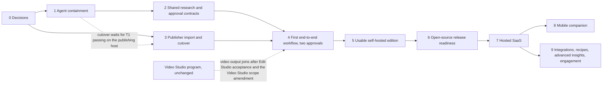

# Roadmap: from today's CreatorBrio to automated, approved publishing

**Status:** Revision 3, validated under [#218](https://github.com/mk-global/creatorbrio/issues/218) (revision 2 under [#216](https://github.com/mk-global/creatorbrio/issues/216)).
The sequence is PROPOSED; it is not an accepted execution backlog until the founder accepts it in the [decision register](DECISION-REGISTER.md), and each milestone still needs its own admitted issues.

**Date:** 2026-11-18.

**Architecture:** [ARCHITECTURE-RFC.md](ARCHITECTURE-RFC.md).

**Migration:** [SOCIAL-AUTOMATION-MIGRATION.md](SOCIAL-AUTOMATION-MIGRATION.md).

## Principles

- Serve the positioning (FD-F): each phase moves a creator closer to research-backed, reviewed, published content that is then measured and improved; nothing is built that does not serve that outcome.
- Defer by default (FD-G): a phase designs the contracts that would be costly to retrofit and implements only what its outcome needs ([capability matrix](ARCHITECTURE-RFC.md#product-capability-matrix)).
- Phase numbers are stable identifiers cited by other records; the order is the dependency graph below.
- Start from the product that exists: the carousel engine, the Design Agent, Production v2, Video Studio and the working publisher.
- Security corrections come before any credential is within an agent's reach.
- One verified outcome per phase, with objective exit criteria; infrastructure arrives only with the phase that needs it.
- The Video Studio program keeps its scope, workstreams, gates and order; this roadmap adds work beside it and names where it depends on Video Studio work, never relabelling Video Studio items as done.
- No paid model run without a founder-approved budget, as issue #186 already requires.
- No ticket, no implementation.

## Sequence at a glance

### Changes from the founder's suggested order, and why

- **The publisher import (phase 3) runs in parallel with phases 1 and 2.**
  The import is behavior-preserving and changes no CreatorBrio runtime, so it does not need agent containment: it adds code that becomes public anyway and exposes no credential, because credentials stay in the OS keychain outside the repository.
  The cutover that makes the runner deploy from CreatorBrio waits for T1 to pass on the actual publishing host (FD-I), because from then the live runner deploys from this repository, and an unconfined agent with a shell can write to that checkout; a recorded baseline is not that proof.
  Retiring the standalone deployment early also ends a period of maintaining two copies of the code that posts to real accounts.
  Integration of CreatorBrio with the publisher stays behind containment and the shared contracts, in phase 4.
- **"First end-to-end workflow" and "Social Automation integration" are one phase (4).**
  The publisher is imported in phase 3, so the first workflow publishes through it for configured accounts and otherwise ends in a frozen package approved through Gate 2 in the publisher and a manual posting handoff; building the workflow without publishing first would only defer the riskiest integration.
- **Platform app reviews for the hosted edition start as paperwork during phase 6**, because business verification and app review take weeks to months and gate hosted onboarding regardless of code.
- **The measurement loop starts in phase 5, not phase 9** (revision 3): the positioning promises to help measure and improve the next piece, so a read-only performance readback per published post, which research can cite, lands before the hosted and mobile phases (AD-42); advanced insights stay in phase 9.
- **The creator outcome proof (T7) runs after phase 4**, before open-source release claims, because the positioning's outcomes are unvalidated until measured (FQ-9).

## Phase 0: architecture decisions (documentation only)

- **Impact:** a single reconciled architecture; no product change.
- **Reuses:** the merged proposal, the preserved review, the publisher assessment.
- **New:** this revision, the decision register, the migration plan, the research matrix.
- **Depends on:** nothing.
- **Gates:** documentation PR with required CI and independent review.
- **Acceptance:** merged (#216 and #218); the founder answers the open founder questions in the [decision register](DECISION-REGISTER.md) (FQ-8 and the rule half of FQ-3 were answered on 2026-11-18) and accepts or amends the PROPOSED decisions before the phase that implements each.
- **Operations:** none.
- **Risks:** decisions recorded as accepted without the founder's word; mitigated by labelling every non-founder decision PROPOSED.
- **Deferred:** everything else.

## Phase 1: agent containment and security corrections (first milestone)

- **Impact:** the Design Agent can no longer be steered by a web page into reading secrets or acting outside CreatorBrio; its behavior no longer depends on whoever's Claude Code settings are on the machine.
  It also reduces, for the Design Agent, the exposure that `docs/architecture/video-production-api.md` records: a process running as the same operating-system user, today's Design Agent with its shell included, can read every local secret.
  It does not close that exposure, because separating a process from the person needs operating-system account separation and M1 is not an operating-system account boundary ([RFC section 7.4](ARCHITECTURE-RFC.md#74-agent-containment-precondition-for-any-credential-in-reach)).
- **Reuses:** the Visual Director's isolation flags, the source-retrieval boundary, the Production API's run-token model, the acceptance harness, Claude Code's documented sandbox and settings controls (sources and dates in [RFC section 7.4](ARCHITECTURE-RFC.md#74-agent-containment-precondition-for-any-credential-in-reach)).
- **New:** the agent-only listener (or typed tools) that confines the agent's API authority to its run's carousel (AD-46); a refusal to start on a Claude CLI older than 2.1.219, which `strictAllowlist` needs; the contained execution profile, an explicit environment, a stable per-carousel working folder, outside the repository, with writes confined to it so a follow-up message still resumes the same session, sandbox configuration with its network limited to the agent's API address and port (the agent-only listener, AD-46) (Route A of RFC 7.4 with `strictAllowlist` on, or Route B, typed tools over MCP, if the feasibility proof fails) and read denial, web fetch disabled with linked pages retrieved by the server and handed to the agent as delimited untrusted text, the Claude CLI version T1 last passed on recorded in the profile with a visible warning when it differs, the T1 harness; then typed tools over MCP (WS8 and G8).
- **Depends on:** issues #156 and #186; WS8 and G8 for the second step, which M1 itself needs if the feasibility proof selects Route B.
- **Gates:** the network feasibility proof passed on the publishing host (macOS) and Linux, and on WSL2 where a test host exists, otherwise WSL2 reported unavailable until proven (AD-35), before the rest of M1 proceeds; T1 baseline recorded against today's agent and passed after the change; the acceptance harness shows no material quality regression, or the founder accepts the measured change (FQ-4); budget approved (FQ-5).
- **Acceptance:** see [First milestone](#first-milestone-m1-contain-the-design-agent).
- **Operations:** sandbox prerequisites on Linux and on WSL2 on Windows (bubblewrap, socat and the seccomp filter) become documented requirements, per the vendor's [sandboxing documentation](https://code.claude.com/docs/en/sandboxing.md) (retrieved 2026-11-17).
  If any of them is missing, the Design Agent is reported unavailable with setup guidance, as on native Windows, and the doctor command checks for all three.
- **Risks:** design quality may drop without free web access or the shell; mitigated by measuring and by research moving into the server's retrieval step.
  The agent loses its own topic research until phase 2's research job returns it, and native Windows without WSL2, or Linux and WSL2 without the sandbox prerequisites, lose the Design Agent; both are deliberate capability changes (see [First milestone](#first-milestone-m1-contain-the-design-agent)).
- **Deferred:** OS-account separation (only if typed tools fail on quality, or T1's keychain canary on the publishing host requires it, AD-45).

## Phase 2: shared research and approval contracts

- **Impact:** carousels gain a real research step with sources and claims, and a first approval gate; productions and carousels share one approval model.
- **Reuses:** `ResearchDossier`, `ResearchSource`, `Claim` and `Approval` from Production v2; `source-retrieval.ts`; the carousel store; the Production API's person principal (the human key or a paired browser session) and its refusal of agent approvals.
- **New:** the shared contract module; `ApprovalRecord` with in-force derivation, a stable person identifier and the permission exercised (AD-38, AD-39); the local owner as the one person, created at setup; dossier identity and revision and a carousel revision counter (AD-41); optional brand voice and audience fields if the research job and planner need them; additive carousel fields (`research`, `plan`, `stage`, `approvals`); approval routes for carousels (Gate 1 and Gate 2) that require the Production API's person principal (the human key or a paired browser session), extended to them by a second pairing cookie scoped to those routes (see Gates); a research job in the worker, which also returns topic research without supplied URLs; page extraction with Defuddle behind the existing retrieval boundary; search provider adapters behind the provider gateway (bring-your-own key, Brave by default), storing only pages CreatorBrio fetches itself because search providers forbid keeping their result payloads; the Gate 1 review UI.
- **Depends on:** phase 1 (research must not run through an uncontained agent); WS1 and WS9 owners agree the shared module, since WS9 owns research for video; WS5 for the worker that runs the research job; WS8 and G8 for the provider gateway that hosts the search adapters.
- **Gates:** existing carousels load unchanged; a change to an approved dossier reopens Gate 1.
  Approval routes for carousels (Gate 1 and Gate 2) require the person principal of the Production API (human key or paired browser session).
  The human key is a header and works on any route, while the session cookie is scoped to `/api/video`, so pairing also sets a second cookie, bound to the same session record (one revocation ends both) and scoped to the approval routes.
  A cookie's `Path` matches by prefix, so the carousel approval routes share one dedicated path prefix, the second cookie is scoped to exactly that prefix, and no other route sits under it.
  `docs/architecture/video-production-api.md` is updated in the same change (RFC section 13).
  Agents are kept from obtaining the principal because confinement (M1) denies reads of the key and session records and of the browser's profile and cookie stores, which is not an operating-system account boundary (RFC 5.5).
  An agent-run token, a tokenless loopback request carrying the app's Origin and a tokenless loopback request with no Origin cannot create an approval (part of T2).
- **Acceptance:** a person can create a carousel from an idea, receive a dossier with cited sources and claim statuses, approve or revise it, and the approval is bound to the revision.
  Gate 1 applies when an item asks for research; designing directly from a brief, as today, remains available.
- **Operations:** research providers' keys and costs appear in settings and run records.
- **Risks:** coupling video and carousel schemas; mitigated by lifting only the shared types and keeping Production v2's re-exports.
- **Deferred:** competitor trend analysis beyond official APIs and user-supplied links; multi-format campaigns.

## Phase 3: publisher import and cutover

Detailed in [SOCIAL-AUTOMATION-MIGRATION.md](SOCIAL-AUTOMATION-MIGRATION.md).

- **Impact:** one repository holds the publishing code that runs the founder's accounts; nothing changes for the accounts.
- **Reuses:** the publisher's code, tests, state directory and runtime, moved with its behavior and tests intact, apart from the recorded P1 changes (approval paths that do not meet RFC 5.4; FQ-3).
- **New:** a sanitized snapshot import under `publisher/`, a Python CI job, operator configuration kept outside the repository, provenance and licence records, a runner deploy that pins CreatorBrio commits.
- **Depends on:** FQ-1 (licence), FQ-2 (history) and FQ-9 (the revised sequence); the sanitized snapshot prepared in the private repository (migration step P1), from which every new human-attributed record carries a principal and earlier ones are read by AD-38's legacy rule; for the cutover only, T1 passed on the actual publishing host (FD-I).
- **Gates:** sensitive-material scan of the snapshot returns nothing; the full publisher suite passes in CreatorBrio CI, each approval path removed under P1 replaced by a test of the RFC 5.4 rule; T12 shadow parity; first live posts watched.
- **Acceptance:** the runner deploys from CreatorBrio, every post in the shadow window behaves identically, and the standalone repository is archived after the rollback window.
- **Operations:** the runner deploys from a pinned CreatorBrio commit; the rollback path is the archived repository's last commit with the same state directory.
- **Risks:** leaking private operational data into the public repository; a deploy gate that silently tests the wrong tree; mitigated in the migration plan.
- **Deferred:** a cloud publishing path (AD-28), the calendar check, a TypeScript port.

## Phase 4: first end-to-end workflow with two approvals

- **Impact:** FD-A for carousels: idea to research approval to production to package approval to scheduled or immediate publishing, with notifications; for a platform with no configured app, the same flow goes through Gate 2 in the publisher and ends in the frozen handoff bundle and a manual posting handoff.
  Videos made outside CreatorBrio can be packaged, approved and published the same way once the Video Studio `spec/01` amendment (RFC section 13, AD-34) is made.
- **Reuses:** phases 1 to 3; the carousel export; the publisher's package, approval and lifecycle.
- **New:** JPEG export with upright orientation and one shape across slides between 4:5 and 1.91:1 (today's PNG, 9:16 and single-slide exports cannot be published as carousels), converted before staging so the person approves the published bytes; the package builder; the publisher client (machine-readable stage, approve, status and event reads); the Gate 2 review card rendered from the staged package; durable notifications fed by the publisher's event log; brand-to-account linking with zero or more accounts per brand and connections owned by the workspace (AD-40); staging provenance recorded with every staging (AD-41); plan entries and a calendar view that shows them beside the publisher's slots and publication states (AD-44); the rights and credits manifest of every asset, taken from its rights record (WS3) or the person's declaration, carried in the package and shown on the Gate 2 card, with staging refused for an asset that is not cleared (AD-33); a `manual` destination in the publisher (AD-36), which holds the frozen handoff bundle of an approved package and records the person's confirmation of posting as an attributed event.
- **Depends on:** phases 1, 2 and 3; the worker process (WS5) for export jobs; WS3's rights records where they exist.
- **Gates:** T1 passed, including canaries for the agent's file-reading tool, the keychain, the browser's profile and cookie stores and local Unix sockets; if the CLI's controls cannot pass it, typed tools (phase 1, step 2) are a prerequisite; T2 approval binding; T3 reconciliation inherited; T4 worker restart; one delivery owner per alert (no duplicate phone alerts); no video is packaged before the `spec/01` amendment (RFC section 13).
- **Acceptance:** for a real brand, a carousel goes from an idea to a live Instagram post and Page post through both gates, with every step visible, and a deliberately changed slide after approval is refused; cost and duration per approved artifact are reported from the run records.
  A package for a platform with no configured app goes through Gate 2, yields the frozen handoff bundle, and a change after approval is refused.
- **Operations:** the publisher's runner remains the single scheduler, and plan entries never trigger anything; notifications are CreatorBrio records fed by the publisher's event log, delivered through one channel per alert.
- **Risks:** the person approves something other than the stored bytes; mitigated by rendering the card from the publisher.
- **Deferred:** CreatorBrio-produced video until Edit Studio acceptance (#96) and the `spec/01` amendment; LinkedIn and TikTok adapters.

## Phase 5: a genuinely usable self-hosted edition

- **Impact:** someone other than the founder can run the whole workflow on their own Mac or Linux machine with their own keys and apps, and see how each published post performed, with that performance available to the next piece's research.
- **Reuses:** the setup and doctor skills, the onboarding procedure from the publisher (generalized).
- **New:** the insights module's read-only performance readback for posts on the destinations the publisher supports, keyed by publication and offered to research as a citable source, with correlation never presented as causation (AD-42); Linux adapters for secrets, triggers and keep-awake; a setup flow for AI keys and platform apps; bring-your-own app and bucket guides per platform; backup and restore of every store; health checks in the UI; API-key runtimes for unattended steps; a conformance test for each publisher port that gets a second adapter (secrets, triggers, keep-awake, media host), as the migration plan requires; setup documentation naming Python as the publisher's prerequisite, which every Gate 2 publication needs, the manual handoff included.
- **Depends on:** phase 4.
- **Gates:** T5 with an independent person; T13 provenance chain; restore of a backup on a clean machine with matching hashes and approvals.
- **Acceptance:** two independent installs (one Mac, one Linux) complete the workflow end to end, one of them publishing with its own apps.
- **Operations:** the support surface grows; documentation is the product here.
- **Risks:** platform setup is too hard for non-developers; the manual handoff keeps the workflow complete for them.
- **Deferred:** installers and containers until T9; insight dashboards, benchmarks, experiments and attribution (phase 9 or later).

## Phase 6: open-source release readiness

- **Impact:** CreatorBrio can be announced as an open-source product that does what it says.
- **Reuses:** the phase 5 guides, doctor checks and backup and restore; `docs/PROVENANCE.md` and the dependency licence scan (OSS-01 in the Video Studio `spec/08`); the architecture documentation and the decision register as the contributor's map.
- **New:** contributor guide, architecture map for contributors, issue templates for modules, licence and provenance bill of materials, telemetry policy (none by default), a trademark policy for the CreatorBrio name, a release that includes the publisher, optional container image only after T9.
- **Depends on:** phase 5; the publisher's licence decision (FQ-1) recorded in `docs/PROVENANCE.md`.
- **Gates:** T9; T7 (run after phase 4) supports every outcome the release claims; a fresh-machine install by a contributor; every advertised capability demonstrated.
- **Acceptance:** a contributor who has not worked on the project installs from the released documentation on a fresh machine and completes the workflow; every advertised capability has a recorded demonstration; the bill of materials shows no component that `spec/08` excludes.
- **Operations:** begin hosted-edition business verification and app reviews in parallel (paperwork, not code): the registered legal entity, owned domain, privacy policy and recorded screencasts those reviews need.
- **Risks:** advertising what self-hosters cannot do, because platform audits and paid APIs limit publishing; mitigated by the wording of RFC 11.2 and the manual handoff.
  A licence or provenance gap found after release; mitigated by the licence scan and T9.
- **Deferred:** plug-ins and recipe sharing.

## Phase 7: hosted SaaS

- **Impact:** sign up, connect accounts through provider-approved flows, and run the workflow without maintaining anything.
- **Reuses:** the publisher's port adapters and conformance tests from phase 5 (secrets, triggers, keep-awake, media host); the durable notification records from phase 4; the person principal that phase 2 extends beyond `/api/video` (AD-14) and the run records; the publisher's command interface, which becomes an authenticated service API with the same operations.
- **New:** amend Video Studio ADR item 10; identity and workspaces on the principal model (Better Auth); membership, invitations and roles over the permission set of AD-39, so a creator can invite a reviewer who can comment or approve without publishing credentials or administrative authority; assignments on plan entries; the storage ports for carousels, productions, assets and notifications and the T8 conformance suite, which the existing crash and multi-process tests become and which runs unchanged against a second adapter; PostgreSQL with Drizzle and an S3-compatible object-storage adapter as that second adapter; the hosted job layer, pg-boss on the product's PostgreSQL unless T10 chooses otherwise; the hosted secret adapter; containerized workers without egress; the publisher's store and credential adapters, or its TypeScript port if decided then (AD-07); usage ledger and budgets; billing; operations, backup and incident response.
- **Depends on:** phases 5 and 6; business verification and app reviews started in phase 6 (FQ-7); the AD-07 decision on the publisher's language.
- **Gates:** T6, T7, T8, T10, T11; platform app reviews and Business Verification passed; a YouTube quota extension, because uploads share a bucket of about 100 per day per Google project; a legal and provider-terms review.
- **Acceptance:** a new person signs up, connects an account through a provider-approved flow and completes the workflow in their own workspace; every cross-tenant attempt in T11 fails; cost per approved artifact is inside the founder-set target (T6).
- **Operations:** always-on scheduling, managed credentials with rotation, backup and restore, monitoring and alerting, incident response, support, and keeping platform apps and API versions current.
- **Risks:** platform review timelines; per-artifact model cost; tenant isolation defects.
- **Deferred:** enterprise isolation, single sign-on.

## Phase 8: mobile companion

- **Impact:** create, approve, schedule and follow status on a phone.
- **Reuses:** the application API and principal model from phase 7; the durable notification records; the Gate 2 review card rendered from the staged package; the responsive web app and email, which serve phones first (AD-22).
- **New:** an Expo and React Native client over the hosted API after hosted identity (TD-14), with Web Push first, deep links to approval cards and a notification inbox; no video editing.
- **Depends on:** phase 7 (hosted identity and API).
- **Gates:** same approval semantics as the web; push is never proof of receipt.
- **Acceptance:** from a phone, a person signs in, approves a package against its fingerprint, schedules it and sees its outcome; the approval record is the same as one made on the web.
- **Operations:** device-token storage, push credentials, and the app-store review and release process.
- **Risks:** push treated as proof of receipt, app-store review delays and scope creep into editing; mitigated by status always readable in the app and the no-editing rule.
- **Deferred:** offline editing.

## Phase 9: integrations, recipes, advanced insights and engagement

- **Impact:** more platforms, reusable brand workflows, deeper performance learning, and, if its review allows, help with comments and messages.
- **Reuses:** the publisher's reconciliation tests; the insights snapshots, owned by the insights module from phase 5; the [platform capability table](OSS-RESEARCH.md#platform-capabilities-for-publishing).
- **New:** a uniform adapter surface (`check`, `validate`, `prepare`, `publish` or `schedule`, `find_live`, and the platform reads the insights module uses) with conformance tests, defined when the first new adapter is added; a LinkedIn member adapter (document posts only after a live call confirms the self-serve permission covers them), Threads and Bluesky adapters, TikTok as "send to drafts" until an audit allows public posting, recipes as brand and style profiles plus parameters, insight dashboards and comparisons beyond phase 5's readback with correlation never presented as causation, and the community engagement module (AD-43) only after its independent privacy, platform-permissions and response-policy review and under an agreed response policy.
- **Depends on:** phase 7 (the diagram's order); the AD-07 decision before the third new adapter is built; each platform's self-serve access confirmed by a live call where the platform table says so.
- **Gates:** each new adapter passes the adapter conformance and reconciliation tests and a live rehearsal in which a forced lost answer ends in exactly one post (the method of T3); engagement waits for its independent review, the response policy and explicit approval to store messages (AD-43, FQ-8).
- **Acceptance:** at least one new platform publishes, or for TikTok sends to drafts, for a real account of the person through both gates; insight views label correlation as correlation.
- **Operations:** per-platform token refresh and expiry (LinkedIn member tokens last 60 days without refresh), API version upkeep, and app review for each platform's hosted access.
- **Risks:** platform policies change; mitigated by re-verifying each platform's facts before its adapter starts.
  A reply posted that nobody wanted; mitigated by the agreed reply policy.
- **Deferred:** X and Pinterest (low priority in the research), recipe sharing between users.

## First milestone (M1): contain the Design Agent

**Goal.** No content a person or a web page shows the Design Agent can make it read a secret, write outside its own carousel folder, reach any host or local port other than its agent-only listener, or change anything outside its own carousel, and its behavior depends only on CreatorBrio's own configuration.

**Why it is still the first milestone (re-checked 2026-11-18).** Today's Design Agent has an unrestricted shell and web fetch, and `docs/architecture/video-production-api.md` records that such a process can read every local secret of its user, so a hostile page it reads is a risk now, independent of the migration; containment is also FD-I's precondition for the cutover and the precondition for any credential integration.
It depends on no other phase.
Before its implementation starts, the founder accepts the decisions it implements (AD-11, AD-35 and AD-46) and its issues are admitted; FQ-5 (budget) is needed before the T1 baseline runs, FQ-4 before the prompt change merges, and #186's re-admission before its own implementation.

**Order.**
The feasibility proof and the T1 harness with its baseline come first, because the baseline must be recorded against today's agent before any containment change lands; tickets 1 to 3 follow.

**First engineering ticket.** "Prove the Design Agent's sandbox network route": on the publishing host (macOS) and on Linux, and on WSL2 where a test host exists, show under the profile's `strictAllowlist` setting (Claude Code 2.1.219 or later) and pinned permission mode that a sandboxed command reaches a stand-in agent-only listener on one named port and nothing else (no other localhost port, no external host, no Unix socket on Linux and WSL2), record Route A or Route B in AD-35, and record a platform that could not be tested as unavailable until proven.
It changes no product behavior, so it can open now; its prerequisite is a Linux test host, and a Windows test host for WSL2 is wanted but not required, because without one WSL2 is reported unavailable until proven.

**Tickets.**

1. [#156](https://github.com/mk-global/creatorbrio/issues/156): start the Design Agent without the person's setting sources and the developer `CLAUDE.md` (existing, admitted).
2. [#186](https://github.com/mk-global/creatorbrio/issues/186): a versioned Creative Agent execution profile with a pinned model and effort and no inherited advisor, plugins, skills or hooks (existing, OPEN, design-first).
   It does not yet carry the canonical ticket sections, so it is re-admitted to the canonical ticket policy before implementation: its design is reviewed and its scope, acceptance criteria and verification are added, or it is replaced by an implementation ticket.
3. New ticket, to open when M1 starts: "Confine the Design Agent's shell, files, environment and network".
   Draft body:
   - **Problem:** the Design Agent runs with an unrestricted shell, web fetch and file reads, from the repository folder, with the app's environment; `docs/architecture/video-production-api.md` records that such a process can read every local secret.
   - **Desired outcome:** the agent's shell runs inside Claude Code's sandbox with the unsandboxed escape hatch off and startup failing if the sandbox is unavailable; the shell's network reaches the agent's API address and port (the agent-only listener, AD-46) and nothing else, by the mechanism below; the data folder, key files, home-directory secrets, the browser's profile and cookie stores and the repository are denied for reading; the working directory is one confined folder per carousel conversation, outside the repository, named by the carousel's server-generated identifier, created on first use, reused by that carousel's runs so the stored Claude session keeps resolving (Claude Code keeps sessions per working directory, a local observation of the CLI on 2026-11-17 rather than vendor documentation, which T1 verifies), emptied when the person clears the chat and removed with the carousel, and writes anywhere outside it are denied, including other carousels' folders and this repository's checkout, which the live runner deploys from after cutover; the environment is an explicit allowlist; web fetch is disabled; reference and render images are copied into the carousel folder at the start of each run for reading; the profile records the Claude CLI version T1 last passed on, and a different version starts with a visible warning in the app and in the doctor command, and T1 is rerun on that version on demand.
     A chat begun before M1 cannot resume in the new per-carousel folder: it starts one fresh session through the existing reset path (`docs/architecture/design-agent.md`: a session Claude Code can no longer find is reset automatically, with a message asking the person to send again), with the carousel's slides intact.
     The sandbox uses Seatbelt on macOS and bubblewrap on Linux and WSL2, and native Windows runs unsandboxed ([sandboxing documentation](https://code.claude.com/docs/en/sandboxing.md), retrieved 2026-11-17): on Windows the confined Design Agent runs under WSL2, and on native Windows without WSL2 the Design Agent is reported unavailable with setup guidance; this is a deliberate capability change.
     On Linux and WSL2 without the sandbox prerequisites (bubblewrap, socat and the seccomp filter), the Design Agent is likewise reported unavailable with setup guidance, and the doctor command checks for all three.
     The seccomp filter is required because it blocks Unix domain sockets: without it a sandboxed command could reach local socket services such as the Secret Service, and on WSL2 could launch Windows binaries outside the Linux sandbox ([RFC section 7.4](ARCHITECTURE-RFC.md#74-agent-containment-precondition-for-any-credential-in-reach)).
     The Design Agent creates slides by calling the app's API with `curl` from its shell, so the shell's network follows the mechanism of [RFC section 7.4](ARCHITECTURE-RFC.md#74-agent-containment-precondition-for-any-credential-in-reach), chosen by a feasibility proof on macOS, Linux and WSL2.
     Route A, tried first: the agent's API calls go through the sandbox proxy to an `allowedDomains` entry for exactly the host the agent is given by `resolveAppOrigin()` and the agent-only listener's port (AD-46) (`src/lib/request-origin.ts` derives the host from the request's Host header, typically `localhost`; the port is the agent-only listener's, not the app's main port), sent through the proxy explicitly instead of relying on the default `NO_PROXY` direct path.
     The sandbox's local-address check exempts `localhost` and `*.localhost`, so the usual `localhost:<port>` entry needs no IP form; the IP and port form (for example `127.0.0.1:<port>`) is needed as well only when the Host header carries another name that resolves to loopback.
     The profile also sets `sandbox.network.strictAllowlist: true` through `--settings` and pins a permission mode that is not bypass-permissions, so every host outside the allowlist is refused in every mode, whereas an `allowedDomains` entry alone leaves such a host to the permission mode, which allows it without a prompt in bypass-permissions mode (sandboxing documentation, retrieved 2026-11-17).
     Route B, if Route A fails when tested on any of macOS, Linux or WSL2: the agent reaches the API only through typed tools on an MCP server that CreatorBrio operates, which brings phase 1 step 2 into M1, and the shell then needs no network at all.
     `network.allowLocalBinding` is rejected because on macOS it lets sandboxed commands connect to every local port, and `excludedCommands` is rejected for the agent's API calls because it runs them with no filesystem or network limits.
     On Linux and WSL2 a sandboxed command's localhost is private, so a direct connection to the app does not work and `allowLocalBinding` has no effect (sandboxing documentation, section "A command fails to reach a server on localhost", retrieved 2026-11-17).
     When a person supplies URLs, the server retrieves them through the existing SSRF-safe retrieval (`src/lib/source-retrieval.ts`: at most three public pages, bounded in time and size) and hands the retrieved page text to the Design Agent as a clearly delimited block of untrusted content, as it already does for the Visual Director; the agent no longer fetches pages itself.
     M1 therefore removes the agent's own web research on a topic: supplied URLs keep working through server retrieval, and topic research without URLs returns with phase 2's research job; this is a deliberate, temporary capability change, part of the quality change that FQ-4 asks the founder to accept.
     The design prompt's URL instruction (today "Use WebFetch to fetch the page content") changes to use that block.
     This is a governed change: it needs the founder's authorization, and the pinned prompt test (`tests/prompt-baseline.test.ts`) gets that documented substitution in the same change.
     The API-call instructions change in the same governed way on either route (AD-46): under Route A they call the agent-only listener through the proxy with the run-scoped token, under Route B they become typed tool calls, and on both the style-preset instruction is dropped.
   - **Agent API authority (AD-46):** the shell's one allowlisted port is an agent-only listener, separate from the app's main port, serving only the operations the design prompt uses for the run's own carousel and checking a run-scoped token bound to it (or, under Route B, typed tools with the same scope); style-preset creation, which the prompt asks for today but which is not carousel-scoped, is not served, and its instruction is dropped in coordination with #159; the API-call instruction change this needs is part of FQ-4's governed prompt change.
   - **Acceptance criteria:** first, a feasibility proof on macOS and Linux, and on WSL2 where a test host exists, shows that, with the profile's `strictAllowlist` setting and pinned permission mode, the agent reaches its API origin (the agent-only listener) and no other localhost port and no external host, before the rest of M1 proceeds, and the chosen route is recorded in the decision register (AD-35); from inside the sandbox, no request, with or without a token, changes another carousel, a brand, a template, a style preset, an upload or any approval or account record; tests pin the arguments, settings and environment; on macOS, Linux and WSL2 a run cannot read a canary file in `data/` or in a browser profile or cookie store folder through either its shell or its file-reading tool, cannot read a canary environment variable, cannot reach an external host or any localhost port other than the agent-only listener's, cannot obtain a canary Keychain or Secret Service item, cannot connect to a canary Unix domain socket service, cannot launch a Windows binary (on WSL2), and cannot write a canary file anywhere outside its own carousel's folder, including another carousel's folder and the repository checkout; a follow-up message in a carousel chat begun after M1 resumes the same session, and a chat begun before M1 starts one fresh session through the existing reset path with the carousel's slides intact; the profile records the CLI version and a different version shows a warning in the app and in the doctor command; on native Windows without WSL2, and on Linux or WSL2 without bubblewrap, socat or the seccomp filter, the Design Agent is reported unavailable with setup guidance, and the doctor command checks for those prerequisites; a carousel made from a supplied URL still works end to end without the agent's own web fetch; carousel creation, editing, continuation and export still work.
4. New ticket, to open when M1 starts: "T1: agent injection containment harness".
   Draft body:
   - **Problem:** there is no repeatable proof that injected instructions cannot make an agent exfiltrate secrets or act outside its tools.
   - **Desired outcome:** a harness serves a hostile page and hostile reference text to a real design run inside an isolated instance with synthetic brand and canaries, and reports every canary access, every egress attempt and every non-API action.
   - **Acceptance criteria:** the baseline against today's agent is recorded before any containment change lands; after tickets 1 to 3 the harness reports zero changes outside the run's carousel through the app's API with or without a token, zero canary reads (including a canary in a browser profile and cookie store folder), zero canary writes outside the carousel folder, zero external egress, no connection to any localhost port other than the agent-only listener's, zero Unix domain socket connections, on WSL2 zero Windows binary launches, no approvals and a follow-up message that resumes the same session; the harness runs on demand with a founder-approved spend cap and never in CI.

**M1 acceptance criteria.**

- [ ] A feasibility proof on macOS and Linux, and on WSL2 where a test host exists (otherwise WSL2 is reported unavailable until proven), shows that, with the profile's `strictAllowlist` setting and pinned permission mode, the agent reaches its API origin (the agent-only listener) and no other localhost port and no external host, and the chosen route (Route A, or Route B if Route A fails on any tested platform) is recorded in the decision register (AD-35); the rest of M1 proceeds only after it passes.
- [ ] The Design Agent and the Visual Director start with an explicit, versioned execution profile; changing the person's own Claude Code settings changes neither (pinned by tests).
- [ ] The agent has no web fetch, its shell is sandboxed with the escape hatch off, its shell's network reaches only the agent-only listener's one named port by the chosen route, its working directory is one confined folder per carousel conversation outside the repository, and it cannot write outside that carousel's folder.
- [ ] From inside the sandbox nothing outside the run's own carousel can change through the app's API, with or without a token (AD-46).
- [ ] The profile refuses to start on a Claude CLI older than 2.1.219.
- [ ] A follow-up message in a carousel chat begun after M1 resumes the same session; a chat begun before M1 starts one fresh session through the existing reset path, with the carousel's slides intact.
- [ ] The profile records the Claude CLI version T1 last passed on; a different version starts with a visible warning in the app and in the doctor command, and T1 is rerun on that version on demand.
- [ ] A carousel made from a supplied URL still works end to end without the agent's own web fetch: the server retrieves the page, and the agent receives its text only as delimited untrusted content.
- [ ] The design prompt's URL instruction change is authorized by the founder and recorded as a documented substitution in the pinned prompt test; the API-call instruction change (AD-46) is authorized and recorded in the same way.
- [ ] The agent's own web research on a topic is removed as a deliberate, temporary capability change: supplied URLs keep working through server retrieval, topic research without URLs returns with phase 2's research job, and the founder accepts the change under FQ-4.
- [ ] On Windows the confined Design Agent runs under WSL2; on native Windows without WSL2 it is reported unavailable with setup guidance.
- [ ] On Linux and WSL2 without the sandbox prerequisites (bubblewrap, socat and the seccomp filter) the Design Agent is reported unavailable with setup guidance, and the doctor command checks for all three.
- [ ] T1 passes after the change on every supported platform, including the actual publishing host, with its baseline recorded before it.
- [ ] The acceptance harness shows no material regression in design quality, latency or estimated cost against the recorded baseline, or the founder accepts the measured change.
- [ ] `docs/architecture/design-agent.md` (including its `WebFetch` research line), `docs/architecture/creative-workflow.md`, `docs/architecture/visual-director.md` (the Visual Director's execution profile), `docs/architecture/video-production-api.md` (its statement about today's Design Agent, which changes when M1 lands), the README (including the Windows requirement and the Linux and WSL2 sandbox prerequisites) and the `CLAUDE.md` tool-grant line describe the new profile, the URL handoff, the removal of the agent's own topic research and the Windows behavior.
- [ ] Full repository checks and the independent review pass; rollback is reverting the profile change.

**Risks.**

- Design quality may drop without the shell and web fetch; mitigated by the acceptance harness and the founder's decision in FQ-4.
- The agent loses its own web research on a topic until phase 2's research job returns it; supplied URLs keep working through server retrieval.
  This is a deliberate, temporary capability change.
- The vendor's sandbox does not run on native Windows, so there the Design Agent runs under WSL2 or is reported unavailable with setup guidance.
  This is a deliberate capability change; Windows is untested today (README).
- On Linux and WSL2 without bubblewrap, socat or the seccomp filter, the Design Agent is likewise reported unavailable with setup guidance, and the doctor command checks for all three.
- Route A may not work on every operating system: on Linux and WSL2 a sandboxed command's localhost is private, and whether a proxied connection to the app's loopback address reaches the host server is what the feasibility proof settles before the rest of M1; Route B (typed tools) is the fallback at the cost of bringing WS8 and G8 into M1.
- A chat begun before M1 starts one fresh session once, because its stored session cannot resume in the new folder; its slides are intact.
- A newer Claude CLI version may change sandbox behavior; the visible warning and the on-demand T1 rerun make that visible without blocking the app.

**Explicitly not in M1:** typed tools replacing the shell (the next milestone in phase 1, under WS8, unless the feasibility proof selects Route B, which brings them into M1), any publisher integration, and any change to the frozen design prompt beyond the URL instruction and the API-call instructions above.

## Cross-cutting gates

| Concern | Minimum evidence |
|---|---|
| Creative quality | Acceptance harness and real creator acceptance (T7) |
| Reliability | Restart and replay tests, approval re-entry, no duplicate posts (T2, T3, T4, T12) |
| Security | T1 on the publishing host before cutover (FD-I); T1 on every supported platform before credential integration; T11 before tenants |
| Cost | Per-run records now; T6 before pricing |
| Portability | Conformance suites before adapters ship (T8) |
| Licensing | Provenance updated with every import; T9 before any image |
| Operations | Runbooks for the publisher's runner, restore and rollback before cutover |
