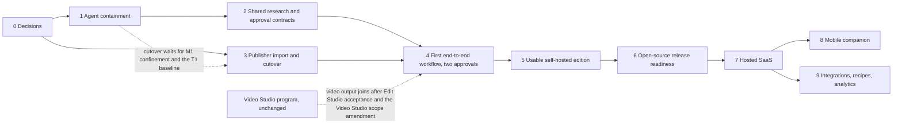

# Roadmap: from today's CreatorBrio to automated, approved publishing

**Status:** Revision 2, reconciled under [#216](https://github.com/mk-global/creatorbrio/issues/216).
The sequence is PROPOSED; it is not an accepted execution backlog until the founder accepts it in the [decision register](DECISION-REGISTER.md), and each milestone still needs its own admitted issues.

**Date:** 2026-11-17.

**Architecture:** [ARCHITECTURE-RFC.md](ARCHITECTURE-RFC.md).

**Migration:** [SOCIAL-AUTOMATION-MIGRATION.md](SOCIAL-AUTOMATION-MIGRATION.md).

## Principles

- Start from the product that exists: the carousel engine, the Design Agent, Production v2, Video Studio and the working publisher.
- Security corrections come before any credential is within an agent's reach.
- One verified outcome per phase, with objective exit criteria; infrastructure arrives only with the phase that needs it.
- The Video Studio program keeps its scope, workstreams, gates and order; this roadmap adds work beside it and names where it depends on Video Studio work, never relabelling Video Studio items as done.
- No paid model run without a founder-approved budget, as issue #186 already requires.
- No ticket, no implementation.

## Sequence at a glance

### Changes from the founder's suggested order, and why

- **The publisher import (phase 3) runs in parallel with phases 1 and 2.**
  The import is behavior-preserving and changes no CreatorBrio runtime, so it does not need agent containment: it adds code that becomes public anyway and exposes no credential, because credentials stay in the OS keychain outside the repository.
  The cutover that makes the runner deploy from CreatorBrio waits for M1's confinement ticket and T1's baseline, because from then the live runner deploys from this repository, and an unconfined agent with a shell can write to that checkout; confinement must deny agent writes outside the agent's own carousel folder before live publishing depends on it.
  Retiring the standalone deployment early also ends a period of maintaining two copies of the code that posts to real accounts.
  Integration of CreatorBrio with the publisher stays behind containment and the shared contracts, in phase 4.
- **"First end-to-end workflow" and "Social Automation integration" are one phase (4).**
  The publisher is imported in phase 3, so the first workflow publishes through it for configured accounts and falls back to a frozen package with a manual posting handoff otherwise; building the workflow without publishing first would only defer the riskiest integration.
- **Platform app reviews for the hosted edition start as paperwork during phase 6**, because business verification and app review take weeks to months and gate hosted onboarding regardless of code.

## Phase 0: architecture decisions (documentation only)

- **Impact:** a single reconciled architecture; no product change.
- **Reuses:** the merged proposal, the preserved review, the publisher assessment.
- **New:** this revision, the decision register, the migration plan, the research matrix.
- **Depends on:** nothing.
- **Gates:** documentation PR with required CI and independent review.
- **Acceptance:** merged; the founder answers the open questions FQ-1 to FQ-9 in the [decision register](DECISION-REGISTER.md).
- **Operations:** none.
- **Risks:** decisions recorded as accepted without the founder's word; mitigated by labelling every non-founder decision PROPOSED.
- **Deferred:** everything else.

## Phase 1: agent containment and security corrections (first milestone)

- **Impact:** the Design Agent can no longer be steered by a web page into reading secrets or acting outside CreatorBrio; its behavior no longer depends on whoever's Claude Code settings are on the machine.
  It also closes the exposure that `docs/architecture/video-production-api.md` records: a process running as the same operating-system user, today's Design Agent with its shell included, can read every local secret.
- **Reuses:** the Visual Director's isolation flags, the source-retrieval boundary, the Production API's run-token model, the acceptance harness, Claude Code's documented sandbox and settings controls (sources and dates in [RFC section 7.4](ARCHITECTURE-RFC.md#74-agent-containment-precondition-for-any-credential-in-reach)).
- **New:** the contained execution profile, an explicit environment, a stable per-carousel working folder, outside the repository, with writes confined to it so a follow-up message still resumes the same session, sandbox configuration with a loopback-only network allowlist and read denial, web fetch disabled with linked pages retrieved by the server and handed to the agent as delimited untrusted text, the Claude CLI version T1 last passed on recorded in the profile with a visible warning when it differs, the T1 harness; then typed tools over MCP (WS8 and G8).
- **Depends on:** issues #156 and #186; WS8 and G8 for the second step.
- **Gates:** T1 baseline recorded against today's agent and passed after the change; the acceptance harness shows no material quality regression, or the founder accepts the measured change (FQ-4); budget approved (FQ-5).
- **Acceptance:** see [First milestone](#first-milestone-m1-contain-the-design-agent).
- **Operations:** sandbox prerequisites on Linux (bubblewrap and socat) and WSL2 on Windows become documented requirements, per the vendor's [sandboxing documentation](https://code.claude.com/docs/en/sandboxing.md) (retrieved 2026-11-17).
- **Risks:** design quality may drop without free web access or the shell; mitigated by measuring and by research moving into the server's retrieval step.
  The agent loses its own topic research until phase 2's research job returns it, and native Windows without WSL2 loses the Design Agent; both are deliberate capability changes (see [First milestone](#first-milestone-m1-contain-the-design-agent)).
- **Deferred:** OS-account separation (only if typed tools fail on quality).

## Phase 2: shared research and approval contracts

- **Impact:** carousels gain a real research step with sources and claims, and a first approval gate; productions and carousels share one approval model.
- **Reuses:** `ResearchDossier`, `ResearchSource`, `Claim` and `Approval` from Production v2; `source-retrieval.ts`; the carousel store; the Production API's person principal (the human key or a paired browser session) and its refusal of agent approvals.
- **New:** the shared contract module; `ApprovalRecord` with in-force derivation; additive carousel fields (`research`, `plan`, `stage`, `approvals`); approval routes for carousels (Gate 1 and Gate 2) that require the Production API's person principal (the human key or a paired browser session), extended beyond `/api/video`; a research job in the worker, which also returns topic research without supplied URLs; page extraction with Defuddle behind the existing retrieval boundary; search provider adapters behind the provider gateway (bring-your-own key, Brave by default), storing only pages CreatorBrio fetches itself because search providers forbid keeping their result payloads; the Gate 1 review UI.
- **Depends on:** phase 1 (research must not run through an uncontained agent); WS1 and WS9 owners agree the shared module, since WS9 owns research for video; WS5 for the worker that runs the research job; WS8 and G8 for the provider gateway that hosts the search adapters.
- **Gates:** existing carousels load unchanged; a change to an approved dossier reopens Gate 1.
  Approval routes for carousels (Gate 1 and Gate 2) require the person principal of the Production API (human key or paired browser session), extended beyond `/api/video`; agents can never obtain it because confinement (M1) denies reads of the key and session records.
  An agent-run token, and a tokenless loopback request carrying the app's Origin, cannot create an approval (part of T2).
- **Acceptance:** a person can create a carousel from an idea, receive a dossier with cited sources and claim statuses, approve or revise it, and the approval is bound to the revision.
  Gate 1 applies when an item asks for research; designing directly from a brief, as today, remains available.
- **Operations:** research providers' keys and costs appear in settings and run records.
- **Risks:** coupling video and carousel schemas; mitigated by lifting only the shared types and keeping Production v2's re-exports.
- **Deferred:** competitor trend analysis beyond official APIs and user-supplied links; multi-format campaigns.

## Phase 3: publisher import and cutover

Detailed in [SOCIAL-AUTOMATION-MIGRATION.md](SOCIAL-AUTOMATION-MIGRATION.md).

- **Impact:** one repository holds the publishing code that runs the founder's accounts; nothing changes for the accounts.
- **Reuses:** the publisher's code, tests, state directory and runtime, moved with its behavior and tests intact.
- **New:** a sanitized snapshot import under `publisher/`, a Python CI job, operator configuration kept outside the repository, provenance and licence records, a runner deploy that pins CreatorBrio commits.
- **Depends on:** FQ-1 (licence) and FQ-2 (history); the sanitized snapshot prepared in the private repository (migration step P1); for the cutover only, M1's confinement ticket merged and T1's baseline recorded (T1 passing is required before phase 4's credential integration, not before cutover).
- **Gates:** sensitive-material scan of the snapshot returns nothing; the full publisher suite passes in CreatorBrio CI; T12 shadow parity; first live posts watched.
- **Acceptance:** the runner deploys from CreatorBrio, every post in the shadow window behaves identically, and the standalone repository is archived after the rollback window.
- **Operations:** the runner deploys from a pinned CreatorBrio commit; the rollback path is the archived repository's last commit with the same state directory.
- **Risks:** leaking private operational data into the public repository; a deploy gate that silently tests the wrong tree; mitigated in the migration plan.
- **Deferred:** a cloud publishing path (AD-28), the calendar check, a TypeScript port.

## Phase 4: first end-to-end workflow with two approvals

- **Impact:** FD-A for carousels: idea to research approval to production to package approval to scheduled or immediate publishing, with notifications; for accounts without a configured publisher, the same flow ends in a frozen package and a manual posting handoff.
  Videos made outside CreatorBrio can be packaged, approved and published the same way once the Video Studio `spec/01` amendment (RFC section 13, AD-34) is made.
- **Reuses:** phases 1 to 3; the carousel export; the publisher's package, approval and lifecycle.
- **New:** JPEG export with upright orientation and one shape across slides between 4:5 and 1.91:1 (today's PNG, 9:16 and single-slide exports cannot be published as carousels), converted before staging so the person approves the published bytes; the package builder; the publisher client (machine-readable stage, approve, status and event reads); the Gate 2 review card rendered from the staged package; durable notifications fed by the publisher's event log; brand-to-connected-account linking; the rights and credits manifest of every asset, taken from its rights record (WS3) or the person's declaration, carried in the package and shown on the Gate 2 card, with staging refused for an asset that is not cleared (AD-33).
- **Depends on:** phases 1, 2 and 3; the worker process (WS5) for export jobs; WS3's rights records where they exist.
- **Gates:** T1 passed, including canaries for the agent's file-reading tool and the keychain; if the CLI's controls cannot pass it, typed tools (phase 1, step 2) are a prerequisite; T2 approval binding; T3 reconciliation inherited; T4 worker restart; one delivery owner per alert (no duplicate phone alerts); no video is packaged before the `spec/01` amendment (RFC section 13).
- **Acceptance:** for a real brand, a carousel goes from an idea to a live Instagram post and Page post through both gates, with every step visible, and a deliberately changed slide after approval is refused; cost and duration per approved artifact are reported from the run records.
- **Operations:** the publisher's runner remains the single scheduler; notifications are CreatorBrio records fed by the publisher's event log, delivered through one channel per alert.
- **Risks:** the person approves something other than the stored bytes; mitigated by rendering the card from the publisher.
- **Deferred:** CreatorBrio-produced video until Edit Studio acceptance (#96) and the `spec/01` amendment; LinkedIn and TikTok adapters.

## Phase 5: a genuinely usable self-hosted edition

- **Impact:** someone other than the founder can run the whole workflow on their own Mac or Linux machine with their own keys and apps.
- **Reuses:** the setup and doctor skills, the onboarding procedure from the publisher (generalized).
- **New:** Linux adapters for secrets, triggers and keep-awake; a setup flow for AI keys and platform apps; bring-your-own app and bucket guides per platform; backup and restore of every store; health checks in the UI; API-key runtimes for unattended steps.
- **Depends on:** phase 4.
- **Gates:** T5 with an independent person; restore of a backup on a clean machine with matching hashes and approvals.
- **Acceptance:** two independent installs (one Mac, one Linux) complete the workflow end to end, one of them publishing with its own apps.
- **Operations:** the support surface grows; documentation is the product here.
- **Risks:** platform setup is too hard for non-developers; the manual handoff keeps the workflow complete for them.
- **Deferred:** installers and containers until T9.

## Phase 6: open-source release readiness

- **Impact:** CreatorBrio can be announced as an open-source product that does what it says.
- **Reuses:** the phase 5 guides, doctor checks and backup and restore; `docs/PROVENANCE.md` and the dependency licence scan (OSS-01 in the Video Studio `spec/08`); the architecture documentation and the decision register as the contributor's map.
- **New:** contributor guide, architecture map for contributors, issue templates for modules, licence and provenance bill of materials, telemetry policy (none by default), a trademark policy for the CreatorBrio name, a release that includes the publisher, optional container image only after T9.
- **Depends on:** phase 5; the publisher's licence decision (FQ-1) recorded in `docs/PROVENANCE.md`.
- **Gates:** T9; a fresh-machine install by a contributor; every advertised capability demonstrated.
- **Acceptance:** a contributor who has not worked on the project installs from the released documentation on a fresh machine and completes the workflow; every advertised capability has a recorded demonstration; the bill of materials shows no component that `spec/08` excludes.
- **Operations:** begin hosted-edition business verification and app reviews in parallel (paperwork, not code): the registered legal entity, owned domain, privacy policy and recorded screencasts those reviews need.
- **Risks:** advertising what self-hosters cannot do, because platform audits and paid APIs limit publishing; mitigated by the wording of RFC 11.2 and the manual handoff.
  A licence or provenance gap found after release; mitigated by the licence scan and T9.
- **Deferred:** plug-ins and recipe sharing.

## Phase 7: hosted SaaS

- **Impact:** sign up, connect accounts through provider-approved flows, and run the workflow without maintaining anything.
- **Reuses:** the ports and conformance suites from phases 4 and 5 (storage, secrets, triggers, media host, notifier); the person principal that phase 2 extends beyond `/api/video` (AD-14) and the run records; the publisher's command interface, which becomes an authenticated service API with the same operations.
- **New:** amend Video Studio ADR item 10; identity and workspaces on the principal model (Better Auth); PostgreSQL with Drizzle and an S3-compatible object-storage adapter (T8); the hosted job layer, pg-boss on the product's PostgreSQL unless T10 chooses otherwise; the hosted secret adapter; containerized workers without egress; the publisher's store and credential adapters, or its TypeScript port if decided then (AD-07); usage ledger and budgets; billing; operations, backup and incident response.
- **Depends on:** phases 5 and 6; business verification and app reviews started in phase 6 (FQ-7); the AD-07 decision on the publisher's language.
- **Gates:** T6, T7, T8, T10, T11; platform app reviews and Business Verification passed; a YouTube quota extension, because uploads share a bucket of about 100 per day per Google project; a legal and provider-terms review.
- **Acceptance:** a new person signs up, connects an account through a provider-approved flow and completes the workflow in their own workspace; every cross-tenant attempt in T11 fails; cost per approved artifact is inside the founder-set target (T6).
- **Operations:** always-on scheduling, managed credentials with rotation, backup and restore, monitoring and alerting, incident response, support, and keeping platform apps and API versions current.
- **Risks:** platform review timelines; per-artifact model cost; tenant isolation defects.
- **Deferred:** enterprise isolation, single sign-on.

## Phase 8: mobile companion

- **Impact:** create, approve, schedule and follow status on a phone.
- **Reuses:** the application API and principal model from phase 7; the durable notification records; the Gate 2 review card rendered from the staged package; the responsive web app and email, which serve phones first (AD-22).
- **New:** an Expo and React Native client over the hosted API after hosted identity (TD-14), with Web Push first, deep links to approval cards and a notification inbox; no video editing.
- **Depends on:** phase 7 (hosted identity and API).
- **Gates:** same approval semantics as the web; push is never proof of receipt.
- **Acceptance:** from a phone, a person signs in, approves a package against its fingerprint, schedules it and sees its outcome; the approval record is the same as one made on the web.
- **Operations:** device-token storage, push credentials, and the app-store review and release process.
- **Risks:** push treated as proof of receipt, app-store review delays and scope creep into editing; mitigated by status always readable in the app and the no-editing rule.
- **Deferred:** offline editing.

## Phase 9: integrations, recipes and analytics

- **Impact:** more platforms, reusable brand workflows, performance learning.
- **Reuses:** the publisher's reconciliation tests; the Instagram insights snapshot; the [platform capability table](OSS-RESEARCH.md#platform-capabilities-for-publishing).
- **New:** a uniform adapter surface (`check`, `validate`, `prepare`, `publish` or `schedule`, `find_live`, `insights`) with conformance tests, defined when the first new adapter is added; a LinkedIn member adapter (document posts only after a live call confirms the self-serve permission covers them), Threads and Bluesky adapters, TikTok as "send to drafts" until an audit allows public posting, recipes as brand and style profiles plus parameters, performance views from platform insights with correlation never presented as causation, engagement (comments and messages) only under an agreed reply policy.
- **Depends on:** phase 7 (the diagram's order); the AD-07 decision before the third new adapter is built; each platform's self-serve access confirmed by a live call where the platform table says so.
- **Gates:** each new adapter passes the adapter conformance and reconciliation tests and a live rehearsal in which a forced lost answer ends in exactly one post (the method of T3); engagement waits for the reply policy (FQ-8).
- **Acceptance:** at least one new platform publishes, or for TikTok sends to drafts, for a real account of the person through both gates; performance views show platform insights for published posts and label correlation as correlation.
- **Operations:** per-platform token refresh and expiry (LinkedIn member tokens last 60 days without refresh), API version upkeep, and app review for each platform's hosted access.
- **Risks:** platform policies change; mitigated by re-verifying each platform's facts before its adapter starts.
  A reply posted that nobody wanted; mitigated by the agreed reply policy.
- **Deferred:** X and Pinterest (low priority in the research), recipe sharing between users.

## First milestone (M1): contain the Design Agent

**Goal.** No content a person or a web page shows the Design Agent can make it read a secret, write outside its own carousel folder, reach the network beyond CreatorBrio's own loopback API, or act through anything but CreatorBrio's API, and its behavior depends only on CreatorBrio's own configuration.

**Tickets.**

1. [#156](https://github.com/mk-global/creatorbrio/issues/156): start the Design Agent without the person's setting sources and the developer `CLAUDE.md` (existing, admitted).
2. [#186](https://github.com/mk-global/creatorbrio/issues/186): a versioned Creative Agent execution profile with a pinned model and effort and no inherited advisor, plugins, skills or hooks (existing, OPEN, design-first).
   It does not yet carry the canonical ticket sections, so it is re-admitted to the canonical ticket policy before implementation: its design is reviewed and its scope, acceptance criteria and verification are added, or it is replaced by an implementation ticket.
3. New ticket, to open when M1 starts: "Confine the Design Agent's shell, files, environment and network".
   Draft body:
   - **Problem:** the Design Agent runs with an unrestricted shell, web fetch and file reads, from the repository folder, with the app's environment; `docs/architecture/video-production-api.md` records that such a process can read every local secret.
   - **Desired outcome:** the agent's shell runs inside Claude Code's sandbox with the unsandboxed escape hatch off and startup failing if the sandbox is unavailable; network egress is limited to the app's loopback origin; the data folder, key files, home-directory secrets and the repository are denied for reading; the working directory is one confined folder per carousel conversation, outside the repository, named by the carousel's server-generated identifier, created on first use, reused by that carousel's runs so the stored Claude session keeps resolving (Claude Code keeps sessions per working directory, a local observation of the CLI on 2026-11-17 rather than vendor documentation, which T1 verifies), emptied when the person clears the chat and removed with the carousel, and writes anywhere outside it are denied, including other carousels' folders and this repository's checkout, which the live runner deploys from after cutover; the environment is an explicit allowlist; web fetch is disabled; reference and render images are copied into the carousel folder at the start of each run for reading; the profile records the Claude CLI version T1 last passed on, and a different version starts with a visible warning in the app and in the doctor command, and T1 is rerun on that version on demand.
     A chat begun before M1 cannot resume in the new per-carousel folder: it starts one fresh session through the existing reset path (`docs/architecture/design-agent.md`: a session Claude Code can no longer find is reset automatically, with a message asking the person to send again), with the carousel's slides intact.
     The sandbox uses Seatbelt on macOS and bubblewrap on Linux and WSL2, and native Windows runs unsandboxed ([sandboxing documentation](https://code.claude.com/docs/en/sandboxing.md), retrieved 2026-11-17): on Windows the confined Design Agent runs under WSL2, and on native Windows without WSL2 the Design Agent is reported unavailable with setup guidance; this is a deliberate capability change.
     When a person supplies URLs, the server retrieves them through the existing SSRF-safe retrieval (`src/lib/source-retrieval.ts`: at most three public pages, bounded in time and size) and hands the retrieved page text to the Design Agent as a clearly delimited block of untrusted content, as it already does for the Visual Director; the agent no longer fetches pages itself.
     M1 therefore removes the agent's own web research on a topic: supplied URLs keep working through server retrieval, and topic research without URLs returns with phase 2's research job; this is a deliberate, temporary capability change, part of the quality change that FQ-4 asks the founder to accept.
     The design prompt's URL instruction (today "Use WebFetch to fetch the page content") changes to use that block.
     This is a governed change: it needs the founder's authorization, and the pinned prompt test (`tests/prompt-baseline.test.ts`) gets that one documented substitution in the same change.
   - **Acceptance criteria:** tests pin the arguments, settings and environment; on macOS and Linux a run cannot read a canary file in `data/` through either its shell or its file-reading tool, cannot read a canary environment variable, cannot reach an external host, cannot obtain a canary Keychain or Secret Service item, and cannot write a canary file anywhere outside its own carousel's folder, including another carousel's folder and the repository checkout; a follow-up message in a carousel chat begun after M1 resumes the same session, and a chat begun before M1 starts one fresh session through the existing reset path with the carousel's slides intact; the profile records the CLI version and a different version shows a warning in the app and in the doctor command; on native Windows without WSL2 the Design Agent is reported unavailable with setup guidance; a carousel made from a supplied URL still works end to end without the agent's own web fetch; carousel creation, editing, continuation and export still work.
4. New ticket, to open when M1 starts: "T1: agent injection containment harness".
   Draft body:
   - **Problem:** there is no repeatable proof that injected instructions cannot make an agent exfiltrate secrets or act outside its tools.
   - **Desired outcome:** a harness serves a hostile page and hostile reference text to a real design run inside an isolated instance with synthetic brand and canaries, and reports every canary access, every egress attempt and every non-API action.
   - **Acceptance criteria:** the baseline against today's agent is recorded; after tickets 1 to 3 the harness reports zero canary reads, zero canary writes outside the carousel folder, zero external egress, no approvals and a follow-up message that resumes the same session; the harness runs on demand with a founder-approved spend cap and never in CI.

**M1 acceptance criteria.**

- [ ] The Design Agent and the Visual Director start with an explicit, versioned execution profile; changing the person's own Claude Code settings changes neither (pinned by tests).
- [ ] The agent has no web fetch, its shell is sandboxed with the escape hatch off, its network is limited to the app's loopback origin, its working directory is one confined folder per carousel conversation outside the repository, and it cannot write outside that carousel's folder.
- [ ] A follow-up message in a carousel chat begun after M1 resumes the same session; a chat begun before M1 starts one fresh session through the existing reset path, with the carousel's slides intact.
- [ ] The profile records the Claude CLI version T1 last passed on; a different version starts with a visible warning in the app and in the doctor command, and T1 is rerun on that version on demand.
- [ ] A carousel made from a supplied URL still works end to end without the agent's own web fetch: the server retrieves the page, and the agent receives its text only as delimited untrusted content.
- [ ] The design prompt's URL instruction change is authorized by the founder and recorded as a documented substitution in the pinned prompt test.
- [ ] The agent's own web research on a topic is removed as a deliberate, temporary capability change: supplied URLs keep working through server retrieval, topic research without URLs returns with phase 2's research job, and the founder accepts the change under FQ-4.
- [ ] On Windows the confined Design Agent runs under WSL2; on native Windows without WSL2 it is reported unavailable with setup guidance.
- [ ] T1 passes after the change, with its baseline recorded before it.
- [ ] The acceptance harness shows no material regression in design quality, latency or estimated cost against the recorded baseline, or the founder accepts the measured change.
- [ ] `docs/architecture/design-agent.md` (including its `WebFetch` research line), `docs/architecture/creative-workflow.md`, `docs/architecture/visual-director.md` (the Visual Director's execution profile), the README (including the Windows requirement) and the `CLAUDE.md` tool-grant line describe the new profile, the URL handoff, the removal of the agent's own topic research and the Windows behavior.
- [ ] Full repository checks and the independent review pass; rollback is reverting the profile change.

**Risks.**

- Design quality may drop without the shell and web fetch; mitigated by the acceptance harness and the founder's decision in FQ-4.
- The agent loses its own web research on a topic until phase 2's research job returns it; supplied URLs keep working through server retrieval.
  This is a deliberate, temporary capability change.
- The vendor's sandbox does not run on native Windows, so there the Design Agent runs under WSL2 or is reported unavailable with setup guidance.
  This is a deliberate capability change; Windows is untested today (README).
- A chat begun before M1 starts one fresh session once, because its stored session cannot resume in the new folder; its slides are intact.
- A newer Claude CLI version may change sandbox behavior; the visible warning and the on-demand T1 rerun make that visible without blocking the app.

**Explicitly not in M1:** typed tools replacing the shell (the next milestone in phase 1, under WS8), any publisher integration, and any change to the frozen design prompt beyond the URL instruction above.

## Cross-cutting gates

| Concern | Minimum evidence |
|---|---|
| Creative quality | Acceptance harness and real creator acceptance (T7) |
| Reliability | Restart and replay tests, approval re-entry, no duplicate posts (T2, T3, T4, T12) |
| Security | T1 before credentials are reachable; T11 before tenants |
| Cost | Per-run records now; T6 before pricing |
| Portability | Conformance suites before adapters ship (T8) |
| Licensing | Provenance updated with every import; T9 before any image |
| Operations | Runbooks for the publisher's runner, restore and rollback before cutover |
