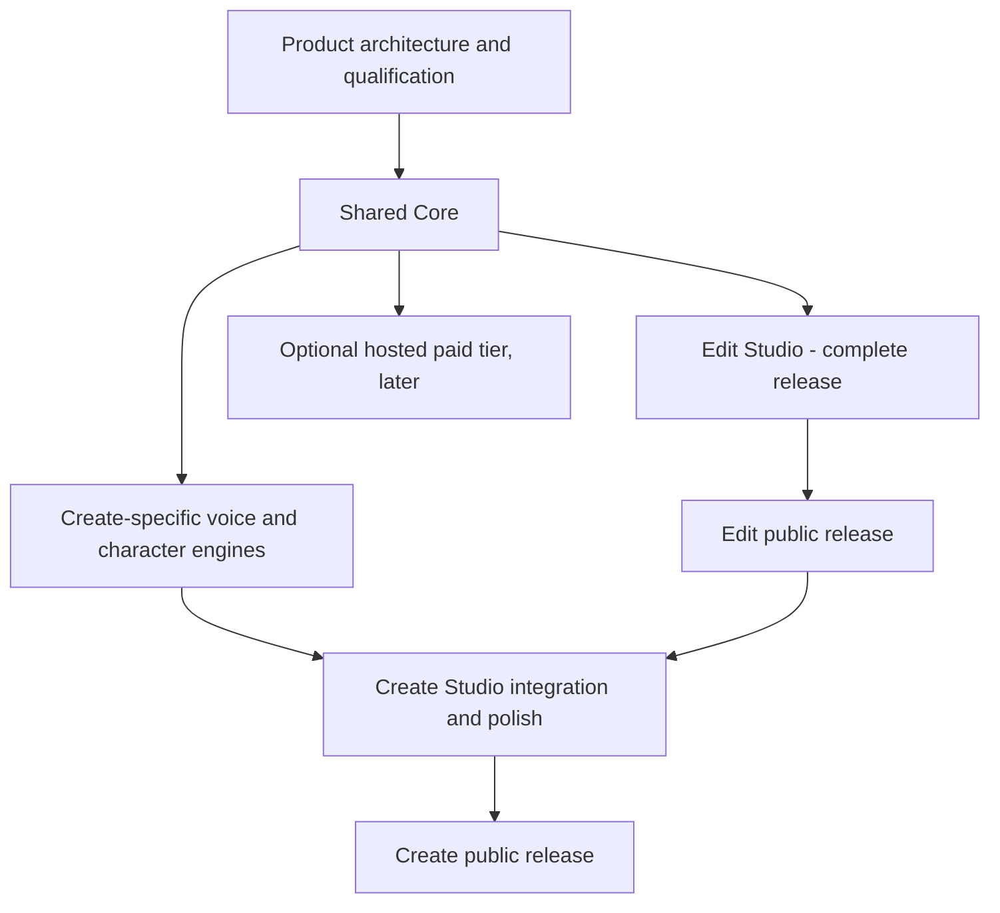

# CreatorBrio Video Studio | product roadmap and implementation program

**Status:** architecture approved; the program plan merged in [PR #110](https://github.com/mk-global/creatorbrio/pull/110), which closed [program #68](https://github.com/mk-global/creatorbrio/issues/68). Work now runs in campaigns: [Campaign A #135](https://github.com/mk-global/creatorbrio/issues/135) (the first Edit Studio slice), [#136](https://github.com/mk-global/creatorbrio/issues/136) and [#137](https://github.com/mk-global/creatorbrio/issues/137). See [Current status](#current-status) for what has merged. **Source contract:** merged [PR #67](https://github.com/mk-global/creatorbrio/pull/67), [113 product requirements](../../research/video-studio/spec/01-product-requirements.md), [31 acceptance tests](../../research/video-studio/spec/10-acceptance-tests.md), [WS0–WS19](../../research/video-studio/spec/11-implementation-program.md). **Decision:** [architecture ADR](../../architecture/adr-creatorbrio-video-studio.md).

## Current status

Status as of 2026-11-08, from merged pull requests and open issues.
A workstream is delivered only when its issue's acceptance criteria are met; every workstream and gate issue below is still open.

**What a person can do today:** edit an Instagram Reel by hand on the Studio page (`/studio`): pair a browser, import media by path, preview with sound, move, trim, split and delete clips, add titles, lower thirds and typed captions, undo and redo, and export an MP4 checked against the Instagram Reel profile.
It has been verified with synthetic media only; creative acceptance on real footage is pending.
No AI-assisted video editing exists yet: the Production API has an authority for agent runs, but nothing uses it.

| Item | Merged so far | Remaining |
|---|---|---|
| WS1 [#78](https://github.com/mk-global/creatorbrio/issues/78) production data and atomic operations | Schema and admission (PR [#113](https://github.com/mk-global/creatorbrio/pull/113)), change sets with undo, redo and agent runs ([#115](https://github.com/mk-global/creatorbrio/pull/115)), durable store ([#119](https://github.com/mk-global/creatorbrio/pull/119)), Production API ([#121](https://github.com/mk-global/creatorbrio/pull/121)), browser pairing ([#123](https://github.com/mk-global/creatorbrio/pull/123)), media admission ledger ([#143](https://github.com/mk-global/creatorbrio/pull/143)) | Stage-exit approvals; the issue's acceptance review |
| WS2 [#79](https://github.com/mk-global/creatorbrio/issues/79) media ingest | Import by path, read-only originals, probing, preview copies, waveform peaks, HDR tone mapping ([#143](https://github.com/mk-global/creatorbrio/pull/143)) | Browser upload and imports as jobs ([#141](https://github.com/mk-global/creatorbrio/issues/141)); real iPhone HDR (G2) |
| WS3 [#80](https://github.com/mk-global/creatorbrio/issues/80) rights and provenance | Imports recorded as user-supplied ([#143](https://github.com/mk-global/creatorbrio/pull/143)) | Licences, consent, credits and a rights check at export |
| WS4 [#81](https://github.com/mk-global/creatorbrio/issues/81) renderer, preview and compiler | Compiler, script-free overlay renderer, FFmpeg export, manifest ([#149](https://github.com/mk-global/creatorbrio/pull/149)) | Storyboard scenes, range renders, transitions, speed, effects; [#147](https://github.com/mk-global/creatorbrio/issues/147), [#152](https://github.com/mk-global/creatorbrio/issues/152) |
| WS5 [#82](https://github.com/mk-global/creatorbrio/issues/82) jobs and workers | File-backed media and render jobs with recovery ([#143](https://github.com/mk-global/creatorbrio/pull/143), [#149](https://github.com/mk-global/creatorbrio/pull/149)) | Model workers and registry; [#148](https://github.com/mk-global/creatorbrio/issues/148) |
| WS12 [#89](https://github.com/mk-global/creatorbrio/issues/89) / [#107](https://github.com/mk-global/creatorbrio/issues/107) graphics | Captions, lower third and title card ([#149](https://github.com/mk-global/creatorbrio/pull/149)) | The remaining Edit Studio graphics |
| WS13 [#90](https://github.com/mk-global/creatorbrio/issues/90) audio | Two-pass loudness normalisation ([#149](https://github.com/mk-global/creatorbrio/pull/149)) | Music, effects, denoise; muting a clip's own sound ([#146](https://github.com/mk-global/creatorbrio/issues/146)) |
| WS14 [#91](https://github.com/mk-global/creatorbrio/issues/91) Studio UI | The Studio page ([#153](https://github.com/mk-global/creatorbrio/pull/153)) | One-frame preview sync over a whole play ([#151](https://github.com/mk-global/creatorbrio/issues/151)); transcript editing, storyboard |
| WS16 [#93](https://github.com/mk-global/creatorbrio/issues/93) QA | Export conformance verifier ([#149](https://github.com/mk-global/creatorbrio/pull/149)) | Creative, claims and rights QA |
| WS17 [#94](https://github.com/mk-global/creatorbrio/issues/94) deliverables | Instagram profile, SRT and WebVTT captions, manifest ([#149](https://github.com/mk-global/creatorbrio/pull/149)) | Other profiles, credit sheets, edit bundles |
| WS0, WS6–WS11, WS15, WS18, WS19 | Architecture decision for WS0 ([#110](https://github.com/mk-global/creatorbrio/pull/110), amended in [#139](https://github.com/mk-global/creatorbrio/pull/139)); nothing else merged | All |

| Gate | Result | Open conditions |
|---|---|---|
| G0 [#66](https://github.com/mk-global/creatorbrio/issues/66), [#68](https://github.com/mk-global/creatorbrio/issues/68) | Contract and program accepted (both closed) | None |
| G1 [#97](https://github.com/mk-global/creatorbrio/issues/97) renderer | HyperFrames failed (GSAP licence); OpenFilm kept as a fallback; CreatorBrio's own script-free overlay renderer with FFmpeg chosen ([record](gates/g1-renderer.md)) | Creator visual review |
| G2 [#98](https://github.com/mk-global/creatorbrio/issues/98) HDR and proxies | Conditional: synthetic HDR only ([record](gates/g2-hdr-proxies.md)) | Real iPhone HDR, Dolby Vision, variable frame rate |
| G7 [#103](https://github.com/mk-global/creatorbrio/issues/103) timeline | Conditional pass for `@xzdarcy/react-timeline-editor` ([record](gates/g7-timeline.md)); the conditions were met in [#153](https://github.com/mk-global/creatorbrio/pull/153) | The issue's closing review |
| G9 [#105](https://github.com/mk-global/creatorbrio/issues/105) licences | Renderer and timeline licences recorded ([#139](https://github.com/mk-global/creatorbrio/pull/139)); the rest not done | The full licence and terms review |
| G3–G6, G8 | Not started | All |

**Sequencing note.** The critical path in section 9 puts the storyboard ([#87](https://github.com/mk-global/creatorbrio/issues/87)) before the editing UI ([#91](https://github.com/mk-global/creatorbrio/issues/91)); Campaign A built a first editing UI slice first, and no storyboard work has started.
Whether to keep that order is an open decision for the maintainer.

## 1. What ships

One MIT-licensed CreatorBrio application, one repository, one shared Video Core, two complete independently releasable creator workflows.

| Release | Product outcome | Explicit definition of complete |
|---|---|---|
| **Foundation (internal)** | One source-preserving production model for footage, script and hybrid; secure jobs, rights, media processing, model gateway, storyboard and renderer contracts | All common invariants work with synthetic and real fixtures. Not marketed as a finished editor |
| **Edit Studio (first public product)** | Raw camera footage to a professional finished video: best takes, smart cuts, storyboard, open/owned B-roll, captions, native diagrams/animation, SFX/music, denoise, reframing/mattes, manual NLE UI, target-scoped revisions, QA, exports | All workflow-A acceptance tests [AT-A1–AT-A7](../../research/video-studio/spec/10-acceptance-tests.md), applicable cross-cutting tests, two creator-approved publishable samples, rights and package checks. **Must not depend on local TTS or cartoon choreography** |
| **Create Studio (second public product)** | Topic or script to voiced, illustrated animated video and faceless YouTube explainers; TTS, word alignment, character rigs, Scene Specs, illustration/style continuity, animation, sound and hybrid productions | All workflow-B and hybrid acceptance tests, long-form timing/regeneration, studio-quality illustration/voice examples, one-scene regeneration, rights/claims QA |

**No duplicate editor or render backend.** Users can combine camera footage, diagrams and animated characters within one production. Open-source and future paid service compatibility are architectural constraints, not a demand to implement billing now.

## 2. Architecture decisions locked

1. **Canonical production document, CreatorBrio-owned.** Brief, research, script, storyboard, media, rights, audio/voice, timeline, revisions and approval state are coherent and versioned. Timeline remains the single authority for rendered pixels/samples.
2. **Typed operations.** Server validates and atomically applies changes. AI edits are reversible, source footage immutable, one run can be kept/discarded, and per-scene edits preserve unrelated clips.
3. **Storyboard is a first-class editor.** Actual composition frames/animatic, per-scene approval, asset slots and scene-to-timeline provenance, for both workflows.
4. **One chosen renderer behind an adapter.** [G1 #97](https://github.com/mk-global/creatorbrio/issues/97) failed HyperFrames (GSAP licence) and qualified OpenFilm as a fallback; the renderer is CreatorBrio's own script-free overlay renderer with FFmpeg for footage, audio and export ([G1 record](gates/g1-renderer.md)).
5. **Reuse a timeline UI component; own editor semantics.** [G7 #103](https://github.com/mk-global/creatorbrio/issues/103) conditionally passed `@xzdarcy/react-timeline-editor` as the interaction layer ([G7 record](gates/g7-timeline.md)); no from-scratch NLE UI without failing the reuse test.
6. **Capability adapter architecture.** Native editable HTML/SVG/vector templates and isolated specialist external-tool outputs both enter the shared timeline; OpenMontage/Ghost Editor techniques remain research references where their licenses prevent code reuse.
7. **Provider-independent AI.** Existing authorized Claude Code CLI for local use, alternate API/local-model runtimes and manual mode. No subscription credential intermediation or automatic paid provider use.
8. **Provider-independent image generation.** Reuse existing loopback image service (see [image interface](image-generation.md)); support local backends now, commercial-safe distributable reference backend, style/reference and scene consistency later.
9. **Commercial-safe by default.** Asset rights and model provenance checked at use/export. No noncommercial default model, no implicit voice cloning, no unverified third-party media right.
10. **No speculative infrastructure.** Local-first Next.js app, bounded workers and file-backed jobs. A future paid hosted tier can be designed without forcing its billing/auth infrastructure into the present local product.

See [merged spec architecture](../../research/video-studio/spec/06-architecture.md), [difference register](../../research/video-studio/spec/09-differences-from-pr64.md), and [data contracts](../../research/video-studio/spec/07-data-models-and-interfaces.md). This roadmap changes delivery sequencing, **not** the 113 requirements or the fundamental production model.

## 3. Stage and engineering sequence

**Phase 0: architecture, governance and qualification.** Approved contract (PR #67), ADR, model/dependency license scan, ticket admission. G1 and G7 are recorded and G9 is in progress; see [Current status](#current-status). No application-wide Node upgrade until necessary. Prepare real footage, style references and fixture recordings.

**Phase 1: Shared Core.** Production v2 schema and immutable changes, media ingest and proxy pipeline, rights/provenance, file-backed job system, AI provider gateway, renderer adapter and preview, research and script, scene-based storyboard, professional media/graphics capability and image-provider contracts. This foundation supports footage, script and hybrid without requiring every specialized creative engine to exist yet.

**Phase 2: Edit Studio.** Word-aligned transcripts; select/rough cut, take ranking and fillers; A-roll and B-roll; searchable Commons/Openverse/owned assets and optional sources; branded captions/diagrams/native motion graphics; relevant sound and music with optional Earshot, safe ducking/denoise; reframe/mask; actual multitrack UI and timeline controls; creative QA and rights; exports and edit bundle; iterative founder and wellness-editor acceptance. Release Edit Studio as a complete editor.

**Phase 3: Create Studio.** Local commercial-safe TTS/forced alignment, narration/lexicons/multi-speaker voices; dynamic storyboards and long-form scripts, reference-driven image/character consistency through local image provider, original editable vector rigs and declarative Scene Specs, stick-figure motion/diagram choreography, voice/sound integration, intelligent scene-only regeneration, hybrid footage and generated scenes, YouTube formats and end-to-end editorial acceptance. Release separately when fully publishable.

**Phase 4 (not on critical path): monetization.** Future commercial offering, user-facing licensing terms, legally compliant provider accounting, hosted inference/compute economics, paid support or workflow upgrades. No premature cloud or payment-service commitment. Legal/provider terms gate required before a paid launch.

## 4. Epic register

| Epic | Linked GitHub epic | Primary WS |
|---|---|---|
| Shared platform and production core | [#69](https://github.com/mk-global/creatorbrio/issues/69) | WS0, WS1, WS2, WS3, WS5 |
| Rendering, preview and exports | [#70](https://github.com/mk-global/creatorbrio/issues/70) | WS4, WS17 |
| Editorial intelligence and storyboard | [#71](https://github.com/mk-global/creatorbrio/issues/71) | WS8, WS9, WS10 |
| Talking-head intelligence | [#72](https://github.com/mk-global/creatorbrio/issues/72) | WS6 |
| Media sourcing, audio, specialist tools | [#73](https://github.com/mk-global/creatorbrio/issues/73) | WS11, WS13, WS15 |
| Professional editor UI | [#74](https://github.com/mk-global/creatorbrio/issues/74) | WS14 |
| Narration, graphics, image and animation | [#75](https://github.com/mk-global/creatorbrio/issues/75) | WS7, WS12, WS18 |
| Quality and releases | [#76](https://github.com/mk-global/creatorbrio/issues/76) | WS16, WS19 |

## 5. Complete workstream register

Every workstream has an executable issue, and the canonical [spec/11](../../research/video-studio/spec/11-implementation-program.md) supplies detailed dependencies and requirement mapping. Deliver only capabilities proven by code and real-output tests, not by README claims.

| WS | Engineering ticket | Release involvement | Depends upon |
|---|---|---|---|
| WS0 | [#77 Prerequisites and ADR](https://github.com/mk-global/creatorbrio/issues/77) | Foundation | Approved product contract, G9 |
| WS1 | [#78 Production data and atomic ops](https://github.com/mk-global/creatorbrio/issues/78) | Foundation | G0 |
| WS2 | [#79 Media ingest/asset registry](https://github.com/mk-global/creatorbrio/issues/79) | Foundation | G2 |
| WS3 | [#80 Rights and provenance](https://github.com/mk-global/creatorbrio/issues/80) | Foundation | G9 for distribution |
| WS4 | [#81 Renderer, preview and compiler](https://github.com/mk-global/creatorbrio/issues/81) | Foundation/Edit | G1, WS1, WS2 |
| WS5 | [#82 Job runner/local workers](https://github.com/mk-global/creatorbrio/issues/82) | Foundation | G0; model gates per capability |
| WS6 | [#83 Retakes, words and reframing](https://github.com/mk-global/creatorbrio/issues/83) | Edit | G2, G3, G5, WS1, WS5 |
| WS7 | [#84 TTS and voice](https://github.com/mk-global/creatorbrio/issues/84) | Create | G4, G9, WS5 |
| WS8 | [#85 AI gateway, roles and MCP](https://github.com/mk-global/creatorbrio/issues/85) | Foundation/Edit | WS1, G8 |
| WS9 | [#86 Research/briefs/script](https://github.com/mk-global/creatorbrio/issues/86) | Foundation/Edit | WS8 |
| WS10 | [#87 Storyboard and editorial review](https://github.com/mk-global/creatorbrio/issues/87) | Foundation/Edit | WS4, WS9 |
| WS11 | [#88 Rights-aware asset sourcing](https://github.com/mk-global/creatorbrio/issues/88) | Edit/Shared | WS3, G9 |
| WS12 | [#89 Graphics/illustration/animation](https://github.com/mk-global/creatorbrio/issues/89) | Edit core, Create extension | WS4; G6 for characters |
| WS13 | [#90 Audio/music/Foley](https://github.com/mk-global/creatorbrio/issues/90) | Edit/Shared | WS4; **does not require WS7** for Edit |
| WS14 | [#91 Studio UI/timeline](https://github.com/mk-global/creatorbrio/issues/91) | Edit/Shared | G7, WS1, WS4 |
| WS15 | [#92 External tool adapters](https://github.com/mk-global/creatorbrio/issues/92) | Edit/Shared | WS5, G9 |
| WS16 | [#93 Technical/creative/rights QA](https://github.com/mk-global/creatorbrio/issues/93) | Edit/Shared | WS12 Edit graphics, WS13 |
| WS17 | [#94 Deliverables/exports/bundles](https://github.com/mk-global/creatorbrio/issues/94) | Edit/Shared | WS4, G9 |
| WS18 | [#95 Brand/video style](https://github.com/mk-global/creatorbrio/issues/95) | Edit base, Create extension | WS10 and graphics |
| WS19 | [#96 Acceptance/release harness](https://github.com/mk-global/creatorbrio/issues/96) | Both | Phase-specific tests |

**Cross-release split tickets:** [#106 Image generation adapter](https://github.com/mk-global/creatorbrio/issues/106), [#107 Edit Studio native graphics](https://github.com/mk-global/creatorbrio/issues/107), [#108 Create Studio character animation](https://github.com/mk-global/creatorbrio/issues/108), [#109 Brand style releases](https://github.com/mk-global/creatorbrio/issues/109). These prevent WS12/WS18 becoming monolithic tickets and keep Create-only features from blocking Edit Studio.

## 6. Qualification gate register

| Gate | GitHub ticket | What it determines | Unblocks |
|---|---|---|---|
| G0 | Product contract [#66](https://github.com/mk-global/creatorbrio/issues/66) and program [#68](https://github.com/mk-global/creatorbrio/issues/68) | Founder acceptance of architecture, sequencing and licensing defaults | All |
| G1 | [#97 macOS renderer](https://github.com/mk-global/creatorbrio/issues/97) | Renderer frame accuracy, speed, A/V sync, sandbox, feature contract ([record](gates/g1-renderer.md)) | WS4 |
| G2 | [#98 iPhone HDR/VFR](https://github.com/mk-global/creatorbrio/issues/98) | HEVC/HDR tone map and proxies ([partial record](gates/g2-hdr-proxies.md)) | WS2 |
| G3 | [#99 Speech/fillers](https://github.com/mk-global/creatorbrio/issues/99) | ASR quality, retakes and filler approach | WS6 |
| G4 | [#100 Local TTS](https://github.com/mk-global/creatorbrio/issues/100) | Natural narration, alignment and voice licensing | WS7 / Create |
| G5 | [#101 Person masking](https://github.com/mk-global/creatorbrio/issues/101) | Tracking/matte suitability | WS6/WS12 |
| G6 | [#102 Vector animation and characters](https://github.com/mk-global/creatorbrio/issues/102) | Declarative scene animation quality | WS12 Create |
| G7 | [#103 Timeline SDK](https://github.com/mk-global/creatorbrio/issues/103) | Reused React timeline UI and controls ([record](gates/g7-timeline.md)) | WS14 |
| G8 | [#104 Provider gateway](https://github.com/mk-global/creatorbrio/issues/104) | Safe Claude/local/API/manual operation | WS8 |
| G9 | [#105 License/terms/model review](https://github.com/mk-global/creatorbrio/issues/105) | Redistribution, voice, image, media rights | Release and relevant components |

Each gate must record PASS / CONDITIONAL / FAIL, reproducible evidence, actual hardware/OS, and the fallback. A passing synthetic/Linux test is not a substitute for a target-Mac validation.

## 7. Product acceptance and release policy

- **Edit Studio:** [spec/10 workflow A](../../research/video-studio/spec/10-acceptance-tests.md), cross-cutting safety, source integrity, editability, rights/credits, voices unchanged, and publishable founder/wellness outputs. The Create-only TTS, cartoon character rig and choreography tests **do not block** this release.
- **Create Studio:** script/topic, research/claims, visual scene storyboard, local TTS, stable illustrated characters, synchronized motions, complete sound design, scene regeneration and final exports; all workflow-B tests plus hybrid and cross-cutting checks.
- **Open-source:** dependencies, model weights, generated/reference assets and connector terms audited at each release. Disable features whose commercial status is unverified. API usage must be explicit, opt-in and budgeted.
- **Roadmap progression:** acceptance is evidence-based, not calendar-based. There is no automatic declaration that a workstream is delivered merely because its issue exists.

## 8. Decisions and defaults to unblock work

- New productions default to **commercial** usage intent, avoiding accidental non-commercial media in future monetized content.
- CC0/CC BY assets are allowed with validated source and attribution; **CC BY-SA remains review-only** until license obligations for specific output combinations are assessed.
- Wikimedia Commons/Openverse can be offered by default; Freesound, Internet Archive, Pexels/Pixabay and provider APIs are optional/opt-in subject to actual terms and access.
- Noncommercial AI models are not part of the default redistributable product; optional personal-only workflows require a separate decision and clear UI.
- Voice cloning is **off by default**, enabled only for permitted models with explicit, recorded voice-owner consent.
- Existing local image-generation service remains usable by the founder; public distribution requires a commercially permitted reference model and a public integration contract, checked in #106 and G9.
- Future hosted/paid usage will use an authorized commercial provider arrangement. **Do not route customers through any individual's Claude subscription.** Obtain contractual/legal confirmation before launch, not before implementing a provider-neutral interface.
- Aim for a 60-second 1080×1920 render in under five minutes on the M5 Max, conditional up to ten minutes with excellent quality; confirm in G1.

## 9. Execution rules and immediate order

Steps 1 and 3 are done (PR #110; the G1 and G7 records in PR #139 and the WS1 pull requests); the rules in steps 2, 4 and 5 still apply.

1. PR #67 merged; create/merge this roadmap PR under issue #68 and standard protected-branch gates. No implementation PR may cite a closed issue: linked execution tickets must be open.
2. Validate workstream and gate ticket bodies with the **canonical installed** EngineeringToolsMK `tools/github-policy/validate.py` (ticket/linked-ticket/pr). Do not copy the validator into this repository.
3. Begin [G1 #97](https://github.com/mk-global/creatorbrio/issues/97) and [G7 #103](https://github.com/mk-global/creatorbrio/issues/103) as isolated technical qualifications; run [G9 #105](https://github.com/mk-global/creatorbrio/issues/105) in parallel. Start pure schema [WS1 #78](https://github.com/mk-global/creatorbrio/issues/78) after governance admission, because it does not depend on a particular renderer.
4. Run actual work on the user's Mac for macOS-only gates. Never claim a benchmark passed from documentation.
5. Keep PR scope narrow, CI full, independent review required, squash merge only, docs accurate. Favor shared core and Edit Studio critical path over Create-only integrations until Edit Studio quality is achieved.

### Program-level critical path

`#78 production schema → #81 compiler/render (after #97) → #87 storyboard → #91 editing UI → #83 footage intelligence + #90 sound + #107 native graphics → #93 QA → #94 export → #96 Edit Studio acceptance`.

Create Studio then depends primarily on `#100 TTS gate → #84 narration; #102 animation gate → #108 characters; #106 images; #95 styles; #96 Create Studio acceptance`.

**No paid tier, separate editing repository or infrastructure platform is authorized by this roadmap.**
